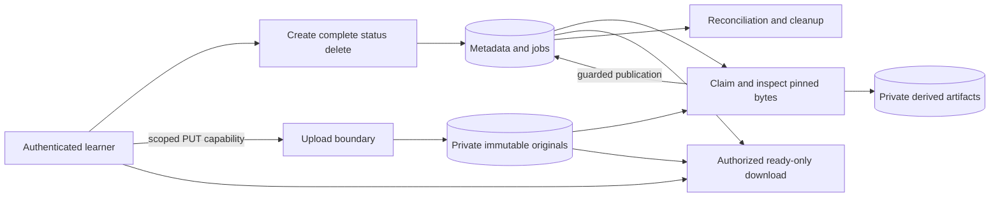

# Architecture and System Design Placement Handbook — Part 10
# S3: File Upload, Storage and Processing Service

**Estimated time: 4–5 hours | Architecture numeric module: 8 | Requires: A0–A4; Resume M8/M15/M18/M23 refreshers**

---

## Why this module exists

“Upload a file” includes at least three different facts: the application authorized an upload, some bytes reached storage, and the exact accepted bytes passed the processing policy. A fourth fact—whether the current caller may download them—must remain separate. A file key or successful client callback does not establish all four.

This chapter implements a local metadata/control API, immutable private objects, an upload capability, idempotent completion, quarantine, leased processing, guarded publication, owner-only download and inventory cleanup. Actual loopback HTTP and local files exercise retries, lost publication state, stale workers and deletion before a late result.

**Organizing principle: bind authorization to a specific upload, pin the bytes you validate, and publish only through current authoritative state.**

The runnable fixture accepts at most 1024 bytes of UTF-8 plain text. Its deterministic rejection policy is not antivirus, a general document parser or a claim that a file is harmless. S3 presigned URLs, multipart transfer, PDF/image/video processing and cloud cleanup are architectural extensions discussed explicitly; none is executed or emulated here.

The 30 Q&As are curated interview practice rather than a measured employer-frequency ranking. This chapter answers architecture bank Q28 and Q42: bytes upload successfully, but completion or a processing worker crashes. It builds on [A3's recovery boundaries](/docs/system-design/reliable-workflows-concurrency) and connects to later S6 media and S12 document/RAG systems.

---

## 1. Prompt and clarification questions

**Prompt:** authenticated learners upload private notes. The service should accept an authorized bounded object, process it asynchronously, expose clear status and let only its owner download an approved file. Failed uploads and processing must not leave permanent untracked storage or publish a deleted file.

| Clarification | Architectural effect |
| --- | --- |
| Private documents, public photos or executable/active content? | Authorization, serving origin, content handling and abuse policy |
| Accepted formats and maximum size? | Transfer strategy, validation, parser isolation and resource limits |
| Direct browser-to-object-store or API-proxied bytes? | Bandwidth path, capability policy, CORS and completion authority |
| Resumable/multipart uploads needed? | Upload-session/part identities, manifest, abort and unfinished-part cleanup |
| Immutable uploads or replacements under one file ID? | Version/generation identity and stale processing protection |
| What counts as complete and who may assert it? | Storage verification, pinned object version and job creation |
| Which processing outputs and deadline? | Queue ownership, compute isolation, retries and derived artifact keys |
| How quickly must delete/revoke take effect? | Tombstones, cached/signed downloads and in-flight access |
| Retention, legal hold, quota and privacy requirements? | Metadata/object lifecycle, accounting and deletion policy |
| Traffic, average size, download ratio and CPU cost? | Storage, egress, queue depth, concurrency and cost model |

Do not select a bucket, CDN and queue before answering what the product promises about identity, bytes, readiness and deletion.

---

## 2. Scope, invariants and evidence limits

| Area | Executed choice |
| --- | --- |
| Upload owner | Trusted lesson credential maps to tenant and subject |
| Create replay | Stable tenant/owner/operation key; exact name/size/SHA-256 intent |
| Accepted input | Restricted `.txt` display name, declared text/plain, 1–1024 bytes |
| Upload capability | Custom HMAC bearer bound to PUT, file, owner/tenant, size, digest and fixed 10-second window |
| Stored bytes | Opaque generated key; complete immutable local object installation |
| Completion | Verify stored size/digest, atomically enter quarantine and create one job |
| Processing | Bounded text checks/summary; lease/token, maximum three claims |
| Publish | Current unexpired claim plus processing state; private derived artifact reference |
| Download | Owner/tenant authorization, ready state, checked original bytes, attachment/no-store/nosniff |
| Delete/cleanup | Tombstone first; fence work; collect private unreferenced/dead objects under shared local authority |
| Exclusions | Cloud SDK, multipart protocol, browser CORS, production auth/TLS, real malware detection, arbitrary parsers, distributed storage/locking and benchmark |

The invariants are concrete:

- A retry cannot silently change an accepted create intent or renew its upload deadline.
- A capability for one upload cannot write another object or authorize a download.
- The bytes accepted for completion cannot be replaced by a legitimate late PUT.
- Quarantine and its durable job commit together; repeated completion creates no second job.
- A stale worker cannot publish after reclaim, lease expiry or deletion.
- Unprocessed, rejected, expired and deleted files are unavailable for new downloads.
- Cleanup cannot delete another filesystem area or race a legitimate local publish into a dangling reference.

The last guarantee depends on every legitimate local writer and collector using the same SQLite write authority. A direct cloud PUT does not acquire that lock. The chapter explains the different cloud protocol instead of extending the local guarantee by analogy.

---

## 3. Estimate bytes, jobs, egress and abandoned work

Assume 10,000 uploads/day, mean size 2 MiB and 30 days of retained originals. This hypothetical product workload is deliberately larger than the fixture's 1 KiB input limit. The prototype is a mechanism test, not a load simulator.

```python
"""Hypothetical object/processing workload; no load or cloud cost benchmark."""
def calculate():
    daily, size, days = 10000, 2*1024*1024, 30
    return {'uploads_per_day':daily, 'assumed_mean_bytes_per_upload':size,
        'average_incoming_MiB_per_second':round(daily*size/86400/1024**2, 3),
        'selected_peak_multiplier':10, 'hypothetical_peak_uploads_per_second':round(daily/86400*10,3),
        'raw_30_day_storage_GiB':round(daily*size*days/1024**3,3),
        'assumed_derived_fraction':0.25, 'derived_30_day_storage_GiB':round(daily*size*days*0.25/1024**3,3),
        'assumed_CPU_seconds_per_processing_job':2,
        'average_required_CPU_cores_at_full_utilization':round(daily*2/86400,3),
        'selected_downloads_per_upload':5, 'daily_download_GiB':round(daily*size*5/1024**3,3),
        'unfinished_sessions_per_day':1000, 'assumed_parts_per_session':4,
        'assumed_MiB_per_part':8, 'one_day_unfinished_parts_GiB':31.25,
        'fixture_max_upload_bytes':1024, 'measured_capacity':False}
```

Calculated output:

```json
{
  "uploads_per_day": 10000,
  "assumed_mean_bytes_per_upload": 2097152,
  "average_incoming_MiB_per_second": 0.231,
  "selected_peak_multiplier": 10,
  "hypothetical_peak_uploads_per_second": 1.157,
  "raw_30_day_storage_GiB": 585.938,
  "assumed_derived_fraction": 0.25,
  "derived_30_day_storage_GiB": 146.484,
  "assumed_CPU_seconds_per_processing_job": 2,
  "average_required_CPU_cores_at_full_utilization": 0.231,
  "selected_downloads_per_upload": 5,
  "daily_download_GiB": 97.656,
  "unfinished_sessions_per_day": 1000,
  "assumed_parts_per_session": 4,
  "assumed_MiB_per_part": 8,
  "one_day_unfinished_parts_GiB": 31.25,
  "fixture_max_upload_bytes": 1024,
  "measured_capacity": false
}
```

The inputs yield about 585.938 GiB of original objects and 146.484 GiB of derived data at the assumed 25% output ratio. They exclude version history, replication, indexes, backups, quarantined/rejected retention and temporary processing files. Define whether a vendor's quoted storage/egress units are decimal GB or binary GiB before comparing costs.

Average incoming bandwidth is about 0.231 MiB/second; a selected 10× peak is about 1.157 uploads/second. Mean size hides a tail of large objects and bursty concurrent transfers. At two assumed CPU-seconds/job, mean processing demand is about 0.231 fully utilized cores, before peak, headroom and parser resource limits.

Five full downloads per upload imply about 97.656 GiB/day of payload egress. A design optimized only for ingest can still be dominated by download cost and authorization/cache behavior.

1,000 abandoned sessions with four 8 MiB parts each retain 31.25 GiB for one day's unfinished uploads. This is a planning example, not an S3 minimum/maximum part-size statement. Unfinished parts, staging objects and failed derived artifacts belong in the storage budget.

---

## 4. Control plane, data plane and multipart decisions

| Path | What happens | Main tradeoff |
| --- | --- | --- |
| API-proxied upload | Application authorizes and streams bytes to storage | Central control; application bandwidth/concurrency/backpressure cost |
| Direct upload | Application creates scoped permission; client sends bytes to storage | Removes large transfer from API; separate completion/version/abuse boundary |
| Multipart/resumable | Client uploads identified parts and completes a manifest | Retry only failed pieces; session/part/abort/expiry complexity |

The local HTTP fixture separates metadata endpoints from a capability-authorized object PUT, but both are served by one local process and bytes pass through it. It demonstrates the logical boundary, not bandwidth offload to a separate storage service.

S3 presigned URLs are time-limited bearer permissions based on the signing principal. They can be reused until expiry, and an upload to an existing key can replace that key's current data. Therefore “presigned” must not be treated as automatically single-use or immutable. [AWS presigned URLs](https://docs.aws.amazon.com/AmazonS3/latest/userguide/using-presigned-url.html).

For a cloud immutable design, use unique server-generated keys and an appropriate conditional-write/version protocol, then pin the actual accepted object identity for processing. AWS documents conditional writes using preconditions; test their interaction with the exact upload and signing API you deploy. [AWS conditional writes](https://docs.aws.amazon.com/AmazonS3/latest/userguide/conditional-writes.html).

Multipart design has three conceptual stages: initiate an owned session, upload/retry identified parts, then complete with the required part manifest. Persist enough information to resume safely and abort abandoned sessions. The assembled object's ETag is not necessarily the whole-file MD5. Do not use an ETag as a universal SHA-256 or malware verdict. [AWS multipart overview](https://docs.aws.amazon.com/AmazonS3/latest/userguide/mpuoverview.html).

Client-side “100% uploaded” is not the same as application completion. Reconcile a lost completion response against authoritative storage/session state rather than blindly creating another logical file.

---

## 5. HTTP API and ownership contract

| Executed endpoint | Credential/meaning | Selected responses |
| --- | --- | --- |
| `POST /api/files` | Lesson bearer plus Idempotency-Key and name/size/sha256/mime | 201 new/replay; changed intent 409; invalid input 400 |
| `PUT /objects/:id` | X-Lesson-Upload capability, exact body, text/plain; no owner bearer required | 201 first write, 200 same-byte retry; 403 bad grant, 422 size/digest mismatch |
| `POST /api/files/:id/complete` | Authenticated owner; verify stored object and schedule | 202 with current accepted state; 409 missing/terminal; 410 expired/deleted |
| `GET /api/files/:id` | Owner status/reason | 200; unknown/other owner or tenant 404 |
| `GET /api/files/:id/download` | Owner and ready state | 200 bytes; 409 not ready; 410 gone; 503 missing/corrupt ready object |
| `DELETE /api/files/:id` | Owner tombstone and cancel job ownership | 200, including repeated delete |

The create response carries ID, fixed expiry, upload path and capability. It is no-store. Equivalent replay returns the original grant/deadline even after expiration; it does not reactivate a dead upload. A new upload needs new explicit intent.

The path ID is an identifier, not proof of authority. Owner APIs scope by tenant plus subject. The upload grant intentionally acts as a bearer: possession can authorize its one bounded upload while valid. It cannot authorize metadata inspection, completion, deletion or download.

These public lesson tokens are a deterministic identity fixture. Production authentication, authorization verification, rate limiting, tenant byte reservations and safe credential distribution remain separate required engineering work; they are not implemented by the token dictionary.

---

## 6. Metadata model and smallest architecture

| Metadata | Purpose |
| --- | --- |
| File ID, tenant, owner | Identity and access scope |
| Operation key and unique scoped constraint | Original-intent replay under retries |
| Display name, expected size/SHA-256, expiry | Accepted upload contract |
| State, reason and result key | Authoritative visibility and selected processing output |
| Job state, attempts, token, lease deadline | Durable execution ownership and bounded recovery |



The primary metadata key finds a file; a unique tenant/owner/operation key decides create replay. The expiry index supports unfinished-upload cleanup. One job per file is enforced by its primary key. This lesson's files are immutable: replacing content creates a new file ID. A mutable product needs a version/generation key carried through storage, job, output and publication.

A job row in the same transaction as quarantine avoids an “accepted completion but no processing work” gap. No broker or cache is required to demonstrate this baseline. A later broker needs an outbox/relay or a DB-backed recovery scanner and idempotent worker handling.

---

## 7. Immutable local objects and safe storage keys

`objects.py` creates a complete staging file, flushes it and installs it by a create-only hard link. It does not overwrite an existing object. The local filesystem must support that primitive; the recorded Windows run did. This is not a cloud consistency or power-loss guarantee.

```python
"""Private local immutable objects. Trusted root; no user-supplied disk paths."""
from pathlib import Path
import os
import re
import uuid


class Objects:
    def __init__(self, root):
        self.root = Path(root).resolve()
        for area in ('raw', 'derived'):
            (self.root/area).mkdir(parents=True, exist_ok=True)

    def path(self, area, key):
        pattern = r'[a-f0-9]{32}' if area == 'raw' else r'[a-f0-9]{32}\.[a-f0-9]{32}'
        if area not in ('raw', 'derived') or not re.fullmatch(pattern, key):
            raise ValueError('invalid server object key')
        target = (self.root/area/key).resolve()
        if target.parent != (self.root/area).resolve():
            raise ValueError('object escaped owned area')
        return target

    def put(self, area, key, data):
        target = self.path(area, key)
        staging = target.with_name(target.name+'.'+uuid.uuid4().hex+'.tmp')
        try:
            with staging.open('xb') as stream:
                stream.write(data)
                stream.flush()
                os.fsync(stream.fileno())
            try:
                # Install complete bytes without replacing an existing version.
                os.link(staging, target)
                return True
            except FileExistsError:
                if target.read_bytes() != data:
                    raise ValueError('immutable object conflict')
                return False
        finally:
            staging.unlink(missing_ok=True)

    def read(self, area, key):
        # Fixture size is bounded at ingress; detect unexpected oversized disk state.
        with self.path(area, key).open('rb') as stream:
            data = stream.read(4097)
        if len(data) > 4096:
            raise ValueError('unexpected oversized stored object')
        return data

    def inventory(self):
        return [(area, file) for area in ('raw', 'derived')
                for file in (self.root/area).iterdir() if file.is_file()]

    def remove_owned(self, area, file):
        target = file.resolve()
        if area not in ('raw', 'derived') or target.parent != (self.root/area).resolve():
            raise ValueError('cleanup escaped owned area')
        target.unlink(missing_ok=True)
```

User display names never become disk paths. Raw keys are generated 32-character hex IDs; derived keys include file ID and claim token. Storage is private and outside the web application content tree. Cleanup resolves each candidate and checks its exact owned parent before unlinking it; a sentinel outside those areas remains untouched in verification.

The staging name is private and not a readable object key. Readers see a fully installed target rather than partially written final bytes. Same-byte retries are harmless; a conflicting immutable insert raises instead of replacing validated content. This fixture assumes no hostile local process/reparse-point manipulation of its owned temporary root.

Local fsync plus a database commit is not a distributed transaction across bytes and metadata. A later metadata failure can leave an object behind. The recovery path intentionally collects such unreferenced objects rather than pretending the two stores commit atomically.

---

## 8. Capability, completion and publication implementation

The complete metadata authority is below. All legitimate local object installation, publication and inventory cleanup acquire its SQLite write transaction.

```python
"""Local metadata authority plus immutable object store and fenced processing."""
from contextlib import contextmanager
import base64
import hashlib
import hmac
import json
import re
import sqlite3
import uuid
from objects import Objects


class Error(Exception):
    def __init__(self, status, reason):
        self.status, self.reason = status, reason


def identity(value):
    if type(value) is not str or not re.fullmatch(r'[A-Za-z0-9_-]{1,64}', value):
        raise Error(400, 'invalid_identity')
    return value


def milliseconds(now):
    if type(now) is not int or not 0 <= now <= 10**15:
        raise Error(400, 'invalid_server_time')
    return now


class Uploads:
    def __init__(self, database, root, secret):
        self.objects, self.secret = Objects(root), secret
        self.db = sqlite3.connect(database, isolation_level=None, timeout=0.3)
        self.db.row_factory = sqlite3.Row
        try:
            self.db.executescript('''CREATE TABLE IF NOT EXISTS uploads(
                id TEXT PRIMARY KEY, tenant TEXT, owner TEXT, operation TEXT,
                name TEXT, size INTEGER, digest TEXT, expires INTEGER,
                state TEXT, result_key TEXT, reason TEXT,
                UNIQUE(tenant,owner,operation));
                CREATE INDEX IF NOT EXISTS upload_expiry ON uploads(state,expires);
                CREATE TABLE IF NOT EXISTS jobs(
                    id TEXT PRIMARY KEY REFERENCES uploads(id), state TEXT, attempts INTEGER,
                    token TEXT, until_ms INTEGER);
                PRAGMA foreign_keys=ON;''')
        except BaseException:
            self.db.close()
            raise

    def close(self):
        self.db.close()

    @contextmanager
    def transaction(self):
        self.db.execute('BEGIN IMMEDIATE')
        try:
            yield
            self.db.execute('COMMIT')
        except BaseException:
            self.db.execute('ROLLBACK')
            raise

    def owned(self, tenant, owner, file_id):
        for value in (tenant, owner, file_id):
            identity(value)
        row = self.db.execute('SELECT * FROM uploads WHERE tenant=? AND owner=? AND id=?',
                              (tenant, owner, file_id)).fetchone()
        if row is None:
            raise Error(404, 'not_found')
        return row

    def capability(self, row):
        raw = json.dumps([row[key] for key in ('id','tenant','owner','size','digest','expires')], separators=(',', ':')).encode()
        payload = base64.urlsafe_b64encode(raw).decode()
        signature = hmac.new(self.secret, b'PUT\n'+payload.encode(), hashlib.sha256).hexdigest()
        return payload+'.'+signature

    def create(self, tenant, owner, operation, data, now):
        for value in (tenant, owner, operation):
            identity(value)
        milliseconds(now)
        if (type(data) is not dict or set(data) != {'name','size','sha256','mime'}
            or type(data['name']) is not str or not re.fullmatch(r'[A-Za-z0-9][A-Za-z0-9 ._-]{0,70}\.txt', data['name'])
            or '..' in data['name'] or data['mime'] != 'text/plain'
            or type(data['size']) is not int or not 1 <= data['size'] <= 1024
            or type(data['sha256']) is not str or not re.fullmatch(r'[a-f0-9]{64}', data['sha256'])):
            raise Error(400, 'invalid_upload_contract')
        with self.transaction():
            row = self.db.execute('SELECT * FROM uploads WHERE tenant=? AND owner=? AND operation=?',
                                  (tenant, owner, operation)).fetchone()
            replay = row is not None
            if row:
                if (row['name'],row['size'],row['digest']) != (data['name'],data['size'],data['sha256']):
                    raise Error(409, 'changed_create_intent')
            else:
                if self.db.execute('SELECT count(*) FROM uploads').fetchone()[0] >= 128:
                    raise Error(503, 'lesson_metadata_cap')
                file_id = uuid.uuid4().hex
                self.db.execute('INSERT INTO uploads VALUES(?,?,?,?,?,?,?,?,?,?,?)',
                    (file_id,tenant,owner,operation,data['name'],data['size'],data['sha256'],now+10000,'uploading',None,None))
                row = self.owned(tenant, owner, file_id)
            return {'id':row['id'], 'expires_ms':row['expires'],
                    'upload_path':'/objects/'+row['id'], 'capability':self.capability(row), 'replay':replay}

    def upload(self, file_id, capability, raw, now):
        identity(file_id)
        milliseconds(now)
        with self.transaction():
            row = self.db.execute('SELECT * FROM uploads WHERE id=?', (file_id,)).fetchone()
            if (row is None or type(capability) is not str or not capability.isascii()
                or len(capability)>2048 or not hmac.compare_digest(self.capability(row), capability)):
                raise Error(403, 'invalid_upload_capability')
            if row['state'] in ('deleted','expired') or now >= row['expires']:
                raise Error(410, 'upload_expired_or_deleted')
            if row['state'] != 'uploading':
                raise Error(409, 'upload_already_completed')
            if type(raw) is not bytes or len(raw) != row['size'] or hashlib.sha256(raw).hexdigest() != row['digest']:
                raise Error(422, 'size_or_checksum_mismatch')
            return self.objects.put('raw', row['id'], raw)

    def complete(self, tenant, owner, file_id, now):
        milliseconds(now)
        with self.transaction():
            row = self.owned(tenant, owner, file_id)
            if row['state'] in ('deleted','expired'):
                raise Error(410, 'gone')
            if row['state'] in ('quarantined','processing','ready'):
                return row['state']
            if row['state'] != 'uploading':
                raise Error(409, 'terminal_processing_result')
            if now >= row['expires']:
                raise Error(410, 'upload_window_expired')
            try:
                raw = self.objects.read('raw', row['id'])
            except FileNotFoundError:
                raise Error(409, 'object_missing') from None
            if len(raw) != row['size'] or hashlib.sha256(raw).hexdigest() != row['digest']:
                raise Error(422, 'stored_object_mismatch')
            self.db.execute("UPDATE uploads SET state='quarantined' WHERE id=?", (file_id,))
            self.db.execute("INSERT INTO jobs VALUES(?,'pending',0,NULL,0)", (file_id,))
            return 'quarantined'

    def claim(self, now):
        milliseconds(now)
        with self.transaction():
            self.db.execute("UPDATE uploads SET state='failed',reason='attempts_exhausted' WHERE id IN (SELECT id FROM jobs WHERE state='inflight' AND until_ms<=? AND attempts>=3) AND state='processing'", (now,))
            self.db.execute("UPDATE jobs SET state='failed',token=NULL WHERE state='inflight' AND until_ms<=? AND attempts>=3", (now,))
            row = self.db.execute('''SELECT u.*,j.attempts FROM jobs j JOIN uploads u ON u.id=j.id
                WHERE j.attempts<3 AND (j.state='pending' OR (j.state='inflight' AND j.until_ms<=?))
                AND u.state IN ('quarantined','processing') ORDER BY u.id LIMIT 1''', (now,)).fetchone()
            if row is None:
                return None
            job = dict(row)
            job.update(token=uuid.uuid4().hex, until_ms=now+2000, attempts=row['attempts']+1)
            self.db.execute("UPDATE jobs SET state='inflight',attempts=?,token=?,until_ms=? WHERE id=?",
                            (job['attempts'],job['token'],job['until_ms'],job['id']))
            self.db.execute("UPDATE uploads SET state='processing' WHERE id=?", (job['id'],))
            return job

    def inspect_content(self, job):
        # Deterministic text policy, NOT antivirus or a safe general document parser.
        raw = self.objects.read('raw', job['id'])
        if len(raw) != job['size'] or hashlib.sha256(raw).hexdigest() != job['digest']:
            return None, 'stored_object_mismatch'
        try:
            text = raw.decode('utf-8')
        except UnicodeError:
            return None, 'unsupported_utf8'
        if '\x00' in text or '[BLOCKED]' in text:
            return None, 'lesson_content_policy'
        result = json.dumps({'characters':len(text), 'lines':len(text.splitlines()),
                             'source_sha256':job['digest']}, sort_keys=True).encode()
        return result, None

    def publish(self, job, result, reason, now):
        milliseconds(now)
        with self.transaction():
            current = self.db.execute('SELECT u.state,j.token,j.until_ms FROM uploads u JOIN jobs j ON j.id=u.id WHERE u.id=?', (job['id'],)).fetchone()
            if not current or current['state'] != 'processing' or current['token'] != job['token'] or current['until_ms'] <= now:
                return False
            key = None
            if reason is None:
                key = job['id']+'.'+job['token']
                self.objects.put('derived', key, result)
            self.db.execute('UPDATE uploads SET state=?,result_key=?,reason=? WHERE id=?',
                            ('ready' if reason is None else 'rejected',key,reason,job['id']))
            self.db.execute("UPDATE jobs SET state='succeeded',token=NULL WHERE id=?", (job['id'],))
            return True

    def delete(self, tenant, owner, file_id):
        with self.transaction():
            self.owned(tenant, owner, file_id)
            self.db.execute("UPDATE uploads SET state='deleted',result_key=NULL WHERE id=?", (file_id,))
            self.db.execute("UPDATE jobs SET state='cancelled',token=NULL WHERE id=?", (file_id,))

    def download(self, tenant, owner, file_id):
        with self.transaction():
            row = self.owned(tenant, owner, file_id)
            if row['state'] in ('deleted','expired'):
                raise Error(410, 'gone')
            if row['state'] != 'ready':
                raise Error(409, 'not_ready')
            try:
                raw = self.objects.read('raw', file_id)
            except (FileNotFoundError,ValueError):
                raise Error(503, 'ready_object_missing_or_corrupt') from None
            if len(raw) != row['size'] or hashlib.sha256(raw).hexdigest() != row['digest']:
                raise Error(503, 'ready_object_missing_or_corrupt')
            return raw

    def cleanup(self, now):
        milliseconds(now)
        removed = 0
        # Every legitimate object write/publish also holds this DB write authority.
        with self.transaction():
            self.db.execute("UPDATE uploads SET state='expired' WHERE state='uploading' AND expires<=?", (now,))
            live = {row['id']:row for row in self.db.execute("SELECT * FROM uploads WHERE state NOT IN ('deleted','expired')")}
            for area, file in self.objects.inventory():
                key = file.name
                keep = (key in live if area == 'raw' else any(row['state'] == 'ready' and row['result_key'] == key for row in live.values()))
                if not keep:
                    self.objects.remove_owned(area, file)
                    removed += 1
        return removed
```

The custom grant is an HMAC of the fixed upload contract with an explicit PUT context. Verification compares it with the grant derived from authoritative metadata. The API does not parse a client-selected disk key, accept a renewed deadline or trust a client completion statement instead of checking the object.

`BEGIN IMMEDIATE` serializes local writers for the whole database file. That makes the cleanup/publication boundary clear and limits throughput; it is not row-level locking or a protocol implemented by direct S3 uploads. A production remote-store version must avoid treating long network I/O under a database write lock as a scalable design.

The 128-row metadata cap includes tombstones/replay identity. It rejects new work instead of silently forgetting old intent; original replay still works. This is a finite teaching resource bound, not production retention or a per-tenant storage quota.

---

## 9. Completion trace and idempotent recovery

**Trace:** authenticate owner → find accepted upload → verify deadline/state → read the immutable original → compare actual size/SHA-256 → atomically set quarantine and insert the unique job → acknowledge scheduling. A repeated completion sees the existing accepted state and creates no extra job.

Observed intake evidence:

```json
{
  "create_replay_preserves_id_and_expiry": true,
  "upload_window_ms": 10000,
  "same_byte_upload_replay": true,
  "wrong_target_capability_status": 403,
  "wrong_checksum_status": 422,
  "before_processing_download_status": 409,
  "complete_replay_job_count": 1,
  "post_completion_PUT_status": 409,
  "client_filename_used_as_disk_key": false
}
```

The suite calls complete before bytes exist, forces wrong-body and wrong-target uploads, retries accepted bytes, closes/reopens metadata and retries completion. It injects job insertion failure to verify the quarantine transition rolls back while already uploaded bytes remain available for a legitimate completion retry.

A client-provided digest helps bind the intended bytes and detect transfer/replacement mismatches; it is not a trust verdict on content. An attacker can declare the digest of malicious bytes correctly. Production checksum verification also needs the right storage checksum algorithm/type and exact object version. [AWS object integrity](https://docs.aws.amazon.com/AmazonS3/latest/userguide/checking-object-integrity.html).

If a completion callback is missing, a reconciler can inspect expired/pending session state and the authoritative object/session rather than relying only on the browser. It must still use the same idempotent completion/job boundary. Object notifications can be duplicated or arrive out of order; use them as recoverable signals, not unchecked commands to make any matching key ready. [AWS event notifications](https://docs.aws.amazon.com/AmazonS3/latest/userguide/EventNotifications.html).

---

## 10. Quarantine, leased processing and guarded publication

```text
uploading --verified completion + job--> quarantined
quarantined --claim--> processing
processing --current accepted result--> ready
processing --current content rejection--> rejected
processing --third expired claim--> failed
uploading --expired sweep--> expired
any owned state --delete--> deleted
```

`ready` means this fixture's text policy completed and its artifact was published. `rejected` means a deterministic content-policy result; `failed` means the attempt budget exhausted. A job can complete successfully with a rejected file: worker execution success and file approval are distinct.

The worker reads bounded original bytes, verifies size/hash again, decodes strict UTF-8 and rejects NUL or a lesson marker. It derives a small character/line summary. No PDF parsing, OCR, image decode, antivirus engine or sandbox has been executed. Never label this result “virus free.”

Before publication, the authority requires the file still be processing, the token still current and its lease unexpired. A reclaimed worker has a new token. Derived objects include that token in their key so independent attempts cannot overwrite another result.

Observed processing and rollback evidence:

```json
{
  "completed_state": "quarantined",
  "claimed_state": "processing",
  "accepted_state": "ready",
  "rejected_examples": [
    "unsupported_utf8",
    "lesson_content_policy"
  ],
  "completion_job_transaction_rollback": true,
  "artifact_survives_metadata_rollback": true,
  "orphan_artifact_collected": true,
  "publication_retry_succeeds": true,
  "antivirus_or_general_document_safety_proven": false
}
```

The injected ready-state update failure occurs after the artifact file was installed. Metadata rolls back, leaving processing plus an orphan artifact. Cleanup removes that artifact while keeping the active original. The same still-valid claim can recreate its artifact and publish. The suite therefore exercises the bytes/metadata gap directly.

A three-claim budget includes crashes before work finishes. Polling after the third expired claim marks failed; there is no automatic infinite loop, lease renewal, timed retry backoff, manual reprocess API or worker supervisor. Those mechanisms need an explicit product/operations policy if added.

---

## 11. Real HTTP boundary and private downloads

```python
"""Owned local control API plus separate bearer-capability object PUT."""
from http.server import BaseHTTPRequestHandler, ThreadingHTTPServer
import json
import re
import sqlite3
from uploads import Error, Uploads

CREDENTIALS = {'lesson-alice':('tenant-a','alice'), 'lesson-bob':('tenant-a','bob'),
               'lesson-other':('tenant-b','alice')}


def server(database, root, secret, clock):
    class Handler(BaseHTTPRequestHandler):
        def log_message(self, *_):
            pass

        def reply(self, status, value=None, raw=None):
            data = raw if raw is not None else json.dumps(value or {}).encode()
            self.send_response(status)
            self.send_header('Content-Length', str(len(data)))
            self.send_header('Content-Type', 'text/plain; charset=utf-8' if raw is not None else 'application/json')
            self.send_header('Cache-Control', 'no-store')
            self.send_header('X-Content-Type-Options', 'nosniff')
            self.send_header('Connection', 'close')
            if raw is not None:
                self.send_header('Content-Disposition', 'attachment; filename="download.txt"')
            self.end_headers()
            self.wfile.write(data)
            self.close_connection = True

        def body(self, limit):
            length = self.headers.get('Content-Length', '0')
            if self.headers.get('Transfer-Encoding') or not length.isascii() or not length.isdigit() or len(length)>8 or int(length)>limit:
                raise Error(413, 'body_size_or_framing')
            data = self.rfile.read(int(length))
            if len(data) != int(length):
                raise Error(400, 'incomplete_body')
            return data

        def handle_request(self):
            item = None
            try:
                object_route = re.fullmatch(r'/objects/([a-f0-9]{32})', self.path)
                file_route = re.fullmatch(r'/api/files/([a-f0-9]{32})(/complete|/download)?', self.path)
                if object_route and self.command == 'PUT':
                    if self.headers.get('Content-Type') != 'text/plain':
                        raise Error(415, 'unsupported_declared_type')
                    raw = self.body(1024)
                    item = Uploads(database, root, secret)
                    created = item.upload(object_route[1], self.headers.get('X-Lesson-Upload',''), raw, clock())
                    return self.reply(201 if created else 200, {'stored':True})
                if not ((self.path == '/api/files' and self.command == 'POST') or file_route):
                    raise Error(404, 'unknown_route')
                identity = CREDENTIALS.get(self.headers.get('Authorization','').removeprefix('Bearer '))
                if not identity or not self.headers.get('Authorization','').startswith('Bearer '):
                    raise Error(401, 'lesson_credential_required')
                item = Uploads(database, root, secret)
                if self.path == '/api/files':
                    data = json.loads(self.body(2048))
                    result = item.create(*identity, self.headers.get('Idempotency-Key',''), data, clock())
                    return self.reply(201, result)
                file_id, action = file_route.groups()
                if self.body(0):
                    raise Error(400, 'body_not_accepted')
                if self.command == 'POST' and action == '/complete':
                    return self.reply(202, {'state':item.complete(*identity,file_id,clock())})
                if self.command == 'GET' and action == '/download':
                    return self.reply(200, raw=item.download(*identity,file_id))
                if self.command == 'DELETE' and action is None:
                    item.delete(*identity,file_id)
                    return self.reply(200, {'state':'deleted'})
                if self.command == 'GET' and action is None:
                    row = item.owned(*identity,file_id)
                    return self.reply(200, {'id':row['id'],'state':row['state'],'reason':row['reason']})
                raise Error(404, 'unknown_route')
            except Error as error:
                self.reply(error.status, {'error':error.reason})
            except (ValueError, UnicodeError):
                self.reply(400, {'error':'malformed_input_or_object'})
            except sqlite3.Error:
                self.reply(503, {'error':'metadata_unavailable'})
            finally:
                if item is not None:
                    item.close()

        do_POST = handle_request
        do_PUT = handle_request
        do_GET = handle_request
        do_DELETE = handle_request
    return ThreadingHTTPServer(('127.0.0.1', 0), Handler)
```

Observed local HTTP contract:

```json
{
  "create_status": 201,
  "PUT_without_owner_bearer_allowed_with_capability": true,
  "before_ready_download_status": 409,
  "ready_download_status": 200,
  "content_type": "text/plain; charset=utf-8",
  "content_disposition": "attachment; filename=\"download.txt\"",
  "cache_control": "no-store",
  "nosniff": true,
  "after_delete_download_status": 410,
  "late_PUT_after_delete_status": 410,
  "real_S3_or_multipart_protocol_implemented": false
}
```

The HTTP tests actually upload bytes, race PUT/completion, run a processing claim and fetch the original. They verify authentication/tenant scope, upload-grant scope, framing/declared size, checksum, quarantine, attachment/no-store/nosniff and deletion. No external object or provider is contacted.

The download handler rechecks authority and the original bytes. A ready row with a missing/corrupt source returns 503 rather than a fabricated empty success. That mismatch needs telemetry and repair policy. An already authorized response can still be in flight when deletion commits; no protocol can retract bytes already delivered to a client.

The fixed attachment filename avoids putting untrusted display text directly into Content-Disposition. The lesson serves UTF-8 text with no-store and nosniff. Broader formats require deliberate content type, filename encoding, active-content/origin policy and authorization for originals as well as previews/derived artifacts.

This small loopback server is not hardened against hostile slow clients. Its bounded declared-length reader does not implement streaming multipart, resumable upload or a hard total request deadline. Browser CORS and production TLS/auth are also absent.

---

## 12. Delete, expiry and orphan cleanup

**Delete trace:** authenticate owner → commit tombstone and cancel claim token → deny new download/complete/PUT → sweep bytes later. Physical deletion is idempotent and can retry. Tombstones/replay state prevent old capabilities or worker results from becoming new active files.

**Unfinished-upload expiry:** at the fixed deadline, a new PUT/first completion is too late. The sweeper marks uploading rows expired and removes their bytes. A completed file can continue processing beyond that upload deadline: transfer permission expiry is different from file-retention expiry.

Observed lifecycle evidence:

```json
{
  "lease_ms": 2000,
  "stale_publication_accepted": false,
  "post_delete_publication_accepted": false,
  "late_capability_resurrection_status": 410,
  "expiry_equality_ms": 10000,
  "abandoned_state_after_sweep": "expired",
  "expired_replay_renews_window": false,
  "three_crashes_state": "failed",
  "ready_but_missing_source_status": 503,
  "arbitrary_external_cloud_writes_coordinated": false
}
```

The collector computes a live reference set while holding the same write authority used for local object installation and metadata publication. Raw objects referenced by non-dead metadata stay; only ready-selected derived objects stay. Unreferenced staging/results, metadata-free objects and deleted/expired objects are removable inside the checked private areas.

This full inventory under a global write lock is deliberately simple and expensive. A production inventory/lifecycle job needs bounded batches, grace periods, generation/version checks, ownership and retry progress. A recent unreferenced object may still belong to an in-flight remote upload or result, so “not referenced right now” is not by itself permission to delete it.

Direct cloud PUTs may arrive after an application tombstone because their storage permission remains valid. Do not publish them, and reconcile their exact versions later with a grace/expiry policy. The local PUT handler rechecks metadata on every request; that stronger local behavior is not automatic revocation of an already issued S3 grant.

Multipart sessions need their own abort/reconciliation path. A lifecycle rule for incomplete multipart uploads addresses unfinished parts, which are different from completed orphan objects or old object versions. [AWS incomplete-upload lifecycle](https://docs.aws.amazon.com/AmazonS3/latest/userguide/mpu-abort-incomplete-mpu-lifecycle-config.html).

---

## 13. Concurrent calls and the overwrite/delete races

Observed concurrency:

```json
{
  "concurrent_call_count": 6,
  "PUT_statuses_sorted": [
    200,
    201
  ],
  "completion_statuses": [
    202,
    202
  ],
  "durable_processing_jobs": 1,
  "live_claims": 1,
  "winner_order_assumed": false
}
```

Two actual HTTP PUT calls install once and replay once. Two completion calls both acknowledge the same accepted file while only one job exists. Two independent thread-owned connections then compete for that job; only one gets a live claim. No winner order is assumed.

The overwrite race is prevented by both immutable storage and state checks: an accepted target is never replaced, and completed state rejects further legitimate PUTs. A mutable object key without version binding would let processing validate one set of bytes and a later download serve another.

The stale-worker/delete race is prevented at publication: a worker computes outside the transaction, then must prove current ownership and processing state before creating a selected artifact/reference. Deletion clears that ownership. A stale result is discarded rather than changing deleted metadata back to ready.

For S3 versioning, distinguish key from version ID. Versioning can preserve distinct versions; it does not itself select which version your application validated, authorize access or define deletion of retained history. Store and use the chosen immutable identity consistently. [AWS versioning](https://docs.aws.amazon.com/AmazonS3/latest/userguide/Versioning.html).

---

## 14. Failure matrix and cloud/multipart recovery

| Failure window | Local outcome | Recovery / cloud question |
| --- | --- | --- |
| Create commits; response lost | Same scoped operation replays ID/deadline | Do not create untracked sessions on every retry |
| Bytes arrive; complete never called | Uploading row/object remains until expiry sweep | Reconcile actual object/session; decide whether to complete or abort |
| Complete job insert fails | State rolls back; original remains | Retry one atomic state/job boundary |
| Worker expires/crashes | Current token invalid; bounded reclaim | Lease/attempt policy and duplicate processing |
| Artifact installed; metadata commit fails | Unreferenced artifact remains | Inventory/grace/version reconciliation |
| Delete commits; old worker finishes | Publication fenced | Tombstone/generation applies to every output |
| Ready original disappears externally | Download 503 | Alert, repair/reprocess/restore or mark unavailable |
| Old cloud grant writes after delete | Not executed here | Keep invisible, collect late version safely; do not assume DB revocation |
| Multipart completion response lost | Not executed here | Check owned upload/session and final exact object; repeat supported operation safely |

For a real multipart service, bind session ownership, object key, allowed size/checksum policy and expiry at initiation. Persist upload ID and the intended part/manifest contract; do not accept another user's upload ID because the client can name it. Validate final assembled object/version, then schedule work once. Resume/abort and retries need the actual provider API's documented behavior.

Events or callbacks are delivery mechanisms, not source-of-truth ownership. A duplicate “object created” notification should find the same accepted generation/job. A stale notification for a replaced/deleted generation must not resurrect it. Reconciliation should be safe to rerun and visible in metrics.

No transaction spans an arbitrary remote object store, SQL database and parser process. Prefer recoverable states and idempotent transitions; enumerate the orphan/missing-reference windows instead of drawing one fictional all-or-nothing box.

---

## 15. Security, quotas and processing isolation

| Boundary | Design question |
| --- | --- |
| Create authority | Who owns the file, may choose its namespace and reserve byte quota? |
| Transfer permission | Which method/key/size/checksum/window is granted, and who may possess the bearer? |
| Content handling | Which formats are allowed and which parsers/scanners run under resource limits? |
| Storage permissions | Are originals/quarantine/derived data private and inaccessible through guessed URLs? |
| Download | Does the current caller have access to this exact ready version? |
| Deletion | Are metadata, versions, previews, indexes, backups and cached grants covered by the stated policy? |

OWASP recommends a layered upload boundary: authorized users, constrained names/types/size, generated storage names, private storage and appropriate scanning/sandboxing. A claimed MIME type or extension can be spoofed; neither alone establishes safe content. [OWASP upload guidance](https://cheatsheetseries.owasp.org/cheatsheets/File_Upload_Cheat_Sheet.html).

For arbitrary PDFs, images, office files or archives, treat parser execution as untrusted work. Define time, memory, CPU, page/pixel/member/decompressed-size and output limits, restrict network/filesystem privileges, patch dependencies and isolate failures. A compressed transfer size does not bound expanded work. This paragraph is an architectural requirement, not a feature implemented by the text processor.

Use per-tenant reserved/committed byte accounting when granting uploads, with expiration/reconciliation to release abandoned reservations. Add admission/concurrency budgets for upload bytes, processing CPU and downloads. A global row cap does not make a fair tenant storage quota.

Do not log upload grants, private file contents or signed download URLs. Browser CORS permits selected origins/methods/headers; it is not a substitute for storage authorization. Public content requires abuse reporting/moderation and a deliberate serving policy beyond this private-note lesson.

---

## 16. Growth stages and useful operations evidence

| Trigger | Change to justify | Contract/measurement to retain |
| --- | --- | --- |
| Small private text service | API + metadata + private object boundary | Exact accepted bytes, readiness and owner access |
| Large transfer volume | Direct object-store upload | Scoped grant, fixed identity, completion and orphan policy |
| Unreliable large uploads | Multipart/resumable protocol | Session ownership, part integrity, idempotent completion and abort |
| Slow/risky processing | Isolated worker pools by format/cost | Resource bounds, versions, fenced publication and backlog recovery |
| Many processing stages | Versioned DAG/jobs and durable transitions | Stage inputs/outputs, retry identity and deleted-generation handling |
| High download volume | Authorized CDN/signed access where appropriate | Permission freshness, short expiry, revocation/cache limits and egress cost |
| Large inventories | Batched lifecycle/reconciliation | Never delete active generations; measure orphan lag and failed cleanup |

Measure create/byte-transfer/completion success separately, upload age, checksum mismatch, quarantine age, processing queue age, attempts, lease expiry/stale publish, rejected/failed reasons, ready-but-missing objects, orphan count/bytes, cleanup delay and tenant reserved-versus-actual usage. Storage byte-hours and download egress are different cost signals.

Keep metric labels bounded by format/stage/outcome, not file ID or full filename. Put scoped correlation IDs in controlled logs/traces. Reconciliation metrics should distinguish a missing object from a duplicate event or a deleted generation.

Define an observable readiness objective, such as time from verified completion to ready/rejected under stated load and format assumptions. Do not describe a hypothetical peak calculation as achieved throughput. The 121 local assertions demonstrate mechanisms, not a production SLO.

---

## 17. Reproduce and interpret the verification

From the repository root:

```powershell
cd examples/system-design/module-8-file-upload-processing
python verify.py
python author.py
python integrate.py
python validate_site.py
```

Recorded runtime: **Python 3.12.10**, **SQLite 3.49.1**, **Windows**, on **2026-10-17**. **121 local checks passed**: 17 validation, 23 intake, 19 processing, 19 lifecycle, 27 http, 4 concurrency, 8 estimates, 4 cleanup. Six competing calls cover two PUTs, two completions and two processing claims. File contents, SQLite constraints and real loopback HTTP are exercised directly.

`verification-results.json` records each named assertion. This chapter embeds four exact source files and six exact calculated/observed outputs. `content-validation.json` checks structure and fidelity; `validation-summary.json` records the full site build, routes/search and cleanup.

The harness verifies its absolute temporary root before removal, refuses deletion outside private object areas, closes all owned connections/listeners, joins server/handler/worker threads and removes session data. Port 3000 and Docker remain stopped. No persistent service, cloud upload, malware-scanning claim, power-loss test or capacity benchmark is included.

---

## 18. Interview question bank with answer direction

### Q1. Why separate file metadata from object bytes?

Metadata owns permissions, identity and lifecycle; object storage owns potentially large immutable byte versions. They have different access/cost characteristics and do not share one arbitrary distributed transaction. Design recovery for mismatches explicitly.

### Q2. When should bytes pass through the API?

When centralized transfer control is useful and bandwidth/concurrency cost fits. Direct upload offloads the large transfer but adds a scoped storage permission and completion boundary. Neither path removes content validation or download authorization.

### Q3. Does a presigned upload URL mean one-time upload?

No. Its documented permission lifetime and storage write semantics matter. Design unique/versioned targets, appropriate preconditions and completion verification rather than treating a signature as automatic immutability.

### Q4. What should an upload grant bind?

The intended method, server-chosen target, lifetime and relevant integrity/size policy, with a trusted owner/tenant association in application state. The exact enforceable fields depend on the provider API. Keep the grant out of logs and unrelated access paths.

### Q5. What happens if the create response is lost?

Retry with the same scoped operation key and equivalent intent. Return the original ID/deadline instead of creating another abandoned object/session. Changed intent conflicts; old replay should not renew an expired permission silently.

### Q6. Why not use the user's filename as the storage key?

It can collide, carry path/header ambiguity and expose private information. Use opaque server identity and keep a bounded display name separately. Safe output encoding and download headers remain necessary even for metadata names.

### Q7. Is Content-Type sufficient to validate a file?

No. It is a caller claim. Match allowed formats and actual content behavior using appropriate bounded validation/processing. The text fixture checks UTF-8 and a limited policy; it does not establish general malware safety.

### Q8. Does a matching SHA-256 prove the file is safe?

It establishes byte identity/integrity under the chosen protocol, not benign meaning. A malicious producer can supply the correct digest of malicious content. Safety policy and parser isolation are separate.

### Q9. Why is multipart upload useful?

It can retry individual failed pieces, resume and parallelize large transfers. It also creates session, part-manifest, completion and abort state. Choose it for requirements that justify that complexity and test the actual provider protocol.

### Q10. Can you assume an ETag is the whole-file checksum?

No. Its meaning depends on the storage/upload implementation; multipart ETags are not necessarily whole-file MD5. Use the documented checksum algorithm/type and exact object identity required by your integrity contract.

### Q11. What does the completion endpoint verify?

Owner/session scope, state/deadline and the actual final object's size/integrity/version. It then atomically records accepted completion and durable processing intent. A browser's success message is not enough.

### Q12. What if completion is called twice concurrently?

The authority checks current state and a unique job identity inside a transaction. One transition schedules the job; the other returns the existing accepted state. The real HTTP race verifies one job without assuming which caller wins.

### Q13. What if job creation fails after setting quarantine?

Keep the state transition and job insertion in one local transaction so both roll back. Uploaded bytes can remain for retry. If a separate broker is involved, use an outbox/relay or reconciliation rather than an unchecked dual write.

### Q14. Why quarantine instead of immediately making uploads public?

Transfer success does not mean validation/processing succeeded. Private quarantine keeps unapproved content unavailable while work completes. Define ready/rejected/failed separately and enforce access at every original/preview/download path.

### Q15. What if the object changes while a worker processes it?

Pin an immutable version or use a conditional/version protocol consistently. Otherwise validation can apply to one byte sequence while downloads expose another. The fixture's create-only object and post-completion write denial demonstrate one local solution.

### Q16. How do worker leases and tokens prevent stale publication?

Each claim gets current ownership and a deadline. Publication compares file state, token and expiry before selecting an output. Reclaim or delete invalidates the old owner; the old worker may compute, but it cannot make that result visible.

### Q17. What happens when a worker crashes repeatedly?

Expired claims can be reclaimed with a new token until the chosen attempt budget ends. The fixture counts three durable claims, then marks failed on a recovery poll. A production system needs reason history, alerts and controlled reprocess policy.

### Q18. Is writing an artifact and updating SQL atomic?

Not as one filesystem/database transaction. A failed metadata commit can leave an unreferenced artifact. Use immutable output identities, guarded references and safe reconciliation; the fixture injects this exact failure and recovers.

### Q19. How does delete avoid a worker resurrecting a file?

Commit a tombstone and invalidate execution ownership before collecting bytes. Publication must check that authoritative generation/state. A late result must not transition deleted metadata back to ready.

### Q20. Can deleting metadata revoke an issued cloud PUT immediately?

Do not assume so. Storage permission and application state are separate. Keep late objects invisible and reconcile them under the grant/version/lifecycle policy. The local handler rechecks metadata on each PUT, which is a stronger explicit local boundary.

### Q21. Which data should an orphan collector delete?

Only objects/versions proven outside live, in-flight and retained references under a safe protocol. Use ownership, grace and generation checks as needed. A present-time missing reference is not sufficient if publication can race the collector.

### Q22. What is the difference between unfinished parts and an orphan object?

Unfinished multipart parts belong to an uncompleted storage session; a completed orphan object has no selected application reference. They need different inventory/abort/delete operations, and version history can add another retention category.

### Q23. Does upload-token expiry mean ready files expire too?

No. Transfer permission lifetime, unfinished-session expiry and file retention are different policies. A completed file can still process after its transfer window. State which deadline applies at each operation.

### Q24. What should a download endpoint check?

Current caller/tenant access, exact selected file/version and readiness, then a deliberate serving policy. The fixture returns attachment/no-store/nosniff and verifies the original bytes; other content/CDN paths must enforce equivalent permissions.

### Q25. What if SQL says ready but storage has no object?

Treat it as an availability/integrity mismatch, alert and reconcile under a stated repair/restore policy. Do not return an empty successful file. The fixture returns 503 and leaves the inconsistency observable.

### Q26. How do you process hostile archives or documents safely?

Define accepted formats and bounded compute/decompression/output, isolate parser privileges/network, maintain dependencies and use suitable scanning/sandboxing. A small extension/MIME check or this lesson's marker rejection cannot substitute for those controls.

### Q27. How do tenant quotas work with abandoned uploads?

Reserve allowed bytes/slots when granting permission, then reconcile committed usage and release abandoned reservations safely. Bound processing and download work separately. A global metadata row cap is neither fair allocation nor full storage accounting.

### Q28. What does a CDN change for private downloads?

It can reduce origin/egress pressure, but authorization/cache-key design, signed access lifetime, revocation and retained copies must match the product promise. An already delivered/cached response cannot be recalled simply by deleting a database row.

### Q29. How do duplicate or stale object notifications affect processing?

Treat them as signals to reconcile the accepted exact generation. A unique job and state/version checks suppress duplicate intent and reject stale/deleted generations. Do not trust the order of callback arrival as business authority.

### Q30. What do the runnable examples prove and what remains unproven?

They verify local immutable files, SQLite transactions/replay/leases, bounded text handling, HTTP permissions and cleanup races for the tested cases. They do not prove S3/multipart semantics, malware safety, cloud failover, browser integration, power-loss durability or production capacity.

---

## 19. A 45-minute mock and answer skeleton

**Mock prompt:** “Design private document upload and asynchronous processing. Users retry completion, a worker crashes after writing output, and delete can race a late worker or upload.”

| Segment | Minutes |
| --- | --- |
| Clarify formats, privacy, size and lifecycle | 5 |
| Estimate transfer, storage, processing and abandoned work | 7 |
| Specify identity, APIs, state and exact object version | 8 |
| Trace grant, upload, completion, quarantine and publish | 10 |
| Inject lost callback, stale worker, deletion and orphan cleanup | 10 |
| Justify growth, security and evidence limits | 5 |
| **Total** | **45** |

A defensible short answer:

> I would create an owner-scoped upload intent with a stable retry key, fixed transfer window and server-generated immutable object identity. Transfer success alone does not make the file available: completion checks the actual accepted object and atomically schedules processing. Workers inspect pinned bytes privately, then publish only while their claim and file generation are current. Download checks owner and readiness. Delete tombstones first so late work cannot resurrect it; immutable orphan outputs and abandoned sessions are collected through a recoverable, race-aware protocol. Direct cloud uploads, multipart sessions and arbitrary document parsers each add their own authorization and failure boundaries, which I would test on the actual implementation.

Use bank Q28/Q42 to probe completion/job atomicity, pinned byte identity and safe cleanup. Explain why a signed URL, successful upload callback, ETag or antivirus label alone cannot establish the whole lifecycle contract.

---

## 20. Practice tasks

1. Clarify a private resume-PDF service versus public photo sharing. Identify changed formats, permissions, scanning/serving policy, retention and abuse handling without claiming the text fixture implements them.
2. Recompute raw/derived storage, download egress, processing demand and unfinished-part storage for another workload. Separate average/peak assumptions and logical estimates from measured capacity.
3. Inspect the create replay and upload grant. Attempt changed intent, another target, wrong size/digest and an expired replay; explain which authority rejects each.
4. Run actual upload/completion races and inspect the one durable job. Inject job insertion failure and trace why bytes remain while quarantine rolls back.
5. Follow a file through quarantine, processing, ready and rejected. Explain the deterministic text policy and which malware/parser safety claims it cannot establish.
6. Reclaim at lease equality and attempt stale publication. Delete after processing computes a result and prove the old worker cannot publish or recreate the source.
7. Inject a ready-state metadata failure after artifact installation. Inspect the orphan, collect it and safely retry publication without a dangling ready reference.
8. Inspect owner-only HTTP download headers and error states. Remove a ready source deliberately, explain 503/reconciliation, and distinguish new-request revocation from bytes already in flight.
9. Design a real direct/multipart extension: session ownership, manifest/checksum/version, completion recovery, late writes, abort and separate part/orphan cleanup. Mark every unexecuted cloud mechanism.
10. Complete the 45-minute mock. Add tenant reservations, a risky parser pool or private CDN, justify its consistency/security boundaries and state required implementation tests.

---

## 21. Completion checklist

- [ ] I can clarify formats, privacy, size and lifecycle requirements.
- [ ] I can estimate bytes, jobs, egress and abandoned storage with units.
- [ ] I can distinguish control/data paths and multipart complexity.
- [ ] I can explain owner scope and bounded upload capability.
- [ ] I can trace create replay without extending the deadline.
- [ ] I can explain immutable bytes, checksums and pinned versions.
- [ ] I can reproduce idempotent completion and atomic job creation.
- [ ] I can explain quarantine and the limits of content validation.
- [ ] I can fence stale/expired/deleted worker publication.
- [ ] I can reconcile orphan artifacts and abandoned uploads safely.
- [ ] I can enforce ready-only private download and explicit delete semantics.
- [ ] I can finish the mock and state the local evidence limits.

---

## 22. Research references and continuation

Primary sources reviewed on 2026-10-17. Code, workloads, counterexamples and Q&As are authored material. Cloud API behavior is source-specific; the local capability/object protocol does not emulate S3. No measured interview-frequency ranking is asserted.

| Primary source | Mechanism to verify |
| --- | --- |
| [AWS presigned URLs](https://docs.aws.amazon.com/AmazonS3/latest/userguide/using-presigned-url.html) | Bearer access, lifetime and repeat-write behavior |
| [AWS conditional writes](https://docs.aws.amazon.com/AmazonS3/latest/userguide/conditional-writes.html) | Storage-side overwrite preconditions |
| [AWS multipart overview](https://docs.aws.amazon.com/AmazonS3/latest/userguide/mpuoverview.html) | Parts, final manifest and ETag caveat |
| [AWS object integrity](https://docs.aws.amazon.com/AmazonS3/latest/userguide/checking-object-integrity.html) | Explicit checksum/integrity mechanism |
| [AWS notifications](https://docs.aws.amazon.com/AmazonS3/latest/userguide/EventNotifications.html) | Duplicate/order boundaries for storage events |
| [AWS versioning](https://docs.aws.amazon.com/AmazonS3/latest/userguide/Versioning.html) | Key versus object version |
| [AWS incomplete multipart lifecycle](https://docs.aws.amazon.com/AmazonS3/latest/userguide/mpu-abort-incomplete-mpu-lifecycle-config.html) | Unfinished-part cleanup distinct from completed-object deletion |
| [OWASP upload guidance](https://cheatsheetseries.owasp.org/cheatsheets/File_Upload_Cheat_Sheet.html) | Layered upload/content/storage boundary |

Return to the [architecture roadmap](/docs/system-design), [A3: workflows](/docs/system-design/reliable-workflows-concurrency), [A4: operations](/docs/system-design/secure-observable-operations) or [S2: notification delivery](/docs/system-design/notifications-webhooks). Resume [M8: API security](/docs/resume-skills/api-security-authorization-multi-tenancy), [M15: background work](/docs/resume-skills/caching-background-jobs-data-ingestion), [M18: cloud fundamentals](/docs/resume-skills/aws-gcp-fundamentals) and [M23: document ingestion](/docs/resume-skills/rag-document-ingestion) provide stack refreshers.

**Next: [S4 — Ticket booking and limited-inventory reservation](/docs/system-design/booking-reservations)**, architecture part 11 / numeric module 9. It develops authoritative inventory, atomic holds, expiry, concurrent booking attempts and late-payment decisions with its own local SQLite/signed-HTTP scope. S4-S6 are also authored; remaining systems and architecture consolidation remain planned.
