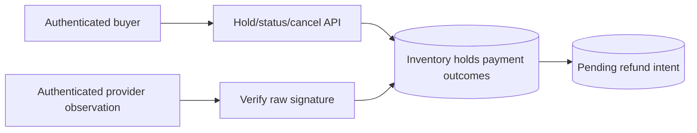

# Architecture and System Design Placement Handbook — Part 11
# S4: Ticket Booking and Limited-Inventory Reservation

**Estimated time: 5–6 hours | Architecture numeric module: 9 | Requires: A0–A4; Resume M9/M13/M15 refreshers**

---

## Why this module exists

A seat map is a view; a reservation is an authoritative allocation. Two callers can both see the last seat as available, a hold can expire while payment is in flight, and a successful provider charge can arrive after somebody else owns the seat. Correctness comes from the inventory transition and recovery policy, not from how quickly the UI disables a button.

**Organizing principle: allocate scarce inventory atomically, attach a fixed hold lifetime, and recheck ownership when an authenticated payment observation arrives.**

This worked system implements assigned seats, atomic multi-seat holds, scoped create replay, authoritative expiry, cancellation, payment/event dedupe and durable refund intent. Real independent SQLite connections race for the last seat. A local HTTP callback verifies exact signed bytes before processing a lesson provider observation. No payment or refund is sent to an external service.

The 30 Q&As are curated preparation, not a measured interview-frequency ranking. This chapter answers bank Q29/Q43 and extends [A3](/docs/system-design/reliable-workflows-concurrency). S8 later develops checkout/ledger/provider reconciliation in more depth; this chapter owns inventory and the late-payment decision.

---

## 1. Prompt and clarification questions

**Prompt:** reserve one to four assigned seats for a short checkout window. Only one active hold or confirmed reservation may own each seat. Payment callbacks can repeat or arrive late; a late charge must not take inventory from a new owner.

| Clarification | Effect on the design |
| --- | --- |
| Assigned seats or interchangeable quantity? | Per-seat ownership versus conditional quantity decrement |
| All requested seats together or partial allocation? | Transaction boundary and customer response |
| Hold duration and renewal rules? | Authoritative deadline, abuse/capacity and fairness |
| When is price fixed? | Trusted quote, amount/currency binding and repricing policy |
| Payment authorization, capture or confirmed charge? | Confirmation trigger and compensation semantics |
| What should happen after expiry? | Reject, waitlist, reacquire explicitly or refund/review |
| Cancellation after confirmation supported? | Separate ticket lifecycle and refund policy |
| One show/region or cross-region inventory? | Partition key, consistency and coordination latency |
| Peak sale traffic and bot pressure? | Admission queues, quotas and hot-row contention |

State the product rule before picking a lock. This baseline never automatically reacquires inventory for a late charge, even if a seat happens to be free again. That avoids silently changing the accepted reservation contract.

---

## 2. Contract, invariants and deliberate limits

| Area | Executed choice |
| --- | --- |
| Inventory | Tenant/show/seat key with one owning hold pointer |
| Hold | One to four distinct seats, all or none, fixed 5000 ms deadline |
| Price | Sum of authoritative seat prices in integer USD minor units |
| Retry | Tenant/owner/operation key plus canonical show/seat intent |
| Expiry | Expired at equality; checked inside allocation/payment/cancel/status transactions |
| Payment | Trusted signed observation; bind tenant, payment ID, hold, amount and currency |
| Late/extra charge | Retained pending refund intent; do not reassign the seat |
| Mismatch | Review required, without confirming the hold |
| Scope | Local SQLite authority and loopback HTTP, not a deployed provider integration |

Invariants:

- A seat belongs to at most one current hold/confirmation in the authority.
- A failed group request leaves no partial allocation.
- Replaying a hold does not renew it or select a new seat set.
- Expired/cancelled work cannot release a later owner's inventory.
- Confirmation requires the current unexpired hold and matching expected amount/currency.
- Payment replay cannot duplicate confirmation or compensation intent.
- Recording a refund requirement is different from executing a refund.

Server milliseconds are controlled in the fixture. Distributed clock synchronization, real payment authentication, refunds, tax/pricing changes, waitlists, resale and confirmed-ticket cancellation are unimplemented extensions.

---

## 3. Workload and inventory estimates

The included `estimates()` function calculates illustrative units:

```json
{
  "contenders_per_minute": 10000,
  "average_reservation_attempts_per_second": 166.667,
  "assumed_logical_hold_bytes": 512,
  "one_million_retained_holds_MB": 512,
  "hold_window_ms_in_fixture": 5000,
  "seats_per_reservation_max": 4,
  "measured_capacity": false
}
```

10,000 contenders in one minute means about 166.667 reservation attempts/second on average during that interval. Most can fail after inventory is exhausted. Successful bookings/second, incoming attempts/second and provider callbacks/second are separate units.

One million assumed 512-byte logical hold records is 512 MB before indexes, seat relationships, payment/event history, replicas or backups. The five-second fixture window is chosen for deterministic tests, not recommended checkout UX. A product using five minutes retains more active unavailable inventory and needs an abuse/fairness policy.

Estimate peak contention per show and seat group, not just fleet-wide throughput. Ten thousand independent shows distribute differently from ten thousand callers for one remaining seat. A waiting room can reduce pressure but cannot replace the final atomic allocation.

---

## 4. Schema, ownership and indexes

| Table/key | What it owns |
| --- | --- |
| `seats(tenant,show,id)` | Server price and selected owning hold |
| `holds(id)` | Owner, immutable requested seats/amount, state and expiry |
| Unique `(tenant,owner,operation)` | Stable accepted reservation intent |
| `payments(id)` | One provider payment identity, binding fingerprint and outcome |
| `events(id)` | One lesson-provider event identity and saved outcome |
| `refunds(payment_id)` | One pending compensation intent for that charged payment |

The expiry index supports state/deadline scans. Seats are stored as a bounded canonical list in the lesson hold; a larger product can normalize hold-to-seat membership. The important invariant is still seat ownership under the same allocation transaction.

Event/payment IDs are global within this one lesson provider. A multi-provider service must include provider/account identity in the key scope. A provider event ID and a payment's business identity solve different duplicate problems: another event can describe the same charged payment.

Database uniqueness and row/conditional-update constraints should remain the final authority when several API processes exist. PostgreSQL documents row locking and lock ordering/deadlock concerns; this SQLite implementation instead serializes a file-wide write transaction. It has not executed PostgreSQL row-lock behavior. [PostgreSQL locking](https://www.postgresql.org/docs/18/explicit-locking.html), [constraints](https://www.postgresql.org/docs/18/ddl-constraints.html).

---

## 5. API and state contract

| Actual endpoint | Meaning |
| --- | --- |
| `POST /holds` + lesson bearer + Idempotency-Key | Server allocates the requested show/seat set; 201 or explicit failure |
| `GET /holds/:id` | Owner-scoped status with authoritative expiry evaluation |
| `DELETE /holds/:id` | Release a held reservation; expired/cancelled replay remains terminal |
| `POST /provider/payment-success` | Custom signed raw-body lesson-provider observation |

Wrong owner/tenant status and cancellation are hidden with 404. Changed create/event/payment binding conflicts with 409. A known occupied seat returns 409; database unavailability returns 503. Responses are no-store. An unsigned browser claim cannot confirm payment.

State transitions are `held → confirmed`, `held → expired` and `held → cancelled`. Confirmed cancellation is deliberately unsupported and returns 409. Do not reuse that endpoint to release paid tickets without the additional product and refund protocol.

Browsing availability is a proposed read model, not an implemented public seat-map endpoint. It may be cached/stale; reservation still goes to the authority. Never interpret a green UI seat as a promise of allocation.

---

## 6. Smallest architecture and end-to-end trace



**Hold trace:** validate identity/seat list → acquire inventory transaction → expire due holds → replay equivalent operation or verify every requested seat is free → compute price → insert hold and change all owning pointers → commit → respond.

**Payment trace:** authenticate provider bytes → dedupe event and charged payment → evaluate current authoritative hold/deadline/ownership → confirm, review or record refund intent → commit outcome and event → acknowledge. No external network call happens while the inventory transaction is held.

**Lost response:** a create or callback can commit before the client/provider receives its response. Retrying the stable scoped identity replays the saved outcome. A newly chosen operation key is a new allocation attempt, not a retry of the old intent.

---

## 7. Shared local HTTP and transaction support

S4–S6 share this standard-library support file. It provides exact shape/integer checks, a per-thread SQLite connection/transaction boundary and owned loopback JSON transport. The public bearer dictionary is lesson identity, not production authentication.

```python
"""Standard-library support shared by S4-S6; no production auth/server claim."""
from contextlib import contextmanager
from http.server import BaseHTTPRequestHandler, ThreadingHTTPServer
import json
import re
import sqlite3

CREDENTIALS = {'lesson-alice':('t1','alice'), 'lesson-bob':('t1','bob'),
               'lesson-carol':('t1','carol'), 'lesson-other':('t2','alice')}


class Error(Exception):
    def __init__(self, status, reason):
        self.status, self.reason = status, reason


def identity(value):
    if type(value) is not str or not re.fullmatch(r'[A-Za-z0-9_-]{1,64}', value):
        raise Error(400,'invalid_identity')
    return value


def number(value, low=0, high=10**15):
    if type(value) is not int or not low <= value <= high:
        raise Error(400,'invalid_integer')
    return value


def require(user):
    if user is None:
        raise Error(401,'lesson_credential_required')
    return user


def document(raw, fields):
    try:
        value = json.loads(raw)
    except (ValueError,UnicodeError):
        raise Error(400,'invalid_json') from None
    if type(value) is not dict or set(value) != set(fields):
        raise Error(400,'invalid_fields')
    return value


class Database:
    schema = ''

    def __init__(self, path):
        self.db = sqlite3.connect(path, timeout=0.5, isolation_level=None)
        self.db.row_factory = sqlite3.Row
        try:
            self.db.executescript('PRAGMA foreign_keys=ON;'+self.schema)
        except BaseException:
            self.db.close()
            raise

    def close(self):
        self.db.close()

    @contextmanager
    def transaction(self):
        self.db.execute('BEGIN IMMEDIATE')
        try:
            yield
            self.db.execute('COMMIT')
        except BaseException:
            self.db.execute('ROLLBACK')
            raise


def server(factory, dispatch):
    class Handler(BaseHTTPRequestHandler):
        def log_message(self, *_):
            pass

        def reply(self, status, value):
            raw = json.dumps(value,ensure_ascii=False).encode('utf-8')
            self.send_response(status)
            self.send_header('Content-Type','application/json; charset=utf-8')
            self.send_header('Content-Length',str(len(raw)))
            self.send_header('Cache-Control','no-store')
            self.send_header('Connection','close')
            self.end_headers()
            self.wfile.write(raw)
            self.close_connection = True

        def handle_request(self):
            item = None
            try:
                length = self.headers.get('Content-Length','0')
                if self.headers.get('Transfer-Encoding') or not length.isascii() or not length.isdigit() or len(length)>6 or int(length)>8192:
                    raise Error(413,'body_or_framing_limit')
                raw = self.rfile.read(int(length))
                if len(raw) != int(length):
                    raise Error(400,'incomplete_body')
                auth = self.headers.get('Authorization','')
                user = CREDENTIALS.get(auth[7:]) if auth.startswith('Bearer ') else None
                item = factory()
                status, value = dispatch(item,user,self.command,self.path,raw,self.headers)
                self.reply(status,value)
            except Error as error:
                self.reply(error.status,{'error':error.reason})
            except sqlite3.Error:
                self.reply(503,{'error':'metadata_unavailable'})
            except (ValueError,UnicodeError):
                self.reply(400,{'error':'invalid_input'})
            finally:
                if item is not None:
                    item.close()

        do_GET = handle_request
        do_POST = handle_request
        do_PUT = handle_request
        do_DELETE = handle_request
    return ThreadingHTTPServer(('127.0.0.1',0),Handler)
```

The 8 KiB declared-body limit bounds fixture parsing. Hostile slow-client deadlines, TLS, proxy trust, rate limiting and production error/telemetry middleware are outside this tiny server. The injected service callback holds the domain contract; transport code does not choose seat ownership.

---

## 8. Executable inventory and payment authority

```python
"""Assigned-seat holds and trusted payment observations; no real payment calls."""
from pathlib import Path
import sys
sys.path.insert(0,str(Path(__file__).resolve().parents[1]/'worked-systems-s4-s6'))
import hashlib
import hmac
import json
import re
import uuid
from runtime import Database, Error, document, identity, number, require

LESSON_PROVIDER_SECRET = b'published-s4-provider-secret'


class Booking(Database):
    schema = '''
        CREATE TABLE IF NOT EXISTS seats(tenant TEXT,show TEXT,id TEXT,price INTEGER NOT NULL,
            hold_id TEXT,PRIMARY KEY(tenant,show,id));
        CREATE TABLE IF NOT EXISTS holds(id TEXT PRIMARY KEY,tenant TEXT,owner TEXT,operation TEXT,
            show TEXT,seats TEXT,amount INTEGER,currency TEXT,expires INTEGER,state TEXT,
            UNIQUE(tenant,owner,operation));
        CREATE INDEX IF NOT EXISTS hold_expiry ON holds(state,expires);
        CREATE TABLE IF NOT EXISTS payments(id TEXT PRIMARY KEY,fingerprint TEXT,outcome TEXT);
        CREATE TABLE IF NOT EXISTS events(id TEXT PRIMARY KEY,fingerprint TEXT,outcome TEXT);
        CREATE TABLE IF NOT EXISTS refunds(payment_id TEXT PRIMARY KEY,state TEXT);
    '''

    def seed(self, tenant, show, seats):
        # Trusted fixture/admin operation; no public inventory-edit endpoint.
        with self.transaction():
            for seat, price in seats.items():
                self.db.execute('INSERT INTO seats VALUES(?,?,?,?,NULL)',(identity(tenant),identity(show),identity(seat),number(price,1,1000000)))

    def expire(self, now):
        self.db.execute("UPDATE holds SET state='expired' WHERE state='held' AND expires<=?",(now,))
        self.db.execute("UPDATE seats SET hold_id=NULL WHERE hold_id IN (SELECT id FROM holds WHERE state IN ('expired','cancelled'))")

    def owned(self, tenant, owner, hold_id):
        row = self.db.execute('SELECT * FROM holds WHERE tenant=? AND owner=? AND id=?',
                              (identity(tenant),identity(owner),identity(hold_id))).fetchone()
        if row is None:
            raise Error(404,'hold_not_found')
        return dict(row)

    def reserve(self, tenant, owner, operation, show, seats, now):
        for value in (tenant,owner,operation,show):
            identity(value)
        number(now)
        if type(seats) is not list or not 1 <= len(seats) <= 4:
            raise Error(400,'one_to_four_seats')
        for seat in seats:
            identity(seat)
        if len(set(seats)) != len(seats):
            raise Error(400,'duplicate_seat')
        selected = json.dumps(sorted(seats),separators=(',',':'))
        with self.transaction():
            self.expire(now)
            old = self.db.execute('SELECT * FROM holds WHERE tenant=? AND owner=? AND operation=?',
                                  (tenant,owner,operation)).fetchone()
            if old:
                if (old['show'],old['seats']) != (show,selected):
                    raise Error(409,'changed_reservation_intent')
                return dict(old)
            if self.db.execute('SELECT count(*) FROM holds').fetchone()[0]>=128:
                raise Error(503,'lesson_hold_retention_cap')
            rows = [self.db.execute('SELECT * FROM seats WHERE tenant=? AND show=? AND id=?',(tenant,show,seat)).fetchone() for seat in sorted(seats)]
            if any(row is None for row in rows):
                raise Error(404,'seat_not_found')
            if any(row['hold_id'] is not None for row in rows):
                raise Error(409,'seat_unavailable')
            hold_id = uuid.uuid4().hex
            self.db.execute('INSERT INTO holds VALUES(?,?,?,?,?,?,?,?,?,?)',
                (hold_id,tenant,owner,operation,show,selected,sum(row['price'] for row in rows),'USD',now+5000,'held'))
            for seat in sorted(seats):
                changed = self.db.execute('UPDATE seats SET hold_id=? WHERE tenant=? AND show=? AND id=? AND hold_id IS NULL',
                                          (hold_id,tenant,show,seat)).rowcount
                if changed != 1:
                    raise Error(409,'seat_unavailable')
            return self.owned(tenant,owner,hold_id)

    def status(self, tenant, owner, hold_id, now):
        number(now)
        with self.transaction():
            self.expire(now)
            return self.owned(tenant,owner,hold_id)

    def cancel(self, tenant, owner, hold_id, now):
        number(now)
        with self.transaction():
            self.expire(now)
            row = self.owned(tenant,owner,hold_id)
            if row['state'] == 'confirmed':
                raise Error(409,'confirmed_cancellation_not_implemented')
            if row['state'] == 'held':
                self.db.execute("UPDATE holds SET state='cancelled' WHERE id=?",(hold_id,))
                self.db.execute('UPDATE seats SET hold_id=NULL WHERE hold_id=?',(hold_id,))
            return self.owned(tenant,owner,hold_id)

    def payment(self, tenant, event_id, payment_id, hold_id, amount, currency, now):
        # Called only after authenticating the provider observation, never a browser claim.
        for value in (tenant,event_id,payment_id,hold_id):
            identity(value)
        number(amount,1,10000000)
        number(now)
        if type(currency) is not str or not re.fullmatch(r'[A-Z]{3}',currency):
            raise Error(400,'invalid_currency')
        fingerprint = json.dumps([tenant,payment_id,hold_id,amount,currency],separators=(',',':'))
        with self.transaction():
            prior = self.db.execute('SELECT * FROM events WHERE id=?',(event_id,)).fetchone()
            if prior:
                if prior['fingerprint'] != fingerprint:
                    raise Error(409,'changed_event')
                return prior['outcome']
            paid = self.db.execute('SELECT * FROM payments WHERE id=?',(payment_id,)).fetchone()
            if paid:
                if paid['fingerprint'] != fingerprint:
                    raise Error(409,'changed_payment_binding')
                outcome = paid['outcome']
            else:
                self.expire(now)
                hold = self.db.execute('SELECT * FROM holds WHERE tenant=? AND id=?',(tenant,hold_id)).fetchone()
                if hold is None:
                    raise Error(404,'payment_hold_not_found')
                if (hold['amount'],hold['currency']) != (amount,currency):
                    outcome = 'review_required'
                elif hold['state'] == 'held' and hold['expires']>now:
                    owned = self.db.execute('SELECT count(*) FROM seats WHERE hold_id=?',(hold_id,)).fetchone()[0]
                    if owned != len(json.loads(hold['seats'])):
                        raise Error(409,'inventory_invariant_broken')
                    self.db.execute("UPDATE holds SET state='confirmed' WHERE id=?",(hold_id,))
                    outcome = 'confirmed'
                else:
                    outcome = 'refund_required'
                    self.db.execute("INSERT INTO refunds VALUES(?,'pending')",(payment_id,))
                self.db.execute('INSERT INTO payments VALUES(?,?,?)',(payment_id,fingerprint,outcome))
            self.db.execute('INSERT INTO events VALUES(?,?,?)',(event_id,fingerprint,outcome))
            return outcome


def estimates():
    return {'contenders_per_minute':10000,'average_reservation_attempts_per_second':round(10000/60,3),
        'assumed_logical_hold_bytes':512,'one_million_retained_holds_MB':512,
        'hold_window_ms_in_fixture':5000,'seats_per_reservation_max':4,'measured_capacity':False}


def dispatch(item, user, method, path, raw, headers, now):
    if path == '/provider/payment-success' and method == 'POST':
        expected = hmac.new(LESSON_PROVIDER_SECRET,raw,hashlib.sha256).hexdigest()
        supplied = headers.get('X-Lesson-Signature','')
        if not supplied.isascii() or not hmac.compare_digest(expected,supplied):
            raise Error(401,'invalid_provider_signature')
        value = document(raw,['tenant','event_id','payment_id','hold_id','amount','currency'])
        return 200,{'outcome':item.payment(**value,now=now)}
    tenant, owner = require(user)
    if path == '/holds' and method == 'POST':
        value = document(raw,['show','seats'])
        return 201,item.reserve(tenant,owner,headers.get('Idempotency-Key',''),value['show'],value['seats'],now)
    match = re.fullmatch(r'/holds/([a-f0-9]{32})',path)
    if match and method == 'GET':
        return 200,item.status(tenant,owner,match[1],now)
    if match and method == 'DELETE':
        return 200,item.cancel(tenant,owner,match[1],now)
    raise Error(404,'unknown_route')
```

The 128-hold retention cap includes old replay records. It is a finite lesson resource limit, not a production retention strategy or fair user quota. Trusted `seed` is fixture administration and has no public inventory-edit route.

All seat checks/updates and the hold insert live inside `BEGIN IMMEDIATE`. The conditional update checks that the seat is still unowned. A multi-seat failure raises and rolls back the whole transaction. In a row-lock engine, acquire resources in a consistent order and handle deadlock/serialization retries under a bounded retry policy.

---

## 9. Expiry, group rollback and cancellation evidence

```json
{
  "group_amount_minor_units": 2500,
  "currency": "USD",
  "hold_deadline_ms": 5000,
  "expiry_at_equality": true,
  "replay_renews_deadline": false,
  "failed_group_partially_reserves": false,
  "old_cancellation_releases_new_owner": false,
  "partial_update_rollback_tested": true
}
```

At `now == expires`, the hold is expired. The server does not wait for an independent background timer to free it before accepting a new valid reservation. Expiry evaluation and allocation share the authority transaction.

The test requests a group containing an unavailable seat, then verifies the other seat was not taken. Another injected trigger fails the second seat update after the first write; both the hold row and partial inventory changes roll back.

Releasing inventory uses the exact old hold identity. Once a seat points to a replacement hold, cancelling the old expired hold cannot set the new owner's pointer to null. This is the same ownership/version principle used for stale worker publication in S3.

---

## 10. Last-seat race and late-payment evidence

```json
{
  "last_seat_contenders": 2,
  "admitted_holds": 1,
  "rejected_status": 409,
  "old_payment_outcome": "refund_required",
  "reallocated_seat_stolen": false,
  "one_refund_for_duplicate_payment": true,
  "new_owner_outcome": "confirmed",
  "amount_mismatch_outcome": "review_required",
  "refund_executed_at_provider": false,
  "compensation_transaction_rollback_tested": true
}
```

Two independent connections compete for one last seat: one succeeds and one gets a conflict. At expiry, another hold can own the seat. A late authenticated charge for the old hold records `refund_required`; it does not confirm the old hold or steal the replacement.

An amount/currency mismatch is retained as `review_required`. It does not confirm inventory. Automatically refunding every mismatch is not always sufficient: binding or provider-data mistakes need investigation, and the actual payment system must verify what was charged and to whom compensation applies.

A second distinct payment after a hold is confirmed is another charge, even if its event looks similar. This baseline records compensation for it. Repeated events for the same charged payment replay one saved outcome/refund intent. The suite injects refund insertion failure and verifies neither a payment outcome nor event acknowledgement is committed alone.

---

## 11. Confirmation policy alternatives and reconciliation

| Policy | Benefit | Cost / risk |
| --- | --- | --- |
| Authorize funds, then capture after inventory confirmation | Can reduce charged-but-unfulfilled cases | Authorization/capture expiry, provider failures and reconciliation |
| Charge during hold and confirm only before deadline | Clear temporary inventory ownership | Late successful charge needs compensation |
| Reacquire on late charge if still free | May recover some sales | New price/seat/consent semantics and another atomic allocation |
| Waitlist/manual resolution | Product flexibility | User communication, fairness and operational workflow |

The fixture chooses charge observation with strict no-reacquire after expiry. Do not infer provider charge time from callback arrival alone. A different contract could use a trusted provider time plus a grace rule, but it must address seat reallocation and authoritative confirmation, not simply extend a timer retrospectively.

A reconciliation worker would compare unresolved local intent with provider state, execute idempotent refunds, persist their outcomes and alert on ambiguity. Here pending refund rows are durable intent only. They are not consumed or sent to a real provider; S8 will develop that boundary.

---

## 12. Actual HTTP authentication and callback evidence

```json
{
  "reserve_status": 201,
  "server_amount_minor_units": 1200,
  "unsigned_payment_status": 401,
  "signed_payment_outcome": "confirmed",
  "tampered_bytes_status": 401,
  "foreign_owner_status": 404,
  "confirmed_cancel_status": 409,
  "cache_control": "no-store"
}
```

The custom HMAC covers exact raw callback bytes. Tampering is rejected before applying the observation. This is neither Stripe's signature format nor a live payment authentication implementation. Event dedupe remains necessary after authentication.

Stripe documents duplicate events and ordering limitations; real integrations should use the provider's documented SDK/protocol and verify trusted payment/object bindings. This chapter's product policy is authored, not copied from a provider's delivery guarantee. [Stripe webhooks](https://docs.stripe.com/webhooks).

The callback contains no trusted browser-selected final price. Inventory stores the expected amount/currency; a signed observation must match them. Secret management/rotation, provider account scope and timestamp/replay-window policy require their own implementation before using this pattern externally.

---

## 13. Assigned seats versus quantity inventory

For identical stock, a conditional decrement such as “available ≥ requested” inside a transaction can allocate quantity. For assigned seats, each resource needs an owner and a group invariant. Do not translate a total stock counter into seat identity without preserving which customer owns which seat.

Multi-show/cart booking can span partitions. Prefer a bounded single-inventory transaction where the product permits it; otherwise reservation/compensation across services becomes a workflow with partial-failure semantics. A distributed lock alone does not invent an atomic cross-provider checkout.

Redis can support admission or a carefully defined lease/hold layer, but expiring a cache key is not sufficient evidence that paid inventory was released correctly. Keep one authoritative owner transition and a recovery path for lease/state disagreement.

---

## 14. Growth, contention and hot-sale traffic

| Trigger | Next component to justify | Required contract |
| --- | --- | --- |
| Read-heavy browsing | Cached seat map/read model | Staleness visible; authority still decides hold |
| Several API instances | Shared inventory engine | Same key, atomic allocation, fixed time policy |
| File-wide writer contention | Engine-specific row/conditional transaction | Actual contention, deadlock and rollback tests |
| Flash sale overwhelms authority | Waiting room, admission budget, per-user limits | Fairness and bounded queues; allocation remains atomic |
| Many independent shows | Partition by inventory ownership | Keep group transaction within a partition when possible |
| Multiple regions | Explicit inventory leader/ownership | Partition availability versus oversell prevention |

Adding replicas helps read volume but stale reads cannot allocate the last seat. Sharding unrelated shows does not remove contention on one hot seat. Avoid holding inventory transactions during provider calls, expensive rendering or analytics.

---

## 15. Security and abuse boundaries

Bind owner from authenticated context, not a body field. Hide another user's hold management. Keep prices and allowed inventory server-owned. Rate-limit operation creation and active holds per account to reduce hoarding; a fixed TTL alone can still let one actor repeatedly monopolize inventory with new keys.

Validate provider account, object binding, amount and currency before confirming. Separate customer cancellation from privileged operational repair. Administrative releases, compensation and overrides need audit and explicit policy, not a generic “force status” endpoint.

The lesson's public credentials/secrets are fixtures. No card data, account action or financial transaction occurs. These are software workflow notes, with the actual provider boundary left unimplemented.

---

## 16. Measurements and failure signals

Track reservation attempts, conflicts, successes, active/expired/cancelled holds, inventory lock wait, transaction failures, confirmation latency, callbacks by outcome, unresolved review/refund intents and reconciliation age. Measure a conflict separately from an unavailable database.

An important audit is “every selected seat points to a valid held or confirmed owner, and every confirmed group owns its expected seats.” Counts alone can miss ownership errors. Alert on paid-but-unfulfilled age and compensation backlog; a 200 callback response is not proof that a pending refund executed.

Use bounded metric labels for show class/outcome/operation. A metric label for every seat/payment/hold can create another high-cardinality system. Correlate specific identities in controlled logs without storing secrets or full callback contents unnecessarily.

---

## 17. Reproduce and interpret the verification

```powershell
cd examples/system-design/module-9-booking-reservations
python verify.py
cd ../worked-systems-s4-s6
python author.py
python integrate.py
python validate_site.py
```

Recorded on 2026-10-17 using **Python 3.12.10 / SQLite 3.49.1 / Windows**. **57 local checks passed**: 7 validation, 15 holds, 1 concurrency, 15 payments, 12 http, 3 estimates, 4 cleanup. The two last-seat competitors use separate thread-owned connections. HTTP checks use an owned ephemeral loopback listener and never call a payment account.

The evidence includes group/compensation rollback, expiry equality, replay after close/reopen, current-owner confirmation and custom signature validation. It does not prove PostgreSQL behavior, distributed time/partition handling, crash-power-loss durability or peak capacity. All owned listeners/connections and temporary files are removed; port 3000 and Docker remain stopped.

---

## 18. Interview question bank with answer direction

### Q1. Why can both users see the last seat as available?

Browsing is a prior observation, often cached. Only the authoritative allocation can decide ownership under contention. A stale seat map is acceptable if reserve returns an explicit conflict; overselling is not repaired by UI state.

### Q2. What is the central invariant?

One seat has at most one current owner. A multi-seat request owns every requested seat or none, and paid confirmation must reference that same valid owner.

### Q3. How does a hold differ from confirmation?

A hold temporarily excludes others until a fixed deadline; confirmation is the committed booking state. Product policy determines the trusted payment observation that permits that transition.

### Q4. Why check expiry in the allocation transaction?

A background sweeper can lag. The allocator must not treat an expired hold as valid or free inventory independently of a concurrent confirmation. Both decisions need the same authoritative boundary.

### Q5. What happens exactly at the deadline?

This contract expires at equality. The boundary is explicit and tested. Another product may choose differently, but every caller must use the same rule and time authority.

### Q6. Should a retry extend the hold?

No in this design. The same operation replays the original seat set and deadline. Renewal is a separate authorized product operation with limits and fairness implications.

### Q7. How do you make a multi-seat request atomic?

Validate every resource under one transaction, then write hold plus all ownership changes and roll back on any failure. With row locking, use a consistent lock order and a bounded deadlock/serialization retry policy.

### Q8. Can a unique constraint alone encode every inventory rule?

It can enforce key ownership relationships, but deadline, state and all-or-none groups still need correct transactions/conditions. Use constraints as final guards and define the full transition explicitly.

### Q9. Why keep the owner hold ID on the seat?

Release/confirm can prove which allocation they affect. An expired worker or cancellation must not clear a pointer now owned by another hold.

### Q10. What does the idempotency key include?

The operation scope is tenant plus authenticated owner plus client key; equivalence includes show and canonical seat set. A changed request conflicts instead of being replayed as unrelated work.

### Q11. Why use integer minor units?

They avoid binary floating-point money rounding in this bounded example. Currency, rounding, tax and pricing policy still need explicit contracts; the client cannot choose a cheaper final amount.

### Q12. Can the browser mark payment successful?

No. Confirmation requires a trusted provider observation or authoritative provider verification, matched to local expected state. A browser response is user-controlled or can be lost/stale.

### Q13. Is signature verification sufficient?

No. Authentic bytes can still be duplicate, late or mismatched to the expected tenant/hold/amount. Authentication and business-state validation are separate checks.

### Q14. Event ID versus payment ID: why both?

An event identifies one delivered observation; different events can describe one payment. Business-effect dedupe must also bind the charged payment identity to its local intent.

### Q15. What if a charge arrives after expiry?

The chosen policy records refund intent and leaves inventory with its current owner. It never retroactively confirms the expired hold or silently reacquires another seat.

### Q16. What if the original seat is free again?

The same no-reacquire policy still applies. An alternative reacquisition flow needs a new atomic allocation and explicit price/seat/consent rules, not just a late timer extension.

### Q17. What if the amount or currency is wrong?

Record review required without confirming the hold. Reconcile the actual provider charge and expected binding before deciding repair/compensation. Do not overwrite the original payment identity with changed data.

### Q18. How do you avoid duplicate refunds?

Persist one compensation intent per charged payment and use provider-side idempotency when executing it. The fixture verifies the durable intent boundary; external refund execution remains separate.

### Q19. Can you confirm first and write refund intent later?

Separate commits can leave an acknowledged payment outcome without its needed recovery work. The chosen local outcome/event/compensation transition commits atomically or rolls back.

### Q20. Does refund_required mean the customer has been refunded?

No. It means durable work remains. Execution, provider response, retry and reconciliation need their own state and observable outcome.

### Q21. What about a second distinct charge after confirmation?

That is a separate payment, not an event replay. This design records compensation rather than selling the same booking again or ignoring the extra charge.

### Q22. Can Redis key expiry be the whole booking authority?

Only if the full ownership, confirmation and recovery contract is deliberately implemented there. Cache expiry alone does not coordinate a durable paid booking with a late callback.

### Q23. Does adding read replicas stop overselling?

No. They can serve browsing, but stale replica state is unsuitable for final allocation. The inventory authority must serialize/conflict the competing ownership transition.

### Q24. How does quantity inventory differ?

A conditional quantity decrement may suffice for identical units. Assigned seats require particular resource identity; group booking still needs an all-or-none boundary and payment binding.

### Q25. How do you partition the system?

Prefer a key aligned with inventory ownership, often show/resource group. Keep the required allocation together; cross-partition carts need a separate reservation/compensation workflow.

### Q26. What does a waiting room solve?

It can bound incoming pressure and improve fairness during flash sales. It does not allocate inventory safely by itself; the authority still decides each final hold.

### Q27. What happens if provider acknowledgement is lost?

The provider may retry. Persistent event/payment identity returns the saved outcome, including a pending compensation decision, without repeating the business transition.

### Q28. What should a reconciler inspect?

Unresolved local payments, provider observations and compensation status, plus inventory-owner invariants. Repair must use stable identities and audited policy rather than arbitrary state edits.

### Q29. Which important behavior is unimplemented here?

Real provider verification/refunds, confirmed cancellations, renewal, waitlists, multi-region clocks/ownership, PostgreSQL execution and production capacity. The fixture tests local assigned-seat correctness under its stated rules.

### Q30. Give a compact design answer.

Use a shared atomic inventory authority, fixed owner-scoped holds, server pricing and stable intent replay. Recheck live ownership on trusted payment observation. Persist late/extra-charge compensation, and reconcile external effects without taking inventory from a new owner.

---

## 19. A 45-minute mock and answer skeleton

**Mock prompt:** “Two users reserve the final seat. One payment arrives after hold expiry and reallocation.”

| Segment | Minutes |
| --- | --- |
| Clarify seat identity, group and payment policy | 5 |
| State invariants and estimate contention | 7 |
| Specify APIs, schema, time and idempotency scope | 8 |
| Trace atomic hold and authenticated confirmation | 10 |
| Inject expiry, partial update, late charge and lost response | 10 |
| Defend growth and evidence limits | 5 |
| **Total** | **45** |

A defensible short answer:

> I would allocate the whole requested seat set in one authority transaction, with server-owned price and a fixed deadline. Stable owner-scoped retries return the same hold. An authenticated provider observation must match expected payment binding and current unexpired ownership before confirmation. A late or extra charge records compensation and never steals inventory from the new owner. Refund execution and provider reconciliation are separate durable workflows.

---

## 20. Practice tasks

1. Specify assigned seats versus identical quantity, all-or-none groups, price binding, hold expiry and late-charge policy.
2. Recompute peak contenders, hot-resource contention and retained hold storage; distinguish attempts from successful bookings.
3. Run two independent last-seat callers and inspect the winning ownership pointer without assuming the winner.
4. Inject a failure on the second group-seat update and prove both the hold and earlier seat write roll back.
5. Retry an operation with reordered, changed and expired intent. Explain canonical equivalence and fixed deadline.
6. Reallocate at expiry, cancel the old hold and deliver its late charge. Verify the new owner remains unchanged.
7. Repeat a provider event, then use another event for the same payment and a second distinct charge. Explain each identity and outcome.
8. Inject compensation insertion failure and inspect payment/event rollback. Design the unimplemented idempotent provider-refund runner.
9. Propose a waiting room, PostgreSQL row-lock version or inventory partition. Preserve the authority and state what must be retested.
10. Complete the 45-minute mock and bank Q29/Q43. Defend one policy alternative and state the limits of local proof.

---

## 21. Completion checklist

- [ ] I can clarify inventory and payment semantics.
- [ ] I can estimate hot-resource contention and storage units.
- [ ] I can distinguish browse state from authoritative allocation.
- [ ] I can make multi-seat ownership atomic.
- [ ] I can explain fixed hold expiry and equality.
- [ ] I can replay original intent without renewal.
- [ ] I can prevent an old release affecting a new owner.
- [ ] I can authenticate and bind provider observations.
- [ ] I can distinguish event and payment dedupe.
- [ ] I can handle late/extra charges without overselling.
- [ ] I can separate refund intent from execution/reconciliation.
- [ ] I can finish the mock and state evidence limits.

---

## 22. Research references and continuation

Reviewed 2026-10-17. Code, numbers, policies and Q&As are authored examples. Primary sources: [PostgreSQL locking](https://www.postgresql.org/docs/18/explicit-locking.html), [constraints](https://www.postgresql.org/docs/18/ddl-constraints.html), [SQLite transactions](https://sqlite.org/lang_transaction.html), and [Stripe webhook semantics](https://docs.stripe.com/webhooks). None supplies a universal late-payment product rule; that decision is explicit above.

Return to the [architecture roadmap](/docs/system-design), [A3 workflows](/docs/system-design/reliable-workflows-concurrency), [S2 delivery](/docs/system-design/notifications-webhooks) or [S3 upload lifecycle](/docs/system-design/file-upload-processing). Resume [M9 integration](/docs/resume-skills/webhooks-payments-reliable-integrations) and [M13 PostgreSQL](/docs/resume-skills/postgresql-backend) refresh the stack.

**Next: [S5 — Chat and real-time messaging](/docs/system-design/chat-messaging)**, architecture part 12 / numeric module 10. It develops durable message identity, scoped sequencing, reconnect history, bounded online hints and membership enforcement. S4–S6 are authored together; later systems and consolidation remain planned.
