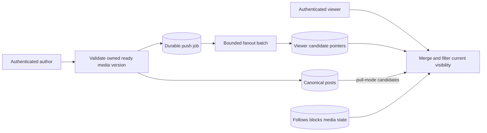

# Architecture and System Design Placement Handbook — Part 13
# S6: Social Feed and Photo Sharing

**Estimated time: 4–6 hours | Architecture numeric module: 11 | Requires: A0–A4 and S3; Resume M14/M15/M20 refreshers**

---

## Why this module exists

A post is durable content; a feed entry is a candidate pointer. When an author has millions of followers, copying that pointer everywhere can overload fan-out. When someone unfollows, blocks, deletes or loses media access, an old pointer must not become permission to keep serving the content.

**Organizing principle: separate canonical posts/media from feed candidates, bound propagation work, and recheck current visibility before returning a page.**

This local SQLite design implements owned ready-media references, immutable post intent, follows, blocks, durable batched push fan-out, pull-mode posts and a hybrid chronological feed. A scoped signed keyset cursor bounds one pagination window. Actual HTTP tests exercise publication, feed reads and access changes.

Media is a trusted lifecycle-metadata fixture linked conceptually to [S3](/docs/system-design/file-upload-processing), not a live S3 projection, image decoder, photo upload or signed-image delivery integration. The 30 Q&As are curated practice, not a measured employer-frequency ranking. The chapter answers bank Q31/Q45: celebrity fan-out overload and its consistency/privacy implications.

---

## 1. Prompt and clarification questions

**Prompt:** authenticated users publish photo posts to a private follower feed. An ordinary author uses asynchronous pointer fan-out; a high-fanout author can use pull-on-read. The feed is chronological, and new reads must respect current local follows, blocks, post state and selected media version.

| Clarification | Architectural consequence |
| --- | --- |
| Public, followers-only, close-friends or private accounts? | Candidate generation versus final permission predicates |
| Chronological feed or personalized ranking? | Ordering/cursor identity and model freshness |
| Photo-only, video, albums or text? | Upload/processing/preview/storage boundaries |
| How much fan-out and skew? | Push, pull, hybrid, batching and hot-author treatment |
| What freshness is promised? | Visibility before worker completion and lag measurement |
| New follow shows old posts? | Backfill and graph-change/cursor races |
| What happens on unfollow/block/delete? | Read filtering, cache/grant lifetime and cleanup |
| How many follows/candidates per viewer? | Query cost, merge limits and overfetch |
| Edits, likes, comments or recommendations? | More versioned state and derived data |

The baseline is followers-only chronological content, includes retained history on new follow, and has no ranking, likes, comments, private-follow approval or recommendation engine. These features require more than adding an extra column to a feed row.

---

## 2. Contract and invariants

| Area | Executed policy |
| --- | --- |
| Media | Trusted ready-state projection; publisher must own exact selected version |
| Publish | Stable tenant/author/client operation, immutable media/version/caption |
| Ordinary author | Post plus durable push job commit together; feed may lag batch processing |
| High-fanout author | Pull mode skips per-follower job; merged at read time |
| Mode | Frozen per post; changing author configuration affects future posts |
| Visibility | Current follows/self, bidirectional block, published state and current ready media/version |
| New follow | Backfill retained push posts; close gaps behind an active job's cursor |
| Pagination | Descending committed post ID, high-water bound, signed viewer/tenant-scoped seek cursor |
| Limits | 256 retained posts/tenant, 16 follows/viewer, page ≤50, fan-out batch ≤50 |

Invariants:

- Equivalent publish retries create one logical post and one push job.
- A batch's inserted pointers and progress cursor commit or roll back together.
- Retrying a batch/backfill cannot duplicate a viewer/post pointer.
- A feed pointer is not an authorization grant.
- Old media-version references do not silently select replacement bytes.
- Delete replay cannot resurrect a post.
- A cursor for one tenant/viewer cannot be reused as another user's feed authority.

The current-visibility guarantee is local to each transaction/request, not global instantaneous revocation of pages, CDN objects or bytes already delivered. The fixture returns metadata references/captions only, with no photo-download capability.

---

## 3. Fan-out, storage and skew estimates

```json
{
  "new_posts_per_second": 400,
  "assumed_mean_followers": 100,
  "hypothetical_push_pointer_writes_per_second": 40000,
  "celebrity_followers": 1000000,
  "assumed_pointer_bytes": 64,
  "logical_pointer_MB_for_one_celebrity_post": 64,
  "fixture_posts_per_tenant_cap": 256,
  "measured_capacity": false
}
```

At an assumed 400 posts/second and 100 followers/post, full push creates about 40,000 pointer writes/second before retries, indexes or replicas. A single post to one million followers has 64 decimal MB of logical pointers at an assumed 64 bytes/pointer. These are arithmetic inputs, not observed database throughput/memory.

An average follower count hides the distribution. A few authors can dominate work, and many followers may not open their feed before pointers age out. Conversely, pull-on-read can repeatedly merge the same hot author's posts for many active viewers. Estimate read frequency, active follower fraction, author post rate, retention and cache behavior before choosing a threshold.

Photos/previews/video usually dominate byte storage and CDN egress. Feed pointers should reference canonical post/media identities rather than copying image bytes. Upload processing cost, original/derived retention and serving authorization remain S3's separate boundary.

---

## 4. Data model, authority and indexes

| Table | Responsibility |
| --- | --- |
| `media(tenant,id)` | Trusted owner/version/readiness projection fixture |
| `posts(id)` | Canonical author, immutable intent, media/version, caption, state and chosen mode |
| Unique tenant/author/operation | Publish replay identity |
| `follows` and `blocks` | Current local graph/access predicates |
| `jobs(post)` | Durable push cursor and completion state |
| `inbox(tenant,viewer,post)` | Unique candidate pointer, not permission |
| `authors` | Trusted mode configuration for future posts |

The author/post index supports newest posts per author. A production inbox index should match viewer plus ordered post/cursor access. Composite indexes must match the actual predicates/order; choosing an index name is not proof that the planner uses it efficiently. [PostgreSQL multicolumn indexes](https://www.postgresql.org/docs/18/indexes-multicolumn.html).

The fixture scans a bounded retained candidate set and applies SQL-backed visibility checks. It is designed for readable mechanism tests, not a production query plan. Unbounded full scans and one query per candidate would require a different query/materialization strategy at scale.

---

## 5. API and actor contract

| Actual endpoint | Meaning |
| --- | --- |
| `POST /posts` | Authenticated author plus client_id/media_id/media_version/caption; 201 new/replay |
| `DELETE /posts/:id` | Owner-scoped soft deletion; foreign ownership hidden with 404 |
| `PUT/DELETE /follows/:author` | Current viewer follows/unfollows, including retained push backfill |
| `PUT/DELETE /blocks/:other` | Current user adds/removes only their own directional block record |
| `GET /feed?limit=&cursor=` | Current local visibility-filtered chronological page |

The credential determines tenant/viewer/author; the body cannot select a different tenant. Invalid/foreign media binding conflicts with 409. Invalid cursor/limit returns 400; another viewer's valid cursor is 403. Responses are no-store.

Media lifecycle and author-mode configuration are trusted fixture/admin methods with no public endpoint. They are not a permission system for users to mark arbitrary objects ready. A deployed media service/projection needs authenticated event ownership, version handling and stale-event recovery.

---

## 6. Smallest architecture and candidate flow



**Push trace:** authorize media reference → commit canonical post plus job → worker reads a bounded follower page → insert unique pointers and advance cursor together → read merges selected pointers with canonical content and checks visibility.

**Pull trace:** commit a pull-mode post without per-follower job → an eligible viewer's read considers that author's retained pull candidates → merge/dedupe/order/filter → return a bounded page. Pull shifts work; it does not make read cost disappear.

**Graph change:** new follow backfills retained push posts, including a follower whose name sorts before an already advanced job cursor. Unfollow/block need not synchronously purge every pointer because read-time authorization is authoritative; eventual cleanup can reclaim stale pointers later.

---

## 7. Shared executable HTTP/transaction support

```python
"""Standard-library support shared by S4-S6; no production auth/server claim."""
from contextlib import contextmanager
from http.server import BaseHTTPRequestHandler, ThreadingHTTPServer
import json
import re
import sqlite3

CREDENTIALS = {'lesson-alice':('t1','alice'), 'lesson-bob':('t1','bob'),
               'lesson-carol':('t1','carol'), 'lesson-other':('t2','alice')}


class Error(Exception):
    def __init__(self, status, reason):
        self.status, self.reason = status, reason


def identity(value):
    if type(value) is not str or not re.fullmatch(r'[A-Za-z0-9_-]{1,64}', value):
        raise Error(400,'invalid_identity')
    return value


def number(value, low=0, high=10**15):
    if type(value) is not int or not low <= value <= high:
        raise Error(400,'invalid_integer')
    return value


def require(user):
    if user is None:
        raise Error(401,'lesson_credential_required')
    return user


def document(raw, fields):
    try:
        value = json.loads(raw)
    except (ValueError,UnicodeError):
        raise Error(400,'invalid_json') from None
    if type(value) is not dict or set(value) != set(fields):
        raise Error(400,'invalid_fields')
    return value


class Database:
    schema = ''

    def __init__(self, path):
        self.db = sqlite3.connect(path, timeout=0.5, isolation_level=None)
        self.db.row_factory = sqlite3.Row
        try:
            self.db.executescript('PRAGMA foreign_keys=ON;'+self.schema)
        except BaseException:
            self.db.close()
            raise

    def close(self):
        self.db.close()

    @contextmanager
    def transaction(self):
        self.db.execute('BEGIN IMMEDIATE')
        try:
            yield
            self.db.execute('COMMIT')
        except BaseException:
            self.db.execute('ROLLBACK')
            raise


def server(factory, dispatch):
    class Handler(BaseHTTPRequestHandler):
        def log_message(self, *_):
            pass

        def reply(self, status, value):
            raw = json.dumps(value,ensure_ascii=False).encode('utf-8')
            self.send_response(status)
            self.send_header('Content-Type','application/json; charset=utf-8')
            self.send_header('Content-Length',str(len(raw)))
            self.send_header('Cache-Control','no-store')
            self.send_header('Connection','close')
            self.end_headers()
            self.wfile.write(raw)
            self.close_connection = True

        def handle_request(self):
            item = None
            try:
                length = self.headers.get('Content-Length','0')
                if self.headers.get('Transfer-Encoding') or not length.isascii() or not length.isdigit() or len(length)>6 or int(length)>8192:
                    raise Error(413,'body_or_framing_limit')
                raw = self.rfile.read(int(length))
                if len(raw) != int(length):
                    raise Error(400,'incomplete_body')
                auth = self.headers.get('Authorization','')
                user = CREDENTIALS.get(auth[7:]) if auth.startswith('Bearer ') else None
                item = factory()
                status, value = dispatch(item,user,self.command,self.path,raw,self.headers)
                self.reply(status,value)
            except Error as error:
                self.reply(error.status,{'error':error.reason})
            except sqlite3.Error:
                self.reply(503,{'error':'metadata_unavailable'})
            except (ValueError,UnicodeError):
                self.reply(400,{'error':'invalid_input'})
            finally:
                if item is not None:
                    item.close()

        do_GET = handle_request
        do_POST = handle_request
        do_PUT = handle_request
        do_DELETE = handle_request
    return ThreadingHTTPServer(('127.0.0.1',0),Handler)
```

The shared helper provides controlled local identity, bounded JSON transport and per-thread SQLite transactions. It does not implement a browser/photo frontend, production authentication, storage/CDN credentials or a distributed worker system.

---

## 8. Executable publication, hybrid feed and scoped cursor

```python
"""Bounded hybrid feed: durable batched pointers, pull posts and current visibility."""
from pathlib import Path
import sys
sys.path.insert(0,str(Path(__file__).resolve().parents[1]/'worked-systems-s4-s6'))
from urllib.parse import parse_qs, urlsplit
import base64
import hashlib
import hmac
import json
import re
from runtime import Database, Error, document, identity, number, require

CURSOR_SECRET = b'published-s6-cursor-lesson-secret'


class Feed(Database):
    schema = '''
        CREATE TABLE IF NOT EXISTS authors(tenant TEXT,user TEXT,mode TEXT,PRIMARY KEY(tenant,user));
        CREATE TABLE IF NOT EXISTS media(tenant TEXT,id TEXT,owner TEXT,version INTEGER,state TEXT,
            PRIMARY KEY(tenant,id));
        CREATE TABLE IF NOT EXISTS follows(tenant TEXT,viewer TEXT,author TEXT,PRIMARY KEY(tenant,viewer,author));
        CREATE TABLE IF NOT EXISTS blocks(tenant TEXT,blocker TEXT,blocked TEXT,PRIMARY KEY(tenant,blocker,blocked));
        CREATE TABLE IF NOT EXISTS posts(id INTEGER PRIMARY KEY AUTOINCREMENT,tenant TEXT,author TEXT,
            operation TEXT,media_id TEXT,media_version INTEGER,caption TEXT,state TEXT,mode TEXT,
            UNIQUE(tenant,author,operation));
        CREATE INDEX IF NOT EXISTS author_posts ON posts(tenant,author,id DESC);
        CREATE TABLE IF NOT EXISTS jobs(post INTEGER PRIMARY KEY,cursor TEXT,state TEXT);
        CREATE TABLE IF NOT EXISTS inbox(tenant TEXT,viewer TEXT,post INTEGER,PRIMARY KEY(tenant,viewer,post));
    '''

    def author_mode(self, tenant, author, mode):
        for value in (tenant,author):
            identity(value)
        if mode not in ('push','pull'):
            raise Error(400,'invalid_mode')
        self.db.execute('INSERT INTO authors VALUES(?,?,?) ON CONFLICT(tenant,user) DO UPDATE SET mode=excluded.mode',(tenant,author,mode))

    def media_state(self, tenant, media_id, owner, version, state):
        # Trusted lifecycle projection fixture, NOT S3 integration/image processing.
        for value in (tenant,media_id,owner):
            identity(value)
        number(version,1,1000000)
        if state not in ('ready','quarantined','deleted'):
            raise Error(400,'invalid_media_state')
        self.db.execute('INSERT INTO media VALUES(?,?,?,?,?) ON CONFLICT(tenant,id) DO UPDATE SET owner=excluded.owner,version=excluded.version,state=excluded.state',
                        (tenant,media_id,owner,version,state))

    def follow(self, tenant, viewer, author, enabled=True):
        for value in (tenant,viewer,author):
            identity(value)
        with self.transaction():
            if enabled:
                if viewer == author:
                    raise Error(400,'self_follow_not_required')
                if self.db.execute('SELECT count(*) FROM follows WHERE tenant=? AND viewer=?',(tenant,viewer)).fetchone()[0]>=16 and not self.db.execute('SELECT 1 FROM follows WHERE tenant=? AND viewer=? AND author=?',(tenant,viewer,author)).fetchone():
                    raise Error(503,'lesson_follow_cap')
                self.db.execute('INSERT INTO follows VALUES(?,?,?) ON CONFLICT DO NOTHING',(tenant,viewer,author))
                # Bounded retained-dataset backfill closes new-follow/batch-cursor gaps.
                self.db.execute("INSERT INTO inbox SELECT tenant,?,id FROM posts WHERE tenant=? AND author=? AND mode='push' AND state='published' ON CONFLICT DO NOTHING",(viewer,tenant,author))
            else:
                self.db.execute('DELETE FROM follows WHERE tenant=? AND viewer=? AND author=?',(tenant,viewer,author))

    def block(self, tenant, user, other, enabled=True):
        for value in (tenant,user,other):
            identity(value)
        if enabled:
            self.db.execute('INSERT INTO blocks VALUES(?,?,?) ON CONFLICT DO NOTHING',(tenant,user,other))
        else:
            self.db.execute('DELETE FROM blocks WHERE tenant=? AND blocker=? AND blocked=?',(tenant,user,other))

    def publish(self, tenant, author, operation, media_id, media_version, caption):
        for value in (tenant,author,operation,media_id):
            identity(value)
        number(media_version,1,1000000)
        if type(caption) is not str or len(caption)>280:
            raise Error(400,'invalid_caption')
        with self.transaction():
            old = self.db.execute('SELECT * FROM posts WHERE tenant=? AND author=? AND operation=?',(tenant,author,operation)).fetchone()
            if old:
                if (old['media_id'],old['media_version'],old['caption']) != (media_id,media_version,caption):
                    raise Error(409,'changed_post_intent')
                return dict(old)
            asset = self.db.execute("SELECT * FROM media WHERE tenant=? AND id=? AND owner=? AND version=? AND state='ready'",(tenant,media_id,author,media_version)).fetchone()
            if asset is None:
                raise Error(409,'media_not_owned_ready_version')
            if self.db.execute('SELECT count(*) FROM posts WHERE tenant=?',(tenant,)).fetchone()[0]>=256:
                raise Error(503,'lesson_post_retention_cap')
            mode = self.db.execute('SELECT mode FROM authors WHERE tenant=? AND user=?',(tenant,author)).fetchone()
            mode = mode[0] if mode else 'push'
            post_id = self.db.execute("INSERT INTO posts(tenant,author,operation,media_id,media_version,caption,state,mode) VALUES(?,?,?,?,?,?,'published',?)",
                (tenant,author,operation,media_id,media_version,caption,mode)).lastrowid
            if mode == 'push':
                self.db.execute("INSERT INTO jobs VALUES(?,'','pending')",(post_id,))
                self.db.execute('INSERT INTO inbox VALUES(?,?,?)',(tenant,author,post_id))
            return dict(self.db.execute('SELECT * FROM posts WHERE id=?',(post_id,)).fetchone())

    def fanout(self, post_id, batch=2):
        number(post_id,1)
        number(batch,1,50)
        with self.transaction():
            job = self.db.execute('SELECT j.cursor,j.state,p.* FROM jobs j JOIN posts p ON p.id=j.post WHERE j.post=?',(post_id,)).fetchone()
            if job is None or job['state'] == 'done':
                return 0
            if self.db.execute('SELECT state FROM posts WHERE id=?',(post_id,)).fetchone()[0] != 'published':
                self.db.execute("UPDATE jobs SET state='done' WHERE post=?",(post_id,))
                return 0
            recipients = self.db.execute('SELECT viewer FROM follows WHERE tenant=? AND author=? AND viewer>? ORDER BY viewer LIMIT ?',
                                        (job['tenant'],job['author'],job['cursor'],batch)).fetchall()
            for recipient in recipients:
                self.db.execute('INSERT INTO inbox VALUES(?,?,?) ON CONFLICT DO NOTHING',(job['tenant'],recipient['viewer'],post_id))
            self.db.execute('UPDATE jobs SET cursor=?,state=? WHERE post=?',
                (recipients[-1]['viewer'] if recipients else job['cursor'],'pending' if len(recipients)==batch else 'done',post_id))
            return len(recipients)

    def visible(self, tenant, viewer, post):
        if post['tenant'] != tenant or post['state'] != 'published':
            return False
        author = post['author']
        if self.db.execute('SELECT 1 FROM blocks WHERE tenant=? AND ((blocker=? AND blocked=?) OR (blocker=? AND blocked=?))',
                           (tenant,viewer,author,author,viewer)).fetchone():
            return False
        if viewer != author and not self.db.execute('SELECT 1 FROM follows WHERE tenant=? AND viewer=? AND author=?',(tenant,viewer,author)).fetchone():
            return False
        return self.db.execute("SELECT 1 FROM media WHERE tenant=? AND id=? AND owner=? AND version=? AND state='ready'",
            (tenant,post['media_id'],author,post['media_version'])).fetchone() is not None

    def cursor(self, tenant, viewer, high, before):
        raw = base64.urlsafe_b64encode(json.dumps([tenant,viewer,high,before],separators=(',',':')).encode()).decode()
        return raw+'.'+hmac.new(CURSOR_SECRET,raw.encode(),hashlib.sha256).hexdigest()

    def page(self, tenant, viewer, limit=10, cursor=None):
        identity(tenant)
        identity(viewer)
        number(limit,1,50)
        with self.transaction():
            if cursor:
                if type(cursor) is not str or not cursor.isascii() or len(cursor)>2048 or cursor.count('.')!=1:
                    raise Error(400,'invalid_cursor')
                raw,signature = cursor.split('.')
                if not hmac.compare_digest(hmac.new(CURSOR_SECRET,raw.encode(),hashlib.sha256).hexdigest(),signature):
                    raise Error(400,'invalid_cursor_signature')
                try:
                    owner_tenant,owner_viewer,high,before = json.loads(base64.b64decode(raw,altchars=b'-_',validate=True))
                except (ValueError,TypeError):
                    raise Error(400,'invalid_cursor_body') from None
                if (owner_tenant,owner_viewer) != (tenant,viewer):
                    raise Error(403,'cursor_scope_mismatch')
                number(high)
                number(before,1,high+1)
            else:
                high = self.db.execute('SELECT coalesce(max(id),0) FROM posts WHERE tenant=?',(tenant,)).fetchone()[0]
                before = high+1
            # Bounded teaching scan, not a production query plan or ranking engine.
            candidates = self.db.execute('''SELECT DISTINCT p.* FROM posts p LEFT JOIN inbox i
                ON i.post=p.id AND i.tenant=p.tenant AND i.viewer=?
                WHERE p.tenant=? AND p.id<=? AND p.id<? AND (p.mode='pull' OR i.post IS NOT NULL)
                ORDER BY p.id DESC''',(viewer,tenant,high,before)).fetchall()
            allowed = [dict(post) for post in candidates if self.visible(tenant,viewer,post)]
            selected = allowed[:limit]
            return {'posts':selected,'high_water':high,'next_cursor':self.cursor(tenant,viewer,high,selected[-1]['id']) if len(allowed)>limit else None}

    def delete(self, tenant, author, post_id):
        number(post_id,1)
        if not self.db.execute('SELECT 1 FROM posts WHERE id=? AND tenant=? AND author=?',(post_id,identity(tenant),identity(author))).fetchone():
            raise Error(404,'post_not_found')
        self.db.execute("UPDATE posts SET state='deleted' WHERE id=?",(post_id,))


def estimates():
    return {'new_posts_per_second':400,'assumed_mean_followers':100,'hypothetical_push_pointer_writes_per_second':40000,
        'celebrity_followers':1000000,'assumed_pointer_bytes':64,'logical_pointer_MB_for_one_celebrity_post':64,
        'fixture_posts_per_tenant_cap':256,'measured_capacity':False}


def dispatch(item, user, method, path, raw, headers):
    tenant, viewer = require(user)
    if path == '/posts' and method == 'POST':
        value = document(raw,['client_id','media_id','media_version','caption'])
        return 201,item.publish(tenant,viewer,value['client_id'],value['media_id'],value['media_version'],value['caption'])
    parsed = urlsplit(path)
    if parsed.path == '/feed' and method == 'GET':
        query = parse_qs(parsed.query,strict_parsing=True,max_num_fields=2)
        if set(query)-{'limit','cursor'} or any(len(value)!=1 for value in query.values()):
            raise Error(400,'invalid_query')
        limit = query.get('limit',['10'])[0]
        if not limit.isascii() or not limit.isdigit():
            raise Error(400,'invalid_limit')
        return 200,item.page(tenant,viewer,int(limit),query.get('cursor',[None])[0])
    match = re.fullmatch(r'/(follows|blocks)/([A-Za-z0-9_-]{1,64})',path)
    if match and method in ('PUT','DELETE'):
        action = item.follow if match[1] == 'follows' else item.block
        action(tenant,viewer,match[2],method=='PUT')
        return 200,{'enabled':method=='PUT'}
    match = re.fullmatch(r'/posts/([0-9]+)',path)
    if match and method == 'DELETE':
        item.delete(tenant,viewer,int(match[1]))
        return 200,{'deleted':True}
    raise Error(404,'unknown_route')
```

The post ID is a deterministic chronological ordering key for this one local commit authority. It is not a universal globally ordered timestamp. In a distributed feed, use a stable total tie-breaker appropriate to the chosen ordering and state how pagination behaves when ranking changes.

The cursor is signed for integrity and binds viewer/tenant/high-water/before. It is not encrypted, a durable snapshot or an authorization grant. The public fixture secret is unsuitable for a deployed signer; production key rotation/expiry policy is not implemented.

---

## 9. Durable fan-out, partial batch rollback and celebrity mode

```json
{
  "push_visible_before_batch": false,
  "push_visible_after_batch": true,
  "partial_batch_rollback_tested": true,
  "cursor_backfill_gap_closed": true,
  "parallel_batch_sizes_sorted": [
    0,
    2
  ],
  "unique_inbox_pointers_after_backfill": 6,
  "pull_post_creates_fanout_job": false,
  "mode_frozen_per_post": true,
  "ranking_engine_implemented": false
}
```

The worker's cursor advances with inserted pointers inside the same transaction. A trigger deliberately fails partway through a batch; earlier pointers and progress roll back. Retry starts from the intact frontier. Unique pointers make overlapping backfill/worker operations harmless.

A new follower can be lexicographically behind the current batch cursor. Simply continuing the old follower query would miss them. The explicit retained-history backfill closes that gap under this bounded local contract. Real huge backfills need their own resumable job, audience/visibility policy and quotas rather than an unbounded follow transaction.

Pull-mode posts create no per-follower job. The author's configuration is a future-write choice; existing posts retain their own mode. Migration of old work, cancellation of jobs, mixed candidate dedupe and backfill must be defined explicitly before changing that policy.

---

## 10. Visibility, media version and pagination evidence

```json
{
  "pointer_is_authorization": false,
  "unfollow_filters_stale_pointer": true,
  "bidirectional_block_checked": true,
  "media_version_replacement_reactivates_old_post": false,
  "delete_replay_resurrects_post": false,
  "new_insert_enters_old_cursor_window": false,
  "cursor_cross_viewer_status": 403,
  "caption_or_media_already_delivered_retracted": false
}
```

Current graph and canonical state are checked for both push and pull candidates. Physical pointers can remain after unfollow; they are filtered. A block in either direction hides the author. Removing your own block cannot remove another user's reverse block.

Ready media is pinned by ID and version. If the projection marks it deleted or changes version, old post references no longer qualify. Replaying the old publish operation still returns the original intent rather than selecting new bytes. Creating a new versioned post is a separate operation.

The first page captures a maximum post ID. Later pages seek strictly below the last returned ID and at/below that high-water mark, so a newly inserted higher ID does not enter the old page window. Deletions/access changes can remove candidates, and graph changes can affect what is currently eligible; this is not a frozen MVCC/authorization snapshot.

---

## 11. Pagination, overfetch and freshness tradeoffs

SQL does not promise a useful page order without an explicit unique ordering. PostgreSQL also documents that large OFFSET values still require skipped rows to be computed. A seek cursor can avoid offset shifting/work for the matching indexed access path; it must encode a stable ordering boundary. [PostgreSQL LIMIT/OFFSET](https://www.postgresql.org/docs/18/queries-limit.html).

An access filter can remove many candidates after a materialized feed read. A production reader needs bounded overfetch/continuation rather than returning too few forever or scanning an unbounded history. This fixture applies visibility to its bounded retained candidates before selecting the page; it does not claim that scanning strategy scales.

Push freshness depends on worker progress; a published canonical post can exist before a follower's candidate arrives. Pull may discover a post sooner but adds read/merge cost. Define an objective at an observable boundary, such as propagation lag or time until eligible feeds can discover a post, instead of claiming all modes have identical freshness.

---

## 12. Concurrent jobs, publish retries and actual HTTP

```json
{
  "competing_worker_calls": 4,
  "parallel_fanout_extra_recipients": 2,
  "equivalent_post_calls": 2,
  "created_posts": 1,
  "created_jobs": 1,
  "winner_order_assumed": false
}
```

Two workers share a durable batch cursor under one write authority. They cover the remaining follower pages without duplicate pointers. Two equivalent publish calls create one canonical post and one job, including under real independent connections.

```json
{
  "create_status": 201,
  "wrong_media_owner_status": 409,
  "feed_status": 200,
  "private_cache_control": "no-store",
  "invalid_cursor_status": 400,
  "next_feed_after_block_empty": true,
  "foreign_delete_status": 404,
  "photo_bytes_or_S3_projection_integration_implemented": false
}
```

HTTP tests publish owned ready media, reject another owner's attachment, follow, read after fan-out, block and delete. Another tenant receives no candidates. These are actual JSON requests to an owned ephemeral listener, not mocked status assertions.

The fixture does not serve photo bytes. A production media-download path must enforce its own current access/grant policy; filtering a feed row cannot revoke an independently public URL or recall a previously issued long-lived media capability.

---

## 13. Privacy, cache invalidation and deletion

| Change | Immediate local read rule | Deferred work |
| --- | --- | --- |
| Unfollow | Author no longer eligible | Reclaim stale inbox pointers if desired |
| Block either direction | Hide author across candidate modes | Invalidate distributed caches/connections under explicit policy |
| Post deleted | Canonical state excludes it | Pointer/index cleanup and retention |
| Media deleted/replaced | Exact ready version no longer matches | Original/preview/object lifecycle from S3 |
| Author mode changed | Existing posts retain mode | Deliberate migration if required |

OWASP authorization guidance emphasizes checking permissions at the relevant access boundary. A stored feed pointer, cursor or object ID should not bypass current scope/ownership checks. [OWASP authorization](https://cheatsheetseries.owasp.org/cheatsheets/Authorization_Cheat_Sheet.html).

Private feed and media caches need keys and freshness/invalidation policy aligned with audience and version. A shared cache keyed only by post ID can accidentally serve one viewer's authorization result to another. Already delivered captions, cached media and in-flight responses have different revocation limits; specify the product promise.

Soft deletion preserves original-intent replay and prevents resurrection in the local model. Removing all rows/IDs immediately can create replay and orphan windows. Retention, legal/product deletion and dedupe identity need a deliberate lifecycle rather than assuming one DELETE statement covers every derived copy.

---

## 14. Hybrid growth and hot-author pressure

| Trigger | Extension | Required tradeoff |
| --- | --- | --- |
| Many ordinary posts | Batched asynchronous push | Propagation lag, recovery cursor and bounded write amplification |
| Huge low-activity follower audience | Pull/hybrid treatment | Read fan-in, cache pressure and candidate limits |
| Many hot active authors per viewer | Bounded merge/materialized stages | Freshness/ranking/candidate budgets |
| Large follower graph | Partitioned graph and resumable backfill | Ownership, graph changes and cursor recovery |
| Photo/video byte volume | Private object storage/CDN | Ready versions, permissions, egress and cleanup |
| Personalized ranking | Candidate generation then scoring | Stable pagination/ranking epoch and evaluation |

No universal follower threshold is asserted. Select policy using observed author post rate, active readership, fan-out lag, read fan-in, storage cost and service objectives. A celebrity's traffic may be dominated by many active readers, making both read and write paths hot.

If workers publish through a broker, post/job/outbox and acknowledgement semantics must remain recoverable. A queue makes work asynchronous; it does not automatically make it idempotent, private or evenly distributed. Batch/tenant budgets and backpressure should prevent one author starving all other propagation.

---

## 15. Media pipeline and projection boundaries

The media metadata here is trusted fixture setup. A real S3-style pipeline would preserve upload owner and immutable generation through quarantine, processing, readiness and delete. The feed should accept the exact ready asset and later media delivery should authorize that same selected version.

Storage notifications can duplicate or reorder; a projection must reject stale/deleted generations rather than blindly overwriting newer media state. AWS documents notification delivery boundaries, which are separate from this fixture's synchronous local table updates. [AWS event notifications](https://docs.aws.amazon.com/AmazonS3/latest/userguide/EventNotifications.html).

Photo previews, resizing, orientation, video transcodes and moderation are unimplemented. Apply S3's parser isolation/resource limits and private serving rules rather than treating a claimed image MIME type as proof of a safe public asset. This chapter composes metadata contracts; it does not claim to decode or publish real images.

---

## 16. Measurements and failure signals

Measure post acceptance/replay/conflict, fan-out work per post, batch retry/rollback, cursor progress, oldest pending job, propagation lag, read candidate count, filtered fraction, merge latency, hot-author load and backfill age. Separate content durable acceptance from follower discoverability.

Track privacy-relevant mismatches such as selected media not ready/version-matched, stale pointer filtering and access-revocation cache lag. A high stale-pointer count can be a cleanup/cost issue even while the reader remains correct. A low fan-out error rate does not prove permissions are enforced.

Use bounded metrics labels for mode/outcome/stage. Keep per-user/post correlation in controlled logs, not labels. Observe photo storage/egress separately from feed metadata cost. No throughput or ranking-quality result is measured by this fixture.

---

## 17. Reproduce and interpret the verification

```powershell
cd examples/system-design/module-11-social-feed-photo-sharing
python verify.py
cd ../worked-systems-s4-s6
python author.py
python integrate.py
python validate_site.py
```

Recorded 2026-10-17 using **Python 3.12.10 / SQLite 3.49.1 / Windows**. **67 local checks passed**: 10 publication, 9 fanout, 4 concurrency, 4 hybrid, 7 pagination, 13 visibility, 13 http, 3 estimates, 4 cleanup. Four competing independent-connection calls exercise batch progression and equivalent publication. HTTP covers the user-facing metadata contract.

This proves the recorded local candidate/visibility/cursor/rollback behavior. It does not prove actual photo storage, S3 projection integration, ranking, distributed fan-out, global revocation, browser UI, production auth/TLS or performance at the hypothetical workload. All owned connections/listeners/threads and temporary files are closed/removed; port 3000 and Docker remain stopped.

---

## 18. Interview question bank with answer direction

### Q1. What is a feed entry versus a post?

A post is canonical content/ownership; an entry is a candidate pointer for a viewer. The pointer can be stale or duplicated in delivery and must not itself grant access to content.

### Q2. How does photo storage fit?

Posts reference an owned exact ready media version. Bytes, processing, previews and download permissions belong to the media lifecycle. This prototype uses metadata fixtures and serves no image bytes.

### Q3. What is push fan-out?

Publishing schedules per-follower candidate pointers, usually asynchronously. It makes later reads simpler but amplifies writes and creates propagation/backfill/recovery work.

### Q4. What is pull fan-out?

The reader gathers eligible author posts when a viewer opens the feed. It avoids writing every follower pointer but shifts cost to read fan-in, merge, caching and candidate selection.

### Q5. Why use a hybrid?

Authors/readers have skewed activity. Different policies can reduce waste, provided the merge, freshness, migration and privacy contract is explicit. There is no universally correct follower threshold.

### Q6. What happens when a celebrity posts?

Full push can create a huge burst of pointer writes. Pull/batched/hybrid handling and budgets may reduce propagation pressure, but active-reader load still needs measurement and bounded read work.

### Q7. Why persist a job with the post?

Otherwise a committed post can lose its required propagation intent in a dual-write gap. A local job/outbox committed atomically provides recovery; a broker integration needs its own relay/ack protocol.

### Q8. How does a batch retry avoid duplicates?

Unique viewer/post identity prevents duplicate pointers, and inserted pointers commit with the job frontier. A failure rolls back both, so retry does not skip recipients or advance past failed work.

### Q9. What if two workers process the same post?

They need one authority-side claim/progress boundary or idempotent overlapping work under a clear protocol. The local transaction serializes batch cursor advancement; distributed workers need their own tested ownership semantics.

### Q10. What if someone follows behind the current batch cursor?

The old follower scan may never visit them. This contract backfills retained pushed posts on follow. A large system needs resumable backfill and a defined audience/freshness rule.

### Q11. Does unfollow require deleting every inbox row immediately?

Not for correctness if final reads recheck current graph permission. Stale pointers can be cleaned later for cost. Serving them without that check would violate the current-visibility contract.

### Q12. How do blocks apply to pull posts?

The final visibility predicate must apply across every candidate source. This fixture filters both directional block records for push and pull; changing modes cannot bypass the rule.

### Q13. Can a viewer remove an author's reverse block?

No. The viewer can remove only their own directional record. Eligibility remains false while the other person's block exists.

### Q14. Why pin media version?

Without version identity, an old post could silently select replacement bytes never accepted for that intent. Deletion/version mismatch hides the old reference; a new post is explicit new intent.

### Q15. What if publish response is lost?

Replay tenant/author/client operation with equivalent media/version/caption. It returns the original post; changed intent conflicts and deletion is not undone.

### Q16. Can an author's mode change rewrite old jobs automatically?

Not in this contract. Each post stores its selected mode. A migration needs explicit backfill/cancel/dedupe behavior and visibility checks; changing a configuration flag is not enough.

### Q17. Why keyset pagination instead of offset?

It can seek below a stable ordering key and avoid shifting offsets/skipped-row cost for a matching access path. It still needs unique ordering, bounded candidate work and a policy for deletions/visibility changes.

### Q18. What does high-water mean here?

It caps post IDs admitted into one page window. New higher IDs wait for a fresh first page. It is not a complete historical snapshot of follows, blocks, media or ranking state.

### Q19. Is a signed cursor authorization?

No. It protects selected pagination fields against tampering and binds scope. Authenticate the requester and recheck current visibility; a cursor cannot grant another user's feed access.

### Q20. What if visibility changes between pages?

Deleted/blocked/unfollowed candidates can disappear and new graph eligibility can change the set. State those semantics honestly. The fixture preserves an ID window while applying current permissions.

### Q21. Why can a page need overfetch?

Some candidate pointers are stale or filtered. A production reader may need bounded extra batches/continuation to fill a page without scanning unbounded history. Candidate count and allowed count are different.

### Q22. How do caches affect privacy?

A cached post or authorization result must be scoped/versioned and invalidated or expired under a stated policy. A shared post-ID-only access cache can leak viewer-specific permission decisions.

### Q23. Can deleting a post revoke an already issued media URL?

Not automatically. Media permission, cache/grant lifetime and bytes already delivered are separate boundaries. The current metadata read can hide a post without recalling existing copies.

### Q24. What changes for personalized ranking?

Separate candidate generation from scoring and define ranking/version/epoch pagination. A changing score order cannot safely reuse the chronological ID cursor without a new contract.

### Q25. How does media readiness reach the feed?

A real service/projection needs authenticated versioned lifecycle events or an authoritative lookup, plus duplicate/stale-event handling. The fixture's trusted local update is not proof of distributed freshness.

### Q26. How should old pointers be cleaned?

Use bounded recoverable cleanup consistent with current canonical state and required retention. Pointer cleanup is a cost operation when final reads filter correctly; do not make privacy depend only on a delayed sweeper.

### Q27. What is the hot-author partition problem?

One author can dominate propagation jobs and read fan-in. Partitioning unrelated authors helps the fleet but not that author's burst by itself. Use measured mode choice, batching and fairness/backpressure.

### Q28. Which metrics expose hidden problems?

Propagation age, candidate/filtered counts, merge latency, backfill delay, pointer amplification and media-version mismatches. Durable post success alone does not measure feed freshness or access correctness.

### Q29. Which features remain unimplemented?

Actual photo transfer/processing/CDN, S3 projection, recommendations, likes/comments, private follow approval, distributed queues/caches, cursor key rotation and production performance/security. The local metadata mechanism is deliberately bounded.

### Q30. Give a compact design answer.

Keep canonical owned/versioned posts, create durable bounded push work where useful and merge eligible pull candidates for hot authors. Use unique pointers, recoverable frontiers and scoped seek cursors. Recheck current graph/post/media visibility on every returned page.

---

## 19. A 45-minute mock and answer skeleton

**Mock prompt:** “Design a photo feed; a celebrity's post overloads fan-out while users can unfollow, block or delete.”

| Segment | Minutes |
| --- | --- |
| Clarify audience, ranking, media and freshness | 5 |
| Estimate read/write fanout and skew | 7 |
| Specify canonical schema, candidate keys and APIs | 8 |
| Trace hybrid publication, batches and page merge | 10 |
| Inject batch failure, graph change, media delete and pagination inserts | 10 |
| Defend growth, privacy and evidence limits | 5 |
| **Total** | **45** |

A defensible short answer:

> I would separate canonical versioned content from viewer pointers. Ordinary posts commit durable batched push intent; selected hot authors use pull candidates merged on read. Batch progress and unique pointers make retries recoverable. New-follow backfill closes graph/cursor gaps. Each page rechecks current follow/block/post/media visibility, and a scoped keyset cursor bounds chronological IDs without pretending to freeze authorization. Media delivery has its own access and revocation contract.

---

## 20. Practice tasks

1. Define followers-only versus public/private-account feeds, chronological versus ranked ordering and media-readiness requirements.
2. Recompute ordinary and celebrity pointer amplification, active read fan-in and photo storage/egress; identify the skew hidden by averages.
3. Publish before running fan-out and compare author/follower discoverability. Explain durable acceptance versus propagation freshness.
4. Inject a mid-batch pointer failure and inspect cursor/pointer rollback. Run competing workers and verify unique coverage without assuming worker order.
5. Add a new follower whose ID sorts before the active job cursor. Explain retained-history backfill and how a large resumable version would differ.
6. Merge push/pull candidates, change author mode and inspect old/new post modes. Propose an explicit migration rather than silently rewriting history.
7. Leave stale pointers while unfollowing/blocking/deleting. Test both block directions and media version changes across every candidate mode.
8. Page while new posts arrive, tamper with the cursor and use another viewer/tenant. State what the high-water bound freezes and what it does not.
9. Design an actual S3 media projection and private CDN path, including stale notifications, exact versions, access checks, caches and revocation limits.
10. Complete the 45-minute mock and Q31/Q45. Justify a measured hybrid policy and identify unimplemented ranking/photo/distributed behavior.

---

## 21. Completion checklist

- [ ] I can clarify audience, ordering, media and freshness.
- [ ] I can estimate fanout and celebrity skew with units.
- [ ] I can separate canonical posts from candidate pointers.
- [ ] I can bind publication to owned ready media versions.
- [ ] I can replay post intent without resurrection.
- [ ] I can commit post and durable push work together.
- [ ] I can recover batched fanout without gaps/duplicates.
- [ ] I can explain follow/backfill cursor races.
- [ ] I can merge push and pull candidates under one visibility rule.
- [ ] I can paginate with scoped keyset/high-water semantics.
- [ ] I can explain current privacy checks and cache/grant limits.
- [ ] I can finish the mock and state media/scale proof limits.

---

## 22. Research references and continuation

Reviewed 2026-10-17. Primary sources: [PostgreSQL pagination](https://www.postgresql.org/docs/18/queries-limit.html), [composite indexes](https://www.postgresql.org/docs/18/indexes-multicolumn.html), [OWASP authorization](https://cheatsheetseries.owasp.org/cheatsheets/Authorization_Cheat_Sheet.html), [AWS notifications](https://docs.aws.amazon.com/AmazonS3/latest/userguide/EventNotifications.html), and [SQLite transactions](https://sqlite.org/lang_transaction.html). Hybrid policy, code, workload and Q&As are authored reasoning, not claims about one company's production stack or measured interview frequency.

Return to the [architecture roadmap](/docs/system-design), [A2 data/cache](/docs/system-design/data-caching-scaling), [S3 media lifecycle](/docs/system-design/file-upload-processing) or [S5 chat](/docs/system-design/chat-messaging). Resume [M14 MongoDB](/docs/resume-skills/mongodb-backend), [M15 background work](/docs/resume-skills/caching-background-jobs-data-ingestion) and [M20 React](/docs/resume-skills/react-fundamentals) refresh the stack.

**Next: [S7 — Background job scheduler and worker platform](/docs/system-design/job-scheduler-workers)**, architecture part 14 / numeric module 12. It develops durable occurrence/frontier, fenced leases, tenant admission, bounded retries and local effect-before-ack recovery with its own SQLite/HTTP scope. S0–S9 are authored; later worked systems and consolidation remain planned.
