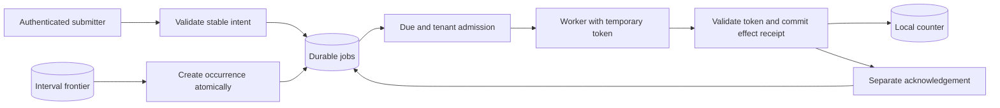

# Architecture and System Design Placement Handbook — Part 14
# S7: Background Job Scheduler and Worker Platform

**Estimated time: 4–6 hours | Architecture numeric module: 12 | Requires: A0–A4, S2 and S3; Resume M15 refresher**

---

## Why this module exists

“Put it in a queue” leaves the important questions unanswered: who owns the work, when may it start, what happens after a worker disappears, and can retry repeat a payment, email or database change? A successful queue acknowledgement and a successful business effect are different events.

**Organizing principle: give logical work a durable identity, make execution ownership temporary, and place duplicate protection at the effect's authority.**

This chapter implements one-off jobs, durable interval scheduling, tenant admission, fenced claims, bounded renewal, retries, cancellation and a local transactional counter effect. It deliberately leaves an effect committed without acknowledgement, reopens the database, and recovers without incrementing twice. Actual HTTP tests cover job submission, scoped status and cancellation.

The worker and scheduler are trusted methods driven by explicit integer time in the verifier. There is no cron daemon, broker, remote email/payment service or measured capacity result. The 30 interview questions are curated coverage, not a statistical ranking of employers' questions.

---

## 1. Prompt and clarification questions

**Prompt:** build a shared platform for immediate, delayed and recurring jobs. A worker may disappear after committing its effect, one tenant may submit a large backlog, and an operator needs truthful status and bounded recovery.

| Clarification | Why it changes the design |
| --- | --- |
| Job types and effects? | CPU isolation, network deadlines and downstream idempotency |
| Due time versus completion deadline? | Eligibility, expiry and admission policy |
| Interval or calendar recurrence? | Missed-run, timezone and daylight-saving semantics |
| Concurrent runs of the same schedule allowed? | Per-schedule overlap control and ordering |
| At-least-once execution acceptable? | Effect dedupe and reconciliation requirements |
| Tenant quotas, priorities and fairness? | Admission policy and noisy-neighbor boundaries |
| Cancellation semantics? | Whether an irreversible effect can already have happened |
| Backlog retention and replay requirements? | Storage, dedupe lifetime and operator workflows |
| Payload size and trust? | References, schema validation, sandboxing and secrets |

The baseline uses a trusted positive integer counter increment, a three-attempt budget and fixed interval recurrence. It coalesces missed intervals into the latest due occurrence. It does not promise every missed run, strict FIFO, schedule overlap exclusion or arbitrary user-code execution.

---

## 2. Contract and invariants

| Concern | Executed policy |
| --- | --- |
| Logical identity | Tenant/owner/client operation; delta, original due and deadline bind intent |
| Eligibility | Due ≤ now and deadline > now |
| Admission | Two live jobs globally, one per tenant |
| Claim | New random token, at most 2,000 ms lease initially |
| Renewal | Current unexpired token only; at most 6,000 ms from that claim's start |
| Attempts | At most three claims; attempt increments on claim, including abandoned claims |
| Failure | Retryable classification plus bounded delay; terminal otherwise |
| Effect | Unique job marker and counter change in the same SQLite transaction |
| Scheduling | One latest due occurrence per schedule/tick; occurrence plus next frontier atomic |
| Retention | 256 total retained jobs and 16 schedules, not an eviction implementation |

The lease gives temporary permission to attempt work. The current token must still match when committing a local effect, renewing or acknowledging. A token change does not remotely stop an old process; the protected resource must reject its stale writes.

An acknowledgement requires the local effect marker. Equivalent enqueue replay uses `original_due`, because retry scheduling is allowed to mutate `due`. A failed job can already have an effect if its acknowledgement was lost; the status response exposes `effect_applied` rather than inventing an atomic boundary across the two commits.

---

## 3. Capacity, queue age and recovery estimates

```json
{
  "jobs_per_day": 864000,
  "average_arrivals_per_second": 10,
  "assumed_mean_job_seconds": 0.5,
  "mean_busy_slots_at_average": 5,
  "one_hour_backlog_at_10_per_second": 36000,
  "drain_seconds_at_15_service_10_arrival": 7200,
  "fixture_global_inflight_cap": 2,
  "fixture_per_tenant_inflight_cap": 1,
  "measured_capacity": false
}
```

864,000 jobs/day average ten arrivals/second. At an assumed half-second mean service time, about five busy slots are needed at average load before headroom, skew, retries and downstream limits. This is an application of arrival rate × mean time, not evidence that five workers are sufficient at a latency target.

A one-hour outage accumulates 36,000 jobs at that rate. If service resumes at fifteen jobs/second while ten new jobs/second continue arriving, net drainage is five/second: 7,200 seconds, or two hours. Clearing the backlog requires capacity above continuing arrivals; adding workers can still fail when a database or provider is the bottleneck.

The fixture's two-slot cap demonstrates admission, not this hypothetical production capacity. Queue age, due-to-start delay, deadline misses and recovery time are more useful than queue length alone. Distinguish jobs waiting for future due times from runnable backlog.

---

## 4. Schema and authority boundaries

| Table | Responsibility |
| --- | --- |
| `jobs` | Canonical intent, original/next due, deadline, attempts, state and active token |
| `turns` | Persisted last admitted tenant for eligible-tenant round robin |
| `effects(job)` | Unique local business-effect receipt |
| `counters(tenant,owner)` | The protected local resource changed with the receipt |
| `schedules` | Trusted interval configuration and next due frontier |

`job_due` helps state/time access, but the bounded fixture still scans/sorts eligible rows. A production query plan needs measurements with actual indexes, partition sizes and skew. `BEGIN IMMEDIATE` serializes writers here. A PostgreSQL implementation could claim a bounded batch with row locks and `SKIP LOCKED`; the latter deliberately skips contended rows and does not itself guarantee fairness or an ordered queue. [PostgreSQL locking clause](https://www.postgresql.org/docs/18/sql-select.html#SQL-FOR-UPDATE-SHARE).

The `schedule_` operation namespace is reserved so a client cannot collide with internal occurrence identity. Internal occurrence keys include schedule ID plus scheduled slot, not wall-clock tick invocation time. The same tick cannot create a new identity for the same logical occurrence.

---

## 5. API and actor contract

| Actual endpoint | Contract |
| --- | --- |
| `POST /jobs` | Credential-derived tenant/owner, Idempotency-Key, delta/due/deadline; 202 |
| `GET /jobs/:id` | Owner-scoped status, attempt count and local effect marker; 200 |
| `DELETE /jobs/:id` | Owner-scoped cancellation; 200 if no committed effect, otherwise 409 |

Unknown owners/tenants see 404, anonymous requests 401, malformed fields 400. The request cannot choose its tenant. Acceptance means a durable job row, not that execution has started or completed. Replay returns the same logical job's current state.

Claim, tick, renew, fail, effect and acknowledgement are trusted worker/admin methods with no public endpoints. A real platform needs service identity, job-type allowlists, payload schemas, secret references and explicit operator privileges. Do not expose a worker's unrestricted effect endpoint to a submitting client.

---

## 6. Smallest architecture and execution trace



**Normal trace:** commit intent → become due → claim within admission limits → commit effect/receipt together → acknowledge success. **Lost-ack trace:** commit effect → omit ack → lease expires → new token claims the same job → receipt says replay → acknowledge. **Cancellation trace:** cancel before effect, invalidate token, then reject the old worker's attempt.

This model does not need an external queue to demonstrate durability. A larger platform may use a broker to wake workers while retaining authoritative job state. If inserting the job and publishing a broker message are separate writes, use a durable outbox/reconciliation path so a lost publication cannot strand accepted work.

---

## 7. Shared executable HTTP and transaction support

```python
"""Standard-library support shared by S4-S6; no production auth/server claim."""
from contextlib import contextmanager
from http.server import BaseHTTPRequestHandler, ThreadingHTTPServer
import json
import re
import sqlite3

CREDENTIALS = {'lesson-alice':('t1','alice'), 'lesson-bob':('t1','bob'),
               'lesson-carol':('t1','carol'), 'lesson-other':('t2','alice')}


class Error(Exception):
    def __init__(self, status, reason):
        self.status, self.reason = status, reason


def identity(value):
    if type(value) is not str or not re.fullmatch(r'[A-Za-z0-9_-]{1,64}', value):
        raise Error(400,'invalid_identity')
    return value


def number(value, low=0, high=10**15):
    if type(value) is not int or not low <= value <= high:
        raise Error(400,'invalid_integer')
    return value


def require(user):
    if user is None:
        raise Error(401,'lesson_credential_required')
    return user


def document(raw, fields):
    try:
        value = json.loads(raw)
    except (ValueError,UnicodeError):
        raise Error(400,'invalid_json') from None
    if type(value) is not dict or set(value) != set(fields):
        raise Error(400,'invalid_fields')
    return value


class Database:
    schema = ''

    def __init__(self, path):
        self.db = sqlite3.connect(path, timeout=0.5, isolation_level=None)
        self.db.row_factory = sqlite3.Row
        try:
            self.db.executescript('PRAGMA foreign_keys=ON;'+self.schema)
        except BaseException:
            self.db.close()
            raise

    def close(self):
        self.db.close()

    @contextmanager
    def transaction(self):
        self.db.execute('BEGIN IMMEDIATE')
        try:
            yield
            self.db.execute('COMMIT')
        except BaseException:
            self.db.execute('ROLLBACK')
            raise


def server(factory, dispatch):
    class Handler(BaseHTTPRequestHandler):
        def log_message(self, *_):
            pass

        def reply(self, status, value):
            raw = json.dumps(value,ensure_ascii=False).encode('utf-8')
            self.send_response(status)
            self.send_header('Content-Type','application/json; charset=utf-8')
            self.send_header('Content-Length',str(len(raw)))
            self.send_header('Cache-Control','no-store')
            self.send_header('Connection','close')
            self.end_headers()
            self.wfile.write(raw)
            self.close_connection = True

        def handle_request(self):
            item = None
            try:
                length = self.headers.get('Content-Length','0')
                if self.headers.get('Transfer-Encoding') or not length.isascii() or not length.isdigit() or len(length)>6 or int(length)>8192:
                    raise Error(413,'body_or_framing_limit')
                raw = self.rfile.read(int(length))
                if len(raw) != int(length):
                    raise Error(400,'incomplete_body')
                auth = self.headers.get('Authorization','')
                user = CREDENTIALS.get(auth[7:]) if auth.startswith('Bearer ') else None
                item = factory()
                status, value = dispatch(item,user,self.command,self.path,raw,self.headers)
                self.reply(status,value)
            except Error as error:
                self.reply(error.status,{'error':error.reason})
            except sqlite3.Error:
                self.reply(503,{'error':'metadata_unavailable'})
            except (ValueError,UnicodeError):
                self.reply(400,{'error':'invalid_input'})
            finally:
                if item is not None:
                    item.close()

        do_GET = handle_request
        do_POST = handle_request
        do_PUT = handle_request
        do_DELETE = handle_request
    return ThreadingHTTPServer(('127.0.0.1',0),Handler)
```

The helper is reused unchanged from S4–S6. Its published lesson credentials, bounded JSON body, per-request database connection and loopback listener are an executable teaching boundary. It provides no production authentication, worker sandbox or arbitrary network-client protection.

---

## 8. Executable scheduler, leases and effect receipt

```python
"""Durable interval/one-off jobs, tenant admission and a local idempotent effect."""
from pathlib import Path
import sys
sys.path.insert(0,str(Path(__file__).resolve().parents[1]/'worked-systems-s4-s6'))
import json
import re
import uuid
from runtime import Database, Error, document, identity, number, require


class Scheduler(Database):
    schema = '''
        CREATE TABLE IF NOT EXISTS jobs(id TEXT PRIMARY KEY,tenant TEXT,owner TEXT,operation TEXT,
            delta INTEGER,due INTEGER,original_due INTEGER,deadline INTEGER,state TEXT,attempts INTEGER,
            token TEXT,lease_until INTEGER,started INTEGER,reason TEXT,
            UNIQUE(tenant,owner,operation));
        CREATE INDEX IF NOT EXISTS job_due ON jobs(state,due,lease_until);
        CREATE TABLE IF NOT EXISTS turns(id INTEGER PRIMARY KEY,last_tenant TEXT);
        INSERT INTO turns VALUES(1,'') ON CONFLICT DO NOTHING;
        CREATE TABLE IF NOT EXISTS effects(job TEXT PRIMARY KEY,tenant TEXT,owner TEXT,delta INTEGER);
        CREATE TABLE IF NOT EXISTS counters(tenant TEXT,owner TEXT,value INTEGER,PRIMARY KEY(tenant,owner));
        CREATE TABLE IF NOT EXISTS schedules(id TEXT PRIMARY KEY,tenant TEXT,owner TEXT,name TEXT,
            delta INTEGER,interval_ms INTEGER,next_due INTEGER,UNIQUE(tenant,owner,name));
    '''

    def _insert(self,tenant,owner,operation,delta,due,deadline):
        old = self.db.execute('SELECT * FROM jobs WHERE tenant=? AND owner=? AND operation=?',(tenant,owner,operation)).fetchone()
        if old:
            if (old['delta'],old['original_due'],old['deadline']) != (delta,due,deadline):
                raise Error(409,'changed_job_intent')
            return dict(old)
        if self.db.execute('SELECT count(*) FROM jobs').fetchone()[0]>=256:
            raise Error(503,'lesson_job_retention_cap')
        job_id = uuid.uuid4().hex
        self.db.execute("INSERT INTO jobs VALUES(?,?,?,?,?,?,?,?,'pending',0,NULL,0,0,NULL)",
                        (job_id,tenant,owner,operation,delta,due,due,deadline))
        return dict(self.db.execute('SELECT * FROM jobs WHERE id=?',(job_id,)).fetchone())

    def enqueue(self,tenant,owner,operation,delta,due,deadline):
        for value in (tenant,owner,operation):
            identity(value)
        if operation.startswith('schedule_'):
            raise Error(400,'reserved_operation_prefix')
        number(delta,1,1000)
        number(due)
        number(deadline,due+1)
        with self.transaction():
            return self._insert(tenant,owner,operation,delta,due,deadline)

    def owned(self,tenant,owner,job_id):
        row = self.db.execute('SELECT j.*,EXISTS(SELECT 1 FROM effects e WHERE e.job=j.id) AS effect_applied FROM jobs j WHERE tenant=? AND owner=? AND id=?',
                              (identity(tenant),identity(owner),identity(job_id))).fetchone()
        if row is None:
            raise Error(404,'job_not_found')
        return dict(row)

    def schedule(self,tenant,owner,name,delta,interval_ms,first_due):
        for value in (tenant,owner,name):
            identity(value)
        number(delta,1,1000)
        number(interval_ms,1000,86400000)
        number(first_due)
        with self.transaction():
            if self.db.execute('SELECT count(*) FROM schedules').fetchone()[0]>=16:
                raise Error(503,'lesson_schedule_cap')
            schedule_id = uuid.uuid4().hex
            self.db.execute('INSERT INTO schedules VALUES(?,?,?,?,?,?,?)',(schedule_id,tenant,owner,name,delta,interval_ms,first_due))
            return schedule_id

    def tick(self,now):
        number(now)
        created = []
        with self.transaction():
            rows = self.db.execute('SELECT * FROM schedules WHERE next_due<=? ORDER BY next_due,id LIMIT 16',(now,)).fetchall()
            for row in rows:
                # Coalesce missed intervals: one most-recent occurrence, not every miss.
                slot = row['next_due']+(now-row['next_due'])//row['interval_ms']*row['interval_ms']
                operation = 'schedule_'+row['id']+'_'+str(slot)
                created.append(self._insert(row['tenant'],row['owner'],operation,row['delta'],slot,slot+row['interval_ms'])['id'])
                self.db.execute('UPDATE schedules SET next_due=? WHERE id=?',(slot+row['interval_ms'],row['id']))
        return created

    def claim(self,now):
        number(now)
        with self.transaction():
            self.db.execute("UPDATE jobs SET state='failed',token=NULL,reason='deadline_or_attempts_exhausted' WHERE state IN ('pending','running') AND (deadline<=? OR (state='running' AND lease_until<=? AND attempts>=3))",(now,now))
            live = self.db.execute("SELECT tenant,count(*) AS n FROM jobs WHERE state='running' AND lease_until>? GROUP BY tenant",(now,)).fetchall()
            if sum(row['n'] for row in live)>=2:
                return None
            busy = {row['tenant'] for row in live}
            rows = self.db.execute("SELECT * FROM jobs WHERE due<=? AND deadline>? AND attempts<3 AND (state='pending' OR (state='running' AND lease_until<=?)) ORDER BY tenant,due,id",(now,now,now)).fetchall()
            tenants = sorted({row['tenant'] for row in rows}-busy)
            if not tenants:
                return None
            last = self.db.execute('SELECT last_tenant FROM turns WHERE id=1').fetchone()[0]
            chosen = next((tenant for tenant in tenants if tenant>last),tenants[0])
            row = next(row for row in rows if row['tenant']==chosen)
            token = uuid.uuid4().hex
            until = min(now+2000,row['deadline'])
            self.db.execute("UPDATE jobs SET state='running',attempts=attempts+1,token=?,lease_until=?,started=? WHERE id=?",(token,until,now,row['id']))
            self.db.execute('UPDATE turns SET last_tenant=? WHERE id=1',(chosen,))
            return dict(self.db.execute('SELECT * FROM jobs WHERE id=?',(row['id'],)).fetchone())

    def live(self,job,now):
        number(now)
        return self.db.execute("SELECT * FROM jobs WHERE id=? AND state='running' AND token=? AND lease_until>? AND deadline>?",(job['id'],job['token'],now,now)).fetchone()

    def renew(self,job,now,extension_ms=2000):
        number(extension_ms,1,5000)
        with self.transaction():
            row = self.live(job,now)
            if row is None:
                return False
            until = min(max(row['lease_until'],now+extension_ms),row['started']+6000,row['deadline'])
            self.db.execute('UPDATE jobs SET lease_until=? WHERE id=?',(until,row['id']))
            return until

    def effect(self,job,now):
        with self.transaction():
            row = self.live(job,now)
            if row is None:
                return 'stale'
            if self.db.execute('SELECT 1 FROM effects WHERE job=?',(row['id'],)).fetchone():
                return 'replay'
            self.db.execute('INSERT INTO effects VALUES(?,?,?,?)',(row['id'],row['tenant'],row['owner'],row['delta']))
            self.db.execute('INSERT INTO counters VALUES(?,?,?) ON CONFLICT(tenant,owner) DO UPDATE SET value=value+excluded.value',
                            (row['tenant'],row['owner'],row['delta']))
            return 'applied'

    def ack(self,job,now):
        with self.transaction():
            if self.live(job,now) is None or not self.db.execute('SELECT 1 FROM effects WHERE job=?',(job['id'],)).fetchone():
                return False
            self.db.execute("UPDATE jobs SET state='succeeded',token=NULL WHERE id=?",(job['id'],))
            return True

    def fail(self,job,now,retryable,delay_ms=0):
        if type(retryable) is not bool:
            raise Error(400,'invalid_failure_class')
        with self.transaction():
            row = self.live(job,now)
            if row is None:
                return False
            number(delay_ms,0,min(4000,500*2**(row['attempts']-1)))
            retry = retryable and row['attempts']<3 and now+delay_ms<row['deadline']
            self.db.execute('UPDATE jobs SET state=?,due=?,token=NULL,reason=? WHERE id=?',
                ('pending' if retry else 'failed',now+delay_ms,'retry_scheduled' if retry else 'terminal_failure',row['id']))
            return True

    def cancel(self,tenant,owner,job_id):
        with self.transaction():
            row = self.owned(tenant,owner,job_id)
            if row['effect_applied']:
                raise Error(409,'effect_already_applied')
            if row['state'] in ('pending','running'):
                self.db.execute("UPDATE jobs SET state='cancelled',token=NULL WHERE id=?",(job_id,))
            return self.owned(tenant,owner,job_id)


def estimates():
    return {'jobs_per_day':864000,'average_arrivals_per_second':10,
        'assumed_mean_job_seconds':0.5,'mean_busy_slots_at_average':5,
        'one_hour_backlog_at_10_per_second':36000,'drain_seconds_at_15_service_10_arrival':7200,
        'fixture_global_inflight_cap':2,'fixture_per_tenant_inflight_cap':1,'measured_capacity':False}


def dispatch(item,user,method,path,raw,headers):
    tenant,owner = require(user)
    if path=='/jobs' and method=='POST':
        value = document(raw,['delta','due','deadline'])
        return 202,item.enqueue(tenant,owner,headers.get('Idempotency-Key',''),**value)
    match = re.fullmatch(r'/jobs/([a-f0-9]{32})',path)
    if match and method=='GET':
        return 200,item.owned(tenant,owner,match[1])
    if match and method=='DELETE':
        return 200,item.cancel(tenant,owner,match[1])
    raise Error(404,'unknown_route')
```

Time is explicit milliseconds on one shared lesson timeline. A deployment must define its authoritative clock and skew assumptions. Local monotonic clocks are useful for elapsed durations but are not directly comparable durable timestamps across machines. Random ownership tokens are compared at this local authority; they are not monotonic fencing numbers for a separate storage service.

---

## 9. Recovering the effect-before-ack gap

```json
{
  "effect_before_ack": "applied",
  "reopen_after_omitting_ack": true,
  "new_claim_token": true,
  "old_worker_effect": "stale",
  "new_worker_effect": "replay",
  "counter": 7,
  "final_state": "succeeded",
  "actual_process_kill": false
}
```

The verifier deliberately omits acknowledgement and closes/reopens SQLite; it does not kill a process or simulate disk corruption. The receipt survives because it committed with the counter change. A new claim uses a different token, rejects the old token and returns `replay` for the already committed effect.

Putting the receipt in the queue's database does not protect an independent email/payment service. If that service commits and the worker loses the reply, only a stable downstream operation ID, authoritative lookup or compensating/reconciliation protocol can resolve uncertainty. A receipt written before the remote call risks losing the effect; one written afterward still leaves a duplicate window.

Standard SQS can redeliver messages, and visibility timeout is not a universal no-duplicate promise. Explain the selected broker's exact contract rather than equating invisibility with exactly-once execution. [SQS at-least-once delivery](https://docs.aws.amazon.com/AWSSimpleQueueService/latest/SQSDeveloperGuide/standard-queues-at-least-once-delivery.html), [visibility timeout](https://docs.aws.amazon.com/AWSSimpleQueueService/latest/SQSDeveloperGuide/sqs-visibility-timeout.html).

---

## 10. Attempts, deadlines and cancellation

```json
{
  "max_attempts": 3,
  "renewal_hard_cap_ms": 6000,
  "deadline_state": "failed",
  "deadline_effect_applied": true,
  "failed_proves_no_effect": false,
  "original_intent_replay_after_retry": true
}
```

Retry classification is a business decision. A temporary unavailable dependency may be retryable; a permanently invalid payload usually is not. Unknown remote outcome is a separate state requiring identity-aware retry or lookup, not blind repetition. The verifier supplies a bounded delay; it does not execute a randomized backoff policy. Production workers can add capped exponential backoff with jitter within the deadline and provider budget.

The deadline example intentionally commits an effect just before expiry, then loses the ack. The next claim sweep marks the job failed, while its effect marker remains true. “Failed” describes scheduling completion, not proof of zero side effects. Operators need that distinction before replaying or compensating.

Cancellation fences local work that has not committed. Once this counter effect exists, cancellation returns 409. Remote cancellation can be best effort or require a separate compensating action. State the point of no return rather than promising that a cancelled HTTP request undoes an external transfer.

---

## 11. Fair admission and durable recurrence

```json
{
  "first_two_tenants": [
    "a",
    "b"
  ],
  "third_tenant": "c",
  "global_cap": 2,
  "tenant_cap": 1,
  "concurrent_claims": 2
}
```

Two simultaneous claim calls use independent connections and admit different tenants. After their completion, round robin advances to the third eligible tenant. This is fairness over eligible tenant names at dispatch time, not weighted fairness, equal CPU time or guaranteed latency for differently sized jobs. A long job can occupy its slot, and the one-per-tenant cap deliberately prevents one tenant from using both global slots even if others are idle.

```json
{
  "missed_slots": [
    1000,
    2000,
    3000,
    4000
  ],
  "coalesced_created_slots": [
    4000
  ],
  "next_due_after_first_tick": 5000,
  "tick_replay_created": 0,
  "occurrence_frontier_rollback_tested": true
}
```

At time 4,500, an interval beginning at 1,000 with a 1,000 ms period has missed four slots. The executed policy creates only slot 4,000 and advances to 5,000. Job insertion and frontier movement roll back together under an injected database failure. This prevents a frontier from silently skipping an uncommitted occurrence.

Other valid policies include skipping all missed occurrences, replaying every miss within a bound, or running once immediately. Calendar cron also needs timezone, DST, start deadline, overlap and missed-run rules. This fixture implements fixed intervals only. [Kubernetes CronJob considerations](https://kubernetes.io/docs/concepts/workloads/controllers/cron-jobs/).

---

## 12. Actual HTTP evidence

```json
{
  "POST_jobs": 202,
  "GET_owner": 200,
  "GET_other_owner": 404,
  "GET_other_tenant": 404,
  "anonymous": 401,
  "public_claim_endpoint": 404,
  "cancel_state": "cancelled",
  "real_loopback_HTTP": true
}
```

These are real requests to an owned ephemeral loopback server, separate from direct worker-method tests. The server and databases are closed afterward. Port 3000 is never used. The HTTP interface demonstrates durable acceptance and owner isolation; it does not automatically run a worker after a request.

---

## 13. Choosing a queue and execution model

| Option | Appropriate reason | Cost to examine |
| --- | --- | --- |
| Database-backed queue | Modest work, transactional integration and operational simplicity | Polling, table/index churn and writer contention |
| Managed message queue | Decoupled producers/consumers, managed retention and redelivery | Delivery/order semantics, visibility, quotas and external effect identity |
| Log/stream | Replayable ordered partition history and multiple consumers | Offset ownership, partition skew, delay scheduling and retention |
| Workflow engine | Durable multi-step orchestration, waits and compensation | History growth, activity semantics and operational complexity |

Do not choose a log solely because it is popular. A delayed job, recurring schedule, multi-step workflow and event subscription ask different questions. A queue normally distributes work; a broadcast log often gives each consumer group its own progress. Neither automatically solves idempotent business effects.

---

## 14. Growth, migration and overload

Separate scheduling eligibility, admission and execution capacity. Partition by tenant/job class when measurement justifies it, but a hot tenant still needs its own limits. Move large payloads to versioned object references, isolate long CPU tasks from latency-sensitive work, and cap downstream concurrency independently from worker process count.

Use bounded batches and leases for dispatch, retention cleanup and dead-letter inspection. A dead-letter record should retain original job/effect identity, attempt history and failure classification. Operator replay must specify whether it reuses that identity or creates a new authorized business operation. Deleting receipts before the retry horizon can re-enable duplicates.

The fixture fails admission at a retained-row cap and contains no deletion/archival lifecycle. A production retention plan must preserve required audit and dedupe evidence. Adding more workers without defining safe overload behavior can accelerate dependency failure rather than improve throughput.

---

## 15. Security and workload isolation

Derive tenant identity from authenticated context and check ownership on every status/cancel path. Restrict worker credentials by job class and resource; use allowlisted handlers rather than accepting executable code or arbitrary URLs in a job body. User-supplied fetch jobs require their own destination and network access policy.

Treat payloads and logs as potentially sensitive. Prefer references to secrets over copying credentials into long-lived queue rows. Separate submit, execute, inspect and replay permissions. The fixture's positive integer counter avoids those execution hazards, but the architecture discussion must acknowledge them when extending it to imports, webhooks or model/tool tasks.

---

## 16. Observability and incident questions

Track accepted/due/running/expired counts, oldest runnable age, due-to-start delay, deadline misses, attempt distribution, stale-token rejections, renewal failures, effect replays and terminal jobs with committed effects. Separate tenant and job-class dimensions without creating unbounded metric labels.

For an incident, ask: are arrivals exceeding completions, is one tenant monopolizing resources, are leases shorter than actual runtime, are retries multiplying a dependency outage, or is acknowledgement lag producing apparent failures after completed effects? Correlate job ID, logical operation, attempt and downstream operation ID in traces; keep tokens and private payloads out of public diagnostics.

---

## 17. Run, inspect and evidence limits

From the repository root:

```powershell
python examples/system-design/module-12-job-scheduler-workers/verify.py
```

Verified 2026-10-17 on Python 3.12.10, SQLite 3.49.1, Windows. **65 local checks passed**: 11 identity, 8 leases, 9 effects, 11 retries, 4 concurrency, 3 atomicity, 5 scheduling, 10 http, 4 cleanup. The verifier creates temporary databases, uses two synchronized claim calls on separate connections, sends actual HTTP requests, and checks connection/listener/directory cleanup. Results live in `verification-results.json` beside the source.

These assertions prove selected local transitions, transaction boundaries and controlled races. They do not establish broker behavior, process-kill recovery, cross-region scheduling, arbitrary payload safety or a production throughput/latency SLO. Replacing the counter with a remote service requires new effect-boundary tests.

---

## 18. Interview questions and answers

### Q1. What is a background job?

A durable request to perform work outside the originating request's synchronous path. Its identity, eligibility, state and outcome need to survive the caller disconnecting. Moving work to another thread alone does not give durable acceptance or recoverability.

### Q2. Why use background work?

To bound request latency, absorb bursts and isolate long or unreliable tasks. The tradeoff is delayed completion and more state: retries, status, ownership and recovery. A user-visible operation must distinguish accepted from completed.

### Q3. What is the difference between a scheduler and a queue?

The scheduler decides when logical occurrences become eligible. The queue/distributor assigns runnable work to consumers. A worker executes it. One database can implement all three roles locally, but their policies remain distinct.

### Q4. What does at-least-once mean for a worker?

The same logical work can be delivered or claimed repeatedly. Make repeated execution safe at each effect authority and retain identity long enough. Acknowledge only after the required durable boundary; do not assume duplicate-free delivery.

### Q5. Where is this example's duplicate protection?

The `effects(job)` unique receipt commits with the counter increment. A replay sees the receipt rather than incrementing again. That property covers the local counter only; it does not automatically cover an independent network service.

### Q6. Why is acknowledgement separate?

The effect can commit before the queue sees success. A lost ack then causes another claim. The design must tolerate that gap rather than treating it as impossible or promising an atomic transaction across unrelated systems.

### Q7. What is a lease?

A time-limited execution claim. Expiry permits recovery when a worker disappears. The worker must renew before expiry where supported, and protected writes must verify current ownership because the old process may continue running.

### Q8. Does lease expiry stop the old worker?

No. It changes authority, not process execution. Here a changed token blocks the old worker's local effect and acknowledgement. A remote resource needs its own validated token, monotonic fencing version or stable idempotent operation contract.

### Q9. Why cap renewal duration?

An unhealthy or stuck worker should not monopolize a slot indefinitely. The fixture caps a claim at six seconds and its business deadline. Longer legitimate jobs need a deliberate duration, heartbeat and checkpoint policy.

### Q10. Why retain original due time?

Retry scheduling changes the next eligible time, while enqueue replay must compare the original client intent. Comparing replay input with a mutated due field would reject an equivalent original request after a retry.

### Q11. When should a job retry?

When the failure is classified retryable, attempts remain, and the delayed attempt can begin before deadline. Unknown external outcomes require identity-aware retry or lookup. Repeating a permanently invalid request just wastes the budget.

### Q12. Why add jitter to backoff?

It spreads correlated retries after an outage. Backoff still needs a cap, deadline and downstream budget. The verifier checks permitted delay bounds; it does not claim to implement or measure randomized retry distribution.

### Q13. Can a failed job have completed its effect?

Yes. This example commits just before deadline and loses its acknowledgement. Scheduling later reports failed with `effect_applied=true`. Recovery must inspect effect evidence before replaying or compensating.

### Q14. Can cancellation undo work?

It can prevent a local effect that has not committed by invalidating the token. An existing effect returns conflict here. Undoing an external operation is a separate domain action, often with different permissions and failure modes.

### Q15. How is tenant fairness implemented?

The dispatcher persists the last admitted tenant and rotates among currently eligible non-busy tenants. Global and tenant live-slot caps bound admission. This is dispatch fairness, not equal runtime, weighted scheduling or a universal latency guarantee.

### Q16. Why not let one tenant use every idle slot?

That could improve utilization but weakens the simple isolation contract when other work arrives. Borrowing needs a policy for non-preemptible jobs, reserved capacity and priorities. The fixture deliberately uses a strict one-slot tenant cap.

### Q17. How are recurring occurrences identified?

By schedule ID plus scheduled slot. The tick invocation time is not the logical identity. A transaction inserts the occurrence and advances the schedule frontier, preventing partial progress from skipping work.

### Q18. What happens to missed intervals?

The implemented policy creates only the newest due slot and skips older misses. Replay-all and skip-all are other valid policies. Clarify business meaning before choosing, especially for billing, reporting and expensive ingestion.

### Q19. Why is interval scheduling different from cron?

Cron expresses calendar rules with timezone and DST ambiguities; intervals express elapsed spacing on a selected timeline. The fixture does not parse cron, handle DST or execute a scheduler daemon.

### Q20. How should overlapping scheduled runs behave?

Choose allow, forbid, queue or replace explicitly. Per-tenant admission here limits simultaneous local jobs but is not a general per-schedule overlap policy. A production design may need an active-occurrence uniqueness constraint or lease.

### Q21. Why might a database queue be enough?

It can commit business intent and work together with familiar operations at modest load. Measure polling, contention and retention cost before adding a broker. Simplicity is useful when the required workload fits.

### Q22. What changes with PostgreSQL SKIP LOCKED?

Workers can select unlocked rows without waiting for claimed rows, usually in short claim transactions. This improves competing-consumer access but can change ordering and still requires leases, retries, effect identity and fairness policy.

### Q23. What is a dead-letter queue for?

Preserving terminal or repeatedly failing work for diagnosis and controlled recovery. It is not successful completion or automatic repair. Keep original identity and effect evidence so manual replay does not blindly duplicate business actions.

### Q24. How do you drain an outage backlog?

Estimate backlog divided by service rate minus continuing arrival rate. Ensure the net rate is positive and downstream dependencies can sustain it. Monitor age and deadline loss, not just the number of worker processes.

### Q25. How do you handle large payloads?

Store bounded metadata and versioned object references in the job. Validate referenced ownership/readiness and retention. Copying large private blobs into every retry increases storage, transfer and cleanup complexity.

### Q26. What if the worker crashes mid-transaction?

The database transaction should provide its documented recovery behavior, while the claim may later expire. This verifier injects transactional faults and reopens a committed database; actual process-kill/storage recovery needs separate testing.

### Q27. Which ordering guarantee does the fixture provide?

Eligible tenant rotation with due/id ordering inside the selected tenant. It does not promise strict global FIFO or completion order. Concurrent jobs of different durations can finish in a different order from dispatch.

### Q28. How would you isolate untrusted code?

Use a separate execution boundary with resource, filesystem, network and credential limits, plus allowed job contracts. Do not run client-supplied code in the scheduler's process. This example executes only a fixed trusted counter handler.

### Q29. Which metrics would you alert on?

Runnable age, deadline miss rate, stale ownership, retry amplification, effect replay and tenant saturation. Terminal-with-effect cases deserve reconciliation visibility. Queue depth alone misses future-scheduled work and already completed effects awaiting acknowledgement.

### Q30. Give a compact design answer.

Persist stable job intent and scheduled occurrences, admit due work under tenant limits, and claim with expiring ownership. Bound retries and renewal, dedupe effects at their authority, and reconcile ambiguous completion. Keep cancellation, recurrence, retention and backlog policy explicit.

---

## 19. A 45-minute mock and answer skeleton

**Mock prompt:** “Design a multi-tenant job platform. A worker disappears after changing a database, one tenant floods the queue, and recurring jobs missed an outage.”

| Segment | Minutes |
| --- | --- |
| Clarify effects, due/deadline and recurrence | 5 |
| Estimate concurrency, skew and backlog drain | 7 |
| Define job, occurrence, lease and API contracts | 8 |
| Trace claim, effect receipt and acknowledgement | 10 |
| Inject lost ack, expiry, cancellation and tick rollback | 10 |
| Defend growth, metrics and proof limits | 5 |
| **Total** | **45** |

A defensible short answer:

> I would persist one logical job per tenant/client operation and one occurrence per schedule slot. Due work enters bounded tenant-aware admission, then receives a temporary claim token. Local effects commit with a unique receipt; remote effects require the downstream authority's stable operation contract. Expiry permits reclaim without authorizing stale workers. Retry, renewal, deadline and cancellation rules stay explicit, and terminal status retains evidence of already committed effects. Backlog age and recovery rate guide scaling.

---

## 20. Practice tasks

1. Clarify the due/deadline, duplicate-effect, cancellation and recurrence contract for email, import and billing jobs.
2. Recompute busy slots and backlog drain for a burst and continuing arrivals; include downstream quotas and headroom.
3. Retry enqueue after a retry changes next due time. Explain why original intent fields remain immutable.
4. Omit acknowledgement after the counter effect, reopen the database and reclaim. Inspect counter, receipt, token and state.
5. Run competing claim calls for three tenants. Explain the difference between dispatch fairness and equal service time.
6. Renew up to the hard bound, attempt late renewal and use a stale token for effect and ack.
7. Cancel before effect and after effect; then let a committed effect cross its acknowledgement deadline.
8. Inject occurrence insertion failure and inspect schedule frontier rollback. Compare coalesce, replay-all and skip policies.
9. Replace the counter with a proposed remote payment API. Draw the uncertain-outcome window and required provider identity/reconciliation contract.
10. Complete the mock, including retention, operator replay, workload isolation, observability and measured migration criteria.

---

## 21. Completion checklist

- [ ] I can separate accepted, runnable, claimed and completed work.
- [ ] I can define immutable job and occurrence identities.
- [ ] I can estimate worker concurrency and net backlog drainage.
- [ ] I can explain temporary leases and stale-worker fencing.
- [ ] I can bound renewal, retries and deadlines.
- [ ] I can close the local effect/receipt transaction boundary.
- [ ] I can explain effect-before-ack recovery and ambiguous failure.
- [ ] I can distinguish cancellation from compensation.
- [ ] I can implement and critique tenant admission fairness.
- [ ] I can define missed-run and overlap policies.
- [ ] I can plan retention, operator replay and workload security.
- [ ] I can finish the mock and state the local proof limits.

---

## 22. Research references and continuation

Reviewed 2026-10-17. Primary references: [SQS delivery](https://docs.aws.amazon.com/AWSSimpleQueueService/latest/SQSDeveloperGuide/standard-queues-at-least-once-delivery.html), [SQS visibility](https://docs.aws.amazon.com/AWSSimpleQueueService/latest/SQSDeveloperGuide/sqs-visibility-timeout.html), [PostgreSQL row locking](https://www.postgresql.org/docs/18/sql-select.html#SQL-FOR-UPDATE-SHARE), and [Kubernetes CronJobs](https://kubernetes.io/docs/concepts/workloads/controllers/cron-jobs/). The local policies, estimates, code and interview answers are authored reasoning, not claims about those products' complete implementation.

Return to the [architecture roadmap](/docs/system-design), [A3 reliable workflows](/docs/system-design/reliable-workflows-concurrency), [S2 delivery](/docs/system-design/notifications-webhooks) or [Resume M15 background jobs](/docs/resume-skills/caching-background-jobs-data-ingestion).

**Next: [S8 — Checkout, payments and credit ledger](/docs/system-design/checkout-payments-credit-ledger)**, architecture part 15 / numeric module 13. It develops a separate provider commit boundary, uncertain payment outcomes, verified deduplication and balanced credit journals. S0–S9 are authored; later systems and consolidation remain planned.
