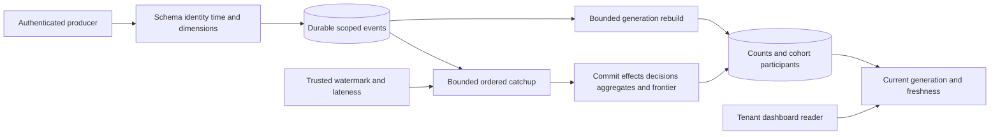

# Architecture and System Design Placement Handbook — Part 20
# S13: Analytics Event Pipeline and Dashboard

**Estimated time: 4–6 hours | Architecture numeric module: 18 | Requires: A0–A4, S2 and S7; Resume M15/M19/M28 refreshers**

---

## Why this module exists

A producer retries after losing its acknowledgement. A consumer changes an aggregate but loses its checkpoint. An activation arrives before its signup, or after the dashboard called a window final. A chart looks plausible while counting different populations in its numerator and denominator.

**Organizing principle: preserve event identity and time semantics, commit projection effects with progress, and publish the metric definition with its freshness.**

This local SQLite pipeline implements durable bounded event batches, scoped replay, five-minute event-time windows, an explicit lateness policy, distinct-subject cohorts, atomic projection/checkpoint recovery, generation rebuild and subject removal. Actual HTTP serves intake and a JSON dashboard read model.

No Kafka/Beam cluster, browser chart, automatic watermark estimator, external spreadsheet connector or throughput test runs. Fixed lesson credentials represent trusted local publishers/readers, not production user/producer authentication. The 30 Q&As are curated practice, not measured interview frequency. This chapter develops Q38/Q52 and connects to the ingestion concerns in Q56.

---

## 1. Prompt and clarification questions

**Prompt:** collect page views, signups and activations for tenant dashboards. Duplicate and out-of-order events must not corrupt metrics, dashboard lag must be visible, and late data and deletion must follow a stated policy.

| Clarification | Architectural consequence |
| --- | --- |
| Operational monitoring or product behavior? | Different actors, retention, dimensions and correctness needs |
| Who is allowed to publish each event? | Authentication, event provenance and spoofing risk |
| What uniquely identifies an occurrence? | Producer-scoped deduplication and replay horizon |
| Event time or receipt time? | Window membership, timezone and clock-skew handling |
| How late may data arrive? | Mutable windows, exclusion, correction or backfill |
| What does activation rate mean? | Cohort identity, ordering, denominator and attribution |
| What freshness is promised? | Queue/projection lag and dashboard status |
| Which dimensions and cardinalities? | Aggregate growth and privacy risk |
| What can be deleted/replayed? | Source retention, erasure markers and rebuild policy |

The baseline has three event kinds and three allowlisted channels. Every event includes an explicit-offset ISO timestamp with whole seconds. It measures same-window, same-channel signup/activation, not seven-day retention, ordered funnel completion, attribution, revenue or causal product impact.

---

## 2. Contract and invariants

| Area | Executed policy |
| --- | --- |
| Event identity | Tenant/credential producer/client event ID, immutable normalized fingerprint |
| Batch | 1–16 events; validation/conflict failure rolls back the whole batch |
| Durability | 202 only after SQLite source commit |
| Source order | Increasing database sequence; event time remains independent |
| Window | Floor UTC event timestamp to 300-second start |
| Lateness | Window becomes final under policy when end + 120 seconds ≤ watermark |
| Watermark | Trusted explicit control; monotonic, not beyond now, only after local backlog drains |
| Projection | Effect receipt, counters, cohort participants, event decision and frontier atomic |
| Metric | Distinct activated signup subjects divided by distinct signup subjects in the same cell |
| Rebuild | New local generation preserves original included/late decisions |
| Privacy | Trusted removal recomputes active aggregates and retains a replay-blocking subject marker |

Equivalent timestamp offsets produce the same event fingerprint. A new ID for the same behavior is a new event, so event deduplication and distinct-user metric semantics remain separate. A real source must define stable occurrence IDs rather than generating a new one on every retry.

The late-data decision is explicit. Too-late events are durably retained as `late_excluded` and do not silently change finalized counts. This preserves an audit/reconciliation input, not automatic correction. Changing that policy requires a separately versioned recomputation decision.

---

## 3. Volume, storage and recovery estimates

```json
{
  "events_per_day": 8640000,
  "average_events_per_second": 100,
  "assumed_peak_multiplier": 5,
  "peak_events_per_second": 500,
  "assumed_raw_event_bytes": 400,
  "logical_raw_GB_per_day": 3.456,
  "outage_seconds": 600,
  "backlog_at_average": 60000,
  "drain_seconds_at_150_service_100_arrival": 1200,
  "fixture_window_seconds": 300,
  "fixture_allowed_lateness_seconds": 120,
  "measured_capacity": false
}
```

8.64 million events/day average 100/second; an assumed fivefold peak gives 500/second. At 400 assumed bytes/event, raw logical input is 3.456 decimal GB/day before indexes, retained decisions, replicas, backups and aggregate state.

A ten-minute outage at the average rate builds 60,000 events. Processing 150/second while 100/second keep arriving drains at fifty/second, requiring twenty minutes. Neither adding partitions nor changing the chart fixes insufficient net service capacity.

The fixture retains at most 512 source events and four generations. These are deterministic lesson limits, not production capacities. Distinct-subject sets can dominate memory for high-cardinality dimensions; estimate users × windows × dimensions and required retention rather than only counting event bytes.

---

## 4. Schema, authority and access patterns

| Table | Responsibility |
| --- | --- |
| `events` | Canonical accepted occurrence, event/receipt time, fingerprint and inclusion decision |
| `active` | Serving projection generation per tenant |
| `checkpoints` | Last source sequence, update time and watermark per generation |
| `effects` | Unique generation/event processing receipt, including exclusions |
| `counts` | Per-window/channel/kind event totals |
| `participants` | Exact distinct-subject sets for defined cohorts |
| `erased` | Tenant/subject marker blocking ingestion replay after removal |

The tenant/sequence index supports bounded catchup; aggregate keys match the read cells. Sequence gaps can result from other tenants or removed rows. They do not imply missing data when the consumer queries its scoped ordered source correctly.

The fixture uses exact sets rather than approximate distinct sketches. Approximate counts can save space but introduce estimation error and complicate cohort intersection, subtraction and erasure. Choose them only with an acceptable metric/error contract.

---

## 5. API and producer trust

| Actual endpoint | Contract |
| --- | --- |
| `POST /events` | Exact events envelope; credential determines tenant/producer; 202 receipts |
| `GET /dashboard?start=&buckets=` | Aligned UTC start, 1–12 five-minute windows, three fixed channels |

Dashboard responses include metric-definition version, active generation, source/projection positions, pending count, update time and watermark. Values are aggregate data; raw subject lists are not returned. Authenticated lesson readers can see their tenant aggregates under this explicit policy.

Processing, watermark advancement, rebuild and subject removal are trusted internal/admin methods without public routes. A deployed collector needs scoped producer credentials, limits, provenance validation and separate reader/admin roles. An authenticated producer report is not proof that a real customer action occurred; these analytics events do not authorize payments or permissions.

---

## 6. Smallest architecture and traces



**Write:** validate the entire request → normalize event times → match scoped IDs/fingerprints → insert new source rows → commit → acknowledge. **Process:** read a bounded ordered slice after the tenant frontier → include or record exclusion → update receipts/counts/sets → move frontier in the same transaction.

**Read:** select active generation and return bounded cells plus freshness metadata in one transaction. **Recovery:** an injected projection failure leaves accepted source rows available and rolls back the whole projection batch. A later call retries from the original frontier.

This is a database-backed local pipeline. If source log and aggregate sink become separate services, their progress/effect boundary needs a cooperative protocol. Kafka transactions do not automatically make arbitrary external database writes atomic. [Kafka delivery semantics](https://kafka.apache.org/41/design/design/).

---

## 7. Shared executable runtime

```python
"""Standard-library support shared by S4-S6; no production auth/server claim."""
from contextlib import contextmanager
from http.server import BaseHTTPRequestHandler, ThreadingHTTPServer
import json
import re
import sqlite3

CREDENTIALS = {'lesson-alice':('t1','alice'), 'lesson-bob':('t1','bob'),
               'lesson-carol':('t1','carol'), 'lesson-other':('t2','alice')}


class Error(Exception):
    def __init__(self, status, reason):
        self.status, self.reason = status, reason


def identity(value):
    if type(value) is not str or not re.fullmatch(r'[A-Za-z0-9_-]{1,64}', value):
        raise Error(400,'invalid_identity')
    return value


def number(value, low=0, high=10**15):
    if type(value) is not int or not low <= value <= high:
        raise Error(400,'invalid_integer')
    return value


def require(user):
    if user is None:
        raise Error(401,'lesson_credential_required')
    return user


def document(raw, fields):
    try:
        value = json.loads(raw)
    except (ValueError,UnicodeError):
        raise Error(400,'invalid_json') from None
    if type(value) is not dict or set(value) != set(fields):
        raise Error(400,'invalid_fields')
    return value


class Database:
    schema = ''

    def __init__(self, path):
        self.db = sqlite3.connect(path, timeout=0.5, isolation_level=None)
        self.db.row_factory = sqlite3.Row
        try:
            self.db.executescript('PRAGMA foreign_keys=ON;'+self.schema)
        except BaseException:
            self.db.close()
            raise

    def close(self):
        self.db.close()

    @contextmanager
    def transaction(self):
        self.db.execute('BEGIN IMMEDIATE')
        try:
            yield
            self.db.execute('COMMIT')
        except BaseException:
            self.db.execute('ROLLBACK')
            raise


def server(factory, dispatch):
    class Handler(BaseHTTPRequestHandler):
        def log_message(self, *_):
            pass

        def reply(self, status, value):
            raw = json.dumps(value,ensure_ascii=False).encode('utf-8')
            self.send_response(status)
            self.send_header('Content-Type','application/json; charset=utf-8')
            self.send_header('Content-Length',str(len(raw)))
            self.send_header('Cache-Control','no-store')
            self.send_header('Connection','close')
            self.end_headers()
            self.wfile.write(raw)
            self.close_connection = True

        def handle_request(self):
            item = None
            try:
                length = self.headers.get('Content-Length','0')
                if self.headers.get('Transfer-Encoding') or not length.isascii() or not length.isdigit() or len(length)>6 or int(length)>8192:
                    raise Error(413,'body_or_framing_limit')
                raw = self.rfile.read(int(length))
                if len(raw) != int(length):
                    raise Error(400,'incomplete_body')
                auth = self.headers.get('Authorization','')
                user = CREDENTIALS.get(auth[7:]) if auth.startswith('Bearer ') else None
                item = factory()
                status, value = dispatch(item,user,self.command,self.path,raw,self.headers)
                self.reply(status,value)
            except Error as error:
                self.reply(error.status,{'error':error.reason})
            except sqlite3.Error:
                self.reply(503,{'error':'metadata_unavailable'})
            except (ValueError,UnicodeError):
                self.reply(400,{'error':'invalid_input'})
            finally:
                if item is not None:
                    item.close()

        do_GET = handle_request
        do_POST = handle_request
        do_PUT = handle_request
        do_DELETE = handle_request
    return ThreadingHTTPServer(('127.0.0.1',0),Handler)
```

The helper is reused unchanged from S4–S6. It provides bounded JSON, no-store HTTP and fixed local credentials. The new proof records its actual verification date separately; historical chapter artifacts retain their original dates. No persistent server or Docker process is needed.

---

## 8. Executable event pipeline and dashboard read model

```python
"""Local durable analytics: event identity, event-time windows and atomic projection."""
from pathlib import Path
import sys
sys.path.insert(0,str(Path(__file__).resolve().parents[1]/'worked-systems-s4-s6'))
from datetime import datetime, timezone
from urllib.parse import parse_qs, urlsplit
import hashlib
import json
import re
from runtime import Database, Error, identity, number, document, require

WINDOW,LATENESS = 300,120
CHANNELS,KINDS = ('organic','paid','referral'),('page_view','signup','activation')


def timestamp(value):
    if type(value) is not str or len(value)>40:
        raise Error(400,'invalid_event_time')
    try:
        parsed = datetime.fromisoformat(value.replace('Z','+00:00'))
        if parsed.tzinfo is None or parsed.utcoffset() is None or parsed.microsecond:
            raise ValueError('explicit offset and whole seconds required')
        result = int(parsed.timestamp())
    except (ValueError,OverflowError):
        raise Error(400,'invalid_event_time') from None
    return number(result,1262304000,4102444800)


def iso(value):
    return datetime.fromtimestamp(value,timezone.utc).isoformat().replace('+00:00','Z')


class Pipeline(Database):
    schema = '''
        CREATE TABLE IF NOT EXISTS events(seq INTEGER PRIMARY KEY AUTOINCREMENT,tenant TEXT,producer TEXT,
            event_id TEXT,fingerprint TEXT,subject TEXT,kind TEXT,channel TEXT,event_time INTEGER,
            received INTEGER,decision TEXT,UNIQUE(tenant,producer,event_id));
        CREATE INDEX IF NOT EXISTS event_frontier ON events(tenant,seq);
        CREATE TABLE IF NOT EXISTS active(tenant TEXT PRIMARY KEY,generation INTEGER);
        CREATE TABLE IF NOT EXISTS checkpoints(tenant TEXT,generation INTEGER,last_seq INTEGER,
            updated INTEGER,watermark INTEGER,PRIMARY KEY(tenant,generation));
        CREATE TABLE IF NOT EXISTS effects(tenant TEXT,generation INTEGER,event INTEGER,decision TEXT,
            PRIMARY KEY(tenant,generation,event));
        CREATE TABLE IF NOT EXISTS counts(tenant TEXT,generation INTEGER,bucket INTEGER,channel TEXT,kind TEXT,
            n INTEGER,PRIMARY KEY(tenant,generation,bucket,channel,kind));
        CREATE TABLE IF NOT EXISTS participants(tenant TEXT,generation INTEGER,bucket INTEGER,channel TEXT,kind TEXT,
            subject TEXT,PRIMARY KEY(tenant,generation,bucket,channel,kind,subject));
        CREATE TABLE IF NOT EXISTS erased(tenant TEXT,subject TEXT,PRIMARY KEY(tenant,subject));
    '''

    def setup(self,tenant):
        identity(tenant)
        self.db.execute('INSERT INTO active VALUES(?,1) ON CONFLICT DO NOTHING',(tenant,))
        self.db.execute('INSERT INTO checkpoints VALUES(?,1,0,0,0) ON CONFLICT DO NOTHING',(tenant,))

    def checkpoint(self,tenant):
        row = self.db.execute('''SELECT c.* FROM checkpoints c JOIN active a
            ON a.tenant=c.tenant AND a.generation=c.generation WHERE c.tenant=?''',(identity(tenant),)).fetchone()
        if row is None:
            raise Error(404,'pipeline_not_configured')
        return dict(row)

    def validate(self,value,now):
        fields = {'id','subject','kind','channel','event_time','schema_version'}
        if type(value) is not dict or set(value)!=fields or type(value['schema_version']) is not int or value['schema_version']!=1:
            raise Error(400,'invalid_event_schema')
        for field in ('id','subject'):
            identity(value[field])
        if value['kind'] not in KINDS or value['channel'] not in CHANNELS:
            raise Error(400,'unknown_event_dimension')
        at = timestamp(value['event_time'])
        if at>now+60:
            raise Error(400,'future_event_skew')
        canonical = [value['subject'],value['kind'],value['channel'],at,1]
        digest = hashlib.sha256(json.dumps(canonical,separators=(',',':')).encode()).hexdigest()
        return dict(value,event_time=at,fingerprint=digest)

    def append(self,tenant,producer,values,now):
        identity(tenant)
        identity(producer)
        number(now)
        if type(values) is not list or not 1<=len(values)<=16:
            raise Error(400,'batch_size')
        normalized = [self.validate(v,now) for v in values]
        result = []
        with self.transaction():
            self.checkpoint(tenant)
            for event in normalized:
                if self.db.execute('SELECT 1 FROM erased WHERE tenant=? AND subject=?',(tenant,event['subject'])).fetchone():
                    raise Error(410,'subject_erased')
                old = self.db.execute('SELECT * FROM events WHERE tenant=? AND producer=? AND event_id=?',(tenant,producer,event['id'])).fetchone()
                if old:
                    if old['fingerprint']!=event['fingerprint']:
                        raise Error(409,'changed_event_intent')
                    seq = old['seq']
                else:
                    if self.db.execute('SELECT count(*) FROM events').fetchone()[0]>=512:
                        raise Error(503,'lesson_event_retention_cap')
                    seq = self.db.execute('''INSERT INTO events(tenant,producer,event_id,fingerprint,subject,
                        kind,channel,event_time,received,decision) VALUES(?,?,?,?,?,?,?,?,?,NULL)''',
                        (tenant,producer,event['id'],event['fingerprint'],event['subject'],event['kind'],event['channel'],event['event_time'],now)).lastrowid
                result.append({'id':event['id'],'seq':seq,'replay':old is not None})
        return result

    def apply(self,tenant,generation,event,decision):
        inserted = self.db.execute('INSERT INTO effects VALUES(?,?,?,?) ON CONFLICT DO NOTHING',
            (tenant,generation,event['seq'],decision)).rowcount
        if not inserted or decision!='included':
            return
        bucket = event['event_time']//WINDOW*WINDOW
        self.db.execute('''INSERT INTO counts VALUES(?,?,?,?,?,1) ON CONFLICT(tenant,generation,bucket,channel,kind)
            DO UPDATE SET n=n+1''',(tenant,generation,bucket,event['channel'],event['kind']))
        self.db.execute('INSERT INTO participants VALUES(?,?,?,?,?,?) ON CONFLICT DO NOTHING',
            (tenant,generation,bucket,event['channel'],event['kind'],event['subject']))

    def process(self,tenant,limit,now):
        number(limit,1,32)
        number(now)
        with self.transaction():
            checkpoint = self.checkpoint(tenant)
            rows = self.db.execute('SELECT * FROM events WHERE tenant=? AND seq>? ORDER BY seq LIMIT ?',
                (tenant,checkpoint['last_seq'],limit)).fetchall()
            for event in rows:
                closes = (event['event_time']//WINDOW+1)*WINDOW+LATENESS
                decision = event['decision'] or ('late_excluded' if closes<=checkpoint['watermark'] else 'included')
                self.apply(tenant,checkpoint['generation'],event,decision)
                self.db.execute('UPDATE events SET decision=? WHERE seq=?',(decision,event['seq']))
            frontier = rows[-1]['seq'] if rows else checkpoint['last_seq']
            self.db.execute('UPDATE checkpoints SET last_seq=?,updated=? WHERE tenant=? AND generation=?',
                (frontier,now,tenant,checkpoint['generation']))
            return {'processed':len(rows),'last_seq':frontier,'generation':checkpoint['generation']}

    def watermark(self,tenant,value,now):
        number(now)
        number(value,0,now)
        with self.transaction():
            checkpoint = self.checkpoint(tenant)
            if value<checkpoint['watermark']:
                raise Error(409,'watermark_regression')
            if self.db.execute('SELECT 1 FROM events WHERE tenant=? AND seq>?',(tenant,checkpoint['last_seq'])).fetchone():
                raise Error(409,'drain_before_watermark')
            self.db.execute('UPDATE checkpoints SET watermark=?,updated=? WHERE tenant=? AND generation=?',(value,now,tenant,checkpoint['generation']))
            return value

    def rebuild(self,tenant,now):
        number(now)
        with self.transaction():
            old = self.checkpoint(tenant)
            if self.db.execute('SELECT 1 FROM events WHERE tenant=? AND seq>?',(tenant,old['last_seq'])).fetchone():
                raise Error(409,'drain_before_rebuild')
            generation = old['generation']+1
            if generation>4:
                raise Error(503,'lesson_generation_retention_cap')
            self.db.execute('INSERT INTO checkpoints VALUES(?,?,?,?,?)',(tenant,generation,old['last_seq'],now,old['watermark']))
            for event in self.db.execute('SELECT * FROM events WHERE tenant=? ORDER BY seq',(tenant,)).fetchall():
                self.apply(tenant,generation,event,event['decision'])
            self.db.execute('UPDATE active SET generation=? WHERE tenant=?',(generation,tenant))
            return generation

    def forget(self,tenant,subject,now):
        # Trusted privacy-admin fixture operation; no public deletion endpoint.
        identity(subject)
        number(now)
        with self.transaction():
            checkpoint = self.checkpoint(tenant)
            self.db.execute('INSERT INTO erased VALUES(?,?) ON CONFLICT DO NOTHING',(tenant,subject))
            removed = self.db.execute('DELETE FROM events WHERE tenant=? AND subject=?',(tenant,subject)).rowcount
            for table in ('effects','counts','participants'):
                self.db.execute('DELETE FROM '+table+' WHERE tenant=?',(tenant,))
            for event in self.db.execute('SELECT * FROM events WHERE tenant=? AND decision IS NOT NULL ORDER BY seq',(tenant,)).fetchall():
                self.apply(tenant,checkpoint['generation'],event,event['decision'])
            self.db.execute('UPDATE checkpoints SET updated=? WHERE tenant=? AND generation=?',(now,tenant,checkpoint['generation']))
            return {'removed_event_rows':removed,'erasure_marker_retained':True}

    def dashboard(self,tenant,start,buckets):
        number(start)
        number(buckets,1,12)
        if start%WINDOW:
            raise Error(400,'unaligned_window')
        with self.transaction():
            checkpoint = self.checkpoint(tenant)
            rows = []
            for bucket in range(start,start+buckets*WINDOW,WINDOW):
                for channel in CHANNELS:
                    where = (tenant,checkpoint['generation'],bucket,channel)
                    views = self.db.execute("SELECT n FROM counts WHERE tenant=? AND generation=? AND bucket=? AND channel=? AND kind='page_view'",where).fetchone()
                    signups = self.db.execute("SELECT subject FROM participants WHERE tenant=? AND generation=? AND bucket=? AND channel=? AND kind='signup'",where).fetchall()
                    activated = self.db.execute("SELECT subject FROM participants WHERE tenant=? AND generation=? AND bucket=? AND channel=? AND kind='activation'",where).fetchall()
                    cohort = {r[0] for r in signups}
                    converted = cohort.intersection(r[0] for r in activated)
                    rows.append({'window_start':iso(bucket),'channel':channel,'page_view_events':views[0] if views else 0,
                        'signed_up_subjects':len(cohort),'activated_signup_subjects':len(converted),
                        'activation_rate':len(converted)/len(cohort) if cohort else None,
                        'finalized_under_policy':bucket+WINDOW+LATENESS<=checkpoint['watermark']})
            high = self.db.execute('SELECT coalesce(max(seq),0) FROM events WHERE tenant=?',(tenant,)).fetchone()[0]
            pending = self.db.execute('SELECT count(*) FROM events WHERE tenant=? AND seq>?',(tenant,checkpoint['last_seq'])).fetchone()[0]
            return {'metric_definition':'same_window_same_channel_signup_activation_v1','generation':checkpoint['generation'],
                'as_of_seq':checkpoint['last_seq'],'retained_source_high_seq':high,'pending_events':pending,
                'projection_updated_at':checkpoint['updated'],'watermark':checkpoint['watermark'],'rows':rows}


def estimates():
    return {'events_per_day':8640000,'average_events_per_second':100,'assumed_peak_multiplier':5,
        'peak_events_per_second':500,'assumed_raw_event_bytes':400,'logical_raw_GB_per_day':3.456,
        'outage_seconds':600,'backlog_at_average':60000,'drain_seconds_at_150_service_100_arrival':1200,
        'fixture_window_seconds':WINDOW,'fixture_allowed_lateness_seconds':LATENESS,'measured_capacity':False}


def dispatch(item,user,method,path,raw,headers,clock):
    tenant,producer = require(user)
    parsed = urlsplit(path)
    if path=='/events' and method=='POST':
        value = document(raw,['events'])
        return 202,{'accepted':item.append(tenant,producer,value['events'],clock())}
    if parsed.path=='/dashboard' and method=='GET':
        query = parse_qs(parsed.query,keep_blank_values=True)
        if set(query)!={'start','buckets'} or any(len(v)!=1 for v in query.values()):
            raise Error(400,'invalid_query')
        if any(not re.fullmatch(r'[0-9]{1,12}',v[0]) for v in query.values()):
            raise Error(400,'invalid_window_parameters')
        return 200,item.dashboard(tenant,int(query['start'][0]),int(query['buckets'][0]))
    raise Error(404,'unknown_route')
```

`BEGIN IMMEDIATE` serializes local writers, including dashboard snapshot transactions. This favors understandable transaction boundaries and can create contention; it is not a scalable warehouse query strategy. Exact local event effects and progress share SQLite authority.

Timestamp parsing requires an explicit offset and rejects fractional seconds/unsupported dates under this lesson contract. It normalizes to integer UTC seconds. It does not infer a timezone for ambiguous spreadsheet dates or implement a business calendar. [Python datetime](https://docs.python.org/3.12/library/datetime.html).

---

## 9. Metric definitions and late data

```json
{
  "UTC_window_start": "2026-10-18T00:00:00Z",
  "window_seconds": 300,
  "allowed_lateness_seconds": 120,
  "signup_subjects": 2,
  "activated_signup_subjects_before_late": 1,
  "activation_rate_before_late": 0.5,
  "activation_rate_after_in_window_late": 1.0,
  "page_views_after_allowed_late": 4,
  "too_late_decision": "late_excluded",
  "empty_cohort_rate": null,
  "watermark_is_trusted_fixture_control": true
}
```

For one tenant/window/channel cell, the denominator is distinct subjects with a signup. The numerator is that set intersected with distinct activation subjects. Repeated signup/activation IDs or orphan activations cannot inflate the ratio beyond one. An empty denominator returns null, not a fabricated zero-percent conversion.

This is not an ordered funnel: an activation timestamp can precede its signup within the same cell and still be in the intersection. It also does not attribute a paid-channel activation to an organic-channel signup. A seven-day post-signup cohort needs an explicit signup anchor, time ordering, identity rules and maturation window.

Before the final boundary, late events can correct existing counts. At the exact end-plus-lateness boundary, future arrivals for that window are excluded under policy. A watermark expresses a progress/completeness assumption, not proof that no historical event will ever arrive. Beam provides window/watermark/trigger concepts, but its runtime is not executed here. [Beam guide](https://beam.apache.org/documentation/programming-guide/#watermarks-and-late-data).

---

## 10. Replay, partial batches and checkpoints

```json
{
  "projection_batch_rollback_tested": true,
  "accepted_events_survive_projection_fault": true,
  "competing_source_insert_rows": 1,
  "competing_projection_calls": 2,
  "effects_and_frontier_atomic": true
}
```

Duplicate intake reuses the original sequence. A changed payload under the same identity conflicts, and an earlier new record in that batch rolls back too. Two processing calls on separate connections drain each source row once under the local transaction boundary.

Moving the checkpoint before applying counts can lose data; applying counts and moving progress independently can double-count after retry. Here effects, canonical decisions, aggregates and frontier commit together. The local proof does not imply exactly-once business effects in unrelated services.

External file/spreadsheet ingestion adds source-specific cursor/row identity, schema and snapshot semantics. Reject unsupported nested records rather than silently dropping properties. Preserve and document timezone conversion; stable matching/upsert IDs and checkpointed batches must survive connector retries. This API rejects unknown nested fields and implements no spreadsheet parser or connector.

---

## 11. Rebuild, finality and subject removal

```json
{
  "active_generation_after_rebuild": 2,
  "metric_values_preserved": true,
  "historical_inclusion_decisions_reused": true,
  "late_exclusions_preserved": 1,
  "failed_generation_flip_rolled_back": true,
  "online_external_rebuild": false
}
```

Rebuild creates a new generation and switches the serving pointer atomically. It uses retained source inclusion decisions, so advancing today's watermark does not retrospectively discard events previously included. A failed pointer flip rolls back the new generation and leaves current dashboard values intact.

This is a bounded blocking local rebuild, not online stream catchup/warehouse migration. A large deployment needs a stable replay position, policy/schema version, catchup, comparison and serving switch. If intentionally correcting old exclusions, version the revised metric policy and label the restatement.

```json
{
  "removed_source_rows": 5,
  "remaining_signup_cohort": 1,
  "remaining_activated_cohort": 1,
  "erased_subject_replay_status": 410,
  "other_tenant_untouched": true,
  "old_generation_participant_rows_removed": true,
  "backups_or_disk_securely_erased": false
}
```

Subject removal deletes local source rows, clears all local projection/participant generations and reconstructs the current generation from remaining decided events. Old generation values become unavailable; they are not immutable historical snapshots. A retained subject marker rejects old/new replay for that subject in the tenant. Other tenants remain separate.

The marker itself is retained identity metadata. This is an executable local lifecycle policy, not a claim of legal compliance or secure disk/backup erasure. Raw archives, replicas, exports, caches and external analytics providers require their own deletion and retention treatment.

---

## 12. Actual HTTP evidence

```json
{
  "POST_events": 202,
  "dashboard": 200,
  "anonymous": 401,
  "tenant_override": 400,
  "duplicate_query_parameter": 400,
  "public_worker_control": 404,
  "public_privacy_control": 404,
  "metric_freshness_reported": true,
  "real_loopback_HTTP": true,
  "Kafka_Beam_or_browser_dashboard_executed": false
}
```

The owned loopback endpoint accepts durable events before materialization, then serves the updated aggregate after trusted processing. Tests exercise retries, anonymous access, tenant override, bounded query parameters and absent worker/privacy management routes.

The “dashboard” implemented here is its JSON read model and metric/freshness contract. No browser chart or hosted analytics console is executed. A frontend can render time/channel series from these bounded rows; it should display null denominators, provisional/final policy and pending updates accurately. All owned listeners/connections and temporary databases are closed/removed; port 3000 stays unused.

---

## 13. Architecture alternatives

| Option | Benefit | Cost or boundary |
| --- | --- | --- |
| Transactional database projection | Source/effect/frontier can share a transaction | Write contention and retention growth |
| Log plus consumers | Replay, independent consumers and partition progress | Sink coordination, skew and consumer ownership |
| Stream processor | Window/trigger/state abstractions | Watermark/state/checkpoint semantics and operations |
| Warehouse batch | Broad historical recomputation | Freshness delay and model/version management |
| Approximate distinct state | Smaller large-cardinality state | Error, intersection and deletion semantics |

Choose based on required freshness, query shape and replay/retention needs. Event ingestion and arbitrary analytical joins are different workloads. A single event stream does not guarantee correct business metric definitions or causal conclusions.

---

## 14. Growth and changed requirements

Partition by an ordering/key boundary that spreads actual traffic. Per-user ordering may suit behavioral sessions; tenant partitions can isolate work but one huge tenant can become hot. Merge partial aggregates only when the operation is valid: summing distinct-user counts from overlapping partitions overcounts.

Separate raw accepted data, validated canonical events and derived metric generations when requirements justify it. Schema evolution needs versioned producers/consumers and replay compatibility. Event corrections can use replacement/retraction identities with a defined accounting rule; this fixture instead rejects changed identity content.

Add bounded backlog admission, retries, poison-event quarantine and connector reconciliation. The global 512-row cap and four-generation cap stop this fixture; they do not implement archival or per-tenant resource fairness. Production retention must coordinate dedupe history, rebuild horizon and erasure.

---

## 15. Security, privacy and data quality

Derive tenant/producer scope from authenticated context and restrict who may publish trusted business events. Limit dimensions and payload size; avoid secrets, raw emails and arbitrary URLs in event properties. A browser event can be blocked, spoofed or repeated, so operational billing/inventory must use its own authority.

Aggregate views can still disclose small groups. Thresholds, access rules, query restrictions and export retention may be needed beyond hiding raw rows. Fixed credentials and same-tenant aggregate visibility are explicit lesson choices, not a deployed governance system.

Validate provenance and metric lineage as well as input syntax. A consistent timestamp with the wrong timezone assumption remains wrong. A clean count with the wrong cohort definition remains misleading. Keep business definitions reviewable and versioned.

---

## 16. Observability and incident questions

Track accepted/replayed/conflicted events, validation failures, pending age/count, projection checkpoint, included/late decisions, watermark lag and aggregate freshness. Monitor dimensions/cardinality, source-to-dashboard latency and rebuild/deletion backlog. Do not expose private subjects as metric labels.

When a graph changes, ask whether raw behavior changed, the source retried, the collector lost data, late data arrived, a metric definition changed, an identity join changed or deletion restated the cohort. Report numerator, denominator, time range and query/model version with the chart.

---

## 17. Run and evidence limits

From repository root:

```powershell
python examples/system-design/module-18-analytics-event-pipeline/verify.py
```

Verified 2026-10-18 on Python 3.12.10, SQLite 3.49.1, Windows. **78 local checks passed**: 6 time, 5 intake, 4 scope, 8 validation, 5 atomicity, 2 projection, 5 watermarks, 5 rebuild, 3 concurrency, 5 metrics, 4 late data, 6 privacy, 1 persistence, 3 bounds, 12 http, 4 cleanup. Four synchronized calls cover paired intake and projection workers. Results are recorded beside the source, including rollback/reopen and actual HTTP cleanup.

No automatic watermark estimation, live broker/processor, external connector, chart renderer, process kill, secure erase or production throughput is tested. The worked system establishes local contracts and failure boundaries; the final consolidation maps those lessons across the full track.

---

## 18. Interview questions and answers

### Q1. What is an analytics event?

A record of an occurrence under a named schema, identity and time/provenance contract. It is distinct from a current-state row. Define who may report it and what it means before choosing a transport or drawing a chart.

### Q2. Why keep event time and receipt time?

Event time describes the reported occurrence; receipt time describes ingestion. They differ with offline clients, retries and clock skew. Event-time windows answer different questions from processing-time monitoring.

### Q3. What identifies a duplicate?

The same tenant/producer/event ID with equivalent canonical content. Reusing it with changed content conflicts. A new ID for the same behavior is a new event, so producers must preserve occurrence identity across retries.

### Q4. Is deduplication the same as counting distinct users?

No. Deduplication prevents repeating one occurrence; distinct-user metrics deliberately group many different occurrences by subject. Both contracts are needed to avoid either duplicate effects or misleading population counts.

### Q5. When should intake acknowledge success?

After its required durable acceptance boundary. Here 202 follows the source transaction commit. It does not mean the dashboard already includes the event, so freshness/projection state must remain visible.

### Q6. Why reject naïve timestamps?

Their UTC meaning is ambiguous without a timezone contract. The fixture requires an explicit offset and normalizes whole seconds. External spreadsheets may need a configured source timezone and explicit DST ambiguity policy rather than guessing.

### Q7. Why bound future timestamps?

A broken or malicious clock can misplace windows and distort progress estimates. The fixture rejects event time more than sixty seconds beyond supplied server time. It does not derive its watermark from the newest client event.

### Q8. What is a watermark?

A progress assumption used to reason about event-time completeness. It is not proof that no older event can arrive. This fixture advances it explicitly after backlog drains; a real processor needs partition, idle-source and estimator policies.

### Q9. What happens to allowed late events?

Before the chosen final boundary they can update an already materialized window. The example adds a delayed activation to the same signup cohort. Out-of-order arrival does not require arrival-order funnel semantics.

### Q10. What happens after finality?

Under this policy the event is retained as late_excluded without silently changing the dashboard. Another system may reopen/restatements/backfill instead. State which policy applies and how consumers learn about corrections.

### Q11. Why drain before watermark advancement?

Accepted local backlog could otherwise be classified too late merely because its worker was delayed. This guard protects the local model. It is not a substitute for distributed source watermark/partition coordination.

### Q12. What commits with the checkpoint?

The processing receipt, canonical inclusion decision, counter/set effects and new frontier. If any fail, all roll back. Independent progress and sink commits create loss or duplicate windows after a crash.

### Q13. Does Kafka make any sink exactly once?

No. Its documented transactions cover defined cooperative boundaries. An external aggregate database must coordinate effect identity and progress or implement a compatible sink protocol. This local example uses one SQLite transaction and no Kafka cluster.

### Q14. Why use effect receipts as well as a frontier?

They identify per-generation event application and make replay/rebuild decisions explicit. A unique receipt prevents repeating its local aggregate effect. It does not protect an unrelated external side effect.

### Q15. How is activation rate defined here?

Distinct subjects with both signup and activation in the same tenant/window/channel divided by distinct signup subjects in that cell. Orphan activations are excluded. The definition does not require event-time ordering or multi-day attribution.

### Q16. Why return null for an empty cohort?

Zero divided by zero is undefined; presenting zero percent invents a result. A dashboard should show no eligible denominator and retain context, rather than making empty data look like observed nonconversion.

### Q17. Can distinct counts be summed across partitions?

Only when their subject sets are disjoint under the metric definition. Overlap causes overcount. Merge sets/sketches using their documented algebra or deduplicate at an appropriate authority.

### Q18. How does rebuild avoid changing history accidentally?

It reuses retained inclusion/exclusion decisions and the metric policy. Applying today's watermark to every historical event would incorrectly exclude previously valid data. An intentional restatement needs a versioned policy and labeled output.

### Q19. Is this an online reindex/rebuild?

No. It performs a bounded local transaction and atomically changes the serving generation. Large deployments need snapshot/replay positions, catchup, comparison, switch and rollback procedures across services.

### Q20. What should a dashboard report besides values?

Metric definition/version, time range/timezone, numerator/denominator, source/projection freshness and provisional/final policy. A successful response with stale or differently defined data can still mislead users.

### Q21. How do you handle schema evolution?

Version producers and consumers, define compatibility/defaults and replay behavior, and avoid silently dropping unfamiliar properties. The fixture accepts only version one with exact fields and rejects unsupported nested input.

### Q22. How would a spreadsheet connector recover?

Preserve stable source record identity, explicit timestamps/timezone and the complete supported nested structure. Validate batches, checkpoint durable progress and reconcile source changes. This event API demonstrates those principles but implements no spreadsheet connector.

### Q23. How should privacy deletion affect aggregates?

Define whether identifiable state and derived cohorts are recomputed, anonymized or retained under an explicit policy. The local fixture removes source/participant data and rebuilds current aggregates, retaining a replay-blocking marker.

### Q24. Why keep an erasure marker?

Otherwise a delayed original event can recreate removed subject state. The marker is itself retained metadata with its own policy. It does not prove secure disk erase or compliance across backups and external providers.

### Q25. How do you choose a partition key?

From required ordering, workload skew and mergeable state. Tenant-only partitioning may isolate small customers while making one large tenant hot. More partitions do not automatically split one subject's ordering requirement or sink bottleneck.

### Q26. How do you recover an outage backlog?

Ensure service capacity exceeds continuing arrivals, then estimate backlog divided by net drainage. Respect sink limits and query load. Age and source-to-dashboard freshness reveal more than worker count alone.

### Q27. Can product events authorize revenue reports?

Only under a defined trusted provenance/reconciliation model. Browser-reported actions may be spoofed or missing. Authoritative payment/accounting state remains separate; this fixture models behavior counts, not a financial ledger.

### Q28. What is the difference between a metric and causality?

A metric summarizes observed data under a definition. A change in that metric does not establish that a product change caused it. Experiments, confounding, population selection and attribution need separate analysis.

### Q29. What did the tests establish?

Selected local intake, time, replay, transaction, cohort, late-policy, rebuild, removal and HTTP behavior. They do not establish broker failover, automatic watermark correctness, dashboard rendering or production capacity.

### Q30. Give a compact design answer.

Persist versioned scoped event identities and explicit event/receipt times, process bounded batches with effects and checkpoints atomically, and define cohort/window/late policies. Serve a versioned fresh read model, rebuild from retained canonical decisions and handle subject removal/replay deliberately.

---

## 19. A 45-minute mock and answer skeleton

**Mock prompt:** “Design a tenant analytics dashboard. Events duplicate, activations arrive late, a worker loses progress and a subject requests removal.”

| Segment | Minutes |
| --- | --- |
| Clarify provenance, metric and event-time policy | 5 |
| Estimate volume, state and backlog drainage | 7 |
| Define event, checkpoint and aggregate keys | 8 |
| Trace durable intake and atomic projection | 10 |
| Inject duplicate, late, rebuild and removal cases | 10 |
| Defend freshness, growth and evidence limits | 5 |
| **Total** | **45** |

A defensible short answer:

> I would persist scoped immutable occurrence IDs with explicit event and receipt times. A bounded worker commits inclusion decisions, effect receipts, aggregate changes and source progress together. The dashboard exposes its cohort definition and freshness. Watermarks and lateness govern whether late data updates a window or becomes an explicit exclusion/restatement input. Rebuild preserves the selected policy instead of applying today's cutoff retroactively. Privacy removal covers retained source/participant/projection data and prevents old replay. Broker, connector and large-scale migration guarantees need their own evidence.

---

## 20. Practice tasks

1. Define the producer, occurrence identity, supported schema and provenance for views, signups and trusted business events.
2. Recompute event storage, peak rate, distinct-state size and outage drainage with explicit units and continuing arrivals.
3. Replay equivalent timestamps in different offsets, change an event under the same ID and inject a mid-batch conflict.
4. Stop after a partial projection batch and inspect pending/freshness metadata. Inject a checkpoint failure and retry accepted source.
5. Race intake and processing calls. Explain source identity, distinct-user state and per-generation effect deduplication separately.
6. Send out-of-order activations, orphan activations and repeated signups; state what the resulting ratio does and does not measure.
7. Advance to one second before and exactly at finality, then send late records. Compare exclusion, reopening and versioned restatement policies.
8. Rebuild after watermark advancement and fail the generation flip. Design the separate online distributed migration.
9. Remove a subject, inspect old/current projection state and retry the original event. Enumerate archive/export/provider retention obligations.
10. Complete the mock and Q38/Q52/Q56, including connector cursor/timezone/nested-data contracts and honest metric/evidence claims.

---

## 21. Completion checklist

- [ ] I can define scoped occurrence identity and immutable schema.
- [ ] I can distinguish event, receipt and processing time.
- [ ] I can normalize explicit timezones without guessing ambiguous dates.
- [ ] I can commit source before acknowledging acceptance.
- [ ] I can keep processing effects and progress atomic.
- [ ] I can explain exact cohort numerators and denominators.
- [ ] I can define watermark, lateness and finality policy.
- [ ] I can retain/explain too-late data and restatements.
- [ ] I can rebuild without accidental policy drift.
- [ ] I can scope dashboard access and expose freshness.
- [ ] I can handle subject removal and replay protection.
- [ ] I can finish the mock and state broker/connector/scale limits.

---

## 22. Research references and continuation

Reviewed 2026-10-18. Primary references: [Beam event-time/window concepts](https://beam.apache.org/documentation/programming-guide/#watermarks-and-late-data), [Kafka delivery/transaction boundaries](https://kafka.apache.org/41/design/design/), [PostgreSQL conflict handling](https://www.postgresql.org/docs/18/sql-insert.html), and [Python datetime](https://docs.python.org/3.12/library/datetime.html). The executed engine is SQLite; these references do not imply that their runtimes or complete guarantees were exercised. The metric, late policy and examples are authored teaching choices.

Return to the [architecture roadmap](/docs/system-design), [A3 reliable workflows](/docs/system-design/reliable-workflows-concurrency), [S7 workers](/docs/system-design/job-scheduler-workers), [Resume M15 ingestion](/docs/resume-skills/caching-background-jobs-data-ingestion) or [M28 project explanations](/docs/resume-skills/resume-project-experience-deep-dives).

**Finish with [Consolidation and design mocks](/docs/system-design/consolidation)**, Part 21. All foundations A0–A4 and worked systems S0–S13 are authored. Revision and learner self-assessment continue separately from authoring completion.
