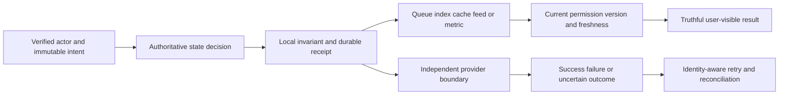

# Architecture and System Design Placement Handbook — Part 21
# Consolidation and Design Mocks

**Estimated time: 2–3 hours for a first revision pass | Requires: A0–A4 and S0–S13 | Continue with spaced practice**

---

## Why this module exists

The track is complete when its teaching material is authored; interview preparation is complete only when you can reconstruct and defend a mechanism without copying its diagram. This chapter turns the five foundations and fourteen systems into reusable decisions, changed-requirement drills, timed mocks and an honest evidence checklist.

**Organizing principle: name the invariant and authority, trace the normal operation, break it at a commit boundary, then defend the recovery and tradeoff.**

There are expanded answer drills for all 60 original bank prompts, 24 self-test questions, fourteen failure cards, six mock scenarios and a manual revision-score helper. The original question-bank checkpoints remain intact. All learning checklists remain unchecked; generated files and passing scripts do not grade your knowledge or predict an interview result.

---

## 1. The answer method to reconstruct under pressure

Use this sequence as a conversation rather than a memorized speech:

1. Identify actors and three core actions; ask the one or two questions that would most change the design.
2. State the invariant, freshness/latency/availability assumptions and explicit exclusions.
3. Estimate traffic, stored state and concurrency with units and uncertain inputs visible.
4. Choose the smallest state/API/component boundary that can uphold the invariant.
5. Trace one write and one read, including authentication, commit, acknowledgement and derived data.
6. Inject a failure between two meaningful steps; explain identity, recovery, authority and remaining uncertainty.
7. Add growth only for an identified bottleneck, then give a viable alternative and its cost.
8. State what the example proves, what is proposed and what still needs measurement.

For a booking problem, the first invariant might be no overselling. For a private knowledge assistant it is no unauthorized context/answer disclosure, plus a truthful accepted-evidence and usage contract. These lead to different deep dives even if both diagrams contain a database, cache and worker.

An unfamiliar problem is still approachable. Translate it into scarce state, temporary ownership, derived views, external effects or scoped disclosure, then select the mechanisms you can justify.

---

## 2. Pattern-to-system revision map

| Reusable decision | Revisit | What to explain without the chapter |
| --- | --- | --- |
| Scope, units and baseline | [A0](/docs/system-design/design-method-estimation) | Assumptions, invariant, workload and evidence |
| State ownership and service boundaries | [A1](/docs/system-design/application-architecture-service-boundaries) | Who changes state and which calls/events cross authority |
| Data, cache and scale | [A2](/docs/system-design/data-caching-scaling) | Access pattern, index, stale data and hot-key cost |
| Replay, concurrency and external uncertainty | [A3](/docs/system-design/reliable-workflows-concurrency) | Receipt/effect atomicity, outbox, lease and compensation |
| Secure operation and measurement | [A4](/docs/system-design/secure-observable-operations) | Scope, readiness/drain, saturation and SLO evidence |
| Unique identity and expiry | [S0](/docs/system-design/url-shortener) | Collision, create replay and disable/expiry authority |
| Shared admission | [S1](/docs/system-design/rate-limiter) | Atomic final-token decision and degraded policy |
| Repeated delivery | [S2](/docs/system-design/notifications-webhooks) | Lost reply, receiver dedupe and bounded retries |
| Bytes versus metadata | [S3](/docs/system-design/file-upload-processing) | Ready publication, quarantine and orphan recovery |
| Scarce inventory | [S4](/docs/system-design/booking-reservations) | Hold, authoritative expiry and late payment |
| Durable append plus live hints | [S5](/docs/system-design/chat-messaging) | Message identity, room order and reconnect |
| Candidate fanout plus current visibility | [S6](/docs/system-design/social-feed-photo-sharing) | Hybrid work, batch frontier and graph/privacy changes |
| Temporary execution authority | [S7](/docs/system-design/job-scheduler-workers) | Claim fencing, effect-before-ack and recurrence |
| Value posting across provider boundary | [S8](/docs/system-design/checkout-payments-credit-ledger) | Unknown charge, unique grant, debit and reversal |
| Replaceable retrieval index | [S9](/docs/system-design/search-autocomplete) | Source/version/ACL before result disclosure |
| Placement versus request load | [S10](/docs/system-design/load-balancer-distributed-cache) | Membership, health, hot key and stale rejoin |
| Current identity and resource policy | [S11](/docs/system-design/multi-tenant-saas) | Role/share, invitation and delayed-result authority |
| Accepted evidence and bounded generation | [S12](/docs/system-design/multi-tenant-rag) | Source/index/request versions, citation and unknown usage |
| Time and metric meaning | [S13](/docs/system-design/analytics-event-pipeline) | Checkpoint, cohort, lateness and restatement |

Many cases reuse one pattern with different business meaning. A job receipt, a payment grant and an analytics effect all need identity, but they do not share the same correction, retention or external-authority contract. Reuse reasoning, not an unexamined helper name.

---

## 3. Draw authority before drawing infrastructure

For each design write a four-column mini-table: state, owner, allowed mutation, evidence of success. Add a second table for derived data and its freshness. This exposes dual-write gaps and authorization shortcuts before they become hidden in arrows.



The drawing is a decision template, not a claim that every system needs every branch. A simple URL service may have no external provider; a payment service cannot pretend the provider branch is inside its local transaction.

Ask where irreversible disclosure/effects occur. A source check after streaming cannot recall earlier tokens. A cancelled worker can still be running. A refund job can exist without a refund. These distinctions make a failure answer defensible.

---

## 4. Capacity drills with explicit assumptions

| Drill | Calculation | Interpretation |
| --- | --- | --- |
| 864,000 actions/day | 864000 / 86400 = 10 requests/s | Assumes one request/action and full-day activity |
| Mean time 0.5 s at 10/s | 10 × 0.5 = 5 busy slots | Mean concurrency before headroom and tail/skew |
| One-hour outage at 10/s | 3600 × 10 = 36000 queued jobs | Continuing arrivals remain during recovery |
| Service 15/s, arrival 10/s | 36000 / (15 − 10) = 7200 s | Two hours to drain under fixed-rate assumptions |
| Two million 768-d float32 vectors | 2000000 × 768 × 4 = 6.144 GB | Raw logical vectors; not full index/RAM footprint |
| 10,000 reads/s, assumed 90% payload hits | 1000 payload misses/s | S10 still has source-head work on every hit |

Try changing one assumption aloud: halve service capacity, add provider throttling, make one key sixty percent of traffic or double average chunk count. If net drainage is zero/negative, there is no finite recovery time under that model.

Do not use active users as simultaneous requests or a p99 as mean service time without justification. Give a sensitivity range where input evidence is weak. A neat number with incorrect units is worse than a transparent uncertain estimate.

---

## 5. Twenty-four confusable pairs

| Pair | Distinction to defend |
| --- | --- |
| Accepted / completed | Durable intent versus finished business outcome |
| Delivery / effect | Repeated transport versus repeated state change |
| Event ID / operation ID | Occurrence/delivery identity versus business intent |
| Original due / next retry due | Immutable request binding versus mutable eligibility |
| Timeout / known failure | Lost knowledge versus authoritative negative outcome |
| Lease / permanent lock | Expiring claim requires stale-worker protection |
| Random token / monotonic fence | Equality ownership and ordered resource fencing have different contracts |
| Cancellation / compensation | Prevent future work versus append a corrective business action |
| Compensation intent / provider completion | Queued recovery is not executed recovery |
| Cache / source | Evictable acceleration versus authoritative state |
| TTL / invalidation | Age limit versus response to changed authority |
| Key distribution / request load | Many equal keys can hide one hot key |
| Membership / health | Configured placement versus observed eligibility |
| Readiness / liveness | Admit new work versus restart decisions |
| Replica / shard | Another copy versus another data partition/authority |
| Global user / tenant membership | Identity versus scoped current role/status |
| Authentication / authorization | Who called versus permitted current action/resource |
| Namespace / permission | Partition selector versus verified access authority |
| Canonical document / index row | Current content/access versus derived candidate |
| Citation pointer / supported answer | Reference structure versus actual support/relevance/truth |
| Character units / provider tokens / money | Fixture measure, provider metering and pricing/ledger are separate |
| Event time / receipt time | Occurrence semantics versus ingestion observation |
| Event count / distinct cohort | Occurrences versus eligible subject population |
| Authoring complete / learner mastery | Material availability versus demonstrated understanding |

Pick five pairs per revision session and give one concrete failure caused by confusing them. Avoid substituting definitions for a state transition and its consequence.

---

## 6. Fourteen changed-requirement and failure cards

| Card | Change or failure | Expected checkpoint |
| --- | --- | --- |
| F01 / S0 | Creator collides; then the client retries | Unique insert decides collision; operation replay retains identity |
| F02 / S1 | Two servers see the last token | Shared atomic arbitration, no independent read-check-write |
| F03 / S2 | Receiver commits; reply disappears | Same delivery retry and receiver receipt/effect boundary |
| F04 / S3 | Object exists after metadata rollback | Exact-version reconciliation and guarded ready publication |
| F05 / S4 | Hold expires before payment callback | Authoritative inventory remains safe; charge recovery separate |
| F06 / S5 | Client resends after reconnect | Stable message operation and durable bounded catchup |
| F07 / S6 | Celebrity fanout grows; user blocks author | Bound/shift candidate work and apply current visibility |
| F08 / S7 | Effect commits; acknowledgement is lost | Reclaim fences old owner and reuses effect receipt |
| F09 / S8 | Charge succeeds but response times out | Unknown outcome, stable provider key and one grant |
| F10 / S9 | Deleted/private title remains indexed | Current source/version/ACL before every disclosure |
| F11 / S10 | Old cache node rejoins after update | Cold/resynchronized rejoin and stale-fill/epoch/incarnation guards |
| F12 / S11 | Member loses access after queuing export | Worker and result delivery recheck current authority |
| F13 / S12 | Old embeddings finish; model requests a tool | Current profile/version fence and independent tool authority |
| F14 / S13 | Duplicate/late activation changes chart | Identity, atomic checkpoint, explicit cohort and late policy |

For each, narrate T0 acceptance, T1 commit, T2 lost observation/change, T3 retry and T4 final reconciliation. Identify the step where two authorities stop sharing a transaction. Then explain what additional test would be needed in a deployed system.

---

## 7. Manual revision helper

```python
"""Manual revision-score helper; it never grades answer quality or learner readiness."""
from pathlib import Path
import json
import re
import sys

BASE = Path(__file__).resolve().parent
QUESTIONS = json.loads((BASE.parent/'roadmap/questions.json').read_text(encoding='utf-8'))
DEMO = {'Q01':2,'Q02':1,'Q19':3,'Q23':0,'Q35':1,'Q37':2,'Q47':2,'Q52':1}
MOCK = [('Clarify scope and invariant',5),('Estimate workload and skew',7),('Define state and APIs',8),
        ('Trace baseline and authority',10),('Inject failure or changed requirement',10),('Defend evidence and tradeoff',5)]


def review(scores):
    valid = {q['id'] for q in QUESTIONS}
    if type(scores) is not dict or set(scores)-valid or any(type(n) is not int or not 0<=n<=3 for n in scores.values()):
        raise ValueError('Use known Q01-Q60 IDs and manually assigned integer scores 0-3.')
    weak = sorted((score,key) for key,score in scores.items() if score<3)
    mapping = {q['id']:q for q in QUESTIONS}
    return {'assessed':len(scores),'unassessed':len(valid-set(scores)),'manual_points':sum(scores.values()),
        'maximum_for_assessed':3*len(scores),'rubric':'0 cannot explain; 1 vocabulary; 2 mechanism; 3 mechanism/tradeoff/failure/evidence',
        'next_cards':[{'id':key,'manual_score':score,'revisit':list(dict.fromkeys(re.findall(r'\b[AS]\d+\b',mapping[key]['mapping'])))} for score,key in weak],
        'automatically_graded':False,'interview_outcome_predicted':False}


if __name__=='__main__':
    if sys.argv[1:]==['--demo']:
        print(json.dumps(review(DEMO),indent=2))
    elif len(sys.argv)==2:
        print(json.dumps(review(json.loads(Path(sys.argv[1]).read_text(encoding='utf-8'))),indent=2))
    else:
        print(json.dumps({q['id']:None for q in QUESTIONS},indent=2))
        print('Fill assessed entries with 0-3 and remove unassessed entries; then pass that JSON path.',file=sys.stderr)
```

From repository root:

```powershell
python examples/system-design/consolidation/revision.py
python examples/system-design/consolidation/revision.py --demo
python examples/system-design/consolidation/revision.py path/to/my-scores.json
```

The first command emits a blank worksheet. Fill scores only for assessed questions and remove unassessed entries before running it. The helper validates IDs/integer ranges and sorts manually scored weak cards. It does not inspect an answer, assign a score or infer readiness from keywords.

---

## 8. Observed score-helper demonstration

```json
{
  "assessed": 8,
  "unassessed": 52,
  "manual_points": 12,
  "maximum_for_assessed": 24,
  "rubric": "0 cannot explain; 1 vocabulary; 2 mechanism; 3 mechanism/tradeoff/failure/evidence",
  "next_cards": [
    {
      "id": "Q23",
      "manual_score": 0,
      "revisit": [
        "A4",
        "S11"
      ]
    },
    {
      "id": "Q02",
      "manual_score": 1,
      "revisit": [
        "A0"
      ]
    },
    {
      "id": "Q35",
      "manual_score": 1,
      "revisit": [
        "S10"
      ]
    },
    {
      "id": "Q52",
      "manual_score": 1,
      "revisit": [
        "S13"
      ]
    },
    {
      "id": "Q01",
      "manual_score": 2,
      "revisit": [
        "A0"
      ]
    },
    {
      "id": "Q37",
      "manual_score": 2,
      "revisit": [
        "S12"
      ]
    },
    {
      "id": "Q47",
      "manual_score": 2,
      "revisit": [
        "S8"
      ]
    }
  ],
  "automatically_graded": false,
  "interview_outcome_predicted": false
}
```

This is synthetic input for the helper: eight manually supplied fixture scores total twelve out of twenty-four possible for those eight questions; fifty-two remain unassessed. It is not your score and must not be presented as twelve out of 180 or as a passed/failed interview. The full bank's theoretical maximum is 60 × 3 = 180 only when every question has been assessed.

Use weak cards to select a targeted revisit. For example, a weak tenant-isolation explanation points to A4/S11 and the private-output paths in S9/S12, rather than restarting the whole handbook.

---

## 9. Architecture concept drills: Q01–Q24

Try a 30–90-second spoken answer before reading the checkpoint and expansion. These editorial timing targets are practice tools, not claims about every employer's format.

### Q01. How do you turn an ambiguous product request into a design scope?

**Original checkpoints:** Actors, three core flows, explicit exclusions, functional/non-functional requirements and a correctness invariant.

Start with actors and three concrete actions, then ask what failure would be unacceptable. Separate required behavior from assumed scale, latency, freshness and availability. State exclusions and one invariant before drawing components. For example, booking may tolerate stale browsing but must serialize the last-seat decision. Explain which answer would change the design; do not invent a global scale requirement just to justify more services.

Revisit: [A0](/docs/system-design/design-method-estimation).

### Q02. How would you estimate average/peak request rate and in-flight work?

**Original checkpoints:** Users and actions -> requests/day -> requests/second; state peak assumptions; distinguish latency, throughput and concurrency.

Convert active users times actions per user into requests per day, divide by the chosen activity window, and state a separate peak assumption. Estimate mean inflight work as arrival rate times mean time using consistent units. A percentile latency is not automatically a mean for that formula. Distinguish registered users, daily users, sessions, simultaneous clients and requests; they cannot substitute for one another.

Revisit: [A0](/docs/system-design/design-method-estimation).

### Q03. How do you estimate storage and bandwidth without false precision?

**Original checkpoints:** Record/payload size, retention, read/write volume, indexes/replication overhead, units and a sensitivity check.

Multiply records per period by retained periods and assumed logical record bytes, then account separately for indexes, replicas, backups and derived artifacts. Estimate bandwidth from request rate and transferred bytes, with reads, writes and cache misses distinguished. Show decimal versus binary units and vary the largest uncertain inputs. The result is planning arithmetic until a real workload measures actual storage and transfer overhead.

Revisit: [A0](/docs/system-design/design-method-estimation).

### Q04. When would you scale up versus scale out?

**Original checkpoints:** Identify the saturated resource, state/correctness constraints, resource ceiling, operational cost and measurement.

Identify the saturated resource using latency, errors, CPU, memory, I/O, pool and queue evidence. Scaling up can preserve a simple transaction authority until its cost or ceiling matters. Scaling out helps separable work but adds coordination, routing and state distribution. Neither fixes an inefficient query, hot key or slow dependency automatically. Preserve the invariant and define the measurement that would justify the next step.

Revisit: [A2](/docs/system-design/data-caching-scaling), [A4](/docs/system-design/secure-observable-operations).

### Q05. Would you start this product as a monolith, modular monolith or microservices?

**Original checkpoints:** Team/deployment boundaries, ownership, change rate, failure isolation and the cost of remote calls.

Begin with the smallest deployment that gives clear module responsibilities and transaction ownership. A modular monolith often fits a small team and uncertain product boundaries. Separate a service when independent scaling, deployment, ownership or isolation supplies a concrete benefit. Explain the new network, consistency, operational and debugging cost. Package boundaries and deployment boundaries are different; a distributed diagram is not proof of better architecture.

Revisit: [A1](/docs/system-design/application-architecture-service-boundaries).

### Q06. How do you decide module/service boundaries and who owns the data?

**Original checkpoints:** Business capability, invariants, ownership, APIs, coupling and cross-boundary transactions.

Group behavior around a state owner and its invariants, then trace who may mutate that state and through which API or transaction. Controllers validate transport, services enforce business policy, and repositories implement scoped persistence. Cross-module reads and events need explicit contracts. Avoid two services independently updating one business entity without an ownership rule, and do not let a convenient shared table silently become every module's public API.

Revisit: [A1](/docs/system-design/application-architecture-service-boundaries).

### Q07. When should a request use a synchronous call, a queue or an event?

**Original checkpoints:** Latency, immediate response needs, decoupling, completion semantics, backlog and recovery.

Use a synchronous call when the caller needs a bounded result now and can accept the dependency. Use durable queued work when accepted execution can finish later, and publish an event when independent consumers react to an occurrence. Specify timeout, acknowledgement, replay and error behavior. Asynchrony shifts latency and failure state rather than removing it; an accepted response needs a truthful completion/status contract.

Revisit: [A1](/docs/system-design/application-architecture-service-boundaries), [A3](/docs/system-design/reliable-workflows-concurrency).

### Q08. How do a reverse proxy, load balancer, API gateway and BFF differ?

**Original checkpoints:** The responsibility and placement of each; overlapping implementations; one request trace without redundant boxes.

A reverse proxy forwards requests; a load balancer selects eligible upstream capacity; an API gateway applies shared edge contracts; a BFF adapts an API/session flow for a particular client. One product can implement several roles. State which hop authenticates identity, what headers it may assert and what the backend revalidates. Naming all four boxes does not justify four deployments or authorize trusting arbitrary incoming identity headers.

Revisit: [A1](/docs/system-design/application-architecture-service-boundaries).

### Q09. What makes an application instance stateless, and when are sticky sessions useful?

**Original checkpoints:** Where sessions/state live, reconnection/failover, shared stores, affinity limits and scale-out implications.

An instance is replaceable when required session, operation and business state survives outside that process or is recoverable under its credential contract. Local caches and temporary work can still exist. Affinity may improve locality, but the selected instance can fail or become hot. Explain recovery after rerouting and distinguish process-local coordination from fleet-wide authority before calling an application stateless.

Revisit: [A1](/docs/system-design/application-architecture-service-boundaries), [A2](/docs/system-design/data-caching-scaling).

### Q10. How do access patterns determine the database and schema?

**Original checkpoints:** Reads/writes, relationships, query shapes, constraints, consistency and a concrete index choice.

List the authoritative writes and required reads, their keys, filters, ordering, cardinality and transaction relationships. Choose indexes and schema around those access patterns, then test plans with representative data. A relational transaction may suit constrained related state; a document model may suit another aggregate boundary. Search, object bytes and analytics projections have separate access needs. Brand familiarity is not an access-pattern argument.

Revisit: [A2](/docs/system-design/data-caching-scaling).

### Q11. How would you diagnose a slow query before changing the architecture?

**Original checkpoints:** Query plan, selectivity, indexes, N+1, returned rows, locks and reproducible before/after measurement.

Reproduce the actual query and bind values, inspect its execution plan and row estimates, and check indexes, sort work, returned rows and lock/pool waits. Separate query execution from network transfer and application serialization. Fix unnecessary work and verify the changed plan/latency before proposing sharding. A tiny local plan proves selected access behavior, not production capacity on a different dataset.

Revisit: [A2](/docs/system-design/data-caching-scaling), [A4](/docs/system-design/secure-observable-operations).

### Q12. How do replication, partitioning and sharding solve different problems?

**Original checkpoints:** Read scale vs data placement/write scale; lag, shard keys, hot partitions, joins and operational trade-offs.

Replication maintains copies for selected read, recovery or availability needs; it introduces lag and a failover contract. Partitioning divides a dataset, while sharding places partitions across independent storage authorities. Choose a key from access, skew and transaction requirements. More shards do not split every hot key or preserve cross-shard invariants automatically. Explain routing, rebalancing and failure ownership separately from adding replicas.

Revisit: [A2](/docs/system-design/data-caching-scaling).

### Q13. Where does this design require strong consistency, and where is eventual consistency acceptable?

**Original checkpoints:** Name the operation/invariant; user-visible stale behavior; read-after-write and partition trade-offs.

Identify the exact decision requiring current authority: last-seat allocation, nonnegative debit or current access may need a transaction or equivalent serialization. Search/feed freshness can be asynchronous under a stated visibility rule. Eventual consistency is not permission to violate an invariant. During a partition, state which operations reject, wait or accept weaker guarantees; CAP does not classify all ordinary latency tradeoffs by itself.

Revisit: [A2](/docs/system-design/data-caching-scaling).

### Q14. Where would you add a cache, and how would you invalidate it?

**Original checkpoints:** Source of truth, key, TTL, update path, stale-read tolerance and failure behavior.

Cache a measured expensive read with an explicit key, freshness window, capacity and miss policy. Keep canonical state independent if eviction/loss is allowed. Define write invalidation and late-refill handling, not only TTL. Tenant/owner/version dimensions can be correctness requirements in the key. S10 deliberately probes canonical versions on every hit, so its cache mechanism does not eliminate all source traffic.

Revisit: [A2](/docs/system-design/data-caching-scaling).

### Q15. How do you handle a hot key, cache stampede or mass expiry?

**Original checkpoints:** Identify the traffic shape; coalescing, jitter, bounded stale reads, spreading load and origin protection.

Measure request and byte skew rather than just distinct-key distribution. Coalesce same-key misses within a defined scope, stagger expiry/warmup and cap fallback load. A local lock does not coordinate a fleet. Read replication or near-caches may help a hot immutable key; mutable hot state can require another authority/data model. Additional virtual nodes alone do not divide one key's traffic.

Revisit: [A2](/docs/system-design/data-caching-scaling), [A4](/docs/system-design/secure-observable-operations).

### Q16. When do you need a work queue versus publish/subscribe?

**Original checkpoints:** One logical job vs multiple interested consumers; acknowledgements, retention, ordering and independent progress.

A work queue distributes an execution obligation among competing workers; publish/subscribe gives independent subscribers their own reaction/progress. Retention and replay can be implemented with a log, but do not define effect correctness by themselves. Clarify fanout, consumer identity, order, retry and acknowledgement. Notification delivery, internal jobs and analytics may share primitives while retaining different business completion rules.

Revisit: [A3](/docs/system-design/reliable-workflows-concurrency).

### Q17. What do at-most-once, at-least-once and exactly-once mean here?

**Original checkpoints:** Define delivery/effect scope; crash/ack timeline; duplication/loss risks; avoid an unscoped exactly-once claim.

Name the delivery/effect boundary and failure model before using these terms. A delivery can repeat while a local unique receipt and transaction prevent a repeated business effect. At-most-once can lose work; at-least-once requires duplicate-safe effects. An exactly-once claim for one cooperative transaction does not extend to an unrelated payment, email or database. State retention and replay assumptions as part of the guarantee.

Revisit: [A3](/docs/system-design/reliable-workflows-concurrency).

### Q18. How should timeouts and retries be chosen?

**Original checkpoints:** End-to-end deadline, retryable errors, bounded attempts, backoff/jitter, retry amplification and operation safety.

Allocate an end-to-end deadline across dependencies, then choose bounded attempts, per-attempt timeout, backoff/jitter and an error classification. Retries require remaining budget and safe identity, especially after an unknown remote outcome. Avoid retry multiplication across layers. Measure dependency behavior and saturation rather than treating every timeout as a known failure or assuming a longer timeout repairs overload.

Revisit: [A3](/docs/system-design/reliable-workflows-concurrency).

### Q19. How would you make a create/payment operation idempotent?

**Original checkpoints:** Client key scope, request equivalence, atomic effect plus dedupe record, saved response, concurrent retries and retention.

Scope a stable operation ID to the authenticated caller/tenant, bind it to immutable original intent and enforce uniqueness at the effect authority. Commit the receipt and local effect together, then return the stored outcome on equivalent replay. Changed intent conflicts. For a remote payment, retain the same provider operation and reconcile uncertainty; a local receipt written separately cannot make the remote boundary atomic.

Revisit: [A3](/docs/system-design/reliable-workflows-concurrency), [S8](/docs/system-design/checkout-payments-credit-ledger).

### Q20. Would you use a database lock, version check, unique constraint or distributed lease?

**Original checkpoints:** State/invariant ownership; contention; transactional boundary; crash/expiry behavior; retries and fencing where needed.

Use a uniqueness constraint for exclusive identity, a conditional update/version for state conflicts, and short transaction locks where a multi-row invariant needs serialization. A lease provides temporary execution ownership and requires stale-writer fencing at the protected resource. These mechanisms solve different races and can be combined. Expiry cannot stop a paused process or make an unrelated downstream write safe.

Revisit: [A3](/docs/system-design/reliable-workflows-concurrency).

### Q21. What problem does the transactional outbox solve?

**Original checkpoints:** Database commit plus event publication dual-write gap; atomic local outbox write; publisher retries and consumer dedupe.

The outbox commits business state and durable publication intent together so a lost immediate publish cannot strand accepted work. The publisher can still repeat after losing acknowledgement, so consumers need their own effect identity. Track retries, retention and ordering under the selected contract. It closes a local dual-write gap; it does not make every consumer or external provider part of the original transaction.

Revisit: [A3](/docs/system-design/reliable-workflows-concurrency).

### Q22. When would you use a saga, and what can compensation fail to undo?

**Original checkpoints:** Sequence of local commits; business compensation, external side effects, recovery ownership and reconciliation.

A saga coordinates a sequence of local transactions when one global transaction is unsuitable. Each step needs durable state, identity, retry/reconciliation and a domain-specific compensating action. Compensation can fail or be unable to undo delivered email, consumed service or irreversible external effects. A recorded refund intent is not a completed refund. Explain operator recovery and the difference between rollback and a later corrective action.

Revisit: [A3](/docs/system-design/reliable-workflows-concurrency).

### Q23. How would you enforce tenant isolation across an entire request path?

**Original checkpoints:** Trusted tenant identity, authorization, query filters, cache/queue keys, files/vector search, logs and negative tests.

Derive tenant context from a verified session/membership decision, then enforce current action/resource policy in SQL, lists, caches, jobs, files, retrieval and result delivery. A frontend namespace, guessed UUID or valid JWT is not resource permission. Test known foreign identifiers, revoked grants and changed roles across every path. External storage/search adapters need scoped authenticated contracts, not just a tenant field copied from the request body.

Revisit: [A4](/docs/system-design/secure-observable-operations), [S11](/docs/system-design/multi-tenant-saas).

### Q24. How do you know whether the design is reliable and fast enough?

**Original checkpoints:** SLOs, p95/p99 and error rate, saturation, traces, realistic load/failure tests, capacity headroom and cost.

Specify workload, correctness properties, latency/error objectives, freshness and recovery targets, then collect appropriate runtime and failure evidence. Separate availability from a successful health endpoint and throughput from registered users. Report hardware, payload, concurrency, duration, warm/cold state and error rate for performance tests. Local controlled examples and planning arithmetic are useful evidence with limited scope, not global SLO proof.

Revisit: [A4](/docs/system-design/secure-observable-operations).


---

## 10. System-building drills: Q25–Q38

Start with a ten-minute sketch, then choose one deep dive. State the actual local implementation boundary when borrowing evidence from the teaching example.

### Q25. Design a URL-shortening service.

**Original checkpoints:** Create/redirect APIs, unique code generation, collision handling, schema, expiry, cache and analytics trade-offs.

Define create/redirect behavior, destination validation, code ownership, expiry and disable. Insert unique random codes with bounded collision retry and retain scoped create intent for client replay. Redirect reads may use cache only within the disable/expiry contract; analytics can be asynchronous and bounded. Estimate read-heavy traffic, avoid fetching arbitrary destinations merely to validate them, and explain public versus private metadata access.

Revisit: [S0](/docs/system-design/url-shortener).

### Q26. Design a rate limiter for an API served by several application instances.

**Original checkpoints:** Limiter algorithm, key/quota scope, atomic updates, shared state, bursts, expiry and degraded behavior.

Choose the quota subject and algorithm from burst/fairness needs, then make shared check-and-update atomic across application instances. Include clock/refill/cost rules, bounded state and a documented degraded policy. Fixed windows, sliding approximations and token buckets have different boundary behavior. A per-process counter cannot enforce one global quota after horizontal scaling, and stale read replicas cannot arbitrate the final token.

Revisit: [S1](/docs/system-design/rate-limiter).

### Q27. Design a notification service that also supports customer webhooks.

**Original checkpoints:** Event storage, subscriptions/preferences, channel workers, retry schedule, signatures, deduplication and delivery status.

Persist notification intent and eligible delivery fanout, then use bounded claims, attempts, deadlines and shared provider cooldowns. Bind signatures to the documented raw payload and subscription authority. A receiver can commit before its reply is lost, so delivery repeats need receiver-side effect dedupe. Preferences, poison payloads and manual replay are business policies. A worker attempt is not evidence that the user or endpoint received the message.

Revisit: [S2](/docs/system-design/notifications-webhooks).

### Q28. Design a secure file-upload and asynchronous processing service.

**Original checkpoints:** Metadata/object separation, direct upload authorization, multipart completion, validation, job state, download permissions and cleanup.

Separate owned metadata from immutable object bytes. Bind upload capabilities to scope/version/expiry, validate completion and quarantine untrusted content before ready publication. Commit durable processing intent with accepted metadata; fence stale workers and make cleanup recoverable. Handle object-without-metadata and metadata-without-object gaps. Local file tests do not prove cloud multipart, antivirus or signed-CDN revocation behavior.

Revisit: [S3](/docs/system-design/file-upload-processing).

### Q29. Design ticket booking or a limited-stock reservation system.

**Original checkpoints:** Browse vs reserve, per-resource inventory state, holds/expiry, transaction/constraint, payment integration and release/refund.

Keep authoritative inventory and active holds under a transaction/constraint that prevents overselling across callers. Define hold expiry from authority time and atomically confirm or release. Browsing may lag; allocation cannot rely solely on a stale cache. Payment is a separate authority, so late success after expiry needs a compensation/reconciliation decision rather than reassigning inventory that another user already acquired.

Revisit: [S4](/docs/system-design/booking-reservations).

### Q30. Design a chat service with online and offline messaging.

**Original checkpoints:** Connection routing, persistent messages, identifiers, ordering scope, acknowledgements, offline fetch, reconnect and permissions.

Commit messages with stable room/client operation identity before durable acknowledgement. Define room ordering, bounded catchup and reconnect cursors; use live delivery only as a hint unless its contract says otherwise. Revalidate current membership on history and delayed delivery. Distinguish accepted message, device delivery and reported read state. The local chapter uses HTTP polling, while WebSocket connection routing remains an architectural extension.

Revisit: [S5](/docs/system-design/chat-messaging).

### Q31. Design a social feed or photo-sharing service.

**Original checkpoints:** Post/media storage, follow graph, feed generation, read/write fan-out, pagination, hot users and freshness.

Separate canonical owned/versioned posts/media from derived viewer candidate pointers. Use bounded push fanout where useful and eligible pull candidates for high-fanout authors. Commit batch pointers and frontier together, handle new-follow backfill, and recheck current follow/block/delete/media state at read time. Define stable pagination under the chosen chronological/ranked order. A stale pointer is not a retained permission grant.

Revisit: [S6](/docs/system-design/social-feed-photo-sharing).

### Q32. Design a background-job scheduler and worker platform.

**Original checkpoints:** Job contract/state, schedules, durable queue, claim/lease, concurrency limits, retry/backoff, poison jobs and monitoring.

Persist stable jobs and recurring occurrence identities, then admit due work with tenant/concurrency limits and temporary claim tokens. Bound renewal, retries and completion deadlines. Commit local effects with unique receipts and reconcile external uncertainty. Specify missed-run/overlap/cancellation policy and recovery backlog. A failed scheduling status can coexist with a committed effect whose acknowledgement was lost.

Revisit: [S7](/docs/system-design/job-scheduler-workers).

### Q33. Design checkout, payments and a usage-credit ledger.

**Original checkpoints:** Order/payment states, integer money, atomic ledger effects, idempotency, external outcomes, reconciliation and auditability.

Snapshot server-derived order price/currency/entitlement, use stable provider operation identity and preserve unknown outcomes. Converge replies, verified callbacks and reconciliation on one grant transaction. Post balanced integer-unit journals with conditional nonnegative spending and appended reversals. Keep event, payment, order and ledger identities distinct. Application CREDIT arithmetic does not establish bank settlement or external refund completion.

Revisit: [S8](/docs/system-design/checkout-payments-credit-ledger).

### Q34. Design search and autocomplete for a product catalog or documents.

**Original checkpoints:** Query semantics, source data, prefix/full-text/semantic indexes, ranking, updates, authorization and latency.

Choose exact, token full-text, prefix, substring or semantic retrieval from the query contract. Keep canonical document/version/access separate from a rebuildable index with durable update/delete intent. Filter current tenant, version and permission before top-k and any title/snippet/count/suggestion disclosure. Evaluate representative judged queries. The S9 engine is actual SQLite FTS5; its token-prefix mode is not arbitrary substring completion.

Revisit: [S9](/docs/system-design/search-autocomplete).

### Q35. Design request routing and a distributed cache across changing nodes.

**Original checkpoints:** Hash placement, virtual nodes, membership/health, remapping, hot keys, replica choice, TTL and failure routing.

Separate backend admission from key placement and source value authority. A stable virtual-node ring chooses distinct physical copies, while health/drain controls eligibility. Bound memory, miss fallback and stale-fill behavior across updates, epochs and node incarnations. Rejoin cold or complete a documented resynchronization. Measure hot-key request skew separately from key counts; the local model does not execute a network proxy or replication protocol.

Revisit: [S10](/docs/system-design/load-balancer-distributed-cache).

### Q36. Design a multi-tenant SaaS with roles, document sharing and expiring invitations.

**Original checkpoints:** Tenant and ownership model, auth/BFF, role checks, invite lifecycle, quotas, storage isolation and tests.

Model global users separately from current tenant memberships, with an explicit role/owner/share action matrix. Bind sessions to verified active context and rotate on checked tenant switch. Make invitation recipient/audience/role/expiry/revocation and one-time effects explicit. Admit quotas atomically and recheck delayed work/delivery. Keep browser/BFF, SQL, files and retrieval trust boundaries distinct and exercise foreign-ID tests.

Revisit: [S11](/docs/system-design/multi-tenant-saas).

### Q37. Design a multi-tenant RAG knowledge-base service.

**Original checkpoints:** Upload/ingestion state, chunk/version metadata, embeddings, retrieval permissions, generation/streaming, evaluation, deletion and cost.

Version canonical text, parsing/chunking and embedding/index profiles. Commit durable ingest intent and fence stale publication. Retrieve only current authorized evidence, bind exact supplied chunks to one generation request, reserve bounded usage and validate citations/tools/current sources before acceptance. Recheck delivery and track deletion across retained projections/context. Feature-hash/extractive fixtures establish orchestration mechanics, not real-model semantic or factual quality.

Revisit: [S12](/docs/system-design/multi-tenant-rag).

### Q38. Design an analytics event-ingestion pipeline and dashboard.

**Original checkpoints:** Event IDs/schema, ingestion/queueing, dedupe, event time, aggregates, late data, dashboard freshness and privacy.

Persist scoped immutable occurrence IDs and explicit event/receipt times. Process bounded ordered source batches with projection effects and progress atomically. Publish a versioned metric definition, cohort denominator, freshness and late-data policy. Rebuild from retained canonical decisions and handle subject erasure/replay. A dashboard's plausible chart is not proof of complete ingestion, a correct cohort or causal product impact.

Revisit: [S13](/docs/system-design/analytics-event-pipeline).


---

## 11. Failure and concurrency drills: Q39–Q52

Do not answer only “retry,” “cache,” “lock” or “use Kafka.” Locate the race, name the state owner and show how the selected mechanism changes a transition.

### Q39. Two URL creators generate the same short code. What happens?

**Original checkpoints:** Uniqueness enforced at storage, collision detection/retry, custom aliases, idempotency and deterministic tests.

Let the authoritative unique constraint decide the collision. Retry generation under a bound for a new random code; do not overwrite an existing owner's mapping. Separately retain the creator's operation identity so equivalent client replay returns its original code. Race independent callers and inspect stored uniqueness. Probabilistic rarity does not eliminate the need for a collision path.

Revisit: [S0](/docs/system-design/url-shortener).

### Q40. Two API servers both admit the final request in a quota. How do you prevent it?

**Original checkpoints:** Atomic shared decision/update, algorithm boundary behavior, consistent keying, time assumptions and failure policy.

Both servers must arbitrate at one shared atomic quota authority. Read-check-write in separate operations permits two winners. Use a conditional update or atomic script/transaction implementing the chosen algorithm and subject key. Test the exact final-token race on independent callers, clock/cost bounds and degraded behavior. A local process lock or asynchronous replica read does not provide the required shared decision.

Revisit: [S1](/docs/system-design/rate-limiter).

### Q41. A webhook receiver accepts an event but the acknowledgement is lost. What happens next?

**Original checkpoints:** Sender retries; receiver deduplicates effects; saved delivery attempts/status; bounded retries and replay.

The sender cannot infer nonacceptance from a lost reply. Retry the same delivery identity within budget and verify that the receiver atomically dedupes the event with its business effect. A signature authenticates the payload but does not prevent repeated effects by itself. Record durable attempts and eventual outcome; the notification chapter exercises actual local connection loss after receiver commit.

Revisit: [S2](/docs/system-design/notifications-webhooks).

### Q42. A user uploads a file, but the completion callback or processing worker crashes. How do you recover?

**Original checkpoints:** Durable state, idempotent completion/job, reconciliation, orphan/partial cleanup and safe retry.

Inspect metadata, exact object/version and durable processing intent rather than trusting one callback. Equivalent completion must converge on one accepted version/job. Fence delayed worker publication after delete/expiry/replacement, and reconcile orphan artifacts created before metadata rollback. Keep quarantine and cleanup state explicit. Actual cloud upload notifications and processing services require additional integration evidence.

Revisit: [S3](/docs/system-design/file-upload-processing).

### Q43. Two users reserve the last seat while one payment arrives after hold expiry. What should happen?

**Original checkpoints:** Atomic reservation, authoritative expiry/version recheck, late-payment handling and explicit refund/reconciliation.

Serialize the final-seat hold at inventory authority, then evaluate current hold expiry when confirming. Only one contender can acquire the scarce unit. If payment succeeds after the hold has expired and inventory moved elsewhere, preserve the charge evidence and initiate the chosen refund/review path without overselling. A compensation record is not provider refund execution; reconciliation must resolve that separate boundary.

Revisit: [S4](/docs/system-design/booking-reservations).

### Q44. A chat client disconnects after sending and resends on reconnect. How do you avoid confusing duplicates?

**Original checkpoints:** Client message ID, persistence/ack boundary, dedupe, reconnect cursor and defined ordering scope.

Use a stable client message operation scoped to sender/room and return the same committed message on replay. A lost sender acknowledgement may follow a durable append. Recover history from a bounded room sequence/cursor rather than treating live hints as the only copy. Revalidate current membership and distinguish send acceptance from receiver delivery/read claims.

Revisit: [S5](/docs/system-design/chat-messaging).

### Q45. A celebrity publishes a post and fan-out overloads the system. What changes?

**Original checkpoints:** Hybrid read/write fan-out, asynchronous/batched work, hot-user handling, feed latency and backpressure.

Estimate fanout amplification and active-reader skew, then consider pull-on-read or hybrid treatment for hot authors. Bound push batches and persist progress with unique pointers. A mode change needs defined semantics for old posts/backfill. Final reads still enforce current graph, block, post and media visibility; avoiding fanout writes does not remove merge cost or privacy obligations.

Revisit: [S6](/docs/system-design/social-feed-photo-sharing).

### Q46. A worker finishes its effect but crashes before acknowledging the job. What happens on retry?

**Original checkpoints:** Redelivery, durable idempotency with the business effect, lease/ack scope and crash-point testing.

After lease expiry, the new worker may reclaim the same logical job. Its effect authority must recognize an existing committed receipt and avoid repeating the effect, then acknowledge. Fence the old token too. The local counter receipt and increment share a transaction; a remote effect requires downstream idempotency/lookup rather than a queue-side receipt alone.

Revisit: [S7](/docs/system-design/job-scheduler-workers).

### Q47. A payment provider succeeds, but your request times out and the client retries. What do you return?

**Original checkpoints:** Stable operation ID, unknown/pending state, provider verification/webhook, atomic ledger effect and reconciliation.

Return or retain an uncertain/pending state unless authoritative evidence establishes success/failure. Reuse the original provider request identity and reconcile the same order/payment. Do not invent a new charge key merely because transport failed. Verified success grants once across callbacks and synchronous replies, while a second distinct payment becomes an explicit unexpected-charge review case.

Revisit: [S8](/docs/system-design/checkout-payments-credit-ledger).

### Q48. A document is deleted or access is revoked while the search index is stale. How do you avoid leaking it?

**Original checkpoints:** Authoritative permission enforcement, deletion/version propagation, result filtering and cache/index lag handling.

Treat stale index rows as candidates and consult current canonical tenant/access/deletion/version state before exposing any result. Suggestions, snippets and counts also disclose content. A retained tombstone/watermark prevents old upsert resurrection. Define temporary false negatives during edit lag and cache/download revocation boundaries; an already delivered page cannot be retrospectively erased by a later permission check.

Revisit: [S9](/docs/system-design/search-autocomplete).

### Q49. A cache/backend node fails, then rejoins. What happens to placement, load and stale values?

**Original checkpoints:** Membership and health state, bounded remapping, ownership/replication, hot spots, invalidation and measured behavior.

Health can remove a node from eligibility without changing configured placement. On rejoin, discard old cache contents or finish a documented resynchronization before serving. Fence old fills by source version, membership epoch and incarnation where appropriate. Bound fallback/warmup and inspect hot-key load. The local model verifies controlled state changes, not failure detection or distributed membership agreement.

Revisit: [S10](/docs/system-design/load-balancer-distributed-cache).

### Q50. A valid user changes the document or tenant ID in a request. How is access rejected?

**Original checkpoints:** Server-derived tenant context, resource-level checks, all data paths including lists/jobs, and negative tests.

Derive active tenant from verified context, query the requested object within that scope and enforce current action/owner/share policy. A valid session, known UUID or UI restriction is insufficient. Apply the same rule to lists, writes, exports and workers. Test known foreign IDs, demotion, removed membership and result delivery after revocation; document whether denial returns 403 or hides existence with 404.

Revisit: [S11](/docs/system-design/multi-tenant-saas).

### Q51. A document is updated while embedding retries run, or one tenant's chunks reach another tenant's query. How do you prevent that?

**Original checkpoints:** Document/version IDs, idempotent indexing, stale-job checks, tenant-scoped keys/filters and retrieval-time authorization.

Bind worker payloads/chunks to immutable source version and index profile, then check current canonical state before publication. Scope retrieval to verified tenant and current permission/version before ranking. Bind citations to the exact supplied request evidence and recheck acceptance/delivery. Old embeddings may remain physically present temporarily but must not authorize a current answer or cross-tenant disclosure.

Revisit: [S12](/docs/system-design/multi-tenant-rag).

### Q52. An event is duplicated or arrives late, after the dashboard aggregate was computed. How do you correct the metric?

**Original checkpoints:** Event identity, bounded dedupe/retention assumptions, event-time windows, correction/recomputation and denominator consistency.

Replay the same occurrence identity without adding another projection effect. For a distinct late event, apply the declared mutable-window or restatement policy; retain exclusions explicitly. Commit count/cohort changes with progress and define the metric's population. Rebuild must preserve or intentionally version historical inclusion decisions, rather than applying today's watermark to all old events and silently changing history.

Revisit: [S13](/docs/system-design/analytics-event-pipeline).


---

## 12. Resume-specific architecture drills: Q53–Q60

Distinguish original project facts, newly built teaching fixtures and proposed improvements. Unknown benchmark or implementation details remain unknown unless their own evidence is available.

### Q53. Explain your consistent-hashing load balancer: why that policy, and what did your benchmark actually establish?

**Original checkpoints:** Ring lookup/virtual nodes, failure detection, placement vs load balance, remapping denominator, workload and reproducible metrics.

Explain stable ring lookup, virtual points, distinct physical copies and measured primary/copy-set movement over the same key sample. Separate placement from live request balancing and hot-key traffic. Report hardware/workload/concurrency/duration/errors for any actual performance result. The new local sample is independent teaching evidence, not proof of an original resume benchmark; unresolved original claims remain unresolved.

Revisit: [S10](/docs/system-design/load-balancer-distributed-cache).

### Q54. Trace authentication from Next.js through the BFF to FastAPI in your AI research platform.

**Original checkpoints:** Trust boundaries, credentials, server-side verification, session/JWE handling where documented, authorization and token exposure.

Trace browser credential, BFF validation, authenticated backend hop and backend resource authorization separately. Verify the actual documented session/JWE implementation before naming it as project fact. Encryption or a signed token does not establish current tenant membership by itself. Reject spoofable identity headers, keep secrets out of the client, and explain browser cookie/CSRF controls without claiming the local bearer fixture implemented them.

Revisit: [S11](/docs/system-design/multi-tenant-saas).

### Q55. How would you design signed, expiring and revocable candidate invitations with scoped rate limits?

**Original checkpoints:** Token creation/verification, expiry/revocation source of truth, audience/scope, replay/abuse handling and ownership checks.

Choose a signed capability or high-entropy opaque token with verified recipient/audience/tenant/scope/expiry. Keep mutable revocation and one-time acceptance effects at a durable authority. Limit issuance/acceptance abuse by appropriate scoped budgets and permissions. A consumed invite must not restore later-removed membership. The executed S11 alternative is opaque server state; signed-token and email-delivery behavior are architectural extensions.

Revisit: [S1](/docs/system-design/rate-limiter), [S11](/docs/system-design/multi-tenant-saas).

### Q56. How would you make external spreadsheet ingestion recover from partial batches, timezone ambiguity and nested-record loss?

**Original checkpoints:** Input contracts, UTC semantics, stable matching/upserts, transaction/batch policy, validation, checkpoints and reconciliation.

Specify complete input schemas, stable external row/occurrence matching, explicit timezone conversion and supported nested structures. Commit bounded updates with progress, retry equivalent batches and reconcile partial source snapshots. Reject unsupported records instead of silently flattening away fields. Separate connector, canonical event and analytical projection checkpoints. The local event API demonstrates transaction/time principles without executing an external spreadsheet connector.

Revisit: [S7](/docs/system-design/job-scheduler-workers), [S13](/docs/system-design/analytics-event-pipeline).

### Q57. How would you build an SLA engine with working-day deadlines and tiered escalation?

**Original checkpoints:** Calendar/timezone model, task state machine, scheduled scan vs events, idempotent alerts, audit log and restart behavior.

Define business calendar, holidays, timezone/DST, task transitions and escalation tiers before scheduling scans. Give each logical alert a stable task/tier/threshold identity, persist state/outbox and retry delivery safely. Recompute deadlines under an explicit calendar/version policy and audit changes. A cron schedule alone neither calculates working-day deadlines nor proves an escalation message reached its recipient.

Revisit: [S2](/docs/system-design/notifications-webhooks), [S7](/docs/system-design/job-scheduler-workers).

### Q58. How would you meter several AI providers and debit credits without charging twice?

**Original checkpoints:** Provider usage normalization, pricing versions, integer/decimal accounting, reservations/settlement, idempotent ledger and failed-call policy.

Normalize provider usage by model/version, units and pricing version, then use exact arithmetic and a durable reservation/settlement ledger. Define failed/unknown call policy and retain stable request/provider identity across retries. Settle once when trusted usage arrives and reconcile unresolved reservations. S12 uses character-budget fixtures, while S8 demonstrates CREDIT journals; neither is evidence of live multi-provider prices or cash reconciliation.

Revisit: [S8](/docs/system-design/checkout-payments-credit-ledger).

### Q59. How would you isolate each tenant's uploaded research, vector retrieval and graph reads?

**Original checkpoints:** Tenant identity across storage/jobs/retrieval/graphs, access model, index strategy, revocation and cross-tenant tests.

Propagate verified tenant/resource identity through uploads, storage metadata, ingest jobs, vector queries and graph predicates. Recheck current permissions/version before output and direct citation/download access. Namespaces and embeddings are derived data, not membership authority. Include cross-tenant, revoked-share, updated/deleted-source and delayed-result tests for every actual adapter; local SQL fixtures do not establish isolation in untested external services.

Revisit: [S11](/docs/system-design/multi-tenant-saas), [S12](/docs/system-design/multi-tenant-rag).

### Q60. How would you defend the traffic, performance and availability claims for the fest website?

**Original checkpoints:** Define users vs sessions vs concurrent requests, measurement window, workload, p95/error rate, monitoring and source evidence.

Define the claimed population and observation window: users, sessions, requests and concurrent work are different. Preserve original logs/monitoring and state missing evidence rather than borrowing a new synthetic benchmark. A defensible load result includes hardware, payload, traffic shape, warmup, errors and percentile latency. Availability also requires a denominator and failure window; a successful deployment or page load does not establish it.

Revisit: [A0](/docs/system-design/design-method-estimation), [A4](/docs/system-design/secure-observable-operations).


---

## 13. Six 45-minute mocks

Use the same time budget for each scenario:

| Segment | Minutes |
| --- | --- |
| Clarify scope and invariant | 5 |
| Estimate workload and skew | 7 |
| Define state and APIs | 8 |
| Trace baseline and authority | 10 |
| Inject failure or changed requirement | 10 |
| Defend evidence and tradeoff | 5 |
| **Total** | **45** |

**Mock M1 — Booking and payment.** Start with group seat holds and server-owned expiry. At minute 25, two callers want the last seat and a callback arrives after expiry. Defend the inventory authority, original operation replay, late-charge recovery and what evidence proves only local behavior. Strong anchors: S4/S8/A3.

**Mock M2 — Durable messaging and notifications.** Start with room history and reconnect. Then a receiver commits a webhook effect but loses the reply while membership changes. Separate message identity, delivery identity, current access and acknowledgements. Decide which live hints may be dropped. Strong anchors: S2/S5/S11.

**Mock M3 — Worker platform and tenant burst.** Start with delayed/recurring jobs. Then a worker disappears after its effect, one tenant fills the backlog and missed occurrences accumulate. Define coalescing/overlap, lease fencing, admission and recovery drainage. Strong anchors: S7/S1/A4.

**Mock M4 — Cache placement and operations.** Start with three cache nodes and multiple application instances. Then one node fails/rejoins, a stale fill finishes and a key becomes hot. Separate membership/health/admission, current values and measured movement/load. Strong anchors: S10/A2/A4.

**Mock M5 — Private RAG workspace.** Start with owned/shared uploads and citations. Then source changes during embedding, a share is revoked during generation and usage is unknown after timeout. Define accepted evidence, caller scope, reservations and deletion/stream boundaries. Strong anchors: S3/S9/S11/S12/S8.

**Mock M6 — Analytics ingestion and dashboard.** Start with event IDs and a signup/activation chart. Then events duplicate, arrive late and a subject is removed while a rebuild runs. State cohort/time policy, atomic progress, freshness and restatement/deletion boundaries. Strong anchors: S13/S7/A3.

Have a peer choose the failure without warning. If alone, hide the second half of each prompt until the failure segment. Record the first broken assumption and one concrete correction after the mock. Six completed drawings without self-review are not six demonstrated mechanisms.

---

## 14. Twenty-four final self-tests

### T01. Accepted versus done

A 202 response exists, but no worker has run. What may the UI claim? **Checkpoint:** durable acceptance only, explicit pending status/freshness, no invented completion.

### T02. Mean concurrency

Ten arrivals/second take 0.5 seconds on average. What is five? **Checkpoint:** estimated mean busy work, not users, worker sufficiency or p99 capacity.

### T03. Cache dependency

A cache hit still probes canonical version. What load remains? **Checkpoint:** source availability and every-read metadata work; hit ratio alone does not describe all DB traffic.

### T04. Ambiguous timeout

The provider may have committed. Can you mark declined? **Checkpoint:** unknown state, stable operation, verified lookup/reconciliation and no new charge identity.

### T05. Delayed old worker

Its lease expired but the process resumes. What blocks its write? **Checkpoint:** validation at the protected resource, not expiry alone.

### T06. Atomic local receipt

A receipt is written before a separate remote email. Is the gap solved? **Checkpoint:** no; downstream identity/reconciliation or an appropriate protocol is needed.

### T07. Retry after scheduling changes

Next due moved. Which input is compared on create replay? **Checkpoint:** immutable original due/deadline/intent rather than mutable retry state.

### T08. Repeated event versus repeated user

Two different signup IDs refer to one subject. What counts once? **Checkpoint:** distinct cohort subject, while event IDs remain different occurrences.

### T09. Empty denominator

There are no eligible signups. Is activation zero percent? **Checkpoint:** undefined/null denominator, with definition and data range visible.

### T10. False finality

A watermark passed the boundary. Can old data never appear? **Checkpoint:** it is a progress/policy assumption; choose exclusions, corrections or restatement.

### T11. Backlog recovery

Service equals continuing arrivals. When does the backlog clear? **Checkpoint:** no finite drain under that fixed-rate model.

### T12. Old rejoin bytes

A named cache server returns with old entries. Is the name sufficient? **Checkpoint:** cold or verified resynchronization and generation/topology/value guards.

### T13. Equal key counts

One key receives sixty percent of requests. Is the ring balanced? **Checkpoint:** placement counts and actual request/byte/service load are different.

### T14. Grant after top-k

The first ten candidates are forbidden. What did postfiltering miss? **Checkpoint:** lower-ranked permitted candidates; filter before limit or bound a truthful overfetch contract.

### T15. Known foreign ID

A user supplies a real document UUID from another tenant. What authorizes access? **Checkpoint:** verified active context plus scoped resource/action checks; UUID secrecy does not.

### T16. Removed member

Their old signed/encrypted credential still parses. Is access valid? **Checkpoint:** current membership/revocation and resource policy must still allow it.

### T17. Invitation replay

A previously accepted member was removed. May the token restore access? **Checkpoint:** not under the executed policy; explicit administrator action is required.

### T18. Citation with real ID

The cited chunk exists but was not supplied to this request. Accept it? **Checkpoint:** no; request evidence membership and exact support/current permission matter.

### T19. Exact quotation

The source quote is valid. Is the world claim true? **Checkpoint:** source provenance/quote support do not establish truth, relevance or general entailment.

### T20. Unknown generation cost

A model timeout occurs. Do you refund/retry automatically? **Checkpoint:** retain defined uncertainty and reservation until trusted reconciliation; customer policy is explicit.

### T21. Streamed rejection

Validation fails after text reached the browser. Can rejection retract it? **Checkpoint:** no; buffered/provisional-output and disclosure contracts differ.

### T22. Privacy purge

Vectors were removed. Is deletion complete everywhere? **Checkpoint:** source, request context, answers, files, caches, providers and backups have separate lifecycles.

### T23. Recorded versus fresh proof

An earlier JSON says all checks passed. Did today's catalogue rerun its engine? **Checkpoint:** no; dates/scopes distinguish historical receipts from a fresh runtime execution.

### T24. Resume benchmark

A new local synthetic test is fast. Can it substantiate an old production claim? **Checkpoint:** no; preserve original evidence or clearly identify the new experiment and missing provenance.

---

## 15. Two-minute project explanation and evidence ledger

Use problem → constraints → your responsibility → one write/read path → one hard decision → observed result → limitation. For a team project, identify what you personally built and which behavior depends on someone else's system. Do not imply a proposed improvement was shipped.

Maintain a small evidence ledger with claim, original artifact, measurement definition/window, known limits and unresolved question. For traffic, distinguish people, sessions, requests and concurrency. For an external refund or alert, distinguish intent from verified provider outcome. For RAG, distinguish real-model quality from deterministic orchestration checks.

The resume drills retain unresolved original-project details. This completion pass does not invent original logs, upgrade project guarantees or turn the new examples into historical production evidence. [Resume M28](/docs/resume-skills/resume-project-experience-deep-dives) and [M29](/docs/resume-skills/consolidation-interview-drills) provide the existing project/revision bridge.

---

## 16. Complete teaching and evidence catalogue

| Chapter | Teaching route | Recorded local assertions | Original verification date |
| --- | --- | --- | --- |
| A0 | [How to approach a design question](/docs/system-design/design-method-estimation) | 62 | 2026-10-16 |
| A1 | [Application architecture and service boundaries](/docs/system-design/application-architecture-service-boundaries) | 67 | 2026-10-16 |
| A2 | [Data, caching and scaling](/docs/system-design/data-caching-scaling) | 91 | 2026-10-16 |
| A3 | [Reliable workflows and concurrency](/docs/system-design/reliable-workflows-concurrency) | 90 | 2026-10-16 |
| A4 | [Operating a secure and observable system](/docs/system-design/secure-observable-operations) | 93 | 2026-10-16 |
| S0 | [URL shortener](/docs/system-design/url-shortener) | 118 | 2026-10-16 |
| S1 | [Rate limiter](/docs/system-design/rate-limiter) | 95 | 2026-10-17 |
| S2 | [Notification and webhook delivery service](/docs/system-design/notifications-webhooks) | 109 | 2026-10-17 |
| S3 | [File upload, storage and processing service](/docs/system-design/file-upload-processing) | 121 | 2026-10-17 |
| S4 | [Ticket booking and limited-inventory reservation](/docs/system-design/booking-reservations) | 57 | 2026-10-17 |
| S5 | [Chat and real-time messaging](/docs/system-design/chat-messaging) | 59 | 2026-10-17 |
| S6 | [Social feed and photo sharing](/docs/system-design/social-feed-photo-sharing) | 67 | 2026-10-17 |
| S7 | [Background job scheduler and worker platform](/docs/system-design/job-scheduler-workers) | 65 | 2026-10-17 |
| S8 | [Checkout, payments and credit ledger](/docs/system-design/checkout-payments-credit-ledger) | 62 | 2026-10-17 |
| S9 | [Search and autocomplete](/docs/system-design/search-autocomplete) | 77 | 2026-10-17 |
| S10 | [Load balancer and distributed cache](/docs/system-design/load-balancer-distributed-cache) | 69 | 2026-10-17 |
| S11 | [Multi-tenant SaaS with authentication and permissions](/docs/system-design/multi-tenant-saas) | 95 | 2026-10-17 |
| S12 | [Multi-tenant RAG knowledge-base platform](/docs/system-design/multi-tenant-rag) | 125 | 2026-10-17 |
| S13 | [Analytics event pipeline and dashboard](/docs/system-design/analytics-event-pipeline) | 78 | 2026-10-18 |

The catalogue contains **19 teaching chapters**: five foundations and fourteen worked systems. The master roadmap and this consolidation make **21 authored files**. Those teaching chapters contain **570 Q&As**, **190 practice tasks** and **19 standard 45-minute mocks**, in addition to this chapter's 60 bank drills, six mock scenarios and final self-test.

The table totals **1,600 recorded local assertions** across the teaching artifacts, preserving each original verification date/runtime/scope. It is an inventory of existing receipts, not a claim that every historical runtime/engine was freshly executed today. The final document audit validates catalogue/source/output/link integrity and the current site build separately.

Runtime claims remain chapter-specific: real SQLite/FTS5/HTTP or documented Node/TypeScript behavior where actually exercised; fake/local providers, explicit clocks and in-process distributed-system models where stated. No new production load/SLO or original resume benchmark evidence is created by this catalogue.

---

## 17. Revision routes after the first reading

**Seven-day active route:** 120 minutes/day, 840 minutes total. Days are revision after reading prerequisites, not a promise to learn the entire track from zero in one week.

| Day | Focus | Minutes |
| --- | --- | --- |
| 1 | A0–A2, scope/data/cache estimates and Q01–Q15 | 120 |
| 2 | A3–A4, S0–S2 and identity/retry/security drills | 120 |
| 3 | S3–S4, file/hold/payment races and Mock M1 | 120 |
| 4 | S5–S7, reconnect/fanout/lease failures and Mock M3 | 120 |
| 5 | S8–S10, value/search/cache boundaries and Mock M4 | 120 |
| 6 | S11–S12, tenant/evidence/usage failures and Mock M5 | 120 |
| 7 | S13, weakest cards, self-test and one unseen mock | 120 |

**Three-day route:** 150 minutes/day, 450 total. Day 1 revisits foundations plus S0–S4 and one mock; day 2 covers S5–S10 and failure cards; day 3 covers S11–S13, resume provenance and weakest questions. Limit breadth when a core invariant is still weak; adjust the schedule instead of declaring mastery by completion of a timer.

**Two-hour final review:** twenty minutes on scope/units and confusable pairs, thirty on weak failure cards, forty-five on one timed mock, fifteen on self-test, ten on the evidence ledger. Total: 120 minutes. Do not use this as a substitute for the first build/read pass.

Alternate retrieval practice: explain from memory, check one paragraph, close it and reconstruct the mechanism. When rereading becomes effortless but narration fails, switch to a changed requirement or a concrete race timeline.

---

## 18. Mistakes to catch in your own narration

Watch for replacing a state owner with a product name, adding caches before defining freshness, assuming every retry is safe, or saying “exactly once” without a boundary. Another warning is presenting HTTP 200, a queue acknowledgement, an outbox row or a compensation request as proof of the final user/provider effect.

Avoid universal architectural answers. A monolith can be the correct baseline. A separate service can be justified by isolation or ownership. Strong consistency can be required for allocation while derived views lag. The answer is the requirement and mechanism connecting them, not a slogan.

Be precise about experiments. Fixed-clock fault tests, a connection-loss fixture, a real engine query plan, a process reopen and a killed process are different evidence. Source fidelity and passing JSON receipts do not establish workload capacity, security certification or learner mastery.

---

## 19. Rubric and error log

Score manually using the original bank scale: zero cannot explain, one vocabulary only, two coherent mechanism, three mechanism plus tradeoff/failure/evidence. Apply it per question and keep unassessed questions separate. The helper's denominator includes only assessed cards.

For each mock record prompt/assumptions, invariant, first weak transition, missing evidence, corrected mechanism and next revisit. A practical error entry is “used lease expiry as proof the old worker stopped; next run must show a resource-side token check,” not merely “study distributed systems.”

Do not set a universal pass score or predict hiring outcomes from this bank. A high total can hide a critical weakness in authorization, money/inventory invariants or unknown external outcomes. Reassess weak mechanisms through a new example, not just memorized wording.

---

## 20. Practice tasks

1. Reconstruct the eight-step answer method for one unfamiliar system without opening its worked chapter.
2. Draw the authority table and two failure boundaries for booking, notifications and private RAG.
3. Recalculate the six capacity drills under changed assumptions and label every unit and uncertainty.
4. Explain five confusable pairs aloud, each with a concrete failure caused by mixing them up.
5. Work all fourteen failure cards as T0–T4 timelines and identify a test at the actual state authority.
6. Answer the 60 bank questions before reading their expansions; keep manual scores and unassessed items distinct.
7. Complete two contrasting 45-minute mocks and have the changed requirement selected without advance reading.
8. Run the manual-score demo, then create your own partial worksheet and choose targeted chapter revisits.
9. Audit one original resume claim against its evidence ledger without borrowing the new fixtures' measurements.
10. Complete the 24 self-tests, review the catalogue scopes and schedule a new mock for each unresolved mechanism.

---

## 21. Learning completion checklist

- [ ] I can scope an unfamiliar prompt before drawing components.
- [ ] I can estimate traffic/state/recovery with explicit units.
- [ ] I can name the authority behind each correctness invariant.
- [ ] I can separate canonical state from derived candidates and freshness.
- [ ] I can trace duplicate, timeout and effect-before-ack recovery.
- [ ] I can distinguish leases, cancellation and compensation.
- [ ] I can defend tenant/resource checks across synchronous and delayed paths.
- [ ] I can explain current evidence/citation and usage uncertainty boundaries.
- [ ] I can define event-time/cohort/late-data semantics.
- [ ] I can complete changed-requirement mocks without memorized diagrams.
- [ ] I can defend resume claims with original evidence and visible limitations.
- [ ] I can separate authored material, recorded/fresh checks and my own mastery.

---

## 22. Authored completion and continuation

The **Architecture and System Design track is fully authored**: master roadmap, A0–A4, S0–S13 and this final consolidation, **21 files**. All planned teaching routes are published; learner self-assessment remains manual. The 60 original prompts/checkpoints are preserved and expanded here rather than replaced.

The separate product/analytics track P0–P5 remains later work in the resume plan. Optional extra systems such as video streaming, crawling and collaborative editing are enrichment, not unfinished requirements of these 21 files. No additional architecture chapter is required to complete this planned track.

Return to the [master roadmap](/docs/system-design), [S13 analytics](/docs/system-design/analytics-event-pipeline) or [Resume Skills revision](/docs/resume-skills/consolidation-interview-drills). Use each teaching chapter's linked primary references for its technical contract; this chapter synthesizes the authored material and does not introduce new provider guarantees or interview-frequency evidence.
