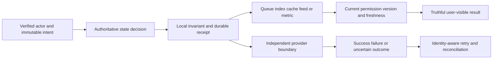

# Architecture and System Design Placement Handbook — Part 21
# Consolidation and Design Mocks

**Estimated time: 2–3 hours for a first revision pass | Requires: A0–A4 and S0–S13 | Continue with spaced practice**

---

## Why this module exists

The track is complete when its teaching material is authored; interview preparation is complete only when you can reconstruct and defend a mechanism without copying its diagram. This chapter turns the five foundations and fourteen systems into reusable decisions, changed-requirement drills, timed mocks and an honest evidence checklist.

**Organizing principle: name the invariant and authority, trace the normal operation, break it at a commit boundary, then defend the recovery and tradeoff.**

There are expanded answer drills for all 60 original bank prompts, 24 self-test questions, fourteen failure cards, six mock scenarios and a manual revision-score helper. The original question-bank checkpoints remain intact. All learning checklists remain unchecked; generated files and passing scripts do not grade your knowledge or predict an interview result.

---

## 1. The answer method to reconstruct under pressure

Use this sequence as a conversation rather than a memorized speech:

1. Identify actors and three core actions; ask the one or two questions that would most change the design.
2. State the invariant, freshness/latency/availability assumptions and explicit exclusions.
3. Estimate traffic, stored state and concurrency with units and uncertain inputs visible.
4. Choose the smallest state/API/component boundary that can uphold the invariant.
5. Trace one write and one read, including authentication, commit, acknowledgement and derived data.
6. Inject a failure between two meaningful steps; explain identity, recovery, authority and remaining uncertainty.
7. Add growth only for an identified bottleneck, then give a viable alternative and its cost.
8. State what the example proves, what is proposed and what still needs measurement.

For a booking problem, the first invariant might be no overselling. For a private knowledge assistant it is no unauthorized context/answer disclosure, plus a truthful accepted-evidence and usage contract. These lead to different deep dives even if both diagrams contain a database, cache and worker.

An unfamiliar problem is still approachable. Translate it into scarce state, temporary ownership, derived views, external effects or scoped disclosure, then select the mechanisms you can justify.

---

## 2. Pattern-to-system revision map

| Reusable decision | Revisit | What to explain without the chapter |
| --- | --- | --- |
| Scope, units and baseline | [A0](/docs/system-design/design-method-estimation) | Assumptions, invariant, workload and evidence |
| State ownership and service boundaries | [A1](/docs/system-design/application-architecture-service-boundaries) | Who changes state and which calls/events cross authority |
| Data, cache and scale | [A2](/docs/system-design/data-caching-scaling) | Access pattern, index, stale data and hot-key cost |
| Replay, concurrency and external uncertainty | [A3](/docs/system-design/reliable-workflows-concurrency) | Receipt/effect atomicity, outbox, lease and compensation |
| Secure operation and measurement | [A4](/docs/system-design/secure-observable-operations) | Scope, readiness/drain, saturation and SLO evidence |
| Unique identity and expiry | [S0](/docs/system-design/url-shortener) | Collision, create replay and disable/expiry authority |
| Shared admission | [S1](/docs/system-design/rate-limiter) | Atomic final-token decision and degraded policy |
| Repeated delivery | [S2](/docs/system-design/notifications-webhooks) | Lost reply, receiver dedupe and bounded retries |
| Bytes versus metadata | [S3](/docs/system-design/file-upload-processing) | Ready publication, quarantine and orphan recovery |
| Scarce inventory | [S4](/docs/system-design/booking-reservations) | Hold, authoritative expiry and late payment |
| Durable append plus live hints | [S5](/docs/system-design/chat-messaging) | Message identity, room order and reconnect |
| Candidate fanout plus current visibility | [S6](/docs/system-design/social-feed-photo-sharing) | Hybrid work, batch frontier and graph/privacy changes |
| Temporary execution authority | [S7](/docs/system-design/job-scheduler-workers) | Claim fencing, effect-before-ack and recurrence |
| Value posting across provider boundary | [S8](/docs/system-design/checkout-payments-credit-ledger) | Unknown charge, unique grant, debit and reversal |
| Replaceable retrieval index | [S9](/docs/system-design/search-autocomplete) | Source/version/ACL before result disclosure |
| Placement versus request load | [S10](/docs/system-design/load-balancer-distributed-cache) | Membership, health, hot key and stale rejoin |
| Current identity and resource policy | [S11](/docs/system-design/multi-tenant-saas) | Role/share, invitation and delayed-result authority |
| Accepted evidence and bounded generation | [S12](/docs/system-design/multi-tenant-rag) | Source/index/request versions, citation and unknown usage |
| Time and metric meaning | [S13](/docs/system-design/analytics-event-pipeline) | Checkpoint, cohort, lateness and restatement |

Many cases reuse one pattern with different business meaning. A job receipt, a payment grant and an analytics effect all need identity, but they do not share the same correction, retention or external-authority contract. Reuse reasoning, not an unexamined helper name.

---

## 3. Draw authority before drawing infrastructure

For each design write a four-column mini-table: state, owner, allowed mutation, evidence of success. Add a second table for derived data and its freshness. This exposes dual-write gaps and authorization shortcuts before they become hidden in arrows.



The drawing is a decision template, not a claim that every system needs every branch. A simple URL service may have no external provider; a payment service cannot pretend the provider branch is inside its local transaction.

Ask where irreversible disclosure/effects occur. A source check after streaming cannot recall earlier tokens. A cancelled worker can still be running. A refund job can exist without a refund. These distinctions make a failure answer defensible.

---

## 4. Capacity drills with explicit assumptions

| Drill | Calculation | Interpretation |
| --- | --- | --- |
| 864,000 actions/day | 864000 / 86400 = 10 requests/s | Assumes one request/action and full-day activity |
| Mean time 0.5 s at 10/s | 10 × 0.5 = 5 busy slots | Mean concurrency before headroom and tail/skew |
| One-hour outage at 10/s | 3600 × 10 = 36000 queued jobs | Continuing arrivals remain during recovery |
| Service 15/s, arrival 10/s | 36000 / (15 − 10) = 7200 s | Two hours to drain under fixed-rate assumptions |
| Two million 768-d float32 vectors | 2000000 × 768 × 4 = 6.144 GB | Raw logical vectors; not full index/RAM footprint |
| 10,000 reads/s, assumed 90% payload hits | 1000 payload misses/s | S10 still has source-head work on every hit |

Try changing one assumption aloud: halve service capacity, add provider throttling, make one key sixty percent of traffic or double average chunk count. If net drainage is zero/negative, there is no finite recovery time under that model.

Do not use active users as simultaneous requests or a p99 as mean service time without justification. Give a sensitivity range where input evidence is weak. A neat number with incorrect units is worse than a transparent uncertain estimate.

---

## 5. Twenty-four confusable pairs

| Pair | Distinction to defend |
| --- | --- |
| Accepted / completed | Durable intent versus finished business outcome |
| Delivery / effect | Repeated transport versus repeated state change |
| Event ID / operation ID | Occurrence/delivery identity versus business intent |
| Original due / next retry due | Immutable request binding versus mutable eligibility |
| Timeout / known failure | Lost knowledge versus authoritative negative outcome |
| Lease / permanent lock | Expiring claim requires stale-worker protection |
| Random token / monotonic fence | Equality ownership and ordered resource fencing have different contracts |
| Cancellation / compensation | Prevent future work versus append a corrective business action |
| Compensation intent / provider completion | Queued recovery is not executed recovery |
| Cache / source | Evictable acceleration versus authoritative state |
| TTL / invalidation | Age limit versus response to changed authority |
| Key distribution / request load | Many equal keys can hide one hot key |
| Membership / health | Configured placement versus observed eligibility |
| Readiness / liveness | Admit new work versus restart decisions |
| Replica / shard | Another copy versus another data partition/authority |
| Global user / tenant membership | Identity versus scoped current role/status |
| Authentication / authorization | Who called versus permitted current action/resource |
| Namespace / permission | Partition selector versus verified access authority |
| Canonical document / index row | Current content/access versus derived candidate |
| Citation pointer / supported answer | Reference structure versus actual support/relevance/truth |
| Character units / provider tokens / money | Fixture measure, provider metering and pricing/ledger are separate |
| Event time / receipt time | Occurrence semantics versus ingestion observation |
| Event count / distinct cohort | Occurrences versus eligible subject population |
| Authoring complete / learner mastery | Material availability versus demonstrated understanding |

Pick five pairs per revision session and give one concrete failure caused by confusing them. Avoid substituting definitions for a state transition and its consequence.

---

## 6. Fourteen changed-requirement and failure cards

| Card | Change or failure | Expected checkpoint |
| --- | --- | --- |
| F01 / S0 | Creator collides; then the client retries | Unique insert decides collision; operation replay retains identity |
| F02 / S1 | Two servers see the last token | Shared atomic arbitration, no independent read-check-write |
| F03 / S2 | Receiver commits; reply disappears | Same delivery retry and receiver receipt/effect boundary |
| F04 / S3 | Object exists after metadata rollback | Exact-version reconciliation and guarded ready publication |
| F05 / S4 | Hold expires before payment callback | Authoritative inventory remains safe; charge recovery separate |
| F06 / S5 | Client resends after reconnect | Stable message operation and durable bounded catchup |
| F07 / S6 | Celebrity fanout grows; user blocks author | Bound/shift candidate work and apply current visibility |
| F08 / S7 | Effect commits; acknowledgement is lost | Reclaim fences old owner and reuses effect receipt |
| F09 / S8 | Charge succeeds but response times out | Unknown outcome, stable provider key and one grant |
| F10 / S9 | Deleted/private title remains indexed | Current source/version/ACL before every disclosure |
| F11 / S10 | Old cache node rejoins after update | Cold/resynchronized rejoin and stale-fill/epoch/incarnation guards |
| F12 / S11 | Member loses access after queuing export | Worker and result delivery recheck current authority |
| F13 / S12 | Old embeddings finish; model requests a tool | Current profile/version fence and independent tool authority |
| F14 / S13 | Duplicate/late activation changes chart | Identity, atomic checkpoint, explicit cohort and late policy |

For each, narrate T0 acceptance, T1 commit, T2 lost observation/change, T3 retry and T4 final reconciliation. Identify the step where two authorities stop sharing a transaction. Then explain what additional test would be needed in a deployed system.

---

## 7. Manual revision helper

{{REVISION_CODE}}

From repository root:

```powershell
python examples/system-design/consolidation/revision.py
python examples/system-design/consolidation/revision.py --demo
python examples/system-design/consolidation/revision.py path/to/my-scores.json
```

The first command emits a blank worksheet. Fill scores only for assessed questions and remove unassessed entries before running it. The helper validates IDs/integer ranges and sorts manually scored weak cards. It does not inspect an answer, assign a score or infer readiness from keywords.

---

## 8. Observed score-helper demonstration

{{SCORE_OUTPUT}}

This is synthetic input for the helper: eight manually supplied fixture scores total twelve out of twenty-four possible for those eight questions; fifty-two remain unassessed. It is not your score and must not be presented as twelve out of 180 or as a passed/failed interview. The full bank's theoretical maximum is 60 × 3 = 180 only when every question has been assessed.

Use weak cards to select a targeted revisit. For example, a weak tenant-isolation explanation points to A4/S11 and the private-output paths in S9/S12, rather than restarting the whole handbook.

---

## 9. Architecture concept drills: Q01–Q24

Try a 30–90-second spoken answer before reading the checkpoint and expansion. These editorial timing targets are practice tools, not claims about every employer's format.

{{CONCEPT_CARDS}}

---

## 10. System-building drills: Q25–Q38

Start with a ten-minute sketch, then choose one deep dive. State the actual local implementation boundary when borrowing evidence from the teaching example.

{{SYSTEM_CARDS}}

---

## 11. Failure and concurrency drills: Q39–Q52

Do not answer only “retry,” “cache,” “lock” or “use Kafka.” Locate the race, name the state owner and show how the selected mechanism changes a transition.

{{FAILURE_CARDS}}

---

## 12. Resume-specific architecture drills: Q53–Q60

Distinguish original project facts, newly built teaching fixtures and proposed improvements. Unknown benchmark or implementation details remain unknown unless their own evidence is available.

{{RESUME_CARDS}}

---

## 13. Six 45-minute mocks

Use the same time budget for each scenario:

| Segment | Minutes |
| --- | --- |
{{MOCK_TIMING}}
| **Total** | **45** |

**Mock M1 — Booking and payment.** Start with group seat holds and server-owned expiry. At minute 25, two callers want the last seat and a callback arrives after expiry. Defend the inventory authority, original operation replay, late-charge recovery and what evidence proves only local behavior. Strong anchors: S4/S8/A3.

**Mock M2 — Durable messaging and notifications.** Start with room history and reconnect. Then a receiver commits a webhook effect but loses the reply while membership changes. Separate message identity, delivery identity, current access and acknowledgements. Decide which live hints may be dropped. Strong anchors: S2/S5/S11.

**Mock M3 — Worker platform and tenant burst.** Start with delayed/recurring jobs. Then a worker disappears after its effect, one tenant fills the backlog and missed occurrences accumulate. Define coalescing/overlap, lease fencing, admission and recovery drainage. Strong anchors: S7/S1/A4.

**Mock M4 — Cache placement and operations.** Start with three cache nodes and multiple application instances. Then one node fails/rejoins, a stale fill finishes and a key becomes hot. Separate membership/health/admission, current values and measured movement/load. Strong anchors: S10/A2/A4.

**Mock M5 — Private RAG workspace.** Start with owned/shared uploads and citations. Then source changes during embedding, a share is revoked during generation and usage is unknown after timeout. Define accepted evidence, caller scope, reservations and deletion/stream boundaries. Strong anchors: S3/S9/S11/S12/S8.

**Mock M6 — Analytics ingestion and dashboard.** Start with event IDs and a signup/activation chart. Then events duplicate, arrive late and a subject is removed while a rebuild runs. State cohort/time policy, atomic progress, freshness and restatement/deletion boundaries. Strong anchors: S13/S7/A3.

Have a peer choose the failure without warning. If alone, hide the second half of each prompt until the failure segment. Record the first broken assumption and one concrete correction after the mock. Six completed drawings without self-review are not six demonstrated mechanisms.

---

## 14. Twenty-four final self-tests

### T01. Accepted versus done

A 202 response exists, but no worker has run. What may the UI claim? **Checkpoint:** durable acceptance only, explicit pending status/freshness, no invented completion.

### T02. Mean concurrency

Ten arrivals/second take 0.5 seconds on average. What is five? **Checkpoint:** estimated mean busy work, not users, worker sufficiency or p99 capacity.

### T03. Cache dependency

A cache hit still probes canonical version. What load remains? **Checkpoint:** source availability and every-read metadata work; hit ratio alone does not describe all DB traffic.

### T04. Ambiguous timeout

The provider may have committed. Can you mark declined? **Checkpoint:** unknown state, stable operation, verified lookup/reconciliation and no new charge identity.

### T05. Delayed old worker

Its lease expired but the process resumes. What blocks its write? **Checkpoint:** validation at the protected resource, not expiry alone.

### T06. Atomic local receipt

A receipt is written before a separate remote email. Is the gap solved? **Checkpoint:** no; downstream identity/reconciliation or an appropriate protocol is needed.

### T07. Retry after scheduling changes

Next due moved. Which input is compared on create replay? **Checkpoint:** immutable original due/deadline/intent rather than mutable retry state.

### T08. Repeated event versus repeated user

Two different signup IDs refer to one subject. What counts once? **Checkpoint:** distinct cohort subject, while event IDs remain different occurrences.

### T09. Empty denominator

There are no eligible signups. Is activation zero percent? **Checkpoint:** undefined/null denominator, with definition and data range visible.

### T10. False finality

A watermark passed the boundary. Can old data never appear? **Checkpoint:** it is a progress/policy assumption; choose exclusions, corrections or restatement.

### T11. Backlog recovery

Service equals continuing arrivals. When does the backlog clear? **Checkpoint:** no finite drain under that fixed-rate model.

### T12. Old rejoin bytes

A named cache server returns with old entries. Is the name sufficient? **Checkpoint:** cold or verified resynchronization and generation/topology/value guards.

### T13. Equal key counts

One key receives sixty percent of requests. Is the ring balanced? **Checkpoint:** placement counts and actual request/byte/service load are different.

### T14. Grant after top-k

The first ten candidates are forbidden. What did postfiltering miss? **Checkpoint:** lower-ranked permitted candidates; filter before limit or bound a truthful overfetch contract.

### T15. Known foreign ID

A user supplies a real document UUID from another tenant. What authorizes access? **Checkpoint:** verified active context plus scoped resource/action checks; UUID secrecy does not.

### T16. Removed member

Their old signed/encrypted credential still parses. Is access valid? **Checkpoint:** current membership/revocation and resource policy must still allow it.

### T17. Invitation replay

A previously accepted member was removed. May the token restore access? **Checkpoint:** not under the executed policy; explicit administrator action is required.

### T18. Citation with real ID

The cited chunk exists but was not supplied to this request. Accept it? **Checkpoint:** no; request evidence membership and exact support/current permission matter.

### T19. Exact quotation

The source quote is valid. Is the world claim true? **Checkpoint:** source provenance/quote support do not establish truth, relevance or general entailment.

### T20. Unknown generation cost

A model timeout occurs. Do you refund/retry automatically? **Checkpoint:** retain defined uncertainty and reservation until trusted reconciliation; customer policy is explicit.

### T21. Streamed rejection

Validation fails after text reached the browser. Can rejection retract it? **Checkpoint:** no; buffered/provisional-output and disclosure contracts differ.

### T22. Privacy purge

Vectors were removed. Is deletion complete everywhere? **Checkpoint:** source, request context, answers, files, caches, providers and backups have separate lifecycles.

### T23. Recorded versus fresh proof

An earlier JSON says all checks passed. Did today's catalogue rerun its engine? **Checkpoint:** no; dates/scopes distinguish historical receipts from a fresh runtime execution.

### T24. Resume benchmark

A new local synthetic test is fast. Can it substantiate an old production claim? **Checkpoint:** no; preserve original evidence or clearly identify the new experiment and missing provenance.

---

## 15. Two-minute project explanation and evidence ledger

Use problem → constraints → your responsibility → one write/read path → one hard decision → observed result → limitation. For a team project, identify what you personally built and which behavior depends on someone else's system. Do not imply a proposed improvement was shipped.

Maintain a small evidence ledger with claim, original artifact, measurement definition/window, known limits and unresolved question. For traffic, distinguish people, sessions, requests and concurrency. For an external refund or alert, distinguish intent from verified provider outcome. For RAG, distinguish real-model quality from deterministic orchestration checks.

The resume drills retain unresolved original-project details. This completion pass does not invent original logs, upgrade project guarantees or turn the new examples into historical production evidence. [Resume M28](/docs/resume-skills/resume-project-experience-deep-dives) and [M29](/docs/resume-skills/consolidation-interview-drills) provide the existing project/revision bridge.

---

## 16. Complete teaching and evidence catalogue

{{CATALOGUE_TABLE}}

The catalogue contains **19 teaching chapters**: five foundations and fourteen worked systems. The master roadmap and this consolidation make **21 authored files**. Those teaching chapters contain **570 Q&As**, **190 practice tasks** and **19 standard 45-minute mocks**, in addition to this chapter's 60 bank drills, six mock scenarios and final self-test.

The table totals **{{RECORDED_CHECKS}} recorded local assertions** across the teaching artifacts, preserving each original verification date/runtime/scope. It is an inventory of existing receipts, not a claim that every historical runtime/engine was freshly executed today. The final document audit validates catalogue/source/output/link integrity and the current site build separately.

Runtime claims remain chapter-specific: real SQLite/FTS5/HTTP or documented Node/TypeScript behavior where actually exercised; fake/local providers, explicit clocks and in-process distributed-system models where stated. No new production load/SLO or original resume benchmark evidence is created by this catalogue.

---

## 17. Revision routes after the first reading

**Seven-day active route:** 120 minutes/day, 840 minutes total. Days are revision after reading prerequisites, not a promise to learn the entire track from zero in one week.

| Day | Focus | Minutes |
| --- | --- | --- |
| 1 | A0–A2, scope/data/cache estimates and Q01–Q15 | 120 |
| 2 | A3–A4, S0–S2 and identity/retry/security drills | 120 |
| 3 | S3–S4, file/hold/payment races and Mock M1 | 120 |
| 4 | S5–S7, reconnect/fanout/lease failures and Mock M3 | 120 |
| 5 | S8–S10, value/search/cache boundaries and Mock M4 | 120 |
| 6 | S11–S12, tenant/evidence/usage failures and Mock M5 | 120 |
| 7 | S13, weakest cards, self-test and one unseen mock | 120 |

**Three-day route:** 150 minutes/day, 450 total. Day 1 revisits foundations plus S0–S4 and one mock; day 2 covers S5–S10 and failure cards; day 3 covers S11–S13, resume provenance and weakest questions. Limit breadth when a core invariant is still weak; adjust the schedule instead of declaring mastery by completion of a timer.

**Two-hour final review:** twenty minutes on scope/units and confusable pairs, thirty on weak failure cards, forty-five on one timed mock, fifteen on self-test, ten on the evidence ledger. Total: 120 minutes. Do not use this as a substitute for the first build/read pass.

Alternate retrieval practice: explain from memory, check one paragraph, close it and reconstruct the mechanism. When rereading becomes effortless but narration fails, switch to a changed requirement or a concrete race timeline.

---

## 18. Mistakes to catch in your own narration

Watch for replacing a state owner with a product name, adding caches before defining freshness, assuming every retry is safe, or saying “exactly once” without a boundary. Another warning is presenting HTTP 200, a queue acknowledgement, an outbox row or a compensation request as proof of the final user/provider effect.

Avoid universal architectural answers. A monolith can be the correct baseline. A separate service can be justified by isolation or ownership. Strong consistency can be required for allocation while derived views lag. The answer is the requirement and mechanism connecting them, not a slogan.

Be precise about experiments. Fixed-clock fault tests, a connection-loss fixture, a real engine query plan, a process reopen and a killed process are different evidence. Source fidelity and passing JSON receipts do not establish workload capacity, security certification or learner mastery.

---

## 19. Rubric and error log

Score manually using the original bank scale: zero cannot explain, one vocabulary only, two coherent mechanism, three mechanism plus tradeoff/failure/evidence. Apply it per question and keep unassessed questions separate. The helper's denominator includes only assessed cards.

For each mock record prompt/assumptions, invariant, first weak transition, missing evidence, corrected mechanism and next revisit. A practical error entry is “used lease expiry as proof the old worker stopped; next run must show a resource-side token check,” not merely “study distributed systems.”

Do not set a universal pass score or predict hiring outcomes from this bank. A high total can hide a critical weakness in authorization, money/inventory invariants or unknown external outcomes. Reassess weak mechanisms through a new example, not just memorized wording.

---

## 20. Practice tasks

1. Reconstruct the eight-step answer method for one unfamiliar system without opening its worked chapter.
2. Draw the authority table and two failure boundaries for booking, notifications and private RAG.
3. Recalculate the six capacity drills under changed assumptions and label every unit and uncertainty.
4. Explain five confusable pairs aloud, each with a concrete failure caused by mixing them up.
5. Work all fourteen failure cards as T0–T4 timelines and identify a test at the actual state authority.
6. Answer the 60 bank questions before reading their expansions; keep manual scores and unassessed items distinct.
7. Complete two contrasting 45-minute mocks and have the changed requirement selected without advance reading.
8. Run the manual-score demo, then create your own partial worksheet and choose targeted chapter revisits.
9. Audit one original resume claim against its evidence ledger without borrowing the new fixtures' measurements.
10. Complete the 24 self-tests, review the catalogue scopes and schedule a new mock for each unresolved mechanism.

---

## 21. Learning completion checklist

- [ ] I can scope an unfamiliar prompt before drawing components.
- [ ] I can estimate traffic/state/recovery with explicit units.
- [ ] I can name the authority behind each correctness invariant.
- [ ] I can separate canonical state from derived candidates and freshness.
- [ ] I can trace duplicate, timeout and effect-before-ack recovery.
- [ ] I can distinguish leases, cancellation and compensation.
- [ ] I can defend tenant/resource checks across synchronous and delayed paths.
- [ ] I can explain current evidence/citation and usage uncertainty boundaries.
- [ ] I can define event-time/cohort/late-data semantics.
- [ ] I can complete changed-requirement mocks without memorized diagrams.
- [ ] I can defend resume claims with original evidence and visible limitations.
- [ ] I can separate authored material, recorded/fresh checks and my own mastery.

---

## 22. Authored completion and continuation

The **Architecture and System Design track is fully authored**: master roadmap, A0–A4, S0–S13 and this final consolidation, **21 files**. All planned teaching routes are published; learner self-assessment remains manual. The 60 original prompts/checkpoints are preserved and expanded here rather than replaced.

The separate product/analytics track P0–P5 remains later work in the resume plan. Optional extra systems such as video streaming, crawling and collaborative editing are enrichment, not unfinished requirements of these 21 files. No additional architecture chapter is required to complete this planned track.

Return to the [master roadmap](/docs/system-design), [S13 analytics](/docs/system-design/analytics-event-pipeline) or [Resume Skills revision](/docs/resume-skills/consolidation-interview-drills). Use each teaching chapter's linked primary references for its technical contract; this chapter synthesizes the authored material and does not introduce new provider guarantees or interview-frequency evidence.
