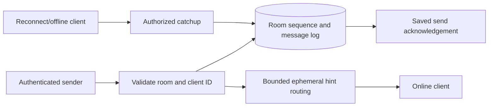

# Architecture and System Design Placement Handbook — Part 12
# S5: Chat and Real-Time Messaging

**Estimated time: 4–6 hours | Architecture numeric module: 10 | Requires: A0–A4; Resume M6/M7/M15 refreshers**

---

## Why this module exists

A socket is a transport connection, not a durable conversation. A client can disconnect after its send commits but before the acknowledgement arrives; a recipient may be offline, a gateway can lose a push, and a formerly authorized member can retain an old connection. These are message identity, persistence and authorization problems as much as networking problems.

**Organizing principle: persist one logical message before acknowledging it, use room-scoped ordering for recovery, and treat online notifications as recoverable hints.**

This example implements a durable SQLite message log, scoped client-ID replay, atomic room sequence allocation, bounded history catchup, monotonic reported-read cursors and process-local connection hints. Actual HTTP polling exercises send/retry/connect/reconnect behavior. It does not implement a WebSocket handshake, SSE stream, Redis gateway cluster or a production real-time latency claim.

The 30 Q&As are curated interview practice, not a measured employer-frequency ranking. This chapter answers Q30/Q44 and follows [S4's ownership/replay reasoning](/docs/system-design/booking-reservations). A later deployment may change the transport while preserving the durable message contract.

---

## 1. Prompt and clarification questions

**Prompt:** support small authenticated chat rooms with online hints and offline recovery. Clients resend after uncertain send results. Current members can read retained history; removed members must not use new API requests or queued hints to keep accessing the room.

| Clarification | Architectural consequence |
| --- | --- |
| One-to-one, small group or huge broadcast room? | Membership model, write/read amplification and hot-room ownership |
| What does send acknowledgement mean? | Accepted in memory, durably stored, recipient received or human read |
| Per-room or global ordering? | Sequencer partition and cross-room coordination |
| Offline history duration and catchup limits? | Retention, cursor expiry, dedupe identity and storage |
| Edits, deletes, attachments and moderation? | Versioned events, media access and derived UI state |
| Multiple devices and read receipts? | User/device cursor scope and monotonic merges |
| Membership change and history policy? | Current permission checks, history cutoffs and connection revocation |
| End-to-end encryption? | Key distribution, server indexing/moderation and recovery tradeoffs |
| Latency, connections and availability objective? | Gateway pool, heartbeat/reconnect and capacity plan |

The fixture chooses a current-membership policy that grants access to all retained room messages. It does not implement a join-time history cutoff or end-to-end encryption. State those product choices rather than accidentally deriving them from an SQL query.

---

## 2. Contract, acknowledgement boundaries and invariants

| Boundary | Meaning here |
| --- | --- |
| Persisted send acknowledgement | The committed logical message and room sequence exist |
| Online hint | A best-effort sequence notification for one local connection |
| Catchup response | Authorized durable messages after a cursor, optionally bounded by a high-water mark |
| Reported read cursor | Client-reported progress, merged monotonically per room/user |
| Human read | Not proven by any acknowledgement in this fixture |

Invariants:

- One tenant/room/sender/client ID identifies one immutable text intent.
- An equivalent retry receives the original sequence; changed content conflicts.
- Room sequence allocation and message persistence commit together.
- Lost/overflowed hints do not delete or duplicate the durable message.
- Catchup is ordered by room sequence and bounded by the requested history window.
- New history, send, receipt and hint requests require current membership.
- A stale device's read report cannot move the user's reported progress backwards.

The fixture retains at most 256 messages/room and rejects new sends at the cap instead of silently pruning replay identity. It allows at most 16 local connections and two queued hints/connection. These are teaching resource limits, not production capacity settings.

---

## 3. Traffic, storage and connection estimates

{{ESTIMATES_OUTPUT}}

One million messages/day averages about 11.574 messages/second. At an assumed 512 logical bytes/message, thirty days is 15.36 decimal GB before indexes, metadata, replicas, receipts and attachments. Mean traffic hides hot rooms and synchronized bursts.

Ten thousand connections at an assumed 16 KiB each is 156.25 MiB of connection state, excluding runtime buffers, TLS, kernel memory and queued data. Measure real gateway memory rather than treating this as an observed budget. An unbounded per-client output queue can dominate otherwise small connection state.

Estimate message writes, recipient fan-out, connected devices, reconnect catchup reads and attachment bytes separately. A million-member broadcast room is not simply a small room with a larger integer; it changes notification and sequencing pressure.

---

## 4. Data model and ordering scope

| Key/table | Responsibility |
| --- | --- |
| `rooms(tenant,id)` | Last committed room sequence |
| `members(tenant,room,user)` | Current membership policy |
| `messages(tenant,room,seq)` | Durable ordered content |
| Unique tenant/room/sender/client ID | Original send replay |
| `reads(tenant,room,user)` | Monotonic client-reported progress |
| In-memory connection ID | Routing/bounded hint queue, not durable history |

The message primary key supports a seek query on one room after a sequence. Client-generated IDs are scoped by room and sender: another sender may use the same string without colliding. A room-local sequence defines authoritative commit order; it is not a global timestamp or total order across all rooms.

If a distributed ID generator is added, uniqueness and chronological/room order remain separate concerns. A unique random ID alone does not tell a reconnecting client which gap to fetch. Keep a cursor contract that matches the partition/order used by storage.

---

## 5. Transport choices and the actual API

| Executed endpoint | Meaning |
| --- | --- |
| `POST /rooms/:room/messages` | Authenticated client_id/text send; 201 with saved sequence/replay flag |
| `GET /rooms/:room/messages?after=&limit=&until=` | Authorized ascending catchup with high-water/continuation |
| `POST /rooms/:room/connections` | Create one bounded local device-hint session |
| `GET /connections/:id` | Authorized current-member hint drain or resync marker |
| `DELETE /connections/:id` | Free owned routing state |
| `POST /rooms/:room/read` | Merge reported read sequence monotonically |

All these are loopback JSON HTTP calls. WebSocket is a sensible deployment transport for bidirectional online delivery; SSE or long polling may fit different client/server needs. A persistent connection reduces per-message transport overhead but does not supply message storage, replay or application authorization automatically.

RFC 6455 specifies WebSocket handshake/framing/control behavior. Application persistence and acknowledgement policy sit above that protocol. The prototype tests the application mechanism through HTTP rather than claiming to test WebSocket protocol correctness. [RFC 6455](https://www.rfc-editor.org/rfc/rfc6455.html).

---

## 6. Smallest architecture and traces



**Send trace:** validate input/membership → look up scoped client ID → replay or atomically allocate sequence and insert message → commit → attempt online hint → return persisted acknowledgement.

**Uncertain send:** the connection dies after commit but before acknowledgement. The client retries the same stable client ID and text; the service returns the original message. A new ID would represent a new message and could create a visible duplicate.

**Receive/reconnect:** subscribe/connect and establish a durable catchup frontier, fetch through a high-water mark, then use hints to discover newer committed messages. Deduplicate by durable room/sequence. A robust client rechecks history after subscribing so the history/subscribe timing gap cannot lose a message.

---

## 7. Shared executable transport/transaction support

{{RUNTIME_CODE}}

S4–S6 share this exact standard-library helper. Each handler creates/uses/closes its own SQLite connection. It validates bounded JSON request bodies and public lesson identity. It is not production authentication, TLS, WebSocket origin validation or a hostile-client connection manager.

---

## 8. Executable message log and local hints

{{CORE_CODE}}

The room counter, message insert and scoped duplicate check share one transaction. SQLite serializes file-wide writers, including these simple read/authorization snapshots. A production engine can provide a more concurrent implementation, but must preserve the same sequence/replay boundary and be tested separately.

The in-memory Hub is a deliberately lossy notification path. Its lock bounds local queue mutation and session ownership; it is not a distributed connection directory. Hint timing can differ from durable sequence order when concurrent senders commit then notify on separate threads, so clients recover/order using history.

---

## 9. Durable replay, snapshot catchup and read progress

{{DURABILITY_OUTPUT}}

The suite injects a message-insert fault and verifies that the room head does not advance alone. A subsequent successful send uses the next committed sequence. This no-gap behavior is a property of the local counter transaction, not a promise that every possible distributed ID generator has no gaps.

Catchup captures `high_water` and returns at most the selected limit through it. Passing that bound to subsequent pages excludes later arrivals from that particular catchup window. A fresh catchup discovers the new tail. A cursor ahead of the retained head is an explicit error rather than silently fast-forwarding past future data.

Read progress merges with max, so a late phone acknowledgement cannot regress progress reported by a laptop. The server only checks that the number is within durable history; a client can report something it has not actually read. Do not advertise this as proof of human attention.

---

## 10. Hint loss, backpressure and membership evidence

{{HINTS_AND_PERMISSIONS_OUTPUT}}

The test deliberately drops one hint after message commit and recovers the message from history. It then fills a slow receiver's two-entry hint queue. Overflow clears queued hints and marks resync required; subsequent notifications need not accumulate more memory. The client can close/reconnect and catch up from its saved durable cursor.

Redis documents at-most-once Pub/Sub delivery and loss when a subscriber cannot receive a message. A shared Pub/Sub layer could distribute hints across gateways, but it would not become the durable conversation log. This prototype runs no Redis. [Redis Pub/Sub semantics](https://redis.io/docs/latest/develop/pubsub/).

Before draining a hint queue, the service rechecks current membership. A removed member's queued routing state is removed and history/send/receipt APIs deny new requests. Already delivered text and a response already authorized/in flight cannot be recalled; the model does not claim global instantaneous revocation across a distributed gateway fleet.

---

## 11. Concurrent sends, process restart and cursor recovery

{{CONCURRENCY_OUTPUT}}

Two independent senders using the same client ID/text obtain one saved sequence: one new result and one replay. Another pair sends different client IDs and obtains distinct sequences. The tests inspect durable sorted history and intentionally do not assume push timing.

Closing/reopening the SQLite file preserves message identity/history and reported read state. Replacing the Hub loses routing sessions, which is expected; reconnect creates new ephemeral routing state and resumes from durable history. An application restart with a lost database is a different failure and is not repaired by reconnect alone.

A retention/pruning feature would need a minimum retained sequence, expired-cursor response, replay-key retention and a full-resync policy. This lesson stops new sends at its finite cap rather than implementing those semantics incompletely.

---

## 12. Actual HTTP contract and limits

{{HTTP_CONTRACT_OUTPUT}}

The loopback tests create a device session, send and resend, receive a sequence hint, fetch persisted text and report read progress. They also test malformed/repeated query fields, another tenant, nonmembership and owned connection close. Responses are no-store.

Membership administration is trusted fixture setup, not a public invitation/removal API. A production room service must authorize those operations and choose join-time history policy. Attachment delivery is also unimplemented; an extension should use S3's private ready-version/ownership boundary rather than letting a message contain a raw private storage key as access authority.

---

## 13. Reconnect races, acknowledgements and client behavior

| Failure | Required client/server behavior |
| --- | --- |
| Send committed but acknowledgement lost | Resend same logical client ID and equivalent content |
| Hint arrives twice/out of order | Deduplicate/order using durable room sequence |
| Hint lost or queue overflows | Catch up from last durable cursor; do not assume silence means no messages |
| Gateway restarts | Reauthenticate, create routing state and recover history |
| Member removed | Reject new protected operations and invalidate routing state under the chosen policy |
| Retention passed cursor | Explicit resync/expired-cursor contract if retention is implemented |

An acknowledgement needs a named boundary. Server persistence, device delivery, device display and user read can each require distinct records and acknowledgements. This baseline implements only persistence and a client-reported read cursor; it does not invent reliable device delivery from a socket write.

Do not advance a saved receive cursor merely because a hint names a high sequence. Fetch and durably handle the corresponding messages first, or the client can skip data after a crash. Device-local storage and UI reconciliation are client responsibilities not implemented by these server tests.

---

## 14. Gateway scaling, presence and hot rooms

| Trigger | Extension | New boundary to verify |
| --- | --- | --- |
| More online connections | Gateway pool and routing directory | Connection ownership, expiry, duplicate devices and cleanup |
| Cross-gateway recipients | Shared hint fan-out | Loss/duplication, room scope and durable catchup |
| Hot room sequence contention | Room ownership/partition strategy | Per-room order and failover fencing |
| Huge rooms | Specialized fan-out/broadcast path | Backpressure, membership and history cost |
| Offline/mobile notification | Notification service | Push acceptance versus message/read state |
| Edits/deletes/media | Versioned events and private assets | Old content, cursor behavior and authorization |

Presence and typing indicators can be short-lived, approximate signals rather than durable messages. Heartbeats/TTL and disconnect cleanup should not mark a user offline merely because one of several devices disconnects. The fixture implements session close but no presence service or heartbeat scheduler.

Sticky routing can simplify one live connection's state, but durable replay still needs a shared authority. Reconnect can land on another gateway. Do not make a single process's memory the only place where an acknowledged message exists.

---

## 15. Security and abuse controls

For an actual WebSocket deployment, authenticate the handshake, validate allowed origins where relevant, revalidate session/room permissions, bound frame/application message size and rate, and handle logout/revocation explicitly. Do not assume one successful handshake authorizes every future action forever. [OWASP WebSocket guidance](https://cheatsheetseries.owasp.org/cheatsheets/WebSocket_Security_Cheat_Sheet.html).

Bind sender and tenant from trusted identity; never permit the message body to select them. Enforce room membership on send/history and on delivery paths. Keep connection IDs scoped to their owner. Distinguish output escaping/moderation from storage of text; a text message must not become executable HTML in the UI.

End-to-end encryption changes server search, moderation, multi-device keys, backups and key rotation. It is not implemented by TLS alone or by hashing a message. This chapter does not claim E2EE, production credentials, abuse detection or a hardened connection server.

---

## 16. Tradeoffs and useful telemetry

| Choice | Benefit | Cost/limit |
| --- | --- | --- |
| Durable room log first | Recovery independent of online delivery | Database/storage dependency |
| Per-room ordering | Clear catchup cursor | Hot-room serialization and failover design |
| Ephemeral bounded hints | Low notification state, controlled slow-client memory | Clients must tolerate loss and resync |
| Current-membership history | Simple explicit access policy | Different from join-time/private-history semantics |
| Monotonic reported-read cursor | Safe cross-device merge | Does not prove human reading |

Measure accepted/new/replayed sends, conflicts, storage latency, sequence contention, catchup lag/size, reconnect rate, active devices, hint drops/overflow, unauthorized requests, connection cleanup and room hot spots. Separate message persistence latency from time-to-recipient display.

Avoid one metrics label per room/user/device/message. Trace scoped identities through controlled logs and redact message contents/tokens by default. A low socket error rate can coexist with lost application messages if the persistence/ack contract is wrong; inspect the application invariants.

---

## 17. Reproduce and interpret the verification

```powershell
cd examples/system-design/module-10-chat-messaging
python verify.py
cd ../worked-systems-s4-s6
python author.py
python integrate.py
python validate_site.py
```

Recorded {{DATE}} using **Python {{PYTHON}} / SQLite {{SQLITE}} / {{OS}}**. **{{TOTAL}} local checks passed**: {{COUNTS}}. Four competing thread-owned connection calls exercise duplicate and distinct sends; actual HTTP verifies the application contract.

The proof does not include WebSocket/SSE framing, Redis, a distributed sequencer, production auth/TLS, encrypted client history, human reading, crash-power-loss or a latency/load benchmark. Owned listeners/connections/threads and temporary files are closed/removed; port 3000 and Docker remain stopped.

---

## 18. Interview question bank with answer direction

### Q1. Does WebSocket make chat reliable?

It provides a bidirectional transport protocol, not a durable message history or business acknowledgement. Store and identify messages explicitly, then recover through a cursor when connections or pushes fail.

### Q2. When should send be acknowledged?

At the boundary promised to the caller. Here acknowledgement follows durable message/counter commit. It does not mean a recipient device or person has received/read the text.

### Q3. What if the acknowledgement is lost after commit?

The client resends the same stable client ID and equivalent text. The service finds the saved message and returns its original sequence instead of creating a confusing duplicate.

### Q4. Why not generate a new client ID on every retry?

A new ID tells the authority this is another logical send. The server cannot infer with certainty whether equal text is a retry or an intentional repeated message.

### Q5. What is the client-ID scope?

Tenant, room, authenticated sender and client ID. Another sender or room may use the same string. Reuse within that scope with changed text is a conflict.

### Q6. Why allocate sequence and store message together?

Otherwise the room head can advance without recoverable content or content can exist without the cursor that clients need. One local transaction establishes the chosen commit-order contract.

### Q7. Is ordering global?

No. The contract orders one room's committed messages. A global order adds coordination that most conversations do not need; cross-room chronology is a separate product question.

### Q8. Can push notifications arrive out of order?

Yes, especially after commit on separately scheduled threads/gateways. A hint names durable state. Clients should fetch/order by room sequence rather than treating notification timing as authority.

### Q9. How do offline clients recover?

Request authorized history after the last durably handled sequence, using bounded pages. A captured high-water mark makes one catchup window finite while newer messages remain for the next catchup.

### Q10. Why capture a high-water mark?

It prevents a constantly growing tail from changing the selected catchup window indefinitely. It is a history bound, not permission to skip messages or a substitute for current membership.

### Q11. What is the history/subscription race?

A message can arrive between fetching history and subscribing to online delivery. Connect then recheck durable history, tolerate overlap and deduplicate by durable identity so no gap depends on a perfect timing sequence.

### Q12. Can Redis Pub/Sub replace history?

Not for this recovery contract. Its documented delivery can lose messages when subscribers miss them. It can distribute hints while a durable store remains the catchup authority.

### Q13. What happens to a slow recipient?

Bound its queued output and define resync/disconnect behavior. This fixture marks resync after two queued hints instead of growing memory indefinitely. Durable messages remain fetchable.

### Q14. Is a socket write proof of device delivery?

No. Transport buffers and disconnect timing separate server writes from client application handling. Define an application acknowledgement if device delivery matters.

### Q15. Does a read receipt prove a human read?

No. It is a client report. The server can validate membership and a valid history range, then merge monotonically, but cannot infer human attention from the number alone.

### Q16. Why merge read cursors with max?

Reports from devices can arrive out of order. Taking max preserves already reported progress rather than letting a delayed device regress it.

### Q17. What if a client reports a future sequence?

Reject it under the stated contract. Silently accepting an ahead cursor could make later messages appear already handled and confuse recovery semantics.

### Q18. How does member removal affect old connections?

New protected operations and queued deliveries must recheck current permissions or use an explicit revocation protocol. This local hint drain removes revoked routing state and denies history/send/receipts.

### Q19. Can a removed member read earlier messages?

Not through new API requests under this current-membership policy. Other products may allow prior history or only post-join messages; that must be an explicit access rule.

### Q20. What survives gateway restart?

Durable messages and stored cursors survive when their database survives. Local routing sessions do not. Reauthenticate/reconnect and catch up rather than depending on old process memory.

### Q21. How do you route to a user on several gateways?

Maintain scoped device/connection ownership and distribute hints to the appropriate gateways, with expiry and failure cleanup. Shared routing is an extension; it cannot replace durable message identity/history.

### Q22. Is sticky routing sufficient?

It can reduce routing complexity while a connection lives, but failures/reconnect can move clients. Acknowledged messages and recovery must remain valid across that movement.

### Q23. What changes for huge group rooms?

Hot-room sequencing, membership and recipient fan-out can dominate. Separate broadcast/notification strategies and bounded catchup, while retaining a clear room-order and authorization contract.

### Q24. How are typing and presence different?

They are usually approximate short-lived signals, not durable conversation messages. Use explicit heartbeat/device semantics; one disconnected device need not mean the whole user is offline.

### Q25. What changes if history is pruned?

Expose minimum retained sequence and expired-cursor/full-resync behavior. Preserve dedupe identity for the allowed resend window or document its limit. The fixture avoids silent pruning by stopping at its cap.

### Q26. How do edits/deletes work?

Choose versioned events or a mutation model with clear ordering, authorization, replay and retention. The immutable-text baseline does not implement them; adding a column alone leaves client recovery behavior undefined.

### Q27. How should media attachments work?

Reference an authorized exact ready media version and recheck access when serving it. Reuse S3's lifecycle boundary; a raw object key inside a message must not become a universal download credential.

### Q28. What extra security does a WebSocket deployment need?

Handshake authentication/origin policy where relevant, per-action permissions, session revocation, size/rate bounds and controlled connection lifecycle. An initial handshake cannot authorize every future room operation forever.

### Q29. What is unproven by this fixture?

Actual WebSocket/SSE semantics, global ordering, multi-gateway routing, production authentication, distributed failover, end-to-end encryption, human read state and throughput. It proves the recorded local application invariants.

### Q30. Give a compact design answer.

Persist a scoped logical message and room sequence before acknowledgement. Resend replays that identity; online delivery is bounded and recoverable through ordered history. Recheck current membership and distinguish persistence, device acknowledgement and reported reading.

---

## 19. A 45-minute mock and answer skeleton

**Mock prompt:** “A chat client disconnects after send, resends on reconnect, and misses online notifications while offline.”

| Segment | Minutes |
| --- | --- |
| Clarify rooms, acknowledgements, history and membership | 5 |
| Estimate messages, fanout and connections | 7 |
| Specify IDs, sequence, schema and API | 8 |
| Trace persist/ack, online hint and catchup | 10 |
| Inject lost ack, overflow, restart and member removal | 10 |
| Defend transport/growth and evidence limits | 5 |
| **Total** | **45** |

A defensible short answer:

> I would acknowledge after committing one message under tenant/room/sender/client identity and assigning its room sequence. Uncertain retries replay the saved message. Online gateways send bounded hints, while history after a durable cursor recovers missed or reordered notifications. A high-water mark bounds catchup. Current membership is enforced on sends, history and delivery, and reported-read state merges monotonically without claiming human attention.

---

## 20. Practice tasks

1. Define persistence, device delivery, display and human-read boundaries for one-to-one versus group chat.
2. Recompute retained message bytes, connected-device state and recipient fanout; include reconnect traffic and hot rooms.
3. Resend an uncertain send with the same ID/text, changed text and a new ID. Explain each observed result.
4. Inject message insertion failure and inspect sequence rollback. Run duplicate/distinct concurrent sends without assuming hint timing.
5. Page catchup under a high-water mark while new messages arrive. Explain when the next fresh catchup discovers the tail.
6. Drop a hint and overflow a slow consumer. Recover from durable history and show that local notification queues remain bounded.
7. Close/reopen with a new Hub, then reconnect. Distinguish lost routing state from retained message/replay identity.
8. Remove a member after queuing a hint and test hint/history/send/receipt denial. Discuss an already delivered/in-flight response.
9. Design a real WebSocket gateway and shared hint router, with origin/auth, heartbeat, revocation, backpressure and retention tests clearly marked as extensions.
10. Complete the 45-minute mock and Q30/Q44. Explain why a WebSocket or Pub/Sub server alone does not establish durable chat.

---

## 21. Completion checklist

- [ ] I can clarify room and acknowledgement semantics.
- [ ] I can estimate log, fanout and connection cost.
- [ ] I can scope a stable client message identity.
- [ ] I can persist sequence and message atomically.
- [ ] I can replay sends after an uncertain acknowledgement.
- [ ] I can distinguish room order from hint timing.
- [ ] I can recover offline history with bounded cursors.
- [ ] I can handle lost hints and slow consumers.
- [ ] I can explain restart and routing ownership.
- [ ] I can enforce current membership on delivery paths.
- [ ] I can merge reported reading without overstating it.
- [ ] I can finish the mock and state transport/proof limits.

---

## 22. Research references and continuation

Reviewed {{DATE}}. Primary sources: [RFC 6455](https://www.rfc-editor.org/rfc/rfc6455.html), [Redis Pub/Sub](https://redis.io/docs/latest/develop/pubsub/), [OWASP WebSocket security](https://cheatsheetseries.owasp.org/cheatsheets/WebSocket_Security_Cheat_Sheet.html), and [SQLite transactions](https://sqlite.org/lang_transaction.html). Product acknowledgement/history choices, code, estimates and Q&As are authored here; no measured interview-frequency claim is made.

Return to the [architecture roadmap](/docs/system-design), [A3 workflows](/docs/system-design/reliable-workflows-concurrency), [S2 notifications](/docs/system-design/notifications-webhooks) or [S3 private uploads](/docs/system-design/file-upload-processing). Resume [M6 HTTP](/docs/resume-skills/rest-apis-http) and [M7 authentication](/docs/resume-skills/authentication-sessions-jwt-oauth) refresh the stack.

**Next: [S6 — Social feed and photo sharing](/docs/system-design/social-feed-photo-sharing)**, architecture part 13 / numeric module 11. It combines ready-media references, follows, hybrid fanout, privacy filtering and bounded feed pagination. S4–S6 are authored together; later systems and consolidation remain planned.
