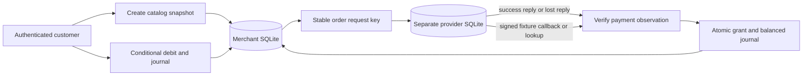

# Architecture and System Design Placement Handbook — Part 15
# S8: Checkout, Payments and Credit Ledger

**Estimated time: 5–7 hours | Architecture numeric module: 13 | Requires: A0–A4, S4 and S7; Resume M7/M8/M13 refreshers**

---

## Why this module exists

A checkout request times out. The payment provider may still have charged the customer. A webhook may arrive twice, arrive before the original response, or race with a reconciliation worker. Crediting the account on every notification creates value twice; treating every timeout as failure can charge twice.

**Organizing principle: separate client intent, provider payment identity and local ledger identity, then reconcile uncertain boundaries using durable evidence.**

This example uses separate local SQLite files for a simulated provider and the merchant. The provider commits a successful charge before an injected reply loss. The merchant recovers through the same provider request key, a signed fixture callback or lookup, then posts a single balanced integer-credit grant. Concurrent spending cannot make the balance negative, and reversal appends an inverse journal.

The executed ledger tracks closed-unit application `CREDIT`, not cash, bank settlement, exchange rates or legal accounting. The provider is local code, not a real payment integration. These distinctions keep the runnable mechanism honest. The 30 questions are curated design practice, not measured interview-frequency data.

---

## 1. Prompt and clarification questions

**Prompt:** sell prepaid application credits. Checkout must survive lost replies, duplicate payment observations and competing spends. Customers need truthful order status, and operators need evidence to reconcile unexpected charges.

| Clarification | Design consequence |
| --- | --- |
| One-time payment, authorization/capture or subscription? | Provider lifecycle and entitlement timing |
| What is being sold? | Immutable price, currency, quantity and entitlement snapshot |
| Credits, cash balance or transferable value? | Unit model, controls and accounting requirements |
| Which provider/merchant accounts? | Signature keys, identity scope and event verification |
| Which success state authorizes credit? | Pending/authorized/settled distinctions |
| Refunds, disputes and chargebacks? | New workflows and entitlement recovery policy |
| Can users spend concurrently? | Atomic debit and nonnegative invariant |
| Can credits expire or be gifted? | Lots, ownership, expiry and audit model |
| What is the retry and reconciliation horizon? | Idempotency retention and operator recovery |

The baseline sells a server-defined USD product for integer credits, models provider success only, and supports spend reversal. It does not implement declines, authorization/capture, external refunds, disputes, taxation, credit expiration, cash withdrawal or subscription billing. Extending those features requires explicit new states and invariants.

---

## 2. Contract and invariants

| Concern | Executed policy |
| --- | --- |
| Checkout identity | Tenant/owner/client operation binds selected SKU |
| Pricing | Catalog amount/currency/credits snapshotted when order is created |
| Provider request | Stable merchant order ID; equivalent retries return one provider payment |
| Timeout | `unknown`; no credit until verified success is observed |
| Observation | Event identity and payment identity both bind order/amount/currency |
| Grant | At most one grant per order and payment ID |
| Journal | Two entries in `CREDIT`, sum zero per journal |
| Spend | Atomic balance predicate prevents a negative user balance |
| Replay | Same operation returns its original journal and historical balance_after |
| Reversal | One appended inverse per owned spend; original entries remain immutable |

The strongest local boundary is the merchant transaction: verified observation, event receipt, payment binding, journal, entries, grant, balance and order-paid state commit together. The provider commit is outside that transaction. A provider success can survive a merchant rollback; reconciliation exists to close that gap.

Grant uniqueness protects against two successful payments being credited to the same order, but the second payment still represents an actual unexpected charge in the modeled world. Its outcome becomes `extra_charge_review`, not silently “handled” and forgotten. No refund is executed by this fixture.

---

## 3. Volume, units and retention estimates

{{ESTIMATES_OUTPUT}}

At an assumed 100,000 successful top-ups/day, two entries/grant create 200,000 daily entries before spends and reversals. At 192 assumed bytes/entry, thirty days are 1.152 decimal GB of logical entry data. Indexes, journal headers, provider observations, audit metadata, replicas and backups add storage; this is not a database sizing benchmark.

The initial fixture product costs 500 USD minor units and grants 100 CREDIT. After a catalog edit, a new order can cost 600 and grant 120, while an old order retains its original snapshot. Credits are not represented as USD cents and are not converted by an implicit exchange-rate formula.

Use integers for the selected smallest supported unit, state currency and rounding rules, and reject client-supplied prices. Different currencies do not universally have two fractional digits. A production money model must follow the selected provider's supported units and currency behavior rather than applying the fixture's one-product assumption everywhere.

---

## 4. Data model and three identities

| Store/table | Responsibility |
| --- | --- |
| Provider `charges(request_id)` | Independent committed charge and unique provider payment ID |
| Merchant `catalog` | Trusted product definition |
| `orders` | Tenant-owned checkout intent and immutable economic snapshot |
| `events` | Provider event identity/fingerprint and stored outcome |
| `observations(payment_id)` | Binding/dedupe across different event IDs for one payment |
| `grants(order_id)` | Single entitlement grant linked to payment and journal |
| `journals` and `entries` | Operation history and balanced CREDIT postings |
| `balances` | Materialized user balance changed in the posting transaction |
| `reversals(original)` | One inverse posting per original spend |

A client retry ID, provider event ID and provider payment ID answer different questions. One client intent can cause many delivery attempts. One payment can produce multiple event IDs. A bug could create multiple payments for one order. Keeping these identities separate makes each failure visible.

The fixture assumes one simulated provider/merchant account and globally unique payment IDs within that scope. A multi-provider or connected-account implementation must include provider/account/environment in identity and verification keys. SQLite entry triggers prohibit update/delete through this connection; a privileged database owner can still change schema. This is application-level immutability, not a tamper-proof audit appliance.

---

## 5. API and trusted actors

| Actual endpoint | Meaning |
| --- | --- |
| `POST /orders` | Credential owner plus SKU and Idempotency-Key; 201 |
| `GET /orders/:id` | Scoped order status and review flag |
| `POST /orders/:id/submit` | Stable provider request; 200 paid or 202 unknown |
| `POST /provider/succeeded` | Raw-body fixture HMAC, verified successful-payment observation |
| `GET /balance` | Current owned integer CREDIT balance |
| `POST /spends` | Owned spend with stable operation and positive units |

Catalog changes, reconciliation and spend reversal are trusted methods in this fixture, not public administrative APIs. Owner and tenant come from the credential. A client cannot add an amount field to create a cheaper order. The callback uses a separate provider signature rather than a customer's bearer token.

The public fixture secret is intentionally not a production credential. Its HMAC protocol has no timestamp freshness check or key rotation; stored event/payment identity handles selected duplicate deliveries. A real integration needs the provider's actual signature protocol, account binding, replay rules and API-version-specific event schema. [Stripe webhook documentation](https://docs.stripe.com/webhooks).

---

## 6. Smallest architecture and commit boundaries



**Normal trace:** create pending order → provider commits charge → merchant verifies matching success → journal/grant/order commit → return paid. **Reply-loss trace:** provider commits → injected TimeoutError → order unknown → repeat the same provider request or look up that order → observe the existing payment → grant once.

**Merchant-failure trace:** provider commits → local grant transaction fails → no partial merchant grant/journal/event remains → a later callback or reconciliation repeats observation → one complete posting. An SQL transaction around the HTTP call would not roll back the remote charge; it would hold locks while waiting and still leave uncertainty.

---

## 7. Shared executable HTTP and transaction support

{{RUNTIME_CODE}}

The shared helper provides local credential mapping, bounded JSON transport, short database transactions and no-store responses. It is reused unchanged from S4–S6. It does not implement a payment provider SDK, TLS termination, browser checkout, card collection or production user sessions.

---

## 8. Executable checkout, provider and ledger

{{CORE_CODE}}

`submit` opens no merchant transaction around the provider call. A synchronous reply and reconciliation both become trusted success observations through the same merchant posting path. This is deliberate convergence: separate entry paths must not have separate entitlement-grant logic.

The provider simulation always succeeds for a new valid request and never makes an actual network call. Its durable idempotency table has no expiry in the fixture. Real provider idempotency retention, equivalent-request behavior and retry rules must be checked for the selected endpoint/API version. [Stripe idempotent requests](https://docs.stripe.com/api/idempotent_requests).

---

## 9. Unknown outcome and recovery

{{PAYMENT_RECOVERY_OUTPUT}}

The first submit leaves the order unknown and the merchant balance at zero, even though the provider charge exists. The retry uses the order ID again, returns that same payment and grants once. A late unknown-state write cannot downgrade an already paid order because it only updates pending rows.

Do not translate a transport timeout directly to declined or create a fresh provider key on every attempt. Distinguish unknown, known failed, known successful and review-required outcomes. A durable reconciliation worker should search unresolved orders with bounded backoff and provider rate limits, preserve attempt evidence, and escalate unresolved cases rather than silently abandoning them.

In a real provider, an event may be a hint to retrieve authoritative object state rather than the complete success authority by itself. Verify the selected event type, merchant account, order binding, status, amount and currency before entitlement. The fixture's signed endpoint accepts only the explicitly modeled successful observation.

---

## 10. Duplicate observations and unexpected charges

{{BINDING_OUTPUT}}

Reusing an event ID with a changed fingerprint conflicts. A new event ID for an already bound payment reuses its outcome; it cannot grant again. Reusing the payment ID for a different order/amount/currency conflicts. Amount or currency mismatch is quarantined without credit, and a second valid payment for an already granted order becomes an extra-charge review case.

These checks complement signature verification: a valid signature does not imply the payment belongs to this order or buys this entitlement. Event ordering also cannot be assumed. The fixture models only success; adding refund/dispute events requires a state machine that reasons about current authoritative payment state and prior grants, not a naïve “last event wins” column.

---

## 11. Ledger concurrency, reversal and rollback

{{CONCURRENCY_OUTPUT}}

Two independent SQLite connections attempt to spend 80 units from a 100-unit balance. One conditional debit commits, one conflicts, and the balance is 20. Both journal entries and the balance update share a transaction; checking balance first in a separate transaction would leave an overspend race.

A reversal appends an inverse journal against the original owned spend and restores the units once. It does not erase the original entries. Replaying the original spend returns its historical `balance_after=20` even after current balance becomes 100. An idempotent operation response is not automatically a fresh account snapshot.

{{ROLLBACK_RECONCILIATION_OUTPUT}}

An injected grant failure rolls back all local merchant posting state while preserving the separate provider commit. Racing callback and reconciliation then converge on one recovered grant. A second-entry failure also rolls back the debit and first entry. Closing/reopening proves selected committed-state persistence; an actual process kill or storage fault was not performed.

The journal is balanced by construction through this trusted posting path, with tests checking every retained journal. It does not have a deferred database constraint proving that arbitrary direct SQL always inserts exactly two balanced entries. Keep direct table mutation restricted and add independent reconciliation/audit checks if extending it.

---

## 12. Actual HTTP evidence

{{HTTP_CONTRACT_OUTPUT}}

Requests use a real owned loopback merchant server. The callback signs exact raw bytes; changing the bytes invalidates the signature. Provider calls remain local method invocations against a separate database. The response-loss flag is controlled by the verifier, not by a customer request field.

The server, database connections and temporary directory are closed afterward. Port 3000 is unused. The endpoint tests establish selected authentication, binding and status behavior; they do not validate a real provider's signature algorithm or delivery system.

---

## 13. Ledger and integration alternatives

| Choice | Benefit | Required reasoning |
| --- | --- | --- |
| Single mutable balance | Simple reads | No operation history by itself; concurrency and recovery still needed |
| Journal plus transactional balance | Auditable postings and fast reads | Posting invariant, operation dedupe and balance reconstruction |
| Provider-hosted checkout | Less direct handling of sensitive payment entry | Verified callbacks, return-page trust and entitlement reconciliation |
| Event-driven entitlement | Decoupled processing and retries | Durable handoff, duplicate observations and delayed user status |

A success redirect in a browser is useful navigation, not trusted evidence that payment succeeded. Read current server order state and keep a pending/unknown user experience when verification has not completed. A real frontend should explain status without exposing internal provider secrets or making the customer retry charges blindly.

---

## 14. Growth, multi-currency and reconciliation

Keep one authoritative posting path while separating provider adapters, checkout UX and asynchronous reconciliation where needed. Partition by an appropriate account/tenant boundary only after defining cross-partition transfer rules. A transaction on one shard cannot silently enforce a balance invariant on another.

For money, use explicit currencies, accounts and supported integer units. Balanced entries must balance within the relevant unit/accounting model; CREDIT postings do not establish USD settlement correctness. Transfers, holds, pending balances, cash refunds and chargebacks need additional journal types and policies.

Reconcile provider objects to orders, orders to grants, grants to journals, and journal-derived balances to the materialized balance. Retain event and idempotency evidence for the required retry/audit horizon. The fixture stops at 128 orders and 256 journals; it implements neither archival nor automatic retention deletion.

---

## 15. Security and trust

Do not accept amount, currency, credit quantity, payment success or owner identity from the customer as authority. Bind provider credentials/signatures to the correct environment/account and use the provider's documented freshness and key-rotation scheme. Restrict reconciliation and reversal separately from ordinary spending.

Avoid storing card data in this application model. Keep sensitive provider payloads and authentication material out of public errors/logs. An operator's manual refund or credit adjustment is a privileged domain action with its own stable ID, reason and audit trail, not a direct UPDATE to the user balance.

The fixture secret and lesson credentials are public examples. The chapter exercises the location of trust decisions; it does not claim production authentication, payment compliance or financial audit readiness.

---

## 16. Observability and incident diagnosis

Track orders by age/state, unknown-outcome age, provider request retries, callback verification failures, event/payment replays, mismatches, extra charges, reconciliation lag and ledger-posting failures. Alert on growing unresolved value and journal/balance divergence, not just successful HTTP response counts.

An investigation should connect tenant, owner, order, provider account/payment, event and journal IDs while protecting private customer data. Ask separately: was the provider charged, was entitlement granted, was credit spent, and was a reversal or refund actually executed? A review intent or queued compensation is not evidence that money returned.

---

## 17. Run, inspect and evidence limits

From the repository root:

```powershell
python examples/system-design/module-13-checkout-payments-credit-ledger/verify.py
```

Verified {{DATE}} on Python {{PYTHON}}, SQLite {{SQLITE}}, {{OS}}. **{{TOTAL}} local checks passed**: {{COUNTS}}. Four synchronized worker calls cover competing spends and callback/reconciliation observation. Results are recorded in `verification-results.json`; owned HTTP listeners, tracked connections and temporary databases are cleaned up.

The tests cover local idempotency, selected uncertainty, transaction faults, ownership and integer-credit posting. They do not establish a real provider contract, cash accounting, external refund completion, API rate-limit recovery, distributed failover or production capacity. Replacing the provider simulation requires new integration evidence.

---

## 18. Interview questions and answers

### Q1. What is checkout responsible for?

Capturing an authenticated customer's purchase intent and an immutable server-calculated economic snapshot, then coordinating verified payment and entitlement. Checkout acceptance, provider success and available credit are separate states with separate evidence.

### Q2. Why snapshot catalog pricing?

A retry or delayed webhook must resolve the original purchase, even after prices change. The stored order retains amount, currency and credit quantity. Recalculating from today's catalog could charge or grant a different deal.

### Q3. Why can't the client send the price?

The customer controls the request body. The server resolves an allowed product and calculates the authoritative amount/entitlement. Client prices can be display hints, but cannot authorize a cheaper charge or larger grant.

### Q4. What does a payment timeout mean?

The caller lacks a confirmed outcome. The provider may have committed. Preserve the order as unknown, reuse the stable request identity and reconcile authoritative state; do not label it declined solely because the reply was lost.

### Q5. What are the three main identities?

Client checkout operation identifies purchase intent; provider payment ID identifies a charge; journal operation identifies an entitlement or spend posting. Provider event IDs identify deliveries and cannot replace payment/order uniqueness.

### Q6. Why use the same provider key on retry?

It lets the provider recognize the same attempted charge under its documented contract. Generating a fresh key after a timeout can create another payment. Request equivalence and retention are provider-specific and need verification.

### Q7. Does provider idempotency solve the whole checkout?

No. Local grants, callbacks, spends and reconciliation need their own identities and invariants. A provider may return one payment repeatedly while a buggy merchant still grants credits on every delivery.

### Q8. Why verify raw webhook bytes?

The signature authenticates a defined byte representation. Parsing and reserializing first can change those bytes. Use the provider's actual signed payload/timestamp protocol; this fixture uses a deliberately simpler public-secret HMAC.

### Q9. Why dedupe event and payment IDs?

The same event may be redelivered, and different events may refer to the same payment. Event dedupe alone cannot prevent all duplicate grants. The payment binding and order grant uniqueness protect the economic operation.

### Q10. What if webhook and API reply race?

Both should call the same verified-observation/posting path. Uniqueness and a transaction converge on one grant regardless of which arrives first. Avoid separate “sync credit” and “webhook credit” implementations.

### Q11. Why check amount and currency after signature?

A genuine event could refer to another product/order/account or an unexpected amount. Authenticate the sender and verify business binding. A valid signature is necessary evidence, not a complete entitlement decision.

### Q12. How is an extra charge handled?

The second distinct payment for an already granted order is retained as a review outcome without granting again. Operations must resolve the charge explicitly. This fixture records review and executes no cash refund.

### Q13. Can a local rollback undo provider success?

No. The provider committed in a separate authority. Merchant rollback must leave recoverable intent/evidence, and a later observation or lookup must converge on the appropriate local state without another charge.

### Q14. Why avoid a database transaction around the provider call?

It holds local locks through network delay without making the remote commit atomic. Keep local transactions short, persist stable intent first, then reconcile the external boundary with identity and verified observations.

### Q15. What is a credit ledger?

An operation history of changes in a defined application unit, with balanced postings and a reproducible user balance. This example's CREDIT is not USD and does not represent a bank settlement ledger.

### Q16. Why not update only a balance column?

It loses the operation history needed to explain duplicates, corrections and reconstruction. A journal plus transactional balance can retain evidence and serve fast reads, provided the posting path and reconciliation enforce their relationship.

### Q17. How does double-entry help here?

Each posting has equal and opposite CREDIT entries: user versus issuance/consumption. Their sum is zero. This conservation check catches selected inconsistencies, but balanced wrong entries can still be wrong; binding and authorization remain necessary.

### Q18. How is overspending prevented?

A conditional update requires balance plus delta to remain nonnegative, inside the same transaction as journal entries. Competing spend calls cannot both rely on a previously read balance and independently debit it.

### Q19. Why use integer units?

The chosen supported unit avoids binary floating-point representation errors in posting arithmetic. Specify unit, bounds and rounding at conversion boundaries. Integer CREDIT alone does not solve currency conversion or provider-specific minor-unit rules.

### Q20. How do spend retries behave?

The same tenant/owner/operation and amount returns the original journal. Changed intent conflicts. Its recorded balance_after describes that posting's historical result, so a separate balance read is needed for current state.

### Q21. Why append a reversal?

It preserves the original event and a linked correction rather than rewriting history. A unique original-to-reversal binding prevents undoing the same spend twice under different operation keys.

### Q22. Is spend reversal a payment refund?

No. It restores application credits consumed by an owned spend. A cash refund involves provider state, amount limits and eventual reconciliation, possibly after credits were already used. That workflow is unimplemented here.

### Q23. What if posting fails after the first entry?

The transaction rolls back the debit, journal and first entry. The verifier injects failure at the second entry. Retrying with the same operation can then create one complete posting.

### Q24. What should reconciliation compare?

Provider payments against unresolved orders, matched orders against grants, grants against journals and computed user postings against materialized balances. Preserve unexpected charges and mismatches for resolution instead of deleting inconvenient evidence.

### Q25. Why isn't a browser success page enough?

The browser redirect is controlled by an untrusted client path and may race server verification. Read server order state. A clear pending/unknown state is more truthful than granting value from a query parameter.

### Q26. What changes for multiple currencies?

Use explicit units/accounts and conversion postings with a defined rate and rounding policy. Do not sum unlike currencies or treat CREDIT as cash. Settlement and accounting requirements need a separately designed model.

### Q27. How do refunds and chargebacks change the design?

They introduce new external states and entitlement consequences, including credits already consumed. Define negative balance, suspension, recovery or loss policies explicitly, and reconcile provider outcomes. Do not merely switch paid back to pending.

### Q28. Which retention rule matters for idempotency?

Keep dedupe evidence for the expected retry and reconciliation horizon, coordinated with provider retention and audit requirements. Deleting keys too early can make an old retry appear new and repeat an economic action.

### Q29. What does this fixture actually prove?

Separate local commits, injected reply loss, selected callback binding, duplicate-safe crediting, concurrent nonnegative spends and transactional reversal. It does not prove real provider delivery, refund completion, banking correctness or production throughput.

### Q30. Give a compact design answer.

Persist an owned catalog snapshot, use a stable provider operation and treat timeouts as uncertain. Verify payment binding, converge replies/callbacks/reconciliation on one atomic grant, and post immutable balanced credit journals. Debit conditionally, reverse by appending and retain unexpected-charge evidence.

---

## 19. A 45-minute mock and answer skeleton

**Mock prompt:** “Design prepaid credits. A provider charges but the response disappears, callbacks repeat, and two requests spend the last credits.”

| Segment | Minutes |
| --- | --- |
| Clarify product, units and provider success | 5 |
| Estimate posting volume and retention | 7 |
| Specify order, payment, grant and journal keys | 8 |
| Trace unknown outcome and verified posting | 10 |
| Inject duplicate callback, rollback and competing spends | 10 |
| Defend reversal, reconciliation and limits | 5 |
| **Total** | **45** |

A defensible short answer:

> I would store the customer's intent with a server-derived price/currency/credit snapshot. The order ID remains the provider request identity across retries. A timeout leaves an unknown outcome, resolved by verified replies, callbacks or lookup. All paths converge on payment/order uniqueness and one atomic entitlement journal. Spending updates balance conditionally with its balanced entries; retries return the original posting. Corrections append reversals, and unexpected payments remain visible for reconciliation rather than triggering a second grant.

---

## 20. Practice tasks

1. Clarify whether the product sells credits, settles cash or authorizes a future capture, and define the authoritative success state.
2. Change the catalog after creating an order; retry checkout and inspect the preserved economic snapshot.
3. Inject reply loss after the provider commit and explain why unknown differs from declined.
4. Retry the same provider request, then compare with creating a new operation key after uncertainty.
5. Deliver one event twice, different events for one payment, changed event content, wrong amount and wrong currency.
6. Record a second distinct successful payment for one order. Explain why no additional credit does not resolve the extra charge.
7. Race two 80-unit spends against 100 credits; inspect conditional debit, journal sums and historical replay response.
8. Inject failure during grant and during the second journal entry. Recover via competing callback/reconciliation and inspect rollback.
9. Reverse an owned spend once, replay the reversal and attempt another owner or operation. Design the separate cash-refund workflow.
10. Complete the mock with provider-account binding, retention, unknown-age alerts and a precise statement of local evidence limits.

---

## 21. Completion checklist

- [ ] I can separate purchase intent, payment and ledger operation identities.
- [ ] I can preserve a server-derived economic snapshot.
- [ ] I can explain unknown payment outcomes and stable retries.
- [ ] I can identify the external commit boundary.
- [ ] I can verify callback authenticity and business binding.
- [ ] I can dedupe both events and payments.
- [ ] I can converge callback, reply and reconciliation paths.
- [ ] I can post balanced integer-credit journals atomically.
- [ ] I can prevent concurrent overspending.
- [ ] I can explain historical replay and append-only reversal.
- [ ] I can retain mismatches and unexpected charges for resolution.
- [ ] I can finish the mock and distinguish credits from cash/provider proof.

---

## 22. Research references and continuation

Reviewed {{DATE}}. Primary references: [Stripe idempotent requests](https://docs.stripe.com/api/idempotent_requests), [Stripe webhooks](https://docs.stripe.com/webhooks), and [SQLite transactions](https://sqlite.org/lang_transaction.html). The separate provider simulation, CREDIT journal, workload and Q&As are authored mechanisms, not a reproduction of Stripe's complete API or accounting guidance.

Return to the [architecture roadmap](/docs/system-design), [A3 reliable workflows](/docs/system-design/reliable-workflows-concurrency), [S4 booking/payment boundary](/docs/system-design/booking-reservations), [S7 workers](/docs/system-design/job-scheduler-workers) or [Resume M13 PostgreSQL](/docs/resume-skills/postgresql-backend).

**Next: [S9 — Search and autocomplete](/docs/system-design/search-autocomplete)**, architecture part 16 / numeric module 14. It separates source documents and permission authority from asynchronous search projections. S0–S9 are authored; later systems and consolidation remain planned.
