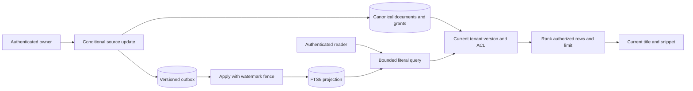

# Architecture and System Design Placement Handbook — Part 16
# S9: Search and Autocomplete

**Estimated time: 4–6 hours | Architecture numeric module: 14 | Requires: A0–A4, S3 and S7; Resume M13/M23/M24 refreshers**

---

## Why this module exists

Search combines a derived index, a ranking policy and an authorization decision. A document may already be updated, deleted or unshared while its old indexed text still exists. Returning the first matching index hit without checking current authority can leak titles, snippets, suggestions and counts.

**Organizing principle: an index supplies candidates; canonical document state and current permissions decide what may be returned.**

This chapter implements actual SQLite FTS5 full-text retrieval and title-token prefix completion. Versioned outbox events maintain a logically asynchronous projection, while current source version, tenant and access checks filter results before the limit. Out-of-order events cannot resurrect old versions or tombstones. A bounded local rebuild recovers from canonical source state.

There is no external search cluster, semantic embedding model, online blue-green rebuild or benchmark. The selected ranking judgments are a small reproducible corpus, not universal relevance evidence. The 30 interview questions are curated coverage of common design dimensions rather than a measured frequency ranking.

---

## 1. Prompt and clarification questions

**Prompt:** authenticated users search a tenant's private/shared/public notes and receive title-prefix suggestions. Updates can lag the index; deletion and permission revocation must stop disclosure on new requests even before indexing catches up.

| Clarification | Architectural consequence |
| --- | --- |
| Exact lookup, full text, prefix or semantic retrieval? | Different index/access structures and quality evaluation |
| Which fields and languages? | Tokenization, stemming, normalization and field weights |
| What does autocomplete complete? | Whole query, title token, product name or spelling |
| Are titles, snippets, counts and suggestions sensitive? | One authorization contract across every output |
| How fresh must edits and deletes be? | Source/index version checks and acceptable false negatives |
| Public within tenant or globally public? | Tenant boundary and cross-tenant discovery policy |
| What ranking quality matters? | Judged queries, top-k metrics and failure cases |
| Corpus/update/query volume and latency target? | Embedded index versus database versus search service |
| Is pagination stable while ranking changes? | Cursor/search-session contract and retained index versions |

The fixture's public flag means readable by authenticated users in the same tenant. Full mode requires all normalized query terms somewhere in title/body. Prefix mode matches title tokens, requiring earlier terms exactly and the final term as a prefix; it is not a whole-title string-prefix contract or a popular-query suggestion engine.

---

## 2. Contract and invariants

| Concern | Executed policy |
| --- | --- |
| Source | Canonical tenant/document, owner, version, tombstone, text and visibility |
| Create | Stable tenant/owner/operation with immutable original fingerprint |
| Edit | Owner plus expected version; stale edits conflict |
| Projection | Immutable event payload and per-document version watermark |
| Permission | Current owner/public/grant, same tenant, source not deleted |
| Freshness | Only index rows whose version equals canonical version may return |
| Query | 1–100 characters, 1–4 literal normalized terms, known mode |
| Results | Limit 1–20 after authorization; current canonical title/snippet |
| Counts | Authorized returned count and has_more only; no unfiltered total |
| Retention | 128 retained source rows, 512 events; no retention sweeper |

Source state and outbox insertion commit together. Projection mutation, watermark and event completion also commit together. Events at or below the current watermark cannot overwrite newer state. Tombstones remain in canonical source/watermarks so late upserts cannot resurrect deleted documents.

The freshness policy trades availability for safety: after an edit, both the old and new text can be unsearchable until the new version is indexed. After a grant is revoked, its old projection row can remain physically present while results disappear immediately under the current local access predicate. This guarantee applies to each new local query, not bytes already delivered or independent caches.

---

## 3. Corpus, indexing and backlog estimates

{{ESTIMATES_OUTPUT}}

One million documents averaging 2,000 bytes are two decimal GB of logical source text. Assuming an index multiplier of 1.5 gives three GB of index data, but the multiplier is a workload assumption. Terms, languages, positions, stored fields, replicas, compression and updates can change it substantially.

At 100 updates/second, a sixty-second indexing outage creates 6,000 pending updates. An indexer handling 150/second with 100/second continuing arrivals drains at fifty/second, taking 120 seconds. Measure oldest unindexed source version and end-to-end searchable freshness, not just worker activity.

Query cost depends on term frequency, candidate count, authorization selectivity, ranking and top-k. A frequent short prefix can match a large fraction of the corpus. Bound query size, term count, result count and service budget; adding an index alone does not make every prefix cheap.

---

## 4. Data model and index authority

| Table | Responsibility |
| --- | --- |
| `documents(tenant,id)` | Current source version, text, owner, deletion and visibility |
| `creates` | Original immutable create fingerprint and document identity |
| `grants` | Current explicit reader access |
| `events` | Versioned immutable projection payload plus processed marker |
| `watermarks` | Latest applied/rebuilt version and tombstone |
| FTS5 `search` | Derived indexed title/body with unindexed tenant/doc/version metadata |

The inverted index maps terms to matching documents/positions; it answers a different access pattern from a B-tree on a whole title. Prefix indexes accelerate selected token prefixes. FTS5's `unicode61` tokenizer and `prefix='2 3 4'` are actual selected options here. They are not a promise of multilingual stemming, typo correction or semantic matching. [SQLite FTS5](https://sqlite.org/fts5.html).

Document versions express source changes, not global time. ACL grant/revoke does not need a text-version increment because the final query uses current grants. An external engine with its own ACL projection would need a separate permission freshness contract; do not infer current authority from a stale indexed permission field.

---

## 5. API and actor contract

| Actual endpoint | Meaning |
| --- | --- |
| `POST /docs` | Owned title/body/public with Idempotency-Key; source plus outbox |
| `PUT /docs/:id` | Owner edit with expected_version/title/body |
| `DELETE /docs/:id` | Owner tombstone; repeat delete retains version |
| `PUT/DELETE /docs/:id/grants/:reader` | Owner grants/revokes current reader |
| `GET /search?q=&mode=&limit=` | Tenant-scoped full or prefix query |

The credential supplies tenant and caller. Unknown fields, duplicate query parameters, unsupported mode and invalid limits are rejected. The caller does not submit raw FTS syntax. Input is normalized to bounded literal tokens, each quoted, with a server-added final prefix operator only in prefix mode.

Index application and rebuild are trusted methods, not public endpoints. There is no separate source-document download route in the fixture. A real download/detail API must enforce the same current source permission rather than treating a previous search hit as a reusable authorization grant.

---

## 6. Smallest architecture and visibility flow



**Write trace:** validate owner/expected version → mutate source → append immutable version payload → commit. **Worker trace:** read event → compare watermark → replace projection or retain newer version → commit projection, watermark and processed marker. **Read trace:** parse literal terms → find matching index candidates → join current source → enforce tenant/version/ACL → rank/limit → return permitted canonical fields.

All stores share one SQLite file, allowing a local current-state join. The async lag is real in the sense that source events remain unapplied until the worker method runs, but no cross-service replication or daemon executes. A distributed search service requires an explicit strategy for authoritative checks and filtered retrieval under bounded latency.

---

## 7. Shared executable HTTP and transaction support

{{RUNTIME_CODE}}

The shared helper is reused unchanged from S4–S6. It provides fixture credential mapping, bounded JSON input, per-request SQLite connections and no-store responses. It does not provide production sessions, distributed cache isolation, query time cancellation or an external search client.

---

## 8. Executable source, FTS5 projection and retrieval

{{CORE_CODE}}

FTS5 `bm25` weights include every column position, even unindexed metadata columns; title/body therefore use `bm25(search,0,0,0,5,1)`. Lower FTS5 BM25 values sort ahead. The chosen title boost is a tested local policy, not a universal scoring constant. A document ID supplies a deterministic tie-breaker for the same snapshot.

The snippet is a bounded canonical body prefix rather than an HTML-highlighted excerpt around a match. It is returned only after the same access predicate. A real highlighted snippet must escape untrusted text and apply permission checks before exposing any matched fragments.

---

## 9. Current permission beats stale projection

{{PERMISSIONS_OUTPUT}}

The private document becomes searchable to Bob after a grant and disappears immediately after revocation, even though its FTS row remains. Neither a title suggestion nor a count leaks the revoked document. Tenant filtering applies even when the caller's username is identical in another tenant.

This is one current local SQL statement's view, not a guarantee about responses already in flight or cached elsewhere. If results are cached, tenant/user/permission version and query policy must be part of cache identity or checked at serving time. Shared popular-query caches and suggestion logs can themselves disclose private terms. [OWASP authorization guidance](https://cheatsheetseries.owasp.org/cheatsheets/Authorization_Cheat_Sheet.html).

Filtering after top-k is also insufficient for result quality: the highest-ranked ten candidates could all be forbidden while an allowed eleventh match is omitted. Here access filtering occurs before LIMIT. A remote engine plus external ACL checker may need bounded iterative overfetch and a truthful partial-result contract rather than a fixed unfiltered top-k.

---

## 10. Edits, tombstones and out-of-order events

{{VERSION_FENCES_OUTPUT}}

After an edit, a version-one index hit cannot reveal old text because it no longer equals current version two. The new text appears only after its event applies. Deleting the source similarly hides the still-indexed version before the delete event runs. A stale upsert delivered after a newer version or tombstone is ignored by the watermark.

Create replay retains the original request fingerprint and identity even after later edits. An edit uses optimistic concurrency, not an idempotency key: a response-lost edit retried with the old expected version may conflict. The caller should read current state and resolve intent rather than treating the conflict as proof that nothing happened.

Tombstone and watermark retention must outlive stale-event/replay risk. Dropping the deletion fence while old outbox data or a replay source remains can allow resurrection in a future index. Cleanup is a separately designed lifecycle; the fixture retains all bounded rows.

---

## 11. Ranking judgments, rollback and rebuild

{{RETRIEVAL_OUTPUT}}

The selected corpus verifies title-before-body ranking for a ledger query, case/diacritic behavior under unicode61, authorized top-k, and literal treatment of attempted query operators. Prefix mode completes a title token, including one that occurs later in a title. It does not infer popularity or match arbitrary substrings in the middle of a token.

Quality should be evaluated with representative query/document judgments. Precision@k asks how many returned results are relevant; recall@k asks how much known relevant material was retrieved; reciprocal rank rewards an early first relevant result. State the dataset, label process and access-filtered candidate population. A single hand-picked query is a regression check, not proof that a ranking is generally best.

{{ROLLBACK_REBUILD_OUTPUT}}

The source/outbox failure leaves neither a new document nor its idempotency record. A projection/watermark failure leaves no half-indexed event. Two synchronized projectors produce applied/replay with one row. Rebuild reconstructs current versions and deletion watermarks atomically in the local database; late older events cannot undo it.

An online external reindex needs more: a new index generation, canonical snapshot or stream position, catchup, validation, atomic reader/alias switch and rollback policy. The local rebuild blocks competing writers and is bounded to 128 retained documents. It is not evidence of zero-downtime migration for a distributed cluster.

---

## 12. Actual HTTP evidence

{{HTTP_CONTRACT_OUTPUT}}

The verifier sends real HTTP create, query, prefix, grant, revoke and delete requests. It proves selected owner/tenant isolation and query-parameter validation. Worker application remains a trusted direct call. Owned listeners and temporary databases are closed afterward, and port 3000 is unused.

---

## 13. Choosing the retrieval structure

| Need | Candidate structure | Tradeoff |
| --- | --- | --- |
| Exact document/key lookup | B-tree/hash access | Does not supply general token relevance |
| Literal text terms | Inverted full-text index | Analyzer/field/ranking/freshness policy |
| Token/name completion | Prefix index, trie or finite-state structure | Memory, language, popularity and update behavior |
| Typo/substring similarity | Trigram index or edit-distance candidates | Broad candidate cost and threshold quality |
| Meaning-based retrieval | Vector index plus embedding pipeline | Model/version, recall, permissions and update/delete handling |
| Hybrid retrieval | Lexical and semantic candidates plus explicit fusion | More evaluation and latency/cost components |

PostgreSQL supplies full-text search and separate trigram similarity tools. These address related but different retrieval contracts. This example runs SQLite FTS5 only. [PostgreSQL full-text search](https://www.postgresql.org/docs/18/textsearch.html), [pg_trgm](https://www.postgresql.org/docs/18/pgtrgm.html).

A vector database does not replace current source authorization. Embeddings and lexical indexes are both derived representations; chunk ownership, model/index generation, deletion and citation/detail access still need versioned authority. That bridge matters for the later RAG architecture chapter.

---

## 14. Growth, caches and external indexes

Start with the simplest structure that meets measured corpus, write and query demands. Database-native search can keep authorization joins close to data. A dedicated service can add retrieval features and independent scaling but introduces network failures, replication lag, query budgets and index lifecycle operations.

Partition according to query and tenant access patterns. Large shared terms and short prefixes can be hot even when documents are evenly distributed. Query replicas and caches help reads, but authorization-sensitive cache keys and invalidation are part of correctness. Do not cache private autocomplete globally just because its response is small.

For external indexing, use durable versioned events or a documented change stream, stable document IDs, deletion fences and replayable progress. Measure indexing freshness from source commit to authorized searchable output. Cross-shard top-k, scoring normalization and pagination need an explicit contract; the fixture implements no pagination beyond a bounded first page.

---

## 15. Security and disclosure boundaries

Check tenant, current permission, deletion and version before exposing title, snippet, suggestion, count, facet, export or detail link. Query syntax is a separate input boundary: parameterizing SQL does not automatically make an embedded FTS query language literal. This code builds a bounded expression from normalized quoted tokens.

Private query logs can reveal user intent and document vocabulary. Limit logging, access and retention, and avoid unbounded query text as metric labels. Bound candidate work and query time at the selected engine/service boundary. The local helper caps input/results but does not claim a production CPU-time governor or resistance to every expensive-term workload.

Current authorization does not retroactively delete already delivered text or third-party copies. Specify cache and download grant lifetime separately. The fixture's no-store header is useful transport behavior, not a universal guarantee that every consumer obeys it.

---

## 16. Observability and relevance evaluation

Track query latency by mode, index-event age, source/index version gaps, stale event drops, rebuild progress, authorization-filter selectivity, empty-result rate and error/budget exhaustion. Distinguish no matching document, temporarily unindexed current version and no authorized match in internal diagnosis without leaking sensitive distinctions to the caller.

Keep a reviewed relevance suite with exact identifiers, prefixes, ambiguous terms, misspellings, multilingual text, updates/deletes and access changes. Add representative judged queries before tuning title weights or semantic fusion. A/B results and offline metrics answer different questions; click-through can be biased by display position and is not automatically ground truth.

---

## 17. Run, inspect and evidence limits

From the repository root:

```powershell
python examples/system-design/module-14-search-autocomplete/verify.py
```

Verified {{DATE}} on Python {{PYTHON}}, SQLite {{SQLITE}}, {{OS}}. **{{TOTAL}} local checks passed**: {{COUNTS}}. Actual FTS5 queries, source/index lag, revoked/deleted visibility, out-of-order events, injected rollback, two competing projectors, rebuild and real HTTP are exercised. Results are recorded in `verification-results.json`, and owned resources are cleaned up.

These checks prove selected bounded local mechanisms and corpus judgments. They do not measure multilingual quality, million-document performance, external index consistency, semantic retrieval or online cluster migration. An actual new engine/analyzer requires a new relevance and access-control verification set.

---

## 18. Interview questions and answers

### Q1. What is a search index?

A derived structure optimized for finding candidates by a selected retrieval contract. An inverted index associates terms with documents; it need not contain current canonical state or permissions. Source truth and query acceleration have different responsibilities.

### Q2. Why isn't a database title index enough?

A whole-field B-tree supports its defined ordering/access patterns, while token search and relevance need term-level structures. The correct choice depends on exact, prefix, substring, language and ranking requirements rather than the word “search” alone.

### Q3. What is tokenization?

Converting text into searchable units under an analyzer's rules. Case, accents, punctuation, stemming and language affect matches. The fixture uses unicode61 and tests selected accent behavior; it does not implement every language's linguistic analysis.

### Q4. What does this autocomplete return?

Authorized documents whose title tokens match the selected expression, with the final query token treated as a prefix. Earlier tokens are exact. It is not whole-title prefix matching, query-log popularity or typo correction.

### Q5. How do prefix and substring search differ?

Prefix matches the beginning of a defined token/name; substring can match inside it. Their index structures and candidate costs differ. The fixture's `led` can complete `ledger`, but it does not promise arbitrary infix matches.

### Q6. Why keep source and index separate?

The source owns current document state and permissions, while the index is replaceable and can lag. This separation supports rebuild and prevents treating a stale projection as permission or as the only retained content.

### Q7. How does a write reach the index safely?

The source mutation and immutable versioned outbox event commit together. A worker applies the event under a watermark fence. Without durable handoff, a source write could succeed while its indexing request is lost.

### Q8. Why store immutable event text?

It makes the event describe one source version instead of reading whatever text happens to exist later. Version ordering then has a clear meaning. A latest-state fetch design is also possible but needs its own authoritative version/retry contract.

### Q9. What if events arrive out of order?

Compare the event version with the applied watermark and ignore older/equal events. Mutate the index, watermark and processed marker atomically. A new projection must not be overwritten by a delayed old upsert.

### Q10. How do tombstones prevent resurrection?

The retained delete version is a fence. An older upsert cannot recreate the row after deletion. Tombstone retention must cover the stale-event/replay horizon; removing it too early weakens the guarantee.

### Q11. What is the edit-lag policy here?

Index version must equal current source version. During lag, old text disappears and new text may not yet be searchable. This accepts temporary false negatives to avoid returning stale content under the chosen contract.

### Q12. How does revocation work before reindexing?

The final query joins current grants/owner/public state. A stale index row remains only a candidate and cannot authorize a result. This local approach depends on current source access being available at query time.

### Q13. Why filter before top-k?

Filtering only the first unfiltered k can discard forbidden hits and miss lower-ranked allowed ones. Enforce access before LIMIT where possible. Separate services may require bounded overfetch with an explicit partial-result policy.

### Q14. Can autocomplete leak private data?

Yes. Titles, suggestions and popular-query vocabulary are disclosures even without full document bodies. Apply the same tenant/current-access contract and avoid sharing private suggestions through global caches or logs.

### Q15. Why avoid an unfiltered total count?

It can reveal hidden document existence and misrepresent the reader's accessible results. The fixture returns authorized page count and has_more only. Counts/facets need their own access-aware design if added.

### Q16. How is query-language injection avoided?

The code extracts a bounded number of literal tokens, quotes them and adds only server-selected operators. SQL parameters protect SQL syntax, but embedded FTS syntax also needs a controlled contract. Raw client query expressions are not accepted.

### Q17. How does BM25 affect ranking?

It scores lexical matches using term/document statistics under the engine's implementation. FTS5 sorts its lower score first and accepts per-column weights. The chosen title weight is a policy tested on a selected corpus, not universal relevance proof.

### Q18. Why add a tie-breaker?

Equal scores still need deterministic ordering for a stable snapshot and reproducible checks. A document ID suffices here. It does not freeze scores or guarantee stable multi-page results while the index changes.

### Q19. Why does create replay survive later edits?

The create operation retains its original fingerprint and document ID separately from current text. Comparing a replay with the current edited text would incorrectly reject the same original create intent.

### Q20. Are edits idempotent here?

They use optimistic expected-version checks. A response-lost edit retried with the old version can conflict even if it succeeded. Fetch current state and resolve intent, or add a separately defined update-operation identity if needed.

### Q21. What if indexing fails midway?

Projection rows, watermark and event marker roll back together in this SQLite transaction. The same event can retry. An external engine/outbox pair needs a convergent operation protocol because they cannot share this local transaction.

### Q22. How does rebuild work?

It reconstructs current source text and deletion watermarks in one bounded local transaction. Pending older events are then stale. This blocks writers locally and is not a zero-downtime external index-generation switch.

### Q23. What is needed for online reindexing?

A new index generation, stable source snapshot/stream position, catchup, validation, an atomic reader switch and rollback strategy. Coordinate late updates and deletes across generations rather than copying documents and immediately discarding the old index.

### Q24. When would you choose PostgreSQL search?

When its retrieval features and measured workload fit and current authorization/data joins are valuable. A separate engine can add independent scaling or features, with replication and lifecycle costs. SQLite FTS5 is the actual executed engine here.

### Q25. What is trigram search useful for?

Similarity and selected substring/typo candidate needs under a defined threshold/index contract. It is different from token full-text ranking or semantic retrieval. Evaluate candidate cost and quality on representative terms.

### Q26. What changes with semantic retrieval?

Add embedding model/version, chunk lifecycle, vector indexing and relevance evaluation. Tenant/access/delete/version rules still apply. A semantically close chunk is a candidate, not automatic permission or an accepted factual citation.

### Q27. How should relevance be measured?

Use representative access-filtered queries with reviewed relevant documents and report appropriate top-k metrics. Separate regression checks, offline judgments and online behavior. Selected handcrafted successes do not establish overall quality.

### Q28. What can make a prefix query expensive?

Short common prefixes can match many terms/documents. Bound query length, result count and work/time budgets, and measure actual term distributions. A prefix index helps lookup but does not eliminate ranking and authorization cost.

### Q29. Which metrics matter beyond latency?

Index freshness, stale-event drops, source/version gaps, empty authorized results, query errors, rebuild lag and judged quality. A fast stale or unauthorized result is still incorrect under this contract.

### Q30. Give a compact design answer.

Keep canonical versioned documents and current ACLs, publish durable versioned indexing intent, and apply it with tombstone fences. Use a retrieval structure matching the query contract, filter permission/version before top-k, evaluate ranking and rebuild from source with explicit freshness and migration guarantees.

---

## 19. A 45-minute mock and answer skeleton

**Mock prompt:** “Design private document search with autocomplete. Index updates lag while a document is edited, unshared and deleted.”

| Segment | Minutes |
| --- | --- |
| Clarify retrieval, language and disclosure contract | 5 |
| Estimate corpus, query cost and indexing backlog | 7 |
| Define source, event, watermark and query APIs | 8 |
| Trace literal retrieval and current authorized top-k | 10 |
| Inject revocation, stale upsert, rollback and rebuild | 10 |
| Defend relevance, engine choice and evidence limits | 5 |
| **Total** | **45** |

A defensible short answer:

> I would keep versioned canonical documents and current grants separate from a replaceable search projection. Source mutations commit durable indexing intent; workers use document versions and tombstone watermarks to reject stale events. Queries use a bounded literal contract and enforce tenant, current source version and access before ranking/limiting any title, snippet, count or suggestion. Edits can temporarily disappear while indexing catches up. Relevance needs judged queries, and an external engine/rebuild introduces explicit freshness and generation-switch work.

---

## 20. Practice tasks

1. Specify exact, full-text, title-token prefix, whole-name prefix, substring and semantic requirements for a notes product.
2. Estimate source/index bytes, indexing backlog and net recovery rate; identify assumptions that need measurement.
3. Create a source document without applying its event, then apply it and compare searchable output.
4. Edit with expected version, retry the old version and inspect the deliberate false-negative window before indexing.
5. Deliver upserts out of order and an old upsert after a tombstone. Explain watermark retention and resurrection risk.
6. Grant, revoke and delete while leaving projection rows stale. Test title, body snippet, prefix, counts and another tenant.
7. Put forbidden documents ahead of allowed ones in ranking and verify access filtering precedes limit.
8. Compare literal OR/wildcard input with controlled prefix mode; test tokenization, title weights and a judged query suite.
9. Inject source/outbox and projection/watermark faults, race projectors and rebuild. Design the separate online-generation migration.
10. Complete the mock and compare database-native, dedicated lexical and semantic retrieval with permission, quality and latency evidence.

---

## 21. Completion checklist

- [ ] I can distinguish exact, lexical, prefix, substring and semantic retrieval.
- [ ] I can explain inverted indexes and tokenizer choices.
- [ ] I can estimate corpus size and indexing recovery rate.
- [ ] I can commit source and versioned outbox together.
- [ ] I can reject stale events with version/tombstone fences.
- [ ] I can explain the selected edit-lag policy.
- [ ] I can enforce current tenant and permission before top-k.
- [ ] I can prevent title, snippet, count and suggestion disclosure.
- [ ] I can separate SQL parameterization from FTS language control.
- [ ] I can evaluate ranking using reviewed query judgments.
- [ ] I can distinguish local rebuild from online reindexing.
- [ ] I can finish the mock and state engine/scale proof limits.

---

## 22. Research references and continuation

Reviewed {{DATE}}. Primary references: [SQLite FTS5](https://sqlite.org/fts5.html), [PostgreSQL full-text search](https://www.postgresql.org/docs/18/textsearch.html), [pg_trgm](https://www.postgresql.org/docs/18/pgtrgm.html), and [OWASP authorization](https://cheatsheetseries.owasp.org/cheatsheets/Authorization_Cheat_Sheet.html). The local projection/version policy, estimates, code and Q&As are authored reasoning, not a claim that every search engine provides these exact semantics.

Return to the [architecture roadmap](/docs/system-design), [A2 data and caching](/docs/system-design/data-caching-scaling), [S3 source/media lifecycle](/docs/system-design/file-upload-processing), [S7 workers](/docs/system-design/job-scheduler-workers), [Resume M23 ingestion](/docs/resume-skills/rag-document-ingestion) or [M24 embeddings](/docs/resume-skills/embeddings-pinecone-pgvector).

**Next: [S10 — Load balancer and distributed cache](/docs/system-design/load-balancer-distributed-cache)**, architecture part 17 / numeric module 15. It develops placement versus admission, membership/health, TTL/LRU, source version checks, stale-fill fences and cold rejoin with an explicit in-process/edge-HTTP scope. S0–S11 are authored; later systems and consolidation remain planned.
