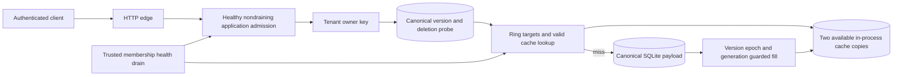

# Architecture and System Design Placement Handbook — Part 17
# S10: Load Balancer and Distributed Cache

**Estimated time: 4–6 hours | Architecture numeric module: 15 | Requires: A0–A4; Resume M15/M19/M27 refreshers**

---

## Why this module exists

Hashing a key to a server answers where it belongs. It does not answer whether the server is overloaded, healthy or holding a current copy. A node that fails and rejoins can bring back stale values; a hot key can overwhelm its owner even when the ring distributes distinct keys evenly.

**Organizing principle: separate placement, live request admission and value authority; define failure and rejoin behavior for each.**

This example implements a deterministic virtual-node ring, distinct cache-copy targets, least-active application routing labels, draining, bounded LRU entries, TTL, source-version validation, late-fill guards and cold rejoin. It compares placement over 2,000 deterministic keys and exercises concurrent reads/writes, transaction rollback and actual HTTP.

The cache nodes and application backends are in-process models. The HTTP edge does not forward traffic to separate backend servers, and the copied entries are not a network replication protocol. No Redis, gossip, consensus, automatic failure detector or throughput benchmark runs. The 30 questions are curated practice, not a measured employer-frequency ranking. This chapter develops bank Q35/Q49 and the resume bridge Q53.

---

## 1. Prompt and clarification questions

**Prompt:** route application requests across healthy instances and cache owned records across changing nodes. A cache node fails, an update occurs, and the node rejoins with old bytes. One key receives most traffic.

| Clarification | Design consequence |
| --- | --- |
| L4 connections or L7 requests? | Routing unit, protocol visibility and connection lifetime |
| Stateless application instances or local session state? | Failover and affinity contract |
| Cache versus authoritative database? | Eviction, loss, stale reads and recovery |
| Required freshness and read-your-writes? | TTL-only, invalidation or authoritative version checks |
| Read/write distribution and hot keys? | Placement differs from load distribution |
| Who owns membership and health? | Configuration epochs, detector uncertainty and split views |
| Replication factor and failure domains? | Distinct physical copies and correlated loss |
| What happens with no cache or no backend capacity? | Source fallback, rejection and overload protection |
| Migration/rejoin requirements? | Cold warmup versus online transfer/resynchronization |

The fixture caches small owned records and treats SQLite as authority. Application routing uses two outstanding slots per healthy nondraining backend label. Cache placement uses two available distinct nodes where possible. A full cache outage falls back to source; unavailable application admission returns 503. Source unavailability is not bypassed with stale values.

---

## 2. Contract and invariants

| Area | Executed policy |
| --- | --- |
| Placement | SHA-256 ring, 32 virtual points/physical node, sorted stable membership |
| Copies | First two distinct healthy physical nodes in ring successor order |
| Health | Trusted explicit state changes; configured ring remains separate |
| Routing | Least active eligible label, deterministic name tie-breaker, two slots/backend |
| Drain | Stop new admission; existing tokens may finish |
| Cache identity | Structured tenant/owner/key; no ambiguous concatenation |
| Valid hit | Entry unexpired and version equals current nondeleted source head |
| Late fill | Same source snapshot, membership epoch, target set and node generations |
| Rejoin | Clear returning node, increment generation, then allow reads |
| Membership change | Increment epoch and clear all model caches; no online transfer |
| Memory model | Four entries/node by default; exact local LRU, fixed 1,000 ms TTL |

Hash placement alone grants no permission. Authentication scopes both source and cache keys. A stale cached value cannot override a newer source version or tombstone. Source writes use expected-version comparison and advance versions, including explicit recreation after deletion.

The coherent local read pays for an authoritative version/deletion probe every time. This is a correctness demonstration with an explicit cost, not a claim that a 90% hit ratio removes 90% of database requests. The shared process lock serializes cache operations; it is not a distributed lock or evidence of scalable throughput.

---

## 3. Capacity, hit ratio and hot-key estimates

{{ESTIMATES_OUTPUT}}

At an assumed 10,000 requests/second and 20 ms mean request time, average concurrent work is about 200 requests before headroom. Tail latency, burstiness, connection reuse and unequal endpoint cost still matter. A backend's active connection count may also differ from active request count with keep-alive or multiplexed protocols.

A hypothetical 90% payload hit ratio leaves 1,000 payload misses/second. This fixture still performs 10,000 source-head probes/second at that assumed workload, and misses can perform additional source reads. The `loads` counter records logical miss loads, not all SQL executions, database bytes or an observed service rate.

If one key receives 60% of requests, it receives 6,000 requests/second regardless of how evenly the other keys are distributed. More virtual nodes redistribute key ownership; they do not split that single key's request rate. Independent read copies, local near-caches, request coalescing or redesigning a mutable hot object may help under an explicit consistency policy.

---

## 4. State and authority boundaries

| State | Responsibility |
| --- | --- |
| SQLite `records(tenant,owner,key)` | Canonical value, version and tombstone |
| Immutable `Ring.points` | Hash placement for one configured member set |
| Cache `epoch` | Generation of local configured membership |
| Node health/generation | Eligibility and restart/rejoin fence |
| Per-node OrderedDict | Bounded copied values, versions and expiries |
| Router nodes/tokens | Local admission counts and outstanding request ownership |

The ring orders hash points and chooses clockwise successors, wrapping at the end. Distinct physical-node selection prevents two virtual points of one server from being mistaken for two independent copies. More virtual points improve the granularity of ownership distribution but add metadata/lookups and do not guarantee equal load.

The Dynamo paper discusses partitioning and replication using consistent hashing in a broader storage design. This local example implements only its stated ring/copy model; it does not implement Dynamo conflict resolution, quorum or membership protocols. [Dynamo paper](https://www.allthingsdistributed.com/files/amazon-dynamo-sosp2007.pdf).

---

## 5. API and trusted control plane

| Actual endpoint | Contract |
| --- | --- |
| `GET /items/:key` | Credential-scoped value/version, hit/miss and model backend label |
| `PUT /items/:key` | expected_version/value; zero means no prior source version |
| `DELETE /items/:key` | expected_version; commit a newer source tombstone |

Successful writes return 200. Wrong expected version returns 409; missing/deleted owned data returns 404; anonymous calls return 401. Another owner or tenant's same key cannot select that record. Unknown body fields cannot supply a different tenant.

Health, membership, drain and fill-ticket methods are trusted local control/worker methods. They have no public management endpoints. A real proxy needs authenticated control updates, stable configuration epochs, request deadlines, upstream connection handling and bounded retries. The model returns labels rather than opening upstream connections.

---

## 6. Smallest architecture and request trace



**Read:** authorize → admit backend label → probe current source head → seek a valid eligible copy → return hit or load source and fill guarded targets → release admission in finally. **Write:** compare expected source version → commit value/tombstone → invalidate local copies. **Lost invalidation:** a retained old entry fails the next source-head version check.

**Failure/rejoin:** mark node ineligible without rewriting configured ring → use other distinct healthy successors → clear returning node and increment generation before eligibility → reload on demand. **Membership change:** install a new ring/epoch and start caches cold. This deliberately trades warmth for simple local recovery semantics.

---

## 7. Shared executable HTTP and transaction support

{{RUNTIME_CODE}}

The unchanged S4–S6 helper supplies fixed lesson credentials, bounded JSON, per-request database connections and no-store HTTP responses. Internal cache TTL is separate from browser HTTP caching. This helper is neither an NGINX replacement nor a production network proxy.

---

## 8. Executable placement, admission and coherent cache

{{CORE_CODE}}

`ticket` deliberately allows the verifier to pause between capture and fill. `fill` checks the captured source snapshot plus topology/incarnation state before insertion. The authoritative source head on later reads remains a second defense even if a separate source writer races a fill. All cache coordination is local to this process.

The exact local LRU counts entries, not bytes. A 256-character value cap is not a production memory accounting policy: Unicode encoding, keys, dictionary overhead and multiple copies add cost. Redis exposes memory limits and alternative eviction policies; its implementation should not be described as this OrderedDict algorithm. [Redis eviction](https://redis.io/docs/latest/develop/reference/eviction/).

---

## 9. Placement evidence and remapping denominator

{{PLACEMENT_OUTPUT}}

The sample compares old and new primary owners over exactly the same 2,000 keys. With an added node, changed primaries go only to that new node; removing a node preserves primaries that belonged to surviving nodes. Those are structural checks, not an assertion that the moved fraction always equals one divided by the new member count.

The modulo comparison uses the same digest and fixed numeric node indices for three versus four nodes. It illustrates how changing the divisor can remap many keys; it is not a fair throughput comparison or a proof that every hash-placement alternative is worse. Report workload, member identities, virtual-node count and primary-versus-replica movement separately.

More balanced distinct-key counts also do not prove balanced bytes, CPU, request frequency or tail latency. Resume benchmark answers should identify which quantity was actually measured and avoid turning a placement sample into a requests-per-second claim.

---

## 10. Request admission, health and drain

{{ROUTING_OUTPUT}}

The direct model keeps two requests outstanding to prove that the second selects a different less-active label. Draining a backend preserves its active token but prevents new admission. An unhealthy backend can finish already admitted calls; there is no claim of remote cancellation. With all eligible capacity exhausted, admission rejects with 503.

Round robin is simple for similar work. Least-connections/least-active policies react to outstanding work but may misrepresent cost. Weighted routing accommodates capacity differences; hashing supplies affinity; latency-aware policies need stable measurements and feedback control. NGINX documents actual proxy algorithms and passive health behavior separately from this local model. [NGINX load balancing](https://nginx.org/en/docs/http/load_balancing.html).

A health observation is evidence from a detector's viewpoint, not proof that a process is universally dead. Add hysteresis, deadlines and controlled probes to avoid flapping. Readiness controls new admission; liveness/restart decisions and graceful shutdown have different responsibilities.

---

## 11. Coherence, failure and concurrent work

{{COHERENCE_OUTPUT}}

TTL expires entries but does not make them fresh immediately after a source write. Invalidation alone has a lost-message and late-fill race. This fixture adds current head checks and rejects an old captured fill after update/delete. An expected-version API retry can conflict after its first write succeeded; it is optimistic concurrency, not a stable client operation-response replay protocol.

{{FAILURE_REJOIN_OUTPUT}}

The failure tests read a surviving populated copy, reject a changed-target fill and isolate a generation change while source version stays unchanged. Membership epoch changes reject old fills independently. All cache nodes down still permits a source read; it does not establish source capacity for a fleet-wide cold start.

{{CONCURRENCY_OUTPUT}}

Two synchronized cold readers use separate database connections and one shared cache lock, yielding one logical miss and one hit. This is coarse process-local coalescing and serializes unrelated keys too. A production design usually needs bounded per-key coordination and wait deadlines; one process's lock does not collapse misses across a fleet. Two competing source CAS writes produce one new version and one conflict.

An injected SQLite update failure preserves the old source row; closing/reopening preserves committed source state with a fresh empty cache. Actual process kills, partitions and packet loss are not executed.

---

## 12. Actual HTTP evidence

{{HTTP_CONTRACT_OUTPUT}}

The owned loopback edge handles real reads/writes/deletes, scope checks and conflict responses. Its backend field is a model selection label, not evidence that a network proxy forwarded a request. Router slots are released on error as well as success. The verifier closes listeners/connections and removes temporary databases; port 3000 stays unused.

---

## 13. Cache and load-balancing alternatives

| Choice | Benefit | Cost or failure question |
| --- | --- | --- |
| Cache-aside | Application controls loading and canonical source stays independent | Miss amplification, invalidation and fill races |
| Write-through | A defined write path updates cache/source | Ordering, partial failure and who remains authoritative |
| Write-behind | Can acknowledge before source flush | Durable buffer, loss/replay and conflict policy |
| TTL-only reads | Avoid source checks while entry lives | Explicit bounded-staleness contract, not immediate revocation |
| Authoritative version probe | Reject stale versions/tombstones at read time | Source availability and per-read work remain |
| Sticky application routing | May improve locality | Failover, skew and session state still need correctness |

Cache-aside does not automatically synchronize independent local caches or guarantee source/cache consistency. Choose expiry/invalidation based on the application's freshness needs. [Azure cache-aside pattern](https://learn.microsoft.com/en-us/azure/architecture/patterns/cache-aside).

Copies, replicas and quorums are distinct commitments. Redis uses asynchronous replication by default, and acknowledgement options do not universally turn it into a strongly consistent system. This model's two synchronous dictionary inserts have none of the network failover semantics of Redis replication. [Redis replication](https://redis.io/docs/latest/operate/oss_and_stack/management/replication/).

---

## 14. Growth, hot keys and safe migration

Measure per-key request skew, byte size, backend service time and miss rate before choosing another ring layout. Replicating hot immutable reads can help; mutable hot counters may need atomic operations at an authority, partitioned counters with explicit aggregation, or a redesigned access pattern. Hashing alone does not make cross-key transactions or rate-limit counters safe.

A deployed configuration change needs a stable agreed membership view, versioned client configuration and a migration policy. During split views, two clients may choose different owners. A cache can tolerate misses if source fallback is bounded; an authoritative sharded store needs a much stronger ownership/write protocol.

Warmup, request coalescing, randomized expiry, admission limits and reserved source capacity can reduce cold-start stampedes. Do not fill unlimited data on every rejoin or simultaneously expire the whole fleet. The fixture clears all entries on a membership epoch and performs no online transfer, background warmup or cross-failure-domain placement.

---

## 15. Security and degraded behavior

Treat source and cache identity as structured tenant/owner/resource data from the authenticated context. Do not use a user-supplied routing key to bypass ownership, and do not cache private values under only a short document key. Protect health, membership and drain controls from ordinary clients.

Cache fallback is an explicit availability policy for this private-record example: source validation is still required, so unavailable source metadata causes failure rather than stale disclosure. Authorization, session revocation, inventory and financial balances often need different degradation rules from public product descriptions. Define each resource's fail-open/fail-closed behavior instead of one global “cache failure” rule.

Real proxies need an allowlisted upstream set, forwarding-header trust policy, transport security, body/deadline limits and safe retry semantics. A timeout on a mutating upstream call can hide a committed effect; blindly replaying it on another backend is not made safe by load balancing.

---

## 16. Observability and reproducible measurement

Track backend inflight/rejections, healthy/draining counts, latency by endpoint, cache hit/miss/expiry/eviction, logical load coalescing, stale-fill rejection, membership epoch and source fallback rate. Separate key count, byte share and request share. Avoid raw private cache keys or unbounded user identifiers as metric labels.

A useful performance experiment specifies hardware/runtime, node topology, data size, read/write mix, key popularity, concurrency, warm/cold state, duration, errors and latency percentiles. Report remapping denominator and whether movement concerns primaries or all copies. The included sample verifies deterministic placement and selected races; it measures no network throughput, p99 latency or production failover time.

---

## 17. Run, inspect and evidence limits

From the repository root:

```powershell
python examples/system-design/module-15-load-balancer-distributed-cache/verify.py
```

Verified {{DATE}} on Python {{PYTHON}}, SQLite {{SQLITE}}, {{OS}}. **{{TOTAL}} local checks passed**: {{COUNTS}}. Four synchronized worker calls exercise two cold readers and two source writers. Results live in `verification-results.json`; tracked database connections, the owned HTTP listener and the temporary directory are checked closed/removed.

The evidence covers local algorithms, bounded cache policies, source coherence guards, controlled topology changes and real edge HTTP. It does not establish distributed linearizability, consensus membership, automatic failure detection, network replication, actual upstream forwarding or throughput. A deployed multi-process cache/proxy needs additional integration and failure-injection evidence.

---

## 18. Interview questions and answers

### Q1. What does a load balancer do?

It selects eligible upstream capacity for incoming work under a routing policy. Its useful behavior includes health, admission, deadlines and draining, not just round robin. A production proxy also handles actual transport and connection lifecycle.

### Q2. How do L4 and L7 balancing differ?

L4 generally routes transport connections without application request semantics. L7 can inspect protocol-level requests and route by allowed application attributes. Connection reuse/multiplexing means connection count and request load are not identical quantities.

### Q3. Is consistent hashing a load-balancing guarantee?

It defines stable placement under a member set and limits selected ownership changes. Equal key counts do not imply equal requests, bytes or CPU. One popular key can dominate one owner despite many virtual nodes.

### Q4. Why use virtual nodes?

They give each physical node multiple points on the ring, improving placement granularity and making some capacity layouts easier. They add metadata and do not guarantee perfect balance, hot-key splitting or independent failure copies.

### Q5. Why require distinct physical replicas?

Two virtual points on the same machine fail together. The copy selector must skip repeated physical nodes. A real system should also consider rack/zone failure domains, which this local model does not implement.

### Q6. What happens when a node is added?

The new configured ring changes ownership for a subset of keys. The sample verifies that changed primaries move to the added node. Cache population/migration is separate; this fixture starts the new membership epoch cold.

### Q7. How is remapping measured correctly?

Use the same key sample and explicit old/new node identities, then divide changed primary owners by all sampled keys. Replica-set movement is a separate measure. Do not report an unspecified percentage as a throughput benchmark.

### Q8. How do health and membership differ?

Membership defines configured placement; health is a current eligibility observation. Temporary failure need not rewrite the ring. Different clients can have split views, so a deployment must state who publishes configuration and how epochs propagate.

### Q9. What does draining mean?

Stop admitting new work while allowing accepted work to finish within a deadline. The fixture retains outstanding tokens on a draining label. It does not implement socket shutdown or cancellation of a remote request.

### Q10. When is least-active useful?

When outstanding work is a useful proxy for load, especially with variable request duration. It can still miss CPU cost, streaming behavior and multiplexing. The model uses local active requests and deterministic tie-breaking.

### Q11. Do sticky sessions solve session reliability?

No. Affinity can improve locality, but the selected instance can fail or become hot. Durable shared/session authority or an explicitly designed stateless credential model still determines correctness after rerouting.

### Q12. What is cache-aside?

The application checks a cache, loads authoritative source on a miss and populates a copy. Writes require an explicit coherence policy. A cache is not automatically current merely because its entries have a TTL.

### Q13. Is TTL the same as eviction?

TTL limits how long an entry may be used under its expiry policy. Eviction removes entries under capacity pressure. A frequently used entry can expire, and an unexpired one can be evicted. Both normally lead to safe reload for a true cache.

### Q14. How does LRU work here?

Successful reads/fills move an entry to the end of an OrderedDict, and overflow removes the oldest entry. It is exact local entry-count LRU. It is not Redis's implementation or a byte-accurate memory policy.

### Q15. Why isn't invalidation alone sufficient?

An invalidation can be lost, or an older load can fill after deletion. The fixture validates current source head and guards captured fills by version/topology state. Distributed alternatives need their own ordering and freshness contract.

### Q16. What cost does the strict version probe impose?

Every hit still contacts the authoritative source head. It avoids some payload loads but does not remove source dependency or all database requests. This is an explicit correctness/performance tradeoff, not a free cache-consistency solution.

### Q17. What is a stale-fill race?

A loader captures old content, a write/delete changes authority, and the loader later inserts its captured value. Checking version and retained tombstone/epoch state can reject it; expiry alone leaves a stale window.

### Q18. Why use node generations?

A physical name can refer to a new incarnation after rejoin. Old work targeting that name must not be accepted automatically. Generation checks distinguish the returning cache from its previous lifetime even when source version stays unchanged.

### Q19. What happens on cache-node rejoin?

The fixture clears old entries and increments generation before making the node eligible. It reloads from canonical source on demand. Real replication may resynchronize instead, with a documented serving/freshness policy during recovery.

### Q20. What if every cache is unavailable?

This example serves source if application admission and source validation work. At scale, cap that fallback load and decide which traffic to reject. Source capacity for an ordinary miss rate may be insufficient for a total cache outage.

### Q21. What is a cache stampede?

Many requests load the same missing/expired value concurrently. Local coalescing, bounded distributed coordination, staggered expiry and controlled warmup can help. This model uses a coarse process lock; it does not collapse requests across machines.

### Q22. Why doesn't adding nodes fix a hot key?

The key still maps to selected owners, so its request concentration remains. Read replication or near-caches may help under a freshness policy. Mutable hot state may require a different data model or authority.

### Q23. Does two-copy caching provide quorum consistency?

No. Copy count alone says nothing about write acknowledgement, failures, ordering or conflict resolution. This model inserts two dictionaries synchronously in one process and implements no network quorum or failover protocol.

### Q24. How should mutating request retries work?

Use a stable operation contract at the effect authority or reconcile unknown outcomes. A proxy timeout does not prove the first backend did nothing. Optimistic expected-version writes can conflict on retry after success; that is different from response replay.

### Q25. How should cache keys include tenants?

Use an unambiguous structured identity containing all isolation dimensions, such as tenant/owner/resource/version where appropriate. Derive authority from verified context. A routing hash never substitutes for a resource permission check.

### Q26. When can stale reads be acceptable?

When the product explicitly permits a bounded freshness window for that resource. Public descriptions may differ from session revocation or payment balances. Define outage, TTL and revocation behavior per data class.

### Q27. What changes for authoritative sharded storage?

Losing a node cannot simply become an empty cache miss. Ownership, durable replicas, write ordering, partitions and recovery need a real protocol. This example always retains independent canonical source state.

### Q28. How should health checks avoid flapping?

Use a defined observation window, failure/recovery thresholds, timeouts and limited probes. Distinguish readiness from liveness and dependency failure. The fixture uses explicit controlled state changes, not an implemented detector.

### Q29. What did the included measurements establish?

Deterministic primary placement/remapping over 2,000 fixed keys and selected local cache/routing transitions. They do not establish production throughput, latency, even request load or network failover time. State that boundary in a resume discussion.

### Q30. Give a compact design answer.

Separate live request admission from cache-key placement and source authority. Use stable membership, distinct copies, explicit health/drain and cold/resynchronized rejoin. Bound memory and misses, fence stale fills, state freshness/fallback costs and measure hot-key load separately from key distribution.

---

## 19. A 45-minute mock and answer skeleton

**Mock prompt:** “Design application routing and a distributed cache. A node fails, an update occurs, the old node rejoins, and one key becomes extremely popular.”

| Segment | Minutes |
| --- | --- |
| Clarify routing unit, authority and freshness | 5 |
| Estimate inflight, misses, skew and source fallback | 7 |
| Specify placement, membership and admission state | 8 |
| Trace normal read/write and guarded cache fill | 10 |
| Inject failure, rejoin, stale fill and hot-key burst | 10 |
| Defend migration, measurement and proof limits | 5 |
| **Total** | **45** |

A defensible short answer:

> I would route requests using current eligible application capacity and place cached records using stable tenant-scoped hash identity. Membership, health and node incarnation are separate states. The source remains authoritative; reads use the chosen freshness contract, and fills are fenced against newer versions, deletion and topology changes. Returning nodes start cold or complete a documented resynchronization. Miss fallback and warmup are bounded. I would measure request/byte skew and latency separately from distinct-key distribution and report the cost of authoritative version checks explicitly.

---

## 20. Practice tasks

1. Clarify L4/L7 routing, connection/request lifetime, cache authority and permitted staleness for private records versus public content.
2. Recompute inflight, payload misses, source-head probes and a hot key's traffic from the workload assumptions.
3. Compare ring primary placement before addition/removal over the same keys; report primary and copy-set movement denominators separately.
4. Change virtual-node count and key popularity. Explain why balanced key counts can coexist with a saturated server.
5. Hold two model requests outstanding, drain one label and exhaust the remaining capacity; inspect token release after errors.
6. Drop invalidation after a source write, then pause an old fill across update/delete. Inspect version and tombstone guards.
7. Fail and rejoin a cache without changing the source version, then change membership. Isolate generation versus epoch rejection.
8. Race cold readers and source CAS writers. Replace the coarse lock with a proposed bounded per-key/fleet coordination design.
9. Design an actual proxy/cache deployment with health hysteresis, bounded fallback, warmup, real replication and private key scoping.
10. Complete the mock and Q35/Q49/Q53, including a reproducible performance experiment and honest claims about this local evidence.

---

## 21. Completion checklist

- [ ] I can separate placement, admission and value authority.
- [ ] I can explain L4/L7 routing and active-work metrics.
- [ ] I can build a stable virtual-node ring with distinct physical copies.
- [ ] I can measure remapping with an explicit denominator.
- [ ] I can distinguish configured membership, health and draining.
- [ ] I can estimate hit/miss traffic and source validation cost.
- [ ] I can explain TTL, eviction and hot-key skew.
- [ ] I can reject late fills after update/delete.
- [ ] I can fence old topology and node incarnations.
- [ ] I can bound miss coalescing and full-cache-outage fallback.
- [ ] I can separate cache copies from network replication guarantees.
- [ ] I can finish the mock and state benchmark/proxy proof limits.

---

## 22. Research references and continuation

Reviewed {{DATE}}. Primary references: [NGINX routing](https://nginx.org/en/docs/http/load_balancing.html), [Dynamo paper](https://www.allthingsdistributed.com/files/amazon-dynamo-sosp2007.pdf), [Redis eviction](https://redis.io/docs/latest/develop/reference/eviction/), [Redis replication](https://redis.io/docs/latest/operate/oss_and_stack/management/replication/), and [Azure cache-aside](https://learn.microsoft.com/en-us/azure/architecture/patterns/cache-aside). Algorithms, policies, estimates and Q&As are authored reasoning; the fixture does not reproduce those products' complete behavior.

Return to the [architecture roadmap](/docs/system-design), [A2 data and caching](/docs/system-design/data-caching-scaling), [A4 operations](/docs/system-design/secure-observable-operations) or [Resume M27 load-balancer bridge](/docs/resume-skills/system-design-load-balancer).

**Next: [S11 — Multi-tenant SaaS with authentication and permissions](/docs/system-design/multi-tenant-saas)**, architecture part 18 / numeric module 16. It develops current session/membership authority, document sharing, invitation lifecycle, atomic quotas and scoped delayed work. S0–S11 are authored; later systems and consolidation remain planned.
