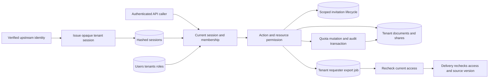

# Architecture and System Design Placement Handbook — Part 18
# S11: Multi-tenant SaaS with Authentication and Permissions

**Estimated time: 4–6 hours | Architecture numeric module: 16 | Requires: A0–A4 and S1; Resume M7/M8/M21/M28 refreshers**

---

## Why this module exists

A valid login does not authorize every tenant, document or administrative action. A user can change a resource ID, retain a token after demotion, replay an old invitation or queue a job before access is revoked. Each path needs a current, scoped authority decision.

**Organizing principle: authentication identifies the caller; current membership, role and resource relationships authorize each operation inside its data boundary.**

This example implements tenant-bound opaque sessions stored as hashes, current role checks, document ownership/sharing, verified tenant switching, expiring revocable invitations, atomic document quotas and delayed metadata exports. Actual HTTP tests cover negative access, invitation acceptance and session revocation. The user changes document/tenant context in controlled tests instead of relying on unpredictable identifiers as protection.

Upstream login is a trusted fixture method. There is no password/OIDC flow, browser cookie/BFF, CSRF implementation, email delivery or object storage. Those architecture boundaries are explained separately from the executed bearer API. The 30 Q&As are curated practice rather than measured interview frequency. This chapter develops bank Q23/Q36/Q50 and the Q54/Q55/Q59 resume bridges.

---

## 1. Prompt and clarification questions

**Prompt:** build a shared SaaS workspace with users in multiple tenants, owner/admin/member/viewer roles, private documents, explicit read sharing, invitations and per-tenant quotas. Removed members and revoked readers must not retain access through existing sessions or queued exports.

| Clarification | Design consequence |
| --- | --- |
| Can one user belong to multiple tenants? | Global identity versus per-tenant membership and active context |
| Which roles and resource relationships matter? | Explicit action matrix, ownership and sharing predicates |
| Do admins read every document? | Product privacy policy, not an automatic consequence of the name admin |
| Browser/BFF, direct API or service clients? | Cookie/session/token boundaries and CSRF responsibilities |
| What revokes access and how quickly? | Current membership checks, session revocation and cache lifetime |
| Invitations to existing accounts or email addresses? | Recipient verification, audience and delivery threat model |
| Which quota and billing rules apply? | Atomic usage, reservations and tenant fairness |
| Jobs, uploads, search or exports? | Tenant context beyond the request handler |
| Pooled rows, schema or database per tenant? | Isolation, operations, routing and migration cost |

The fixture uses global users with tenant memberships, a fixed active tenant per session, title-only documents and explicit read shares. Owner/admin can manage/read tenant documents by policy; member can manage owned documents; viewer can read owned/shared documents but cannot write. A different product can choose narrower admin visibility, but it must encode that choice explicitly.

---

## 2. Contract and invariants

| Area | Executed policy |
| --- | --- |
| Session | Random opaque bearer, SHA-256 digest stored, expiry/revocation checked |
| Active context | Session tenant plus current active user/membership/role |
| Switch | Verify target membership, issue new token and revoke old token atomically |
| Document | Tenant-filtered lookup plus current role/owner/read share |
| Write | Current nonviewer document manager; optimistic expected version for edits |
| Sharing | Document manager, active recipient in the same tenant |
| Membership | Owner/admin matrix, last active owner protection |
| Removal | Disable membership, remove reader shares and revoke tenant sessions together |
| Invitation | Random hashed capability, fixed audience, recipient, role, expiry and server revocation |
| Quota | Current active document count checked with create/intent/audit in one transaction |
| Export | Tenant/requester scope, worker permission recheck and delivery/version recheck |

Every public data operation revalidates session/membership in its local transaction. A remembered role from initial login is not authority. Wrong tenant/private-resource access returns 404; authenticated disallowed role actions such as viewer creation return 403. Invalid or removed membership/session returns 401.

The current-state guarantee is local to each operation's transaction. It does not retroactively remove already delivered bytes or prove instantaneous revocation across independent services/caches. Authentication, authorization, data scoping and resource lifecycle are separate layers of the contract.

---

## 3. Scale, session and quota estimates

{{ESTIMATES_OUTPUT}}

At 1,000 tenants with twenty users each, the assumed membership population is 20,000 rows; 500 documents/tenant gives 500,000 documents. Users can belong to several tenants, so membership rows and unique user count are different quantities. Averages also hide one large tenant dominating storage, connections or job capacity.

The fixture permits session TTL up to one hour and invitation lifetime up to one hour, with exact-boundary expiry. Those are example bounds, not universal security recommendations. Session risk, reauthentication, idle timeout and device/session revocation need a product-specific policy and real identity-provider integration.

Per-tenant document quota is one integer configured by trusted setup. Quota admission must share a transaction with the state consuming it; reading count and inserting separately can over-admit. Storage bytes, seats, model tokens, exports and job concurrency need their own definitions and atomic reservation/release rules. A document-count limit is not a complete SaaS billing system.

---

## 4. Schema and permission matrix

| Table | Responsibility |
| --- | --- |
| `users`, `tenants`, `members(tenant,user)` | Global identity, workspace and current scoped role/status |
| `sessions(hash)` | Opaque credential binding to user/active tenant/expiry/revocation |
| `docs(tenant,id)` | Canonical title, owner, version and deletion marker |
| `creates` | Original create operation/title binding, separate from current edited title |
| `shares(tenant,doc,reader)` | Explicit current read grants |
| `invitations` | Hashed recipient/audience/tenant capability and lifecycle state |
| `audit` | Actor/tenant/action/resource metadata in mutation transactions |
| `exports` | Durable tenant/requester/document metadata-work record |

| Action | Owner/admin | Member | Viewer |
| --- | --- | --- | --- |
| Read/list | All current tenant documents | Own or explicitly shared | Own or explicitly shared |
| Create | Yes within quota | Yes within quota | No |
| Edit/share | Any tenant document | Own document | No |
| Invite | Member/viewer recipients only | No | No |
| Change ordinary membership | Yes | No | No |
| Grant/change owner/admin | Owner only | No | No |

Resource IDs remain scoped by tenant even if UUIDs are practically unique. A guessed or leaked UUID is not a capability. The schema includes selected foreign keys, but authorization is enforced through service paths; direct privileged SQL can bypass those paths. There is no claim that every possible SQL mutation is protected by row-level security in this SQLite example.

---

## 5. API, active tenant and identity boundary

| Actual endpoint | Contract |
| --- | --- |
| `GET /session` | Current user, active tenant and current role |
| `POST /session/switch` | Requested tenant verified against membership; rotate bearer |
| `POST /session/logout` | Revoke this bearer |
| `GET/POST /docs` | Scoped visible list or stable-operation create |
| `GET/PUT /docs/:id` | Current resource check; edit includes expected_version |
| `PUT/DELETE /docs/:id/shares/:reader` | Current manager grants/revokes a same-tenant reader |
| `PUT /members/:user` | Current privileged role changes role/active state |
| `POST /invitations` | Issue member/viewer invitation for a known recipient |
| `POST /invitations/accept` | Authenticated intended recipient, capability and audience |
| `DELETE /invitations/:id` | Same-tenant admin/owner revocation |
| `POST /docs/:id/exports` | 202 durable metadata work |
| `GET /exports/:id` | Current requester/scope/permission/version recheck |

The normal body cannot override tenant. Switching is the explicit exception where a requested target is checked against current verified membership; it does not mean arbitrary tenant input becomes trusted. The shared helper's fixed `lesson-alice` identity is ignored for this chapter. Only the new durable opaque bearer determines SaaS authority.

The trusted `session(user,tenant,...)` setup method represents issuance after identity verification. It is not an exposed login endpoint and is not a model for allowing a browser to assert its own username. Source setup, worker execution and tenant quota configuration also remain trusted internal methods.

---

## 6. Smallest architecture and BFF trust trace



**Executed request:** opaque bearer → session hash lookup → active user/member and expiry → current role/action → tenant/resource predicate → transaction/read result. **Browser/BFF architecture, discussed:** verify login at an identity authority → create server session → browser carries a protected cookie to BFF → BFF derives verified user/tenant and calls backend using an authenticated service/session contract → backend authorizes resource access independently.

Never trust an internet-supplied `X-Tenant` or `X-User` header merely because the BFF also uses that name. The backend must authenticate the hop and either validate the credential itself or accept narrowly defined assertions from an authenticated trusted intermediary. The local fixture runs one bearer API and implements neither of those deployed BFF protocols.

---

## 7. Shared executable HTTP and transaction support

{{RUNTIME_CODE}}

The helper is reused unchanged from S4–S6, but its parsed fixed credential identity is deliberately ignored by SaaS dispatch. Raw Authorization reaches the chapter's own hashed-session authority. HTTP responses are no-store; this example returns no browser cookies and makes no CSRF claim.

---

## 8. Executable sessions, policy, invitations and quotas

{{CORE_CODE}}

Transactions use SQLite `BEGIN IMMEDIATE`, including authorized read paths. That gives a simple serialized local policy/mutation boundary but can create writer contention even for reads. A production database needs a deliberate isolation and concurrency strategy rather than blindly copying this lock pattern.

The document model stores titles only. `deleted` supports query scoping, but no public delete or cleanup API is implemented. Retention caps are 256 source documents, 256 session rows, 64 invitations and 64 exports; there is no archival/expiration sweeper. A valid current writer can replay create at quota because the original operation is checked before new quota admission; changed intent conflicts.

---

## 9. Session lifecycle and current roles

{{SESSIONS_ROLES_OUTPUT}}

Session data binds an active tenant, not an eternal privilege snapshot. Demoting Bob to viewer immediately changes his existing session's role; owning a document no longer authorizes writing under the viewer policy. Removing membership also deletes reader shares and revokes its tenant-bound sessions. Explicit reactivation requires a new session; the old bearer does not revive.

A failed tenant switch leaves the old session usable. A successful one verifies the target and atomically rotates credentials. Logout revokes one session; global logout, device lists, idle timeout and reauthentication are not implemented. Raw session tokens are never recorded in the verification observations.

In browser deployments, use the chosen cookie's Secure, HttpOnly, SameSite, path/domain and lifetime semantics deliberately, and address CSRF for automatically attached credentials. Those controls solve different problems: HttpOnly does not make malicious same-origin actions impossible, and cookie settings do not replace resource authorization. [MDN Set-Cookie](https://developer.mozilla.org/en-US/docs/Web/HTTP/Reference/Headers/Set-Cookie), [OWASP CSRF](https://cheatsheetseries.owasp.org/cheatsheets/Cross-Site_Request_Forgery_Prevention_Cheat_Sheet.html).

Opaque sessions simplify server revocation but require state lookup. Signed JWT/JWE alternatives need issuer/audience/expiry/key validation and a plan for role changes/revocation. Encryption protects token contents under its contract; it does not authorize a document or guarantee that embedded membership is still current. [OWASP session guidance](https://cheatsheetseries.owasp.org/cheatsheets/Session_Management_Cheat_Sheet.html).

---

## 10. Resource isolation and delayed exports

{{ISOLATION_EXPORTS_OUTPUT}}

Tests change document IDs across private owners and tenants, attempt cross-tenant edit/share, and give a viewer a read grant without write/reshare power. Lists apply the same visibility policy rather than leaking records that a detail endpoint would reject. Owner/admin access remains intentionally limited to their active tenant.

The export job stores tenant, requester and document identity durably. Its internal worker rechecks active membership and current document permission. A completed metadata result also rechecks current requester scope/permission and canonical version at delivery. Revocation hides an already produced result; an edit makes an old result stale with 409.

This is metadata work, not a generated PDF, object download or sandboxed job platform. Session logout alone does not cancel accepted work: worker authority is current user/membership/resource access, while delivery requires a valid current session. A deployed file export needs private object keys, scoped download grants, expiry/cleanup and a stated limit on revocation after bytes or signed URLs have been delivered.

---

## 11. Invitation lifecycle, quota races and rollback

{{INVITATIONS_OUTPUT}}

The executed invitation is a high-entropy opaque capability whose digest and authority fields live server-side. It is not a signed JWT. The database binds tenant, intended existing user, member/viewer role, audience, expiry, revocation and used state. Accepting requires both an authenticated intended recipient and the capability; possession alone is insufficient.

Two accepts converge on accepted/already_accepted with one membership. A consumed invitation cannot reactivate a subsequently removed member. Expired/revoked tokens fail, and revoking an accepted invitation does not itself remove the membership it already created; membership removal is a separate privileged action. Invitations remain valid until their own expiry/revocation even if the issuing admin's role later changes under this stated policy.

A signed invitation is another valid design: verify signature plus issuer/audience/tenant/subject/scope/expiry and use a server-side ID/version for revocation and one-time consumption. A signature alone cannot enforce later revocation or prevent two concurrent accepts from creating conflicting effects. The local choice keeps those mutable decisions at one authority.

{{QUOTA_ATOMICITY_OUTPUT}}

Two creates compete for the last tenant slot, and only one commits. A replay of the winner succeeds at full quota, while a new operation conflicts. A second tenant has its own allowance. Trigger-injected audit failures roll back document/intent creation or invitation consumption/membership together; the audit is local mutation evidence, not an immutable external security log.

The last-owner rule is also checked in the membership mutation transaction. An owner can promote another existing member before relinquishing ownership. Admins cannot promote/demote owner/admin identities through this API. Global account disabling and emergency administrator recovery are separate product operations, not implemented shortcuts.

---

## 12. Actual HTTP evidence

{{HTTP_CONTRACT_OUTPUT}}

The owned loopback server handles real session, document, sharing, export, invitation, tenant-switch and logout requests. Fixed lesson identities fail, and another tenant's document/export stays hidden. Worker execution and upstream session issuance remain trusted direct calls. No email is sent and no external account/provider is contacted.

The verifier closes listeners/connections and removes temporary database files. Port 3000 stays unused. The transport tests demonstrate selected API wiring and negative access behavior, not a browser login or production authentication assessment.

---

## 13. Isolation and authorization alternatives

| Choice | Benefit | Cost or question |
| --- | --- | --- |
| Pooled tenant rows | Shared operations and efficient resource use | Every data path/key needs scope and negative tests |
| Schema per tenant | More namespace separation | Migrations, pooling and tenant routing still matter |
| Database per tenant | Stronger operational separation/customization | Connection, backup, fleet migration and cost growth |
| Role-based checks | Clear action matrix | Roles alone may miss ownership/sharing relationships |
| Relationship/attribute policy | Express resource ownership, grants and context | Policy complexity, consistency and evaluation evidence |
| Database RLS defense | Additional row filtering at the database boundary | Database roles, bypass privileges and pooled context must be correct |

PostgreSQL row-security policies can restrict row access, with important owner/privileged-role and enforcement details. They do not remove the need to scope objects, queues, caches or external retrieval. RLS is discussed, not deployed in SQLite. [PostgreSQL row security](https://www.postgresql.org/docs/18/ddl-rowsecurity.html).

Choose isolation from actual requirements, operations and threat boundaries. “Database per tenant” does not solve an application routing a request to the wrong database, and pooled rows do not justify omitting tenant predicates because IDs are globally unique.

---

## 14. Whole-path tenant isolation and growth

Carry verified tenant/resource identity into SQL access, cache keys, object metadata, queue jobs, search filters, vector namespaces and graph predicates. Each destination still needs its own authenticated authority decision. A frontend-selected namespace or an embedding filter supplied by the browser is not proof of membership.

Use compound keys/constraints where appropriate to prevent cross-tenant relationships, centralize scoped repository/service access, and test both list and detail paths. With connection pools, transaction-local tenant context must not leak into the next request. Administrative cross-tenant tooling should use an explicit separate privilege and audited workflow.

Noisy tenants need bounded connections, job concurrency, storage and downstream/model budgets. Apply the appropriate scoped limiter from S1 alongside atomic business quotas; this fixture implements document-count admission and retention caps, not a login/invite abuse limiter or paid billing reservations. Migrations and account deletion need resumable tenant-scoped work and reconciliation across external stores.

---

## 15. Trust, secret handling and negative tests

Authorize by default-deny action/resource rules at every entry path, including worker execution and result delivery. Keep tests for another tenant, another owner, revoked share, viewer write, demoted admin, removed membership, reused session, wrong invite audience and concurrent quota/acceptance. Hidden UI buttons are not backend policy. [OWASP authorization](https://cheatsheetseries.owasp.org/cheatsheets/Authorization_Cheat_Sheet.html).

Hashing a random bearer protects against a simple database-only token disclosure, but a stolen live raw token still acts as the caller until expiry/revocation. Use protected transport and deliberate client storage; avoid tokens in URLs, analytics and logs. Invitation delivery needs a real verified-recipient flow and abuse controls before exposing it outside the fixture.

The title-only service has no upload/vector/graph integration. The whole-path architecture is a design checklist for later systems, not evidence that those services were tested here. [OWASP multi-tenant guidance](https://cheatsheetseries.owasp.org/cheatsheets/Multi_Tenant_Security_Cheat_Sheet.html).

---

## 16. Observability and incident response

Record tenant, actor, action, resource and decision reason at appropriate access-controlled boundaries. Mutation audit rows commit with the local business change. A deployed security event stream should also capture important denied attempts, invitation abuse and session anomalies; those denial logs are not implemented by the silent lesson HTTP helper.

Track session revocations, permission failures, invitation age/acceptance/revocation, quota rejection, export denial/staleness and tenant resource skew without exposing raw bearer/capability values. Investigate whether a leak came from incorrect policy, missing scope, stale permission caching, an external download grant or privileged tooling. “The JWT was valid” does not explain why a document was authorized.

---

## 17. Run, inspect and evidence limits

From the repository root:

```powershell
python examples/system-design/module-16-multi-tenant-saas/verify.py
```

Verified {{DATE}} on Python {{PYTHON}}, SQLite {{SQLITE}}, {{OS}}. **{{TOTAL}} local checks passed**: {{COUNTS}}. Four synchronized worker calls cover two invitation accepts and two quota creates. Selected transactions are fault-injected, committed state is reopened, actual HTTP paths are exercised, and owned resources are closed/removed. Evidence is in `verification-results.json`.

These tests establish local session/policy/invitation/quota/export mechanisms under the stated fixture. They do not establish real identity-provider login, BFF cookies/CSRF, email safety, object-store revocation, production RLS, global permission consistency, tenant deletion completeness or throughput. Each added external boundary needs its own verification.

---

## 18. Interview questions and answers

### Q1. What is multi-tenancy?

Serving separate organizations/workspaces within a shared product while enforcing their data, permission and resource boundaries. A global user can belong to several tenants, but each operation still needs one verified context and permitted action.

### Q2. How do authentication and authorization differ?

Authentication establishes caller identity under a credential contract. Authorization decides whether that caller may perform this action on this resource now. A valid session alone cannot grant access to every tenant or document.

### Q3. Where should tenant identity come from?

Verified session/membership context or a verified explicit tenant-selection workflow. A URL/body/header can request a target but cannot make itself authoritative. Backend resource queries must still enforce the resulting tenant scope.

### Q4. Why separate users and memberships?

Identity is global in this model, while role/status is scoped to one tenant. The same user can be an owner in one workspace and a viewer in another. A single global role field cannot express that policy correctly.

### Q5. What does a tenant switch require?

Check current user membership in the requested target, then establish an authenticated new context. Here a transaction issues a new tenant-bound bearer and revokes the old one. Simply changing a frontend variable cannot switch backend authority.

### Q6. Why store session token hashes?

The high-entropy raw bearer remains with the client, while the database retains a lookup digest. A simple database read does not directly reveal live raw tokens. This does not protect a stolen client token or replace transport/session lifecycle controls.

### Q7. Why check current role after login?

Membership can change while a session remains valid. Embedded or remembered old roles can retain privileges after demotion. This example queries current membership inside each authorized operation's transaction.

### Q8. What happens when membership is removed?

The mutation disables membership, removes its reader shares and revokes tenant-bound sessions. Reactivation requires a new session. Existing completed exports are also checked at delivery, so the old credential/result does not bypass removal.

### Q9. Why protect the last owner?

Otherwise an ordinary membership change can leave the tenant without a managing principal. Check the active-owner condition in the mutation transaction. Ownership transfer can promote another member first; emergency recovery needs a separate privileged design.

### Q10. How do ownership and roles interact?

They are both policy inputs. A member can manage an owned document here, while a demoted viewer cannot write even if still the owner. Admin/owner have explicitly chosen tenant-wide document rights, not cross-tenant access.

### Q11. Does a read share imply write access?

No. The grant enables read/list/export under current membership. Editing or resharing still requires document-management permission and a nonviewer role. Model each action rather than treating any relationship as universal access.

### Q12. Why return 404 for forbidden documents?

It avoids exposing private-resource existence through that endpoint and keeps foreign-tenant lookup behavior consistent. It is a product/API policy, not the authorization mechanism itself. Internal audit can retain more detailed decision reasons safely.

### Q13. Why do lists need their own checks?

Protecting only detail endpoints can still leak titles, counts and IDs through lists/search/exports. Apply the same visibility predicate before output and pagination. This fixture filters its bounded list by tenant and current visibility.

### Q14. What is IDOR?

An object-reference authorization failure where changing an ID reaches a resource the caller should not access. Unpredictable IDs reduce guessing but are not permission checks. Tests must try known foreign IDs across read, write, share and delayed-result paths.

### Q15. How should a BFF call a backend?

Through an authenticated trusted hop with a defined user/tenant assertion or credential validation contract. Strip/reject spoofable external identity headers and authorize resources at the backend. This example discusses that architecture but runs only an opaque bearer API.

### Q16. Are HttpOnly and SameSite enough for browser security?

They address specific cookie exposure and cross-site behavior under their documented contracts. They do not replace CSRF analysis, XSS prevention, server authorization or transport protection. The fixture sends no browser cookies and claims no browser-security implementation.

### Q17. Would JWT or JWE remove session state?

They can carry validated claims, but current roles, revocation and resource relationships still need a freshness strategy. JWE encryption is not document authorization. Compare operational lookup/revocation tradeoffs rather than treating token format as the complete security design.

### Q18. Is this invitation signed?

No. It is a random opaque capability whose digest and mutable authority live server-side. A signed token is another option, but expiry, recipient/audience, revocation and one-time membership effects still require explicit verification and state policy.

### Q19. Why bind an invitation to recipient and audience?

Forwarding or using a token for another workflow must not automatically authorize membership. The caller must be the intended authenticated user, and the selected operation must match the server-stored audience. Possession alone is insufficient here.

### Q20. How are simultaneous accepts handled?

Invitation state, membership insertion and audit commit in one transaction. One call accepts; the other returns already_accepted for the same still-active member. It does not create two memberships or independently repeat an entitlement effect.

### Q21. Can an old invite restore removed access?

Not under this policy. A consumed invitation whose membership was removed conflicts; an expired/revoked one fails. Reactivation is an explicit administrator operation. Revoking an already accepted invitation alone does not remove the existing member.

### Q22. Why not check quota before starting a transaction?

Two callers could both see the last free slot and insert. Count/admission, create intent, document and audit share the transaction here. Real byte/token quotas may require durable reservations across external work.

### Q23. Why allow a create replay at full quota?

It refers to an already committed logical document and consumes no new slot. Check original operation binding before new quota admission while still enforcing current writer permission. A changed operation payload conflicts instead of creating another resource.

### Q24. Why recheck queued work?

Permissions may change after acceptance. Store tenant/requester/resource identity durably and evaluate current authority before producing sensitive output. A worker's powerful service credential should not erase the originating user's scope.

### Q25. Why recheck completed export delivery too?

Access can change after generation. The delivery path must verify current requester/scope/permission and appropriate source version. An object already downloaded or a separately issued signed URL has a different revocation boundary that needs explicit design.

### Q26. What does database RLS add?

Another enforcement layer for row access under correctly configured database roles/policies. It can reduce missing-predicate risk but has bypass/context caveats and does not scope external caches/jobs/files. This SQLite example implements no deployed PostgreSQL RLS.

### Q27. How does pooling affect tenant context?

A reused connection must not retain the previous request's tenant or privileged state. Use a documented transaction-scoped context and reset/verification strategy. Explicit tenant predicates and negative tests remain valuable even with database policies.

### Q28. What changes for vector or graph retrieval?

Propagate verified tenant/resource identity into namespaces, filters and graph predicates, then enforce current permission/version before output. Client-selected namespaces and embeddings are not access authority. The later RAG design needs those additional integration tests.

### Q29. What should audit logs contain?

Scoped actor/action/resource and appropriate decision/result metadata, with protected retention and access. Do not include live bearer/invitation tokens. The fixture transactionally records mutations; denied-request logging and external immutable audit storage remain unimplemented.

### Q30. Give a compact design answer.

Separate global identity from tenant membership, derive a verified active context and check current action/resource policy on every path. Use scoped data keys, revocable sessions/invitations, atomic quota admission and worker/delivery rechecks. Test foreign IDs and changed permissions across synchronous and delayed outputs.

---

## 19. A 45-minute mock and answer skeleton

**Mock prompt:** “Design workspaces with roles, private documents and invitations. A valid user changes IDs, reuses a token after removal and downloads an export after unsharing.”

| Segment | Minutes |
| --- | --- |
| Clarify identity, tenants and action matrix | 5 |
| Estimate tenant skew, sessions and quota units | 7 |
| Define session, membership, document and invite keys | 8 |
| Trace verified context and current resource policy | 10 |
| Inject foreign IDs, revocation, invite/last-slot races | 10 |
| Defend BFF, whole-path scope and evidence limits | 5 |
| **Total** | **45** |

A defensible short answer:

> I would model global users and current tenant memberships separately, then bind each session to a verified active tenant. Every action checks current membership/role plus scoped resource ownership or grants. Tenant switching verifies membership and rotates context. Invitations bind recipient, audience, role and expiry with server-side revocation/consumption. Quota admission commits with the consuming resource and audit. Delayed jobs carry scope and recheck permission before work and result delivery. Browser/BFF, file and retrieval boundaries need their own authenticated contracts and negative tests.

---

## 20. Practice tasks

1. Write the action matrix for owner/admin/member/viewer and decide explicitly whether administrators can read every tenant document.
2. Trace a verified login through a proposed browser/BFF/backend path, distinguishing cookie protection, CSRF and resource authorization.
3. Change document IDs and tenant selection across reads, edits, shares, lists and export results. Compare policy failure with unpredictable IDs.
4. Demote and remove a user with an existing session. Reactivate membership and verify old credentials do not revive.
5. Switch to another authorized tenant and to an unauthorized tenant; inspect token rotation and old-context behavior.
6. Exercise invite recipient/audience mismatch, expiry boundary, revocation, concurrent accept and consumed-token replay after removal.
7. Propose a signed-invitation variant and identify the mutable authority still needed for revocation and one-time effects.
8. Race new documents for the final quota slot, replay the winner and inject audit failure to inspect quota/intent/resource rollback.
9. Revoke a share before worker execution and after export completion, then edit source. Design private object delivery and its revocation limits.
10. Complete the mock and Q23/Q36/Q50/Q54/Q55/Q59, including SQL/pool, cache, queue, file, vector and graph scope boundaries.

---

## 21. Completion checklist

- [ ] I can separate global identity, membership and active tenant context.
- [ ] I can distinguish authentication from current resource authorization.
- [ ] I can define and enforce an action/role/ownership matrix.
- [ ] I can reject foreign IDs across list, detail and write paths.
- [ ] I can explain hashed sessions, expiry, rotation and revocation.
- [ ] I can trace a proposed browser/BFF trust and CSRF boundary.
- [ ] I can enforce current demotion/removal and last-owner policy.
- [ ] I can bind invitations to recipient, audience and lifecycle state.
- [ ] I can handle concurrent accept and prevent removed-member replay.
- [ ] I can admit quota atomically with intent, resource and audit.
- [ ] I can recheck scope/permissions for workers and result delivery.
- [ ] I can finish the mock and state external/security proof limits.

---

## 22. Research references and continuation

Reviewed {{DATE}}. Primary references: [OWASP authorization](https://cheatsheetseries.owasp.org/cheatsheets/Authorization_Cheat_Sheet.html), [session management](https://cheatsheetseries.owasp.org/cheatsheets/Session_Management_Cheat_Sheet.html), [CSRF](https://cheatsheetseries.owasp.org/cheatsheets/Cross-Site_Request_Forgery_Prevention_Cheat_Sheet.html), [multi-tenant security](https://cheatsheetseries.owasp.org/cheatsheets/Multi_Tenant_Security_Cheat_Sheet.html), [MDN cookies](https://developer.mozilla.org/en-US/docs/Web/HTTP/Reference/Headers/Set-Cookie), and [PostgreSQL RLS](https://www.postgresql.org/docs/18/ddl-rowsecurity.html). The local role matrix, invite policy, quotas, code and Q&As are authored design choices, not a production security certification.

Return to the [architecture roadmap](/docs/system-design), [A4 operations/security](/docs/system-design/secure-observable-operations), [S1 scoped limiting](/docs/system-design/rate-limiter), [S9 private retrieval](/docs/system-design/search-autocomplete), [Resume M7 authentication](/docs/resume-skills/authentication-sessions-jwt-oauth) or [M8 authorization](/docs/resume-skills/api-security-authorization-multi-tenancy).

**Next: [S12 — Multi-tenant RAG knowledge-base platform](/docs/system-design/multi-tenant-rag)**, architecture part 19 / numeric module 17. It combines versioned ingest, current authorized retrieval, request evidence/citation acceptance, budget uncertainty and deletion with explicit local vector/model fixtures. S0–S12 are authored; the final worked system and consolidation remain planned.
