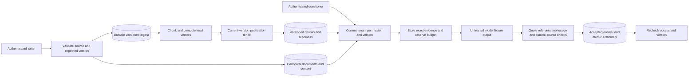

# Architecture and System Design Placement Handbook — Part 19
# S12: Multi-tenant RAG Knowledge-base Platform

**Estimated time: 5–7 hours | Architecture numeric module: 17 | Requires: A0–A4, S3, S7, S9 and S11; Resume M22–M26 refreshers**

---

## Why this module exists

A document is updated while an embedding worker retries its old version. A valid user queries another tenant's chunks. A generated answer cites a real document, but not the excerpt supplied to the model. A timeout leaves usage uncertain. These are architecture and authority problems before they are prompt-engineering problems.

**Organizing principle: keep source, index, request evidence and accepted output tied to verified tenant, permission and version boundaries.**

This chapter combines S11's unchanged session/membership authority with versioned plaintext ingestion, deterministic chunk identities, local vector ranking, current permission checks, generation reservations, strict extractive citation validation and deletion cleanup. A model fixture can return invalid references, fabricated text, a tool request or an unknown outcome. Actual HTTP exercises the request path.

The vectors are feature-hashed word counts, not learned semantic embeddings. The model copies an allowed excerpt; it is not a real LLM. There are no paid APIs, external vector service, PDF parser, object store, tool execution or streaming transport. Those deployment choices are explained separately. The 30 Q&As are curated design practice, not measured employer-frequency rankings. This chapter develops Q37/Q51/Q59 from the architecture bank.

---

## 1. Prompt and clarification questions

**Prompt:** users upload tenant-private knowledge, share selected documents and ask grounded questions. Edits, revocation, deletion and retries must not expose old or foreign content. Model work has a bounded budget and uncertain outcomes must remain visible.

| Clarification | Architectural consequence |
| --- | --- |
| Supported formats and ingestion trust? | Upload validation, extraction isolation, OCR and quarantine |
| User/tenant/document permissions? | Session context, candidate filters and final source checks |
| What does grounded mean? | Citation membership, exact quotes, entailment and answer correctness differ |
| Required edit/delete freshness? | Canonical versions, tombstones and cleanup contracts |
| Lexical, semantic or hybrid retrieval? | Index model, ranking/evaluation and migration |
| Languages and document structure? | Tokenization, chunk boundaries and citation offsets |
| Which model/provider and data policy? | Context limits, transport, retention, region and cost |
| Streaming or buffered answer? | Whether provisional text can escape before validation |
| Tools or read-only answers? | Separate tool authority, allowlists and side-effect budgets |
| Token, money and tenant quotas? | Reservation, provider usage normalization and reconciliation |

The baseline accepts bounded plain text, normalizes whitespace, uses character-window chunks and returns exact quoted evidence. Documents can be privately owned or explicitly read-shared. Owner/admin retain S11's tenant-wide document rights. “Public to all tenants,” anonymous upload, conversations and arbitrary tools are not part of this API.

---

## 2. Contract and invariants

| Concern | Executed policy |
| --- | --- |
| Identity | Current S11 opaque session, active user/membership and scoped role |
| Upload | Stable tenant/user/operation binds normalized text and title |
| Update | Current manager plus expected source version; new durable ingest job |
| Ingest | Source text/digest and job commit with the document mutation |
| Chunk identity | Hash of tenant/doc/version/chunker/embedder/ordinal |
| Publication | Current canonical version only; chunks/readiness/job finish atomically |
| Retrieval | Tenant, current source version and current permission before top-three ranking |
| Generation | One durable request identity, one local begin transition, bounded reservation |
| Acceptance | Exact supplied quote/reference, no tool request, valid fixture usage and current evidence |
| Delivery | Current requester/session plus current permission/version for completed answers/citations |
| Delete | Immediate canonical tombstone; separate row cleanup/redaction |

The model has no authority to select a new tenant, fetch another chunk, execute a tool or override a revoked grant. Retrieved text is data, even when it contains instructions. A reference to an existing chunk is insufficient: it must be evidence actually supplied to this request and still permitted/current at acceptance.

The local read/publish decisions are transactional. They do not promise revocation of bytes already delivered, removal from external providers/backups, or distributed linearizability. The implementation has no learned-model correctness or prompt-injection-immunity claim.

---

## 3. Corpus, vector and generation estimates

{{ESTIMATES_OUTPUT}}

100,000 documents with twenty assumed chunks each produce two million vectors. At 768 float32 dimensions, raw vector payload alone is 6.144 decimal GB. Index structures, source text, chunk metadata, replicas, delete history and backups add storage. This arithmetic is not the memory footprint of pgvector or a managed vector service.

The fixture uses 64-dimensional feature-hash vectors, at most three context chunks and a 512-character output bound. These limits make orchestration reproducible; they do not model a provider's tokenization or context window. Input normalization, repeated overlap, metadata prompts, tools and conversation history all affect real input-token cost.

For production planning, estimate ingestion bytes/day, parse/OCR time, chunk count, embedding requests/tokens, searchable lag, question rate, retrieval/rerank latency, model input/output tokens and retry amplification. Separate one-time reindex cost from ongoing questions. A new model/index generation may temporarily double stored vectors and embedding spend.

---

## 4. Data model, source versions and index profiles

| Table | Responsibility |
| --- | --- |
| Inherited `users/members/sessions/docs/shares` | Current identity, scope, source title/version and visibility |
| `rag_intents` | Original immutable upload fingerprint and source identity |
| `contents(tenant,doc,version)` | Normalized version text, checksum and indexing readiness |
| `ingest` | Durable unique version/chunker/embedder job and state |
| `chunks` | Exact normalized-source offsets, text, vector and profile identity |
| `budgets` | Tenant's total/held/used fixture character units |
| `questions` | Scoped operation, request state, reservation, input-unit count and accepted answer |
| `evidence(request,chunk)` | Exact request-scoped source/version/text snapshot |

Chunk offsets refer to normalized text, not original PDF page coordinates. A real parser must preserve a mapping to pages/sections/cells if citations need those anchors. Do not invent page numbers from character windows or silently change normalization without changing the parser/chunker profile.

Embedding dimensions alone do not define a vector space. Model identity/version, preprocessing and distance metric also matter. The executed profiles are fixed as `char120-overlap20-v1` and `featurehash64-v1`; unknown profiles are rejected for publication. A migration would need parallel generations, evaluation and a controlled query switch. This code does not implement that online migration.

---

## 5. API and trust boundaries

| Actual endpoint | Meaning |
| --- | --- |
| `POST /documents` | title/text plus Idempotency-Key; 202 pending source/ingest |
| `GET /documents/:id` | Current scoped title/version/index status |
| `PUT /documents/:id` | expected_version/title/text; 202 new version |
| `PUT/DELETE /documents/:id/shares/:reader` | S11 current manager/read-share policy |
| `POST /retrieve` | Bounded question; authorized current context candidates |
| `POST /questions` | question/reserve plus Idempotency-Key; buffered fixture generation |
| `GET /questions/:id` | Current requester and source checks before answer delivery |
| `GET /citations/:chunk` | Current authorized exact source/version/offset/quote |
| `DELETE /documents/:id` | Current manager commits a newer tombstone |
| `POST /documents/:id/purge` | Authorized cleanup after deletion |

Tenant comes from the verified S11 session, and the fixed lesson bearer identity is not authority. Status/citation/answer routes cannot use another tenant's IDs as permission. The question body cannot supply a namespace, raw retrieval filter, model tool or another owner.

Session issuance, budget configuration, indexing capture/publication and completion reconciliation are trusted fixture methods. Production ingestion workers and model adapters need authenticated service identities and bounded access of their own. The runtime does not contact an external identity, model or storage provider.

---

## 6. Smallest architecture and end-to-end traces



**Ingestion:** authorized source mutation → versioned text/checksum/job commit → compute chunks/vectors outside the publication transaction → check current document/profile → replace chunk set and mark ready together. A delayed old build cannot delete the new generation's chunks.

**Question:** authorized current retrieval → save exact request evidence and reserve tenant units → transition prepared to running → call model outside the database transaction → validate structure/evidence/usage/current access → settle budget and store only accepted output → recheck at delivery.

**Deletion:** canonical tombstone immediately removes new retrieval/citation access → cleanup removes local content/chunk rows and redacts associated stored request text/results → retain tombstone and minimal operation/usage evidence. Unknown already-started work keeps its reservation until known completion/reconciliation.

---

## 7. Shared runtime and reused S11 authority

{{RUNTIME_CODE}}

`rag.py` imports `SaaS` from `../module-16-multi-tenant-saas/saas.py`, unchanged from [S11](/docs/system-design/multi-tenant-saas). It reuses current session, membership, ownership, share and audit helpers; the RAG dispatcher exposes only this chapter's stated endpoints. Run the repository example with its dependency folders intact. The content audit records the dependency checksum separately from the embedded local source.

The helper supplies bounded JSON and real loopback HTTP, not production sessions, TLS, browser authentication or streaming. Inherited methods that create title-only documents are not exposed by the RAG API; source changes use the versioned upload/update path shown below.

---

## 8. Executable versioned ingestion, retrieval and acceptance

{{CORE_CODE}}

`vector` hashes normalized term counts into 64 bins and normalizes them. This implements actual deterministic numerical ranking but has collisions and no learned synonym/semantic knowledge. Retrieval also requires a literal term overlap, then ranks the current authorized candidate set by dot product. It scans a bounded local corpus; no ANN index runs.

`Model` emits one copied chunk. Invalid-reference, fabrication, tool and timeout modes are controlled fault fixtures. The exact quote rule is intentionally stricter than abstractive RAG and cannot evaluate general paraphrase entailment. A model's output is still untrusted even when it parses as JSON.

---

## 9. Source/index lag and atomic publication

{{VERSIONED_INGESTION_OUTPUT}}

An edit increments source version before the new index is ready. Old chunks disappear from retrieval through the canonical-version predicate; the new text can be temporarily unavailable until publication. The original upload operation still identifies the same edited document because its fingerprint is retained independently from current text.

The worker captures immutable version text and checksum. On commit, it verifies canonical version, job identity and profile before replacing chunks. A late old retry becomes stale; it cannot overwrite the current generation. A completed current publication replays without duplicate chunks.

{{ATOMIC_INGESTION_OUTPUT}}

Fault injection verifies source/content/intent rollback when job insertion fails, and chunk/readiness rollback when job completion fails. Two publishers use separate connections and converge on applied/replay. The example has no ingest daemon, external embedding API, worker lease/attempt budget or durable provider response. S7 supplies the relevant claim/retry concepts when those boundaries are added.

---

## 10. Scoped retrieval, citations and permission races

{{RETRIEVAL_ISOLATION_OUTPUT}}

The SQL candidate query checks tenant, nondeleted current document version, ready content, profile and current owner/admin/share policy before Python ranking/top-three selection. A private higher-scoring candidate cannot displace permitted results by being selected first and discarded afterward. Direct citation access repeats the source authorization and version check.

A request evidence record binds exact chunk ID, source document version and supplied text. Accepting a reference requires membership in that request's evidence, exact quote equality under this extractive contract and current source authority. It does not prove that the source is true, the answer is relevant, or a paraphrase is entailed.

{{PERMISSION_RACES_OUTPUT}}

Revocation before the model call blocks and releases an unstarted reservation. Revocation during the call suppresses output but still settles known fixture usage because work already happened. A completed answer cannot be read after later revocation; an edit similarly makes its source snapshot outdated. A valid session alone never overrides these source checks.

This revalidation cannot undo text already sent to a model provider or previously delivered to a user. Provider data handling and external download/stream boundaries require their own contract. Use least necessary context and prevent unauthorized data from entering the prompt in the first place.

---

## 11. Request identity, budgets, uncertainty and deletion

{{GENERATION_BUDGET_OUTPUT}}

The fixture reserves a worst-case character allowance before calling the model, stores request input-unit count, and atomically settles known usage with answer acceptance. The counter includes fixed overhead plus question/context/output characters; it is not provider tokens, money or the S8 CREDIT ledger. No context means abstention without a model call or reservation.

{{VALIDATION_UNKNOWN_OUTPUT}}

Unsupported references, fabricated quotes and tool requests cannot become accepted output. Valid known usage can still consume budget for a rejected response. An untrusted/excess usage response goes to usage_review and retains the reservation; timeout becomes unknown and also retains it. An idempotent HTTP retry does not start another model call. A trusted known response can reconcile once.

{{CONCURRENCY_OUTPUT}}

Two callers can capture the same question identity, but only one transitions prepared to running. Concurrent tenant reservations cannot exceed the configured allowance. An injected acceptance failure rolls back both usage settlement and stored answer; retrying the known completion does not need another model call. A process crash after begin can leave running work needing reconciliation; no automatic crash recovery/sweeper is implemented.

{{DELETION_OUTPUT}}

Delete immediately hides chunks/citations and fences delayed indexing. Purge separately removes local source/chunk rows and redacts all stored context/answers for affected requests, conservatively including their other supplied context. It releases unstarted reservations but keeps unresolved in-flight reservations. A late known response is blocked and can settle its retained input count without restoring text.

The retained tombstone prevents replay resurrection. SQL DELETE here is logical row removal, not secure disk erasure, backup removal or deletion from a provider that already received text. Cleanup covers this local source/index/request model only; original files, OCR caches, graph nodes, vector services, conversations and backups need explicit lifecycle coverage in a deployment.

---

## 12. Actual HTTP evidence

{{HTTP_CONTRACT_OUTPUT}}

The verifier sends real upload/status, retrieval, question, citation, share/revoke, update, delete and purge requests through an owned loopback listener. HTTP question replay keeps one model-fixture call. The worker publication and upstream session issuance remain direct trusted calls, not external queue/auth integrations.

Unknown/running/usage-review question submission returns 202; known completed/abstained/rejected states return 200 with explicit state. A successful HTTP transport response does not mean the answer was accepted. The listener and database connections close and the temporary directory is removed; port 3000 stays unused.

---

## 13. Retrieval, chunking and orchestration alternatives

| Choice | Benefit | Question to evaluate |
| --- | --- | --- |
| Fixed character/token windows | Simple bounded chunks | Broken tables/sentences, overlap cost and citation anchors |
| Structure-aware chunks | Preserve headings/pages/sections | Parser fidelity, large sections and stable identifiers |
| Lexical retrieval | Useful for exact identifiers/terms | Language normalization and vocabulary mismatch |
| Learned dense vectors | Retrieve conceptual similarity | Model space, recall, permissions and drift |
| Hybrid plus reranking | Combine candidates and improve selected ordering | More latency, budgets and judged evaluation |
| Database-native vector retrieval | Close source/ACL joins and operational reuse | Query plan, selectivity, ANN recall and scale |
| Managed vector service | Independent retrieval operations | Namespace authority, metadata lag, external deletion and cost |

The original RAG research combines parametric generation with retrieved nonparametric evidence; it does not make every application with a vector database grounded or secure. [Lewis et al. RAG paper](https://arxiv.org/abs/2005.11401).

pgvector supports exact and approximate search, with filtering/ANN choices affecting candidate recall and query behavior. The fixture executes neither pgvector nor a managed service. If a remote engine returns a fixed unfiltered top-k, current permission postfiltering can underfill results; use supported filters or bounded overfetch with a truthful result contract. [pgvector documentation](https://github.com/pgvector/pgvector).

Namespaces are useful tenant partitioning mechanisms when selected from trusted context. They do not establish the caller's membership or document-level sharing rights by themselves. A client-supplied namespace remains an untrusted request parameter. [Pinecone production multi-tenancy discussion](https://www.pinecone.io/learn/series/vector-databases-in-production-for-busy-engineers/vector-database-multi-tenancy/).

---

## 14. Generation, tools, streaming and model migration

Start with bounded read-only retrieval/generation. Add an agent/tool loop only when the workflow needs it. Tools require their own server-side allowlist, authenticated scope, argument validation, maximum steps, wall-clock deadline and side-effect identity. Retrieved text or model JSON must not mint a new permission or network capability.

A deployed request may involve query rewriting, reranking, generation and validation models. Each call consumes latency/context/cost budgets and can fail independently. Frameworks can organize those steps, but state, retries, authorization, checkpointing and acceptance remain application contracts. The fixture makes one extractive call and executes no tool.

Buffered output permits source/citation validation before final delivery. Streaming can release provisional text before validation or revocation is known. If used, define provisional/accepted/failure events, client rendering behavior, cancellation and final citation mapping. A final rejection cannot retract bytes already streamed. This chapter implements buffered JSON only.

Model/parser/prompt changes require a versioned evaluation and rollout plan. Rebuild vectors for a changed embedding space; do not assume equal dimensions make old/new embeddings comparable. Keep provenance sufficient to reproduce a request while respecting sensitive-data retention. Provider-native citations can expose source offsets, but the application still owns authorization and acceptance checks. [Claude citation documentation](https://platform.claude.com/docs/en/build-with-claude/citations).

---

## 15. Prompt injection and security boundaries

Retrieved documents can contain hostile instructions, fake system messages, URLs or tool requests. Treat them as untrusted evidence, keep instructions/data distinguishable, minimize tool permissions and validate output. A phrase such as “ignore prior rules” is not authority, whether it comes from an upload, search result or model response. [OWASP prompt-injection guidance](https://cheatsheetseries.owasp.org/cheatsheets/LLM_Prompt_Injection_Prevention_Cheat_Sheet.html).

The controlled tool-request case proves that this fixture does not execute a requested tool. It does not prove that prompt injection cannot influence a real model's answer. Exact quote acceptance can still quote a malicious instruction as text; render untrusted content safely and never execute it. JSON parsing and citation presence alone are not safety or factuality proofs.

Limit uploads, parsing resources, context length, generated output, simultaneous calls and retry horizons. Avoid raw private text/tokens in logs. Give vector/model/storage credentials least necessary authority, verify tenant context at every adapter and protect internal worker/completion APIs. Private query and answer caches need user/permission/version-aware identity; a shared answer cache can leak data even with correct initial retrieval.

---

## 16. Evaluation, observability and incident diagnosis

{{EVALUATION_OUTPUT}}

The judged micro-corpus has three positive queries, a no-answer case, an unshared source and an injected tool request. It is a deterministic regression set with authored labels, not a holdout benchmark or evidence of learned-model answer quality. Its top-one accuracy is reported only for those three positive queries.

Evaluate retrieval coverage/rank against reviewed relevant documents, then separately evaluate answer relevance, supported claims, citation correctness and appropriate abstention. A correct retrieved chunk can still yield a bad answer; a plausible answer can hide retrieval failure. Include stale/deleted/revoked sources, multilingual text, identifiers, tables, contradictory evidence and adversarial content. Model-based judges need their own validation and human review. [Microsoft RAG evaluation overview](https://learn.microsoft.com/en-us/azure/databricks/generative-ai/tutorials/ai-cookbook/fundamentals-evaluation-monitoring-rag).

Track source-to-searchable lag, stale-job drops, permission-filtered candidates, no-context rate, context/output size, model calls, unknown/review reservations, citation rejection and deletion backlog. Correlate request, source version, chunk/index profile and provider operation without exposing raw secrets. An incident should distinguish wrong retrieval, unauthorized context, model misuse, citation acceptance error and stale delivery.

---

## 17. Run, inspect and evidence limits

From repository root with the existing dependency folders intact:

```powershell
python examples/system-design/module-17-multi-tenant-rag/verify.py
```

Verified {{DATE}} on Python {{PYTHON}}, SQLite {{SQLITE}}, {{OS}}. **{{TOTAL}} local checks passed**: {{COUNTS}}. Six synchronized worker calls cover paired publishers, paired reservations and paired generation attempts. Tests include a judged micro-corpus, injected rollback, reopen persistence, actual HTTP and owned-resource cleanup. Results are stored in `verification-results.json`.

The source is bounded to 1,000 raw characters/document, at most 256 retained source identities, 512 ingest jobs and 128 questions, plus inherited S11 caps. There is no retention sweeper, distributed queue/lease daemon, process-kill test or provider integration. The exact-scan vectors and extractive model validate architecture mechanics, not learned semantic relevance, token pricing, streaming, production security or throughput.

---

## 18. Interview questions and answers

### Q1. What is RAG?

Retrieving relevant external evidence and providing it to a generator for a task. It separates some updatable knowledge from model parameters. Retrieval does not automatically make output correct, authorized or properly cited; those need explicit contracts and evaluation.

### Q2. How is RAG different from fine-tuning?

RAG changes supplied evidence at request time, while fine-tuning changes model behavior/parameters through training. They can be complementary. Choose from freshness, task behavior, privacy, cost and evaluation requirements rather than assuming either universally replaces the other.

### Q3. Why separate source and index?

The source owns canonical text/version/permission; the index accelerates candidate retrieval and may lag. This allows rebuild and version fencing. A stale indexed permission or chunk cannot become the only authority for disclosure.

### Q4. What should a chunk identifier contain?

A stable binding to tenant, document, source version, chunker/parser profile, embedding/index profile and ordinal or content identity. The fixture hashes those fields. Replacing text under an old chunk ID would undermine reproducible citations and retries.

### Q5. How do you choose chunk size and overlap?

Evaluate document structure, expected questions, context budget and citation precision. Larger chunks provide context but can dilute retrieval; overlap increases duplication and cost. The fixed 120/20-character policy is a mechanical fixture, not a recommended universal setting.

### Q6. Are these real semantic embeddings?

No. They are normalized feature-hashed word counts with collisions and no learned meaning. They make vector mathematics reproducible locally. Semantic quality requires an actual embedding model and a representative judged dataset.

### Q7. Why version the embedding model?

Different model/preprocessing versions define different spaces even at equal dimensions. Mixing them can invalidate similarity comparisons. A deployment should tag generations, rebuild/evaluate and switch query/index profiles deliberately.

### Q8. What if an old embedding worker finishes late?

Check current canonical source version and index profile before publication. A stale job must not replace current chunks. Chunk replacement and readiness/job completion commit together in the local fixture.

### Q9. What happens during edit/index lag?

Old chunks fail the current-version check and new content may temporarily be unsearchable. This accepts false negatives under the chosen freshness policy. A product allowing older versions needs a different explicit provenance and permission contract.

### Q10. Does a vector namespace guarantee authorization?

No. It partitions queries under an adapter contract. The server must derive the namespace from verified tenant context and enforce document sharing/current membership. A client-chosen tenant namespace is not proof of access.

### Q11. Why filter access before top-k?

Selecting forbidden high-ranked candidates first and discarding them can omit allowed lower matches. The fixture filters current scope/version/permission before ranking. External ANN retrieval may require supported filters or bounded iterative overfetch.

### Q12. What is the request evidence set?

The exact chunk/version/text snapshots supplied to one generation request. Citation acceptance checks against that set rather than every chunk that exists in storage. This prevents a plausible reference to an unrelated unsupplied source from being accepted.

### Q13. What does an accepted citation prove here?

Its reference belongs to the supplied evidence, its quote exactly matches and its source remains current/permitted. It does not prove world truth, relevance or general paraphrase entailment. The model fixture is intentionally extractive.

### Q14. Can a model-generated citation be trusted directly?

No. Validate reference structure, membership, source version, quoted span and current permission. Provider-native citation fields can help represent provenance but do not decide application authorization or answer acceptance.

### Q15. What if no evidence is retrieved?

The fixture abstains without calling the model or reserving generation units. A real product can offer a clearly separate general-knowledge mode, but must not present unsupported output as a grounded answer from private documents.

### Q16. Why reserve budget before generation?

Concurrent requests otherwise can all observe available capacity and exceed it. Reserve a bounded worst case atomically with request identity/evidence, then settle trusted actual usage once. The fixture units are characters, not tokens or money.

### Q17. How does retry avoid duplicate model work?

A durable client operation returns the same request, and only one local prepared-to-running transition may call the model. Running/unknown retries do not automatically call again. A real provider's operation/reconciliation contract still matters across crash windows.

### Q18. What does a model timeout mean?

The outcome/usage may be unknown. Retain the reservation and reconcile evidence rather than blindly refunding or starting another paid call. This fixture injects TimeoutError and records unknown; it does not emulate real provider billing.

### Q19. Why can rejected output still consume budget?

The model performed work even if citations or tools were invalid. Known usage settles under the stated policy. Customer billing/refunds can differ, but require an explicit ledger/pricing policy rather than silently equating rejected with free.

### Q20. What if access changes during generation?

Recheck evidence at acceptance and suppress newly forbidden/stale output. Known work can still consume usage. The context already sent to an external provider cannot be recalled by this local check; prevent unauthorized prompt construction first.

### Q21. Why recheck stored answer delivery?

Permissions and versions can change after acceptance. A stored answer containing old private evidence must not become an enduring bypass. This fixture rejects completed-answer delivery after relevant source change/revocation.

### Q22. What does prompt injection change architecturally?

Retrieved text and model outputs remain untrusted data. Tool scope, arguments and side effects need server authority independent of prompts. The fixture rejects tool requests and executes no tools; it makes no real-model injection-immunity claim.

### Q23. Is a tool allowlist enough?

No. Allowed tools still require caller/resource scope, argument validation, destination policy, deadlines, step/cost limits and safe side-effect identity. A trusted tool with untrusted parameters can still perform an unauthorized action.

### Q24. Why is streaming harder to validate?

Provisional text may reach the client before final source/citation checks. Define acceptance/failure events and rendering behavior, or buffer until validation. A final rejection cannot retract text already sent. Only buffered JSON is implemented here.

### Q25. How is deletion more than removing vectors?

Source objects, extracted text, chunks, request evidence, accepted answers, caches and other projections may retain content. Block logical access immediately and perform tracked cleanup for each store. Backups/provider retention need separate stated boundaries.

### Q26. Why keep tombstones after cleanup?

Old jobs and original operation replays must not resurrect deleted content. A retained version/deletion fence preserves that authority after payload removal. Cleanup is not permission to reuse an old source identity for unrelated bytes.

### Q27. How should retrieval and generation be evaluated?

Use reviewed query/document labels for retrieval rank/coverage, then evaluate supported claims, relevance, citations and abstention separately. Include denied/stale/adversarial cases. A few deterministic successes are regression evidence, not a production-quality benchmark.

### Q28. What changes for hybrid retrieval or reranking?

Define lexical/vector candidate pools, fusion, current access filtering and the rerank budget. Evaluate the combined result on judged queries. Adding another model can increase latency/cost and introduce another untrusted-output boundary.

### Q29. What should you measure in production?

Searchable lag, relevant/authorized context coverage, no-context rate, accepted/blocked/rejected output, provider usage, unknown reservations, latency and cleanup backlog. Correlate source/index/request versions without logging live credentials or unnecessary private text.

### Q30. Give a compact design answer.

Version canonical sources and durable ingestion, publish deterministic chunk generations behind current-version fences, and retrieve only current authorized evidence. Reserve request budget, validate model output against the supplied evidence and current authority, reconcile unknown outcomes, and enforce deletion across source/index/request/delivery boundaries.

---

## 19. A 45-minute mock and answer skeleton

**Mock prompt:** “Design a private multi-tenant knowledge assistant. An old embedding job retries after an edit, a share is revoked during generation, and a model call times out.”

| Segment | Minutes |
| --- | --- |
| Clarify formats, authority, grounding and freshness | 5 |
| Estimate chunks, vectors, latency and model budgets | 7 |
| Define source/index/request/evidence identities | 8 |
| Trace current retrieval and accepted generation | 10 |
| Inject stale indexing, revoked access, timeout and delete | 10 |
| Defend evaluation, migration, streaming and limits | 5 |
| **Total** | **45** |

A defensible short answer:

> I would keep canonical source versions and current permissions independent from replaceable chunks/vectors. A durable versioned ingest job publishes only if the source/profile remains current. Retrieval filters verified tenant, current version and access before ranking. Each question stores its exact evidence and reserves a bounded budget before the model call. Output remains untrusted: validate supplied references, claims, tools, usage and current authority before acceptance, then recheck delivery. Unknown outcomes retain reconciliation state. Deletion immediately fences reads and separately cleans source, projections and retained request data. Quality requires judged retrieval and answer evaluations, not citation presence alone.

---

## 20. Practice tasks

1. Clarify the source formats, permissions, grounding standard, freshness, streaming and model/tool contract for a private research platform.
2. Estimate chunk/vector storage, source-to-searchable backlog, context sizes and real provider token/cost components; separate fixture character units.
3. Change normalization/chunk/model profiles and design stable citation anchors plus a generation migration and rollback strategy.
4. Capture an ingest job, update and publish the new source, then finish the old job. Inspect current chunks, readiness and replay.
5. Inject job/publication failure and race publishers. Explain local transaction guarantees versus external vector upsert/worker retry boundaries.
6. Query as another owner/tenant, grant/revoke access and inspect candidates before top-k, direct citation access and stored answer delivery.
7. Submit invalid references, fabricated quotes and a tool request. Separate citation membership, exact support, relevance and world truth.
8. Race request reservations/generation, lose the model reply and inject settlement failure. Explain retained uncertainty and trusted reconciliation.
9. Delete before delayed indexing and purge during prepared/running requests. Enumerate remaining object/cache/provider/backup deletion obligations.
10. Complete the mock and Q37/Q51/Q59 with a judged evaluation set, prompt-injection boundaries, streaming acceptance and explicit proof limits.

---

## 21. Completion checklist

- [ ] I can separate canonical source authority from replaceable retrieval data.
- [ ] I can version parser, chunk, embedding and index identities.
- [ ] I can atomically accept source and durable ingest intent.
- [ ] I can fence stale publication and explain edit/index lag.
- [ ] I can enforce current tenant/permission/version before retrieval top-k.
- [ ] I can bind citations to exact supplied request evidence.
- [ ] I can distinguish accepted quotes from semantic correctness.
- [ ] I can reserve/settle bounded usage and retain unknown outcomes.
- [ ] I can prevent local duplicate model invocation on request retry.
- [ ] I can recheck acceptance/delivery after access changes.
- [ ] I can explain tool/streaming/deletion boundaries and external retention.
- [ ] I can finish the mock and distinguish regression tests from model-quality evidence.

---

## 22. Research references and continuation

Reviewed {{DATE}}. Primary references: [RAG research](https://arxiv.org/abs/2005.11401), [pgvector](https://github.com/pgvector/pgvector), [Pinecone multi-tenancy](https://www.pinecone.io/learn/series/vector-databases-in-production-for-busy-engineers/vector-database-multi-tenancy/), [Claude citations](https://platform.claude.com/docs/en/build-with-claude/citations), [OWASP prompt injection](https://cheatsheetseries.owasp.org/cheatsheets/LLM_Prompt_Injection_Prevention_Cheat_Sheet.html), and [Microsoft RAG evaluation](https://learn.microsoft.com/en-us/azure/databricks/generative-ai/tutorials/ai-cookbook/fundamentals-evaluation-monitoring-rag). The local vectors/model, policies, workload and interview answers are authored teaching mechanisms, not those products' implementation or measured production performance.

Return to the [architecture roadmap](/docs/system-design), [S3 file lifecycle](/docs/system-design/file-upload-processing), [S7 workers](/docs/system-design/job-scheduler-workers), [S8 credit boundary](/docs/system-design/checkout-payments-credit-ledger), [S9 retrieval](/docs/system-design/search-autocomplete), [S11 tenancy](/docs/system-design/multi-tenant-saas), [Resume M23 ingestion](/docs/resume-skills/rag-document-ingestion), [M24 embeddings](/docs/resume-skills/embeddings-pinecone-pgvector) or [M25 orchestration](/docs/resume-skills/langchain-langgraph-llamaindex).

**Next: [S13 — Analytics event pipeline and dashboard](/docs/system-design/analytics-event-pipeline)**, architecture part 20 / numeric module 18. It develops scoped event identity, atomic projection progress, cohorts, lateness, rebuild and privacy with local SQLite/HTTP evidence. Finish with [Consolidation and design mocks](/docs/system-design/consolidation), Part 21. All 21 planned architecture files are authored; learner self-assessment remains manual.
